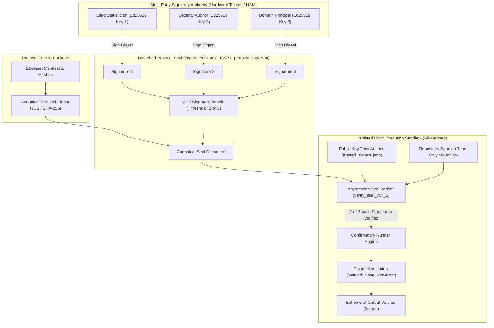

# Architecture Decision Record (ADR) 0001
# Asymmetric Cryptographic Protocol Authorization and Isolated Execution Sandbox

**Status:** PROPOSED (Pre-Freeze Design Specification — Not Authorized for Production)  
**Date:** 2026-11-07  
**Context:** CausaGuard v0.7.1 Pre-Freeze Infrastructure & Governance Hardening  
**Authors:** CausaGuard Systems Architecture & Defensive Security Group  
**Target Baseline:** Post-v0.7.1 Confirmatory Protocol Freeze Infrastructure  
**Cross-References:**  
- Cloudflare Priority 2 Infrastructure Audit Findings  
- [`experiments_v07_1/verify_seal_v07_1.py`](file:///d:/causaguard/experiments_v07_1/verify_seal_v07_1.py)  
- [`research/methodology/v071-confirmatory-statistical-protocol.md`](file:///d:/causaguard/research/methodology/v071-confirmatory-statistical-protocol.md)  

---

## 1. Context and Problem Statement

The prospective CausaGuard v0.7.1 protocol requires a fail-closed cryptographic seal to guarantee codebase immutability, parameter stability, and seed quarantine enforcement prior to running confirmatory evaluations.

In the current development implementation ([`verify_seal_v07_1.py`](file:///d:/causaguard/experiments_v07_1/verify_seal_v07_1.py)), cryptographic authorization verification is implemented as a **test-only synthetic fixture** using symmetric `hmac-sha256`:
```python
def compute_synthetic_authorization_signature(protocol_seal_digest: str, secret_key: str) -> str:
    return hmac.new(secret_key.encode("utf-8"), protocol_seal_digest.encode("utf-8"), hashlib.sha256).hexdigest()
```

While sufficient for testing runner lockout logic in synthetic unit tests, symmetric HMAC introduces fundamental architectural and operational vulnerabilities if adapted for production governance:
1. **Shared Secret Vulnerability:** In symmetric cryptography, the key used to *verify* an authorization signature is identical to the key used to *create* it. Distributing verification capability to researchers, CI runners, or external auditors would distribute signing authority, destroying non-repudiation.
2. **Single Point of Compromise:** A single compromised key allows an attacker to authorize arbitrary codebases, bypass seed quarantines, and forge confirmatory study results.
3. **Absence of Governance Lifecycle:** The current harness lacks provisions for public-key trust anchors, key rotation schedules, revocation lists, and multi-party separation of duties.
4. **Execution Isolation Deficit:** Running agent policies and evaluation harnesses directly on developer host machines without strict filesystem, network, and resource constraints exposes systems to prompt injection, environment tampering, or unintended tool side-effects.

---

## 2. Decision

We propose replacing the synthetic symmetric HMAC authorization mechanism with an **asymmetric multi-party cryptographic signature architecture** combined with an **OCI-compliant isolated Linux execution sandbox**.



---

## 3. Cryptographic Signature Architecture

### 3.1 Asymmetric Algorithm Selection: Ed25519 (RFC 8032)
The production signature scheme shall use **Ed25519** (Edwards-curve Digital Signature Algorithm using SHA-512 and Curve25519):
- **Deterministic Signatures:** Eliminates reliance on runtime entropy generators during signature creation, preventing catastrophic private-key recovery attacks caused by low-entropy random number generators.
- **High Performance & Small Footprint:** 32-byte public keys and 64-byte signatures minimize seal document overhead and verify in sub-millisecond time without requiring external math coprocessors.
- **Standard Library Support:** Natively supported in Python (`cryptography` library / `nacl`) and standard cryptographic toolkits (`ssh-keygen -t ed25519`, `openssl`).

### 3.2 Canonical Payload Serialization
To guarantee deterministic signature verification across platforms (Windows / Linux / macOS), the input to the signature algorithm is computed over the **RFC 8785 JSON Canonicalization Scheme (JCS)** digest of the protocol seal payload, strictly excluding the `signatures` block:
$$\text{Digest} = \text{SHA-256}\left(\text{JCS}\left(\text{Payload} \setminus \{\text{"signatures"}\}\right)\right)$$

### 3.3 Multi-Party Threshold Quorum ($M$-of-$N$)
Confirmatory execution authorization shall require an **$M$-of-$N$ threshold multi-signature** ($M = 2$, $N = 3$):
1. **Signer Role 1: Lead Methodologist / Statistician (`role: "methodology"`)**  
   Certifies that the experimental design, sample allocations ($K=128, N=400$), statistical hypotheses ($C_1, C_2, C_3$), and hurdle parameters ($\Delta = 0.015, \alpha = 0.010$) conform strictly to preregistered standards.
2. **Signer Role 2: Defensive Security Auditor (`role: "security"`)**  
   Certifies that code manifest hashes match clean review baselines, directory path traversal protections are verified, and no unauthorized execution paths exist.
3. **Signer Role 3: Domain Systems Principal (`role: "domain"`)**  
   Certifies that simulation parameters, POMDP state transition costs, and mock tool boundaries are accurate representations of production workflows.

**Threshold Rule:** At freeze time, at least **two distinct signatures** from distinct authorized roles must be present and verified against the authoritative trust registry. A single compromised key cannot authorize confirmatory execution.

### 3.4 Authoritative Public-Key Trust Registry
The public keys of authorized signatories shall be maintained in a version-controlled, immutable trust anchor registry (`config/trusted_signers.json`):
```json
{
  "schema_version": "1.0.0",
  "quorum_required": 2,
  "signers": {
    "signer_methodology_2026": {
      "role": "methodology",
      "identity": "lead-statistician@causaguard.org",
      "public_key_ed25519_hex": "e0a13b4c...",
      "valid_from": "2026-11-01T00:00:00Z",
      "valid_until": "2027-11-01T00:00:00Z",
      "key_id": "KEY-METHODOLOGY-01"
    },
    "signer_security_2026": {
      "role": "security",
      "identity": "auditor-security@causaguard.org",
      "public_key_ed25519_hex": "b5f28c9a...",
      "valid_from": "2026-11-01T00:00:00Z",
      "valid_until": "2027-11-01T00:00:00Z",
      "key_id": "KEY-SECURITY-01"
    },
    "signer_domain_2026": {
      "role": "domain",
      "identity": "principal-domain@causaguard.org",
      "public_key_ed25519_hex": "4d71e2fa...",
      "valid_from": "2026-11-01T00:00:00Z",
      "valid_until": "2027-11-01T00:00:00Z",
      "key_id": "KEY-DOMAIN-01"
    }
  },
  "revoked_key_ids": []
}
```

### 3.5 Private Key Storage and Key Ceremonies
- **Hardware Security Token Mandate:** Private signing keys shall never reside on developer workstations, cloud virtual machines, or CI servers. Private keys must be generated directly on FIPS 140-2 Level 3 certified hardware security modules (HSM) or hardware security tokens (e.g., YubiKey 5 FIPS with PIV/Ed25519 support).
- **Key Rotation Policy:** Signing keys have an active lifespan of 12 months. An annual key ceremony will generate successor keys and update `config/trusted_signers.json`.
- **Revocation Protocol:** If a signing device is lost, stolen, or compromised:
  1. The affected `key_id` is appended to `"revoked_key_ids"` in `config/trusted_signers.json`.
  2. The verifier checks the revocation list prior to signature validation. Any signature signed by a revoked key is rejected with `SecurityViolation`.

---

## 4. Minimum Linux Execution Sandbox Specification

To ensure that confirmatory or exploratory simulations cannot tamper with the repository, leak confidential state, or alter test artifacts, all experimental execution must occur within a **hardened, air-gapped OCI container environment**.

### 4.1 Container Isolation Parameters

| Parameter | Specification | Defensive Security Justification |
|---|---|---|
| **Base Image** | Minimal Debian/Ubuntu LTS (`distroless` or `ubuntu:22.04-minimal`) | Minimizes attack surface and eliminates unnecessary utilities. |
| **User Identity** | Non-root execution (`uid=10001:gid=10001`) | Prevents container breakouts and host privilege escalation. |
| **Capability Dropping** | `--cap-drop=ALL` with `--security-opt=no-new-privileges:true` | Strips all Linux kernel capabilities (raw sockets, ptrace, mount). |
| **Network Isolation** | `--network none` | Strict air-gapping: prevents data exfiltration, telemetry, or remote command-and-control. |
| **Root Filesystem** | `--read-only` | Root container filesystem is completely immutable. |
| **Source Directory Mount** | `-v $(pwd):/workspace:ro` | Source code and manifest files are mounted **strictly read-only**. |
| **Output Volume** | `--tmpfs /tmp:rw,noexec,nosuid,size=512m` and `-v /opt/runs:/output:rw` | Writable areas are limited to ephemeral `/output` and non-executable `/tmp`. |

### 4.2 Resource and Execution Quotas (cgroups v2)
- **CPU Quota:** `--cpus=4.0` (prevents compute starvation on host systems).
- **Memory Ceiling:** `--memory=16g --memory-swap=16g` (strictly blocks out-of-memory cascades).
- **Process Limit:** `--pids-limit=256` (prevents fork bombs or runaway multithreading).
- **Watchdog Timeout:** Runner container is wrapped with a hard execution timeout (e.g. `timeout 3600s`).

### 4.3 Reference Container Launch Command
```bash
docker run --rm \
  --name causaguard-confirmatory-run \
  --network none \
  --read-only \
  --user 10001:10001 \
  --cap-drop=ALL \
  --security-opt=no-new-privileges:true \
  --cpus=4.0 \
  --memory=16g \
  --memory-swap=16g \
  --pids-limit=256 \
  --tmpfs /tmp:rw,noexec,nosuid,size=512m \
  -v "$(pwd)":/workspace:ro \
  -v "$(pwd)/output":/output:rw \
  -w /workspace \
  causaguard-runner:v0.7.1 \
  python experiments_v07_1/evaluate_confirmatory_v07_1.py \
    --domain de \
    --mode final \
    --seal-path /workspace/experiments_v07_1/v071_protocol_seal.json \
    --output-dir /output
```

---

## 5. Consequences and Migration Plan

### 5.1 Benefits
- **Mathematical Non-Repudiation:** Asymmetric signatures permit universal verification without secret sharing.
- **Quorum Governance:** Requires multi-party consensus across methodology, security, and domain leadership.
- **Air-Gapped Reproducibility:** Prevents simulated agent actions from escaping sandboxed test environments.

### 5.2 Implementation Phasing
1. **Pre-Freeze Phase (Current):**  
   - This document serves as the formal architectural specification.
   - Symmetric HMAC test fixtures in `verify_seal_v07_1.py` remain strictly for internal unit tests.
   - `PRODUCTION_AUTHORIZATION_ENABLED` remains locked to `False`.
2. **Freeze Preparation Phase (Future):**  
   - Implement Ed25519 verification logic in `verify_seal_v07_1.py`.
   - Conduct the multi-party signing ceremony using hardware security tokens.
   - Generate `v071_protocol_seal.json` containing the multi-party signatures.
3. **Confirmatory Execution Phase (Future):**  
   - Deploy within the isolated OCI Linux container.
   - Execute confirmatory seeds upon successful asymmetric verification.

