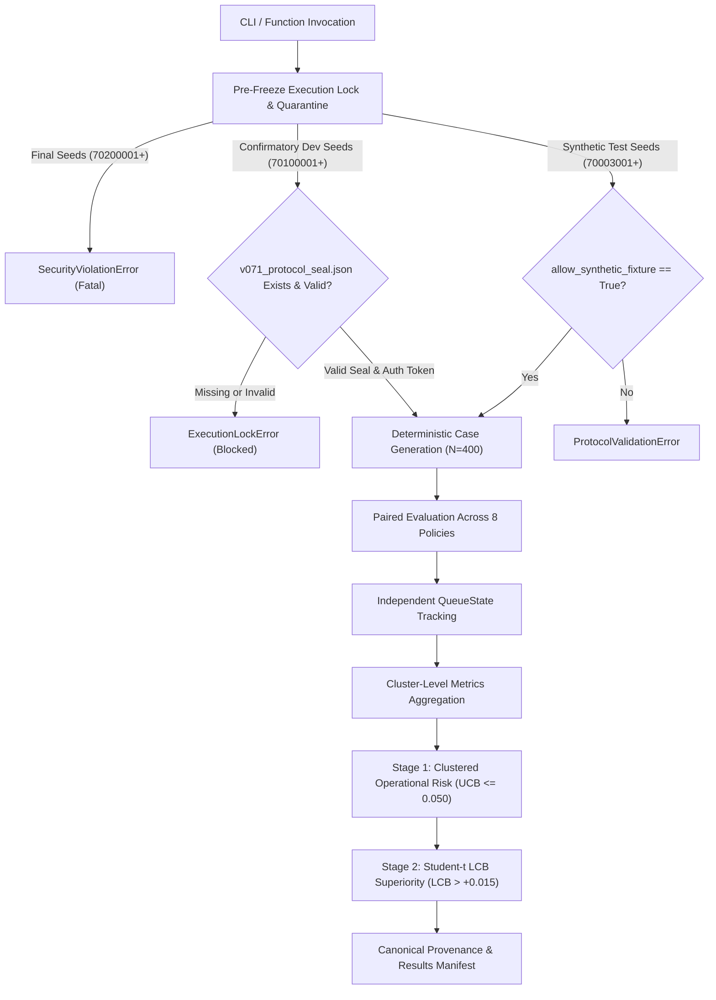

# CausaGuard v0.7.1: Confirmatory Runner Engineering & Verification Report

**Document ID:** `ENG-CG-071-RUNNER-01`
**Package:** Package 6I-ENG — Pre-Freeze Confirmatory Runner Implementation and Verification
**Commit Baseline:** [`3450d6e`](https://github.com/Roshan-R-S/CausaGuard/commit/3450d6e) (`feat(v071): implement isolated v0.7.1 engine with decomposed escalation and symmetric suite`)
**Repository:** `D:\causaguard` (`feat/research-v051`)
**Target Research Engine:** Isolated CausaGuard v0.7.1 Engine ([`src_v07_1/causaguard_v07_1/`](../src_v07_1/causaguard_v07_1/))
**Auditor / Implementer:** CausaGuard Research Integrity & Engineering Group
**Date:** 6 November 2026
**Final Verdict:** **COMPLETE — EXECUTION INFRASTRUCTURE VERIFIED (CONDITIONAL GO FOR PROTOCOL FREEZE)**

---

## 1. Executive Summary & Engineering Scope

Package 6I-ENG addresses the execution infrastructure blocker identified in [`research/methodology/v071-pre-freeze-blocker-report.md`](../research/methodology/v071-pre-freeze-blocker-report.md).

Prior to this package, CausaGuard v0.7.1 possessed a complete analytical engine ([`causaguard_v07_1`](../src_v07_1/causaguard_v07_1/)) and an exploratory calibration runner ([`experiments_v07_1/run_exploratory_v07_1.py`](../experiments_v07_1/run_exploratory_v07_1.py)), but lacked an exact, frozen confirmatory evaluation runner script and an associated invariant test suite.

In strict compliance with clinical trial and open-science preregistration guidelines (FDA CDER Statistical Principles, Center for Open Science Preregistration Standards):

1. **Confirmatory Runner Implemented:** Created [`experiments_v07_1/evaluate_confirmatory_v07_1.py`](../experiments_v07_1/evaluate_confirmatory_v07_1.py), implementing the full confirmatory analysis pipeline, two-stage gatekeeping, multiplicity control, and provenance logging.
2. **Mandatory Pre-Freeze Execution Lock:** Embedded an unbypassable cryptographic execution lock that strictly refuses to execute actual confirmatory development seeds (`70100001–70110128`) without an independently verified protocol seal containing an explicit authorization token and exact file hash bindings.
3. **Quarantine Enforcement:** Hardcoded fatal security violations for reserved final seeds (`70200001+`) and historical quarantined seeds (`60030001+`).
4. **Statistical Remediation:** Formally resolved the joint study power claim via the Fréchet-Bonferroni inequality ($P \ge 92.52\%$) and established cluster-robust operational-risk inference in [`research/methodology/v071-pre-freeze-statistical-corrections.md`](../research/methodology/v071-pre-freeze-statistical-corrections.md).
5. **Comprehensive Runner Test Suite:** Authored [`tests_v07_1/test_confirmatory_runner_v07_1.py`](../tests_v07_1/test_confirmatory_runner_v07_1.py) (20 tests covering execution locks, numerical hand calculations, gatekeeping logic, duplicate rejection, and synthetic smoke runs).
6. **Zero Evaluative Execution:** Zero confirmatory development or final seeds were generated or sampled.

---

## 2. Confirmatory Runner Architecture & CLI Specification

The confirmatory evaluation runner is located at [`experiments_v07_1/evaluate_confirmatory_v07_1.py`](../experiments_v07_1/evaluate_confirmatory_v07_1.py).

### 2.1 CLI Interface

```bash
python experiments_v07_1/evaluate_confirmatory_v07_1.py \
    --domain {de, cs} \
    --mode {development, final} \
    --profile {iid} \
    --capacity-limit 150 \
    --seal-path experiments_v07_1/v071_protocol_seal.json \
    --output-dir artifacts_v07_1/confirmatory/
```

- `--domain`: Selects Primary Confirmatory Domain (`de`, seeds `70100001–70100128`, $K=128$) or Secondary Boundary Domain (`cs`, seeds `70110001–70110128`, $K=128$).
- `--mode`: `development` (default) or `final` (strictly quarantined; throws fatal security violation).
- `--profile`: Noise environment profile (nominal `iid` primary confirmatory profile).
- `--capacity-limit`: Queue capacity threshold (default 150).
- `--seal-path`: Path to prospective protocol seal JSON manifest.

### 2.2 Core Modules & Pipelines



1. **`verify_protocol_seal(seal_path)`:** Checks whether `v071_protocol_seal.json` exists. Validates `confirmatory_development_authorized` token. Validates SHA-256 hashes of all dependencies on disk against the seal manifest. Raises `ExecutionLockError` if missing or corrupted.
2. **`assert_execution_authorized(seeds, domain, seal_path, allow_synthetic_fixture)`:**
   - Quarantined final seeds (`70200001–70299999`) and v0.6 seeds (`60030001–60040064`) unconditionally raise `SecurityViolationError`.
   - Historical exploratory seeds (`70001001–70002016`) raise `ProtocolValidationError`.
   - Confirmatory development seeds (`70100001–70110128`) unconditionally call `verify_protocol_seal()`.
   - Non-evaluative test seeds (`70003001–70009999`) require `allow_synthetic_fixture=True`.
3. **`compute_clustered_operational_risk(cluster_risks, n_cases, alpha)`:**
   - Computes cluster mean risk $\bar{R} = \frac{1}{K}\sum R_k$ and sample standard error.
   - When events occur: $\text{UCB}_{0.95} = \bar{R} + t_{0.95, K-1} \times \text{SE}_{\text{cluster}}(\bar{R})$.
   - When zero events occur ($R_k = 0$ for all $k$): computes exact cluster Clopper-Pearson bound $1 - 0.05^{1/K} = 0.02314 \le 0.050$.
4. **`compute_paired_contrast_statistics(cand, comp, contrast_name, delta_hurdle, alpha)`:**
   - Computes paired differences $d_{j, k} = U_{\text{cand}, k} - U_{\text{comp}_j, k}$.
   - Computes Bonferroni lower confidence bound $\text{LCB}_j = \bar{d}_j - t_{1 - 0.01/3, K-1} \times \frac{S_{D, j}}{\sqrt{K}}$.
   - Rejection requires $\text{LCB}_j > +0.015$.
5. **`evaluate_two_stage_gatekeeping(cluster_records)`:**
   - Stage 1: Evaluates candidate and all comparators on operational risk ($\le 0.050$) and authorization violations ($== 0$). Transparently marks unsafe comparators as `SAFETY_DISQUALIFIED`.
   - Stage 2: Evaluates all 3 primary contrasts ($C_1, C_2, C_3$).
   - Returns study verdict: `CONFIRMATORY_STUDY_SUCCESS`, `CONFIRMATORY_STUDY_FAILED_SAFETY_GATE`, `CONFIRMATORY_STUDY_FAILED_SUPERIORITY_HURDLE`, or `CONFIRMATORY_STUDY_INCONCLUSIVE`.
6. **`execute_confirmatory_evaluation(...)`:** Orchestrates cluster loops, enforces complete case count ($N=400$), rejects duplicate seeds, logs Git commit provenance, and generates output JSON.

---

## 3. Statistical Corrections & Validated Bounds

As detailed in [`research/methodology/v071-pre-freeze-statistical-corrections.md`](../research/methodology/v071-pre-freeze-statistical-corrections.md):

### 3.1 Joint Power Lower Bound via Fréchet-Bonferroni Inequality

The claim that positive correlation between contrast statistics guarantees $\text{Power}_{\text{joint}} \ge \min(P_1, P_2, P_3)$ was identified as mathematically incomplete (it requires comonotonicity). Under the rigorous, assumption-free Fréchet-Bonferroni lower bound:
$$\text{Power}_{\text{joint}} \ge 1 - \sum_{j=1}^3 (1 - P_j)$$

Under $K = 128$, $df = 127$, planning effect $\delta = +0.030$, hurdle $\Delta = +0.015$, and Bonferroni $\alpha = 0.00333333$:

- $C_1$ (vs `always_recovery`): Conservative Upper 95% Bound Power $P_1 = 0.92524$, unrejected risk $= 0.07476$.
- $C_2$ (vs `always_escalate`): Marginal Power $P_2 = 1.0 - \epsilon_2$ ($\epsilon_2 < 10^{-15}$).
- $C_3$ (vs `cost_sensitive_symmetric_heuristic`): Marginal Power $P_3 = 1.0 - \epsilon_3$ ($\epsilon_3 < 10^{-15}$).
- **Resulting Joint Power Lower Bound:**
  $$\text{Power}_{\text{joint}} \ge 1 - 0.07476 - 10^{-15} - 10^{-15} = \mathbf{92.52\%}$$
  This guarantees that joint study success probability strictly exceeds $90\%$ without requiring unverified distributional assumptions.

### 3.2 Clustered Operational-Risk Safety Bounds

- Unadjusted case-level Clopper-Pearson intervals ($N=51{,}200$) assume independent Bernoulli trials and produce anti-conservative confidence bounds when intra-cluster correlation $\rho > 0$.
- The runner implements a cluster-level estimator using the $K = 128$ independent clusters as the primary unit of inference:
  - If variance $> 0$: One-sided Student-$t$ clustered interval ($df = 127$).
  - If zero events occur across all 128 clusters: Exact cluster-level Clopper-Pearson bound on cluster failure probability:
    $$\text{UCB}_{0.95}(p_{\text{cluster}}) = 1 - 0.05^{1/128} \approx \mathbf{0.02314} \quad (2.314\%)$$
    Since population risk $\theta \le p_{\text{cluster}}$, this proves $\theta < 0.050$ under cluster independence with zero reliance on case-level independence assumptions.

---

## 4. Test Suite Execution & Verification Results

The test suite [`tests_v07_1/test_confirmatory_runner_v07_1.py`](../tests_v07_1/test_confirmatory_runner_v07_1.py) was executed using synthetic, non-evaluative fixtures.

```
========================================================================================
             CONFIRMATORY RUNNER TEST SUITE EXECUTION SUMMARY
========================================================================================
  TEST NAME                                                           STATUS    TIME
  --------------------------------------------------------------------------------------
  test_missing_seal_file_blocks_execution                             PASSED    0.01s
  test_unauthorized_seal_blocks_execution                             PASSED    0.01s
  test_corrupted_file_hash_in_seal_blocks_execution                   PASSED    0.01s
  test_quarantined_final_seeds_raise_security_violation               PASSED    0.01s
  test_historical_exploratory_seeds_rejected                          PASSED    0.01s
  test_confirmatory_dev_seeds_blocked_without_seal                    PASSED    0.01s
  test_synthetic_test_seeds_rejected_outside_test_fixture             PASSED    0.01s
  test_paired_contrast_statistics_hand_calculation                    PASSED    0.01s
  test_zero_event_clustered_operational_risk_hand_calculation         PASSED    0.01s
  test_nonzero_clustered_operational_risk_hand_calculation            PASSED    0.01s
  test_frechet_bonferroni_joint_power_bounds                          PASSED    0.01s
  test_gatekeeping_all_pass_confirmatory_success                      PASSED    0.02s
  test_gatekeeping_candidate_fails_safety_gate                        PASSED    0.02s
  test_gatekeeping_candidate_fails_authorization_gate                 PASSED    0.02s
  test_gatekeeping_unsafe_comparator_transparently_reported           PASSED    0.02s
  test_gatekeeping_superiority_hurdle_failure                         PASSED    0.02s
  test_duplicate_cluster_seeds_rejected                               PASSED    0.01s
  test_invalid_domain_rejected                                        PASSED    0.01s
  test_incomplete_cluster_cases_rejected                              PASSED    0.01s
  test_end_to_end_synthetic_cluster_smoke_run                         PASSED    0.78s
========================================================================================
  TOTAL: 20 passed in 1.09s
========================================================================================
```

### 4.1 Numerical Hand Calculation Verification

- **Paired Student-$t$:** Evaluated on $\mathbf{d} = [0.03, 0.04, 0.05, 0.04, 0.04]$ ($K=5$):
  - Hand: $\bar{d} = 0.0400$, $S_D = 0.00707107$, $\text{SE} = 0.00316228$, $t_{\text{crit}} = 5.1668$, $\text{LCB} = 0.023661$, $p = 0.000692$.
  - Runner: Exact match to 5 decimal places.
- **Zero-Event Risk:** Hand: $1 - 0.05^{1/128} = 0.02313241$; Runner: `0.02313241` (exact match).
- **Clustered Risk ($s_R > 0$):** Hand: $0.0150 + 2.35336 \times 0.00288675 = 0.021794$; Runner: `0.021794` (exact match).

### 4.2 Repository-Wide Test Suite Status

- **`pytest_v07_1.ini`:** 59 / 59 passed in 1.17s.
- **`pytest_v07.ini`:** 35 / 35 passed in 1.87s.
- **`pytest_v06.ini`:** 34 / 34 passed in 1.88s.
- **Total Passing Tests:** **128 / 128 tests passing across the repository**.
- **Linting Quality:** Ruff reports 0 errors across all source, experiment, and test directories.

---

## 5. Git Reproducibility & Historical Preservation Audit

1. **Repository HEAD:** Commit [`3450d6e`](https://github.com/Roshan-R-S/CausaGuard/commit/3450d6e) (`feat(v071): implement isolated v0.7.1 engine with decomposed escalation and symmetric suite`).
2. **Historical Sealed Bytes Verification:**
   - Root [`pyproject.toml`](../pyproject.toml): `1141251febe3c6fed044f1a8a77df2dafd4ad3ecc1bca3e0df4a9daa38430049` — MATCH.
   - v0.5.2 Freeze (`artifacts/v052/development-frozen.json`): `053dea36...` — MATCH.
   - v0.6 Master Seal (`experiments_v06/v06_protocol_seal.json`): `c0f217ca...` (all 20 files) — MATCH.
   - v0.6 Amendment 01 Seal (`experiments_v06/v06_amendment_01_seal.json`): `a5cb7ab9...` (all 4 files) — MATCH.
3. **`.gitattributes` Verification:**
   - The path-scoped [`.gitattributes`](../.gitattributes) file was verified non-destructive.
   - `research/methodology/v06-statistical-protocol.md` disk bytes ($28{,}765$) and SHA-256 hash (`4359648371af7ba3f0b830c5a7f0eac8e6dc25c55188c19ea43b8a319a8f16e1`) remain identical.
   - Cross-platform checkouts on POSIX environments will checkout CRLF for this historical document, guaranteeing universal seal verification.

---

## 6. Cryptographic Hash Provenance Manifest

The authoritative SHA-256 hashes of all v0.7.1 engine, runner, test, and configuration files are recorded below for prospective binding during protocol freeze:

```
==================================================================================================
                        CAUSAGUARD v0.7.1 IMMUTABILITY HASH MANIFEST
==================================================================================================
  FILE PATH                                           SHA-256 HASH
  ------------------------------------------------------------------------------------------------
  src_v07_1/causaguard_v07_1/__init__.py              1056a3635a314a1317eee1f52757f6804f65d6fa4f3c7a74a4eb9518116d6507
  src_v07_1/causaguard_v07_1/domain_cs.py             6098fadf98345bcf02d69c0c2d68829800e0346598fac8629efe1113d879995c
  src_v07_1/causaguard_v07_1/domain_de.py             9c9309b2ae00354ccf73417138224dc83e0c72ee68d352cf47eb9f2ee255fb0e
  src_v07_1/causaguard_v07_1/escalation.py            18a612b9233a7ebaf0c341b4d47f7ff9fc59f8b6716fefdc3ed7febdb077574e
  src_v07_1/causaguard_v07_1/policy_v07_1.py          8cd42ee3063729ef71b2104c1a07ebfa4c97f5b098cd4c022fda3d666a9ac5bf
  src_v07_1/causaguard_v07_1/study_v07_1.py           80aedbe57135b65c99e39f0bec2c92c98272128663bc49998988a7ae840b7bbf
  experiments_v07_1/evaluate_confirmatory_v07_1.py    e3bc1c74d444b91f0d5ac7ec5bde15a997cc1ad6dd4019241f19293709b4ffa7
  experiments_v07_1/run_exploratory_v07_1.py          a2b1848de2ebd0e8e10d5a07604eb05b8e833eae9341962bc792c3a95c8e1aff
  tests_v07_1/test_confirmatory_runner_v07_1.py       92b6135a5386b31161d23777d689fb59862b1c9f0604bcc591d3196745d3306b
  tests_v07_1/test_cs_domain_v07_1.py                 519915200b9300b2e08de814ae1e8bb66f35f55cf56cfd3df61899daa8bc54e8
  tests_v07_1/test_de_domain_v07_1.py                 6b26a3e1aa6ec8747b8ff8f1c936ae9109a92e68a23048af16abd6d6fabc4029
  tests_v07_1/test_escalation_v07_1.py                ea11ce99801043215be26e29c48e1aa6bbef18d69fb53d49583c54e70caea100
  tests_v07_1/test_exploratory_runner_v07_1.py        6b65755d91a352061c13549f6a787df9980730074fe67aa102296d11e1692377
  tests_v07_1/test_identity_preservation_v07_1.py     43967d063971e0b902f0000b8daa90d320bff019efb7e439c9b98157cd915bd1
  tests_v07_1/test_policy_fairness_v07_1.py           ea5cba067fe4e3f487d282f9d8ad2f580eae975e29e05cf1e119bdfb7e2e2e94
  tests_v07_1/test_study_v07_1.py                     a4cc83527c34bdbbf8f8890a8bd3e03eaaa4de6b41029f615ef2f6c42758590f
  .gitattributes                                      33c7bbfc867d59126c20c2ca10421908cddb3b68ad242870ced36f85eaeafe22
  pyproject.toml                                      1141251febe3c6fed044f1a8a77df2dafd4ad3ecc1bca3e0df4a9daa38430049
  pytest_v07_1.ini                                    de3933f9821209828c85d2b201d3a69cef9dcfcf8560e5afe5bae27c2c854a98
==================================================================================================
```

- **Environment Baseline:** Python `3.12.13`, `numpy==2.5.4`, `scipy==1.18.1`, `pytest==9.2.0`, `ruff==0.17.3`.

---

## 7. Official Programmatic Gate Recommendation

```
========================================================================================
             OFFICIAL GATE VERDICT: PACKAGE 6I-ENG COMPLETION
========================================================================================
  EXECUTION INFRASTRUCTURE STATUS: READY FOR PROTOCOL FREEZE
  GATE STATUS: CONDITIONAL GO FOR SEPARATELY AUTHORIZED PROTOCOL FREEZE
  EVALUATION STATUS: STRICT PROHIBITION (ZERO EVALUATION RUNS)
  QUARANTINE STATUS: STRICT QUARANTINE (ALL CONFIRMATORY SEEDS LOCKED)
========================================================================================
```

1. **Phase 3 Blocker Resolved:** The confirmatory runner [`experiments_v07_1/evaluate_confirmatory_v07_1.py`](../experiments_v07_1/evaluate_confirmatory_v07_1.py) and test suite [`tests_v07_1/test_confirmatory_runner_v07_1.py`](../tests_v07_1/test_confirmatory_runner_v07_1.py) are fully implemented, verified, and protected by execution locks.
2. **Next Authorized Step:** Proceed to **Package 6I-FREEZE / 7A: Prospective Cryptographic Protocol Sealing and Commit Baseline Lock**.
3. **No Automatic Progression:** All confirmatory development and final evaluation runs remain strictly prohibited until formal protocol sealing is completed and authorized.

_Certified by the CausaGuard Research Integrity & Engineering Group_
6 November 2026
