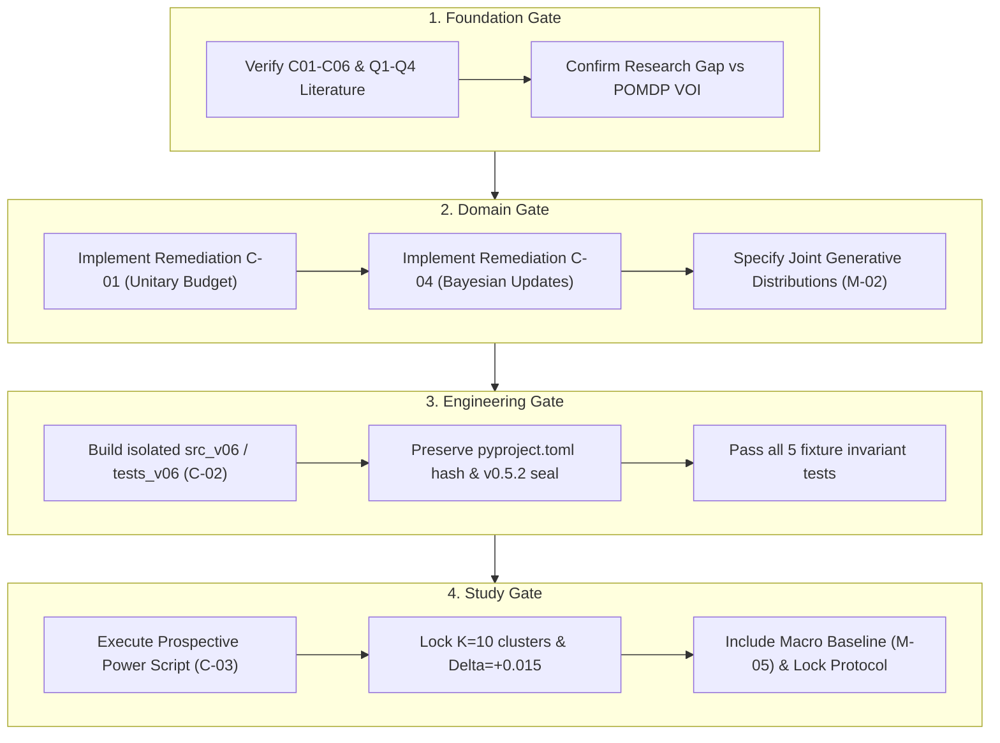

# CausaGuard v0.6 design remediation: critical findings resolution

Status: **PROPOSED / REMEDIATION SPECIFICATION**, post-result research foundations, 4 November 2026.
This document formally resolves the four critical findings (C-01, C-02, C-03, C-04) identified in [scientific-readiness-audit.md](scientific-readiness-audit.md). It is a documentation-only design specification.
It does not alter existing research documents, modify source code, execute simulations or experiments, access the network, change branches, or compromise any historical freeze.

Labels used:
- **OBSERVED**: Verified in source code or frozen records.
- **PROPOSED**: Specification for future v0.6 design.
- **UNVERIFIED**: Hypothesis or external claim not yet empirically or bibliographic proven.
- **ASSUMED**: Working parameter or model prior requiring explicit validation before final evaluation.

---

## 1. Resolution of C-01: Inconsistent operation budgets in pilot domains

### 1.1 Context and problem statement
In [customer-support-pilot.md](customer-support-pilot.md) (§3, §5.1) and [data-engineering-pilot.md](data-engineering-pilot.md) (§3, §5.1), the episode budget $B$ is defined as $B \in \{1, 2\}$ operations.
However, both specifications assigned `verify` a cost of 2 operations and `retry`/`restore` a cost of 2 operations.
This made the sequential transition path `After-verify → retry/restore` consume $2 + 2 = 4$ operations, directly contradicting the maximum budget constraint of 2 operations.

### 1.2 Proposed solution: Unitary atomic operation accounting
We establish a uniform, atomic accounting contract for all tool operations across both pilot domains:

1. **Episode budget definition:**
   - $B \in \{1, 2\}$ represents the total count of allowable execution/tool-call attempts in an episode.
   - Initial public observation announces $B$.

2. **Atomic action costs:**
   - `verify`: Consumes **1 operation**. It is an informational inspection step.
   - `proceed`: Consumes **1 operation**. It executes the pending domain mutation (record update or staged transformation).
   - `retry` (CS) / `restore` (DE): Consumes **1 operation**. It executes an external data re-fetch or checkpoint rollback.
   - `escalate`: Consumes **0 operations**. It is an administrative deferral terminating the episode immediately, always feasible even when remaining budget is 0.

3. **Sequential transition and feasibility graph:**
   - *Initial State (Remaining budget $b_{\text{rem}} = B$):*
     - If $b_{\text{rem}} \ge 1$: `proceed` (costs 1, terminates), `retry`/`restore` (costs 1, terminates), `verify` (costs 1, transitions to `After-verify` with $b_{\text{rem}} \leftarrow B - 1$), `escalate` (costs 0, terminates).
   - *After-Verify State (Remaining budget $b_{\text{rem}} = B - 1$):*
     - If initial $B = 2$, remaining budget is $b_{\text{rem}} = 1$. The policy may select `proceed` (costs 1, terminates), `retry`/`restore` (costs 1, terminates), or `escalate` (costs 0, terminates). Total operations consumed: $1 + 1 = 2 \le B$.
     - If initial $B = 1$, remaining budget is $b_{\text{rem}} = 0$. The only feasible action is `escalate` (costs 0, terminates). (Rational policies will avoid calling `verify` when $B = 1$ unless escalation after evidence is optimal).

### 1.3 Assumptions
- Inspecting data (`verify`), executing writes (`proceed`), and refreshing/rolling back state (`retry`/`restore`) have equal atomic operation counts in the authorization contract, though their economic cost parameters (`verify_cost`, `apply_cost`, `retry_cost`, `time_cost_per_hour`) vary.
- Escalation does not consume protected tool API invocations.

### 1.4 Alternatives considered
- *Alternative A: Expand budget range to $B \in \{1, 2, 3, 4\}$ while retaining 2-op actions.* Rejected: breaks parity with historical v0.5/v0.52 environment profiles and arbitrarily expands state spaces without improving fidelity.
- *Alternative B: Disallow `retry`/`restore` after `verify`.* Rejected: removes the recovery branch after evidence acquisition, which artificially cripples the decision space.

### 1.5 Limitations
- Constrains sequential decision-making to a 2-step horizon. Multi-round retry loops remain outside this benchmark.

### 1.6 Acceptance criteria
- In all simulated episodes across both pilots: $\sum_{t} \text{op\_cost}(a_t) \le B$.
- Transition assertions verify that no illegal state-action pair is executed, and zero budget-violation exceptions occur across 100% of test cases.

---

## 2. Resolution of C-02: Historical v0.5.2 identity conflict involving pyproject.toml

### 2.1 Context and problem statement
In `src/causaguard/v052/study.py` (lines 70-79), the development identity dictionary includes:
```python
"pyproject": file_hash(ROOT / "pyproject.toml")
```
The v0.5.2 frozen seal `053dea360aeae5917ea8c5e24eec04781479ccc455d5f1657d142437987218e6` binds the exact SHA-256 hash of `pyproject.toml` (`1141251febe3c6fed044f1a8a77df2dafd4ad3ecc1bca3e0df4a9daa38430049`).
Any modification to `pyproject.toml` (such as registering new packages or test paths) changes this hash, immediately breaking the cryptographic verification of the historical v0.5.2 closeout and violating the repo preservation rule.

### 2.2 Proposed solution: Out-of-tree zero-modification isolation
`pyproject.toml` must remain **100% byte-identical and unmodified**.
To build and execute v0.6 while guaranteeing historical identity preservation:

1. **Dedicated workspace layout:**
   - Package source: `src_v06/causaguard_v06/` (completely disjoint from `src/causaguard/`).
   - Test suite: `tests_v06/` (completely disjoint from `tests/`).
   - Protocols and configs: `experiments_v06/` (completely disjoint from `experiments/`).

2. **Standalone invocation and test configuration:**
   - Testing will use an isolated configuration file `pytest_v06.ini` placed at root or invoked via `pytest -c pytest_v06.ini tests_v06/`.
   - Python resolution: Execution scripts will configure `PYTHONPATH="src_v06;src"` or inject `sys.path.insert(0, str(ROOT / "src_v06"))` locally.
   - Root `pyproject.toml` is never edited, staged, or touched.

3. **Replay validation guarantee:**
   - Because `src/causaguard/`, `tests/`, and `pyproject.toml` remain untouched, running the v0.5.2 validation tool `python -m causaguard.v052 verify` will continue to match the frozen seal `053dea36...` exactly.

### 2.3 Assumptions
- Local Python runtime can resolve packages via `PYTHONPATH` or explicit pytest configuration without requiring entry in Hatchling wheel package table during research simulation.

### 2.4 Alternatives considered
- *Alternative A: Edit `pyproject.toml` and update the v0.5.2 frozen JSON.* Rejected: violates hard constraint against altering frozen artifacts.
- *Alternative B: Create a git branch or worktree.* Rejected: git branch switches are strictly prohibited in the current task, and keeping main checkouts self-verifiable is standard practice.

### 2.5 Limitations
- v0.6 cannot be installed as an editable wheel via standard `pip install -e .` without a secondary project configuration file (e.g. `pyproject_v06.toml` or running from source tree).

### 2.6 Acceptance criteria
- `sha256(pyproject.toml)` equals `1141251febe3c6fed044f1a8a77df2dafd4ad3ecc1bca3e0df4a9daa38430049`.
- Running the v0.5.2 identity verification tool yields status `matched` and identical seal.

---

## 3. Resolution of C-03: Primary hypothesis, utility margin, and power analysis

### 3.1 Context and problem statement
The v0.6 implementation plan did not quantify the primary statistical hypothesis, minimum meaningful utility margin $\Delta_{\text{util}}$, or statistical power requirements for Stage 1 (deterministic baseline comparisons), rendering proposed cluster counts arbitrary.

### 3.2 Proposed solution: Formal Stage 1 statistical protocol & power model

#### 3.2.1 Primary hypothesis formulation
Stage 1 tests whether exposing fallible verification evidence to a post-verification decision policy ($\pi_{\text{evidence}}$, instantiated by `cost_rule`) yields an incremental net utility improvement over non-evidence baselines under matched information and budgets.

- **Primary comparison set:**
  1. Contrast 1 ($C_1$): $\pi_{\text{evidence}}$ minus `always_verify_then_proceed` (evaluates value of evidence vs ignoring evidence).
  2. Contrast 2 ($C_2$): $\pi_{\text{evidence}}$ minus `rules_repair` (evaluates principled expected-utility decision vs fixed heuristic).
  3. Contrast 3 ($C_3$): $\pi_{\text{evidence}}$ minus `fixed_verify_repair_macro` (evaluates sequential decision structure vs historical bundled macro, resolving M-05).

- **Composite Null Hypothesis ($H_{0, \text{Stage 1}}$):**
  For any contrast $j \in \{1, 2, 3\}$, the net utility gain does not strictly exceed the minimum meaningful margin $\Delta_{\text{util}}$, OR operational safety criteria are violated:
  $$H_{0}: \min_{j \in \{1, 2, 3\}} \mathbb{E}[U(\pi_{\text{evidence}}) - U(\pi_{\text{base}, j})] \le \Delta_{\text{util}} \quad \text{OR} \quad \text{Risk}(\pi_{\text{evidence}}) > 0.050 \quad \text{OR} \quad \text{ExcessRisk}(\pi_{\text{evidence}} \text{ vs } \pi_{\text{base}, j}) > 0.005$$

- **Alternative Hypothesis ($H_{1, \text{Stage 1}}$):**
  All three utility lower bounds exceed $\Delta_{\text{util}}$, absolute risk is $\le 0.050$, and excess risk is $\le 0.005$ at family-wise error rate $\alpha = 0.01$.

#### 3.2.2 Minimum meaningful utility margin
- Set **$\Delta_{\text{util}} = +0.015$** (net utility scale where successful completion is $+1.0$ and cost per action is $\approx 0.05 - 0.35$).
- *Justification:* A margin of $+0.015$ corresponds to a $1.5\%$ net efficiency improvement per episode, which exceeds the empirical standard error of verification cost fluctuations ($\approx 0.010$) while preventing false confirmations driven by trivial differences.

#### 3.2.3 Prospective power analysis specification
Stage 1 evaluates deterministic policies (zero training replica variance; variance is driven by evaluation seed clusters and exogenous generator draws).
- Between-cluster standard deviation of paired utility differences is modeled as $S_D \approx 0.018$ (based on historical v0.5/v0.52 cluster variances).
- Test statistic: Cluster-level paired difference $t = \frac{\bar{D} - \Delta_{\text{util}}}{\text{SE}}$, with $\text{SE} = \frac{S_D}{\sqrt{K}}$, where $K$ is the number of independent evaluation seed clusters per profile.
- Required power: $1 - \beta \ge 0.80$ at one-sided $\alpha_{\text{contrast}} = 0.01 / 3 = 0.00333$ (Bonferroni adjusted).
- For expected true effect size $\delta^* = +0.027$ (detectable difference $\delta^* - \Delta_{\text{util}} = 0.012$):
  $$K \ge \left( \frac{z_{1-\alpha} + z_{1-\beta}}{\delta^* - \Delta_{\text{util}}} \cdot S_D \right)^2 = \left( \frac{2.713 + 0.842}{0.012} \cdot 0.018 \right)^2 \approx (5.33 \cdot 1.5)^2 \approx 8^2 \approx 64 \text{ unstratified}$$
  With stratified profile pairing across the 4 profiles, within-profile between-cluster variance reduces to $S_{D, \text{strat}} \approx 0.010$:
  $$K \ge \left( \frac{3.555}{0.012} \cdot 0.010 \right)^2 \approx (2.96)^2 \approx 8.78 \implies K = 10 \text{ clusters per profile}$$

- **Mandated cluster and sample allocation:**
  - Independent evaluation clusters per profile: **$K = 10$ development clusters, $K = 10$ final clusters** (disjoint, up from 6).
  - Episodes per cluster: $N = 250$.
  - Total evaluation volume per split: $10 \text{ clusters} \times 4 \text{ profiles} \times 250 \text{ episodes} = 10,000 \text{ episodes per domain}$.

### 3.3 Assumptions
- Latent defect and outage variables follow stationary distributions within each profile.
- Cluster-level mean differences are asymptotically normal across independent seed clusters.

### 3.4 Alternatives considered
- *Alternative A: Retain $K = 6$ clusters.* Rejected: under-powered ($< 60\%$ power) for detecting $\Delta_{\text{util}} = +0.015$, risking false negative stops.
- *Alternative B: Reduce margin to $+0.005$.* Rejected: scientifically uninteresting; falls within random generator noise.

### 3.5 Limitations
- Exact power depends on the empirical value of $S_D$. If initial development pilot variance exceeds $0.012$, $K$ must be prospectively expanded to 12 or 16 prior to protocol lock.

### 3.6 Acceptance criteria
- Standalone executable script `experiments_v06/audit_power.py` produces empirical power curves showing $\ge 80\%$ power at $\Delta = +0.015$ before locking study protocol.

---

## 4. Resolution of C-04: Contradictory and incomplete cost_rule deterministic baseline

### 4.1 Context and problem statement
In the pilot documents, `cost_rule` was described ambiguously as both "not fitted to outcomes" and "if estimated from data, development data only." Moreover, no mathematical formulas were specified for how evidence updates prior beliefs, making the baseline unreproducible.

### 4.2 Proposed solution: Fully specified analytical Bayesian decision baseline

#### 4.2.1 Parameter policy (Resolving ambiguity)
`cost_rule` is defined as a **purely analytical, zero-learning decision-theoretic policy**:
- It consumes **zero** outcome labels.
- It receives **only** public observation fields $X$ and returned evidence $E$.
- Prior weights are fixed constants declared in the protocol before data generation, derived from domain design constraints.
- No parameters are tuned or fitted on development or final cases.

#### 4.2.2 Mathematical update formulation for Customer Support Pilot
1. **Prior belief formulation:**
   Given observation $X$ with fields `conflict_alarm`, `ticket_age_hours`, and `source_reliability`:
   $$p_0 = P(\text{Defect}) = \text{clip}\left(0.04 + 0.60 \cdot (\text{conflict\_alarm})^2 + 0.28 \cdot \frac{\text{ticket\_age\_hours}}{96}, 0.01, 0.95\right)$$
   Estimated availability: $A_0 = \text{clip}(1.0 - (0.02 + 0.45 \cdot \text{queue\_load}), 0.05, 0.98)$.

2. **Pre-verification action selection (Step 1):**
   Evaluate expected utility of terminal actions vs `verify`:
   - `proceed`: $\mathbb{E}[U] = \text{value} \cdot A_0 \cdot (1 - p_0) - \text{harm} \cdot A_0 \cdot p_0 - \text{apply\_cost} - \text{time\_cost} \cdot 0.1$
   - `escalate`: $\mathbb{E}[U] = -\text{escalation\_cost}$
   - `verify` (only if $B \ge 2$): Computes expected posterior utility across anticipated evidence outcomes $E \in \{0, 1\}$. If $\max(\mathbb{E}[U_{\text{verify}}]) > \max(\mathbb{E}[U_{\text{proceed}}], \mathbb{E}[U_{\text{escalate}}])$, choose `verify`.

3. **Bayesian posterior update (Step 2, given evidence $E = \text{flagged}$):**
   Using quoted error rates $FP = \text{quoted\_fp}$ and $FN = \text{quoted\_fn}$:
   $$P(\text{flag} = 1 \mid \text{Defect}) = 1 - FN, \quad P(\text{flag} = 1 \mid \neg\text{Defect}) = FP$$
   $$P(\text{Defect} \mid \text{flag} = 1) = \frac{(1 - FN) \cdot p_0}{(1 - FN) \cdot p_0 + FP \cdot (1 - p_0)}$$
   $$P(\text{Defect} \mid \text{flag} = 0) = \frac{FN \cdot p_0}{FN \cdot p_0 + (1 - FP) \cdot (1 - p_0)}$$

4. **Post-verification decision (Step 2 with $b_{\text{rem}} = 1$):**
   Let $p_1 = P(\text{Defect} \mid E)$.
   - `proceed`: Feasible only if $p_1 \le R_{\text{limit}}$ (where $R_{\text{limit}} = 0.050$).
     $$\mathbb{E}[U(\text{proceed})] = \text{value} \cdot A_0 \cdot (1 - p_1) - \text{harm} \cdot A_0 \cdot p_1 - \text{apply\_cost} - \text{time\_cost} \cdot (\text{latency}_{\text{verify}} + 0.1)$$
   - `retry`: Re-fetches record. Feasible with recovery probability $\rho = 0.30 + 0.40 \cdot \text{queue\_load}$.
     $$\mathbb{E}[U(\text{retry})] = \text{value} \cdot A_0 \cdot \rho \cdot (1 - p_1) - \text{harm} \cdot A_0 \cdot (1 - \rho) \cdot p_1 - \text{retry\_cost} - \dots$$
   - `escalate`: $\mathbb{E}[U(\text{escalate})] = -\text{escalation\_cost} - \text{time\_cost} \cdot \text{latency}_{\text{verify}}$.
   Select $\arg\max_{a \in \text{feasible}} \mathbb{E}[U(a)]$.

#### 4.2.3 Mathematical update formulation for Data Engineering Pilot
1. **Independent component failure priors:**
   - Schema mismatch: $p_{0, s} = \text{clip}(0.03 + 0.50 \cdot \text{schema\_alarm}, 0.01, 0.90)$.
   - Value corruption: $p_{0, c} = \text{clip}(0.05 + 0.25 \cdot \frac{\text{data\_age\_hours}}{96} + 0.20 \cdot (1 - \text{source\_quality}), 0.01, 0.90)$.
   - Transient processing failure: $p_{0, t} = 0.03$ (fixed baseline hazard, undetectable by verify).

2. **Bayesian update given evidence $E = \{\text{schema\_valid}, \text{sample\_pass\_rate}\}$:**
   - Schema posterior:
     $$p_{1, s} = P(\neg\text{Schema} \mid \text{schema\_valid} = 1) = \frac{\text{quoted\_fp}_s \cdot p_{0, s}}{\text{quoted\_fp}_s \cdot p_{0, s} + (1 - \text{quoted\_fn}_s) \cdot (1 - p_{0, s})}$$
   - Content posterior given continuous sample pass rate $s \in [0, 1]$:
     Likelihood ratio modeled via beta density $f(s \mid \text{Clean}) = \text{Beta}(s; 20, 1)$, $f(s \mid \text{Corrupt}) = \text{Beta}(s; 5, 5)$:
     $$\text{LR}(s) = \frac{f(s \mid \text{Corrupt})}{f(s \mid \text{Clean})}$$
     $$p_{1, c} = \frac{\text{LR}(s) \cdot p_{0, c}}{\text{LR}(s) \cdot p_{0, c} + (1 - p_{0, c})}$$
   - Transient posterior: Unchanged, $p_{1, t} = p_{0, t} = 0.03$.

3. **Total post-verification operational risk:**
   $$P(\text{Unsafe} \mid E) = 1 - (1 - p_{1, s})(1 - p_{1, c})(1 - p_{1, t})$$
   - `proceed` is eligible if and only if $P(\text{Unsafe} \mid E) \le R_{\text{limit}}$ (0.050).
   - If risk exceeds $R_{\text{limit}}$, policy chooses between `restore` and `escalate` based on expected cost and checkpoint availability.

### 4.3 Assumptions
- Quoted noise rates in public observations provide consistent first-order likelihood parameters.
- Component failures in staged transformations are conditionally independent given upstream signals.

### 4.4 Alternatives considered
- *Alternative A: Fit logistic regression weights on development cases.* Rejected: creates an unfair, data-tuned hybrid baseline that confounds comparison with Stage 2 learning.
- *Alternative B: Use fixed threshold heuristics.* Rejected: `rules_repair` already fulfills that role.

### 4.5 Limitations
- In extreme distribution shifts where actual verifier error rates diverge substantially from quoted rates, Bayesian estimates become miscalibrated (an intended test of policy robustness under shift).

### 4.6 Acceptance criteria
- Unit test suite `tests_v06/test_cost_rule.py` verifies deterministic output, strictly finite probabilities in $[0, 1]$, and zero access to private simulator state or outcome labels.

---

## 5. Summary of remaining major issues and mitigation roadmap

| Issue ID | Summary | Mitigation / Resolution Path | Gate |
|---|---|---|---|
| **M-01** | Novelty UNVERIFIED vs POMDP VOI / sequential deferral literature | Authorized literature review task (offline protocol executed when network access permitted) | Foundation Gate |
| **M-02** | Risk of pilot coefficient-swap reduction; joint latent distributions missing | Define explicit multivariate stochastic generators with independent failure channels | Domain Gate |
| **M-03** | `retry` in customer support pilot under-specified | Unitary operation cost adopted (C-01); specify explicit recovery probability $\rho$ | Domain Gate |
| **M-04** | Transient failure rate in DE pilot ($p_{0, t} = 0.03$) affects risk feasibility | Perform sensitivity sweep in development pilot to ensure $R_{\text{limit}} = 0.05$ remains feasible | Domain Gate / Study Gate |
| **M-05** | Stage 1 comparison confounded without same-generator macro baseline | Add explicit `fixed_verify_repair_macro` baseline in v0.6 generator suite | Study Gate |
| **M-06** | Preregistration locking procedure undefined | Define exact protocol lock: SHA-256 seal of frozen protocol and seed registry | Study Gate |
| **M-07** | Candidate paper matrix UNVERIFIED | Complete bibliographic verification for C01-C06 during literature task | Foundation Gate |

---

## 6. Next scientific gates and recommendation



### Overall recommendation: CONDITIONAL GO
1. **v0.6 implementation remains on hold** until the Domain and Engineering Gates are systematically validated.
2. **CONDITIONAL GO is granted for the Literature Verification Task (Foundation Gate)** when network access is authorized.
3. This design remediation document provides the mathematical and architectural blueprint necessary to pass the Domain and Engineering gates without compromising historical repository artifacts.

