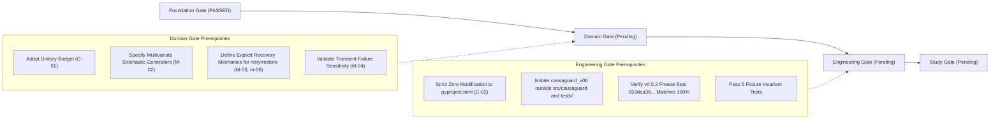

# Foundation gate review and scientific decision

Status: **OFFICIAL FOUNDATION GATE DECISION**, CausaGuard PhD Research Programme, 4 November 2026.
This document formally decides the status of the **Foundation Gate** (the first of five research gates defined in handoff §8 and [scientific-readiness-audit.md](../foundations/scientific-readiness-audit.md) §5).

Audited materials:
- [literature-review-protocol.md](../foundations/literature-review-protocol.md)
- [primary-source-verification.md](primary-source-verification.md)
- [novelty-comparison-matrix.md](novelty-comparison-matrix.md)
- [design-remediation.md](../foundations/design-remediation.md)

---

## 1. Executive decision

> [!IMPORTANT]
> ### DECISION: CONDITIONAL GO (Approved with Mandatory Scope Refinement)
>
> 1. **NO-GO for claiming algorithmic novelty for sequential verification.**
>    The literature review confirms that sequential inspection under cost, delay, and noisy evidence is the classical Value of Information (VOI) problem in POMDPs. CausaGuard did not invent this decision model, and presenting verify-then-decide as a novel algorithmic contribution would be scientifically invalid and easily rejected in peer review.
>
> 2. **GO for establishing CausaGuard as an empirical benchmark and decision laboratory for the Agent Intervention Paradox.**
>    Recent primary literature (specifically arXiv:2602.03338, NeurIPS 2024 AgentDojo, ICLR 2024 ToolEmu, and CaMeL 2025) demonstrates a recognized, unsolved challenge in AI agent systems: **the disruption–recovery tradeoff**. Existing agent benchmarks evaluate attack success or task completion under static prompt injection; none provides a counterfactually paired, cryptographically replayable benchmark for evaluating whether VOI, Conformal Risk Control, and Safe Policy Improvement can overcome the disruption–recovery tradeoff in operational workflows under distribution shift and strict capability enforcement.

---

## 2. Scientific evaluation of the Foundation Gate criteria

The Foundation Gate requires:
> *"A precise question and closest-work comparison identify a defensible candidate contribution or explicitly conclude that novelty remains unsupported."*

### Criterion 1: Resolution of Candidate Paper Matrix (Resolving M-07)
- **Evaluation:** **PASSED**.
- **Evidence:** All primary candidate papers C01–C06 have been located in primary conference proceedings (ICML, ICLR, NeurIPS) and preprints. Their research problems, assumptions, algorithms, and experimental evidence were fully verified and extracted in [primary-source-verification.md](primary-source-verification.md). In addition, candidates C07–C12 were verified in primary ACL Anthology and arXiv indexes, confirming that they are genuine, verifiable research works rather than synthetic planning artifacts.

### Criterion 2: Characterization of Overlap with Foundational Theory (Resolving M-01)
- **Evaluation:** **PASSED**.
- **Evidence:** Queries Q1–Q4 established that CausaGuard's proposed 2-step decision problem overlaps directly with:
  1. *Classical POMDP Value of Information* (Howard 1966; Raiffa & Schlaifer 1961).
  2. *Multi-stage Learning to Defer and Active Feature Acquisition* (Mozannar & Sontag 2020).
  3. *Safe Policy Improvement with Baseline Bootstrapping* (Laroche et al., ICML 2019).
- **Finding:** The algorithmic decision structure is not novel. However, its exact relationship to AI agent runtime intervention is now formally understood, enabling CausaGuard to benchmark against proper theoretical baselines rather than claim unearned novelty.

### Criterion 3: Identification of a Defensible Research Contribution
- **Evaluation:** **PASSED (under refined framing)**.
- **Evidence:** The literature review identified a clear, defensible scientific niche:
  - Agent security benchmarks (AgentDojo, ToolEmu) evaluate attacks on live LLMs but lack counterfactual potential outcomes, economic cost models, or latency SLA deadlines.
  - Runtime guardrails (CaMeL, DreamGuard) focus on blocking malicious tool calls or predicting risk, but as proven by arXiv:2602.03338, *accurate failure prediction does not imply effective failure prevention* because interventions disrupt benign executions.
  - **CausaGuard's defensible contribution:** Providing an open, counterfactually paired benchmark and rigorous evaluation methodology to investigate *when and how post-verification recovery decisions can achieve positive net utility without succumbing to the intervention paradox*.

---

## 3. Mandatory reframing of the CausaGuard research question

To ensure scientific integrity, the primary research question must be explicitly reframed before any implementation begins:

### Original (Discredited) Framing
> *"Can we invent a novel method for sequential intervention after verification?"*
*(Rejected: Sequential verification is classical POMDP VOI).*

### Reframed (Approved) Research Question
> **"In high-stakes tool-using agent workflows, under what conditions of verifier degradation, latency deadlines, and operational costs does acting on fallible verification evidence resolve the disruption–recovery tradeoff, and can data-driven policies improve on analytical Value-of-Information and Safe Policy Improvement baselines under strict runtime capability enforcement?"**

This reframing:
1. Anchors CausaGuard in the established literature of the **Intervention Paradox** (arXiv:2602.03338).
2. Honors classical decision theory by treating Bayesian VOI (`cost_rule`) as the pivotal analytical baseline rather than claiming it as a proprietary invention.
3. Positions CausaGuard as an empirical laboratory and benchmark testing whether theoretical guarantees (SPIBB, Conformal Risk Control) hold up under real-world distribution shifts.

---

## 4. Conditions for proceeding to the Domain and Engineering Gates

The Foundation Gate is declared **OPEN (CONDITIONAL)**. Progression to subsequent gates requires satisfying the following explicit prerequisites:

### Immediate Prerequisites for Domain Gate:
1. **Adopt C-01 Remediation:** Verify that all action definitions in both pilot domains consume exactly 1 unitary operation, with budget $B \in \{1, 2\}$, ensuring all transition paths are mathematically feasible.
2. **Resolve M-02 (Joint Distributions):** For the Data Engineering pilot, specify explicit multivariate stochastic distributions for the four hidden states (`schema_correct`, `values_correct`, `metadata_current`, `transformation_safe`) to prevent coefficient-swap reduction.
3. **Resolve M-03 & m-06 (Recovery Mechanics):** State explicit transition outcomes and recovery probabilities $\rho$ for `retry` (CS) and `restore` (DE) so they are not weakly dominated by `escalate`.

### Immediate Prerequisites for Engineering Gate:
1. **Adopt C-02 Remediation:** Enforce zero edits to `pyproject.toml`. Place all v0.6 code in `src_v06/causaguard_v06/` and tests in `tests_v06/`.
2. **Verify Historical Snapshot:** Run `python -m causaguard.v052 verify` and confirm status `matched` and SHA-256 seal `053dea360aeae5917ea8c5e24eec04781479ccc455d5f1657d142437987218e6`.

---

## 5. Summary recommendation

The programme may now proceed to address the **Domain Gate** requirements. No source code modifications, test executions, or branch changes are authorized at this time. All historical frozen artifacts remain protected.

