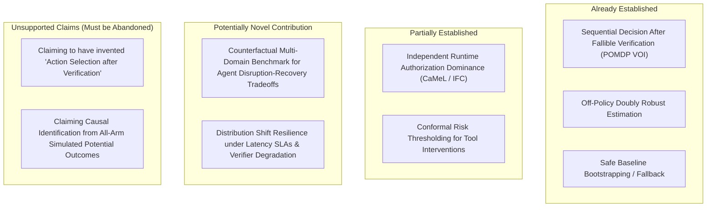

# CausaGuard v0.6 novelty comparison matrix and contribution classification

Status: **NOVELTY ASSESSMENT & METHODOLOGICAL AUDIT**, CausaGuard PhD Research Programme, 4 November 2026.
This document maps CausaGuard v0.6 against verified primary literature (C01–C06, C10–C12, and foundational decision theory) across 10 structural dimensions.

Sources referenced:
- [primary-source-verification.md](primary-source-verification.md)
- [evidence-map.md](../foundations/evidence-map.md)
- [design-remediation.md](../foundations/design-remediation.md)
- Both pilot domain specifications ([customer-support-pilot.md](../foundations/customer-support-pilot.md), [data-engineering-pilot.md](../foundations/data-engineering-pilot.md))

---

## 1. Ten-dimensional comparative matrix

| Dimension | Classical POMDP / VOI (Howard, Blackwell, Kaelbling) | Safe Policy Improvement (SPIBB, Laroche 2019) | Conformal Risk Control (Angelopoulos 2024) | Agent Security Benchmarks (AgentDojo, ToolEmu) | Architectural Runtime Defense (CaMeL, Debenedetti 2025) | **CausaGuard v0.6 (Remediated Design)** |
|---|---|---|---|---|---|---|
| **1. Public vs. Latent State** | Exact belief state maintained over latent state $S$ via known transition/observation matrices. | Observed state space $\mathcal{S}$; uncertainty quantified by visit counts $N(s,a)$. | Covariates $X \in \mathcal{X}$ observed; label/ground truth $Y$ unobserved at test time. | Environment prompt/API state observable; hidden adversarial injection embedded in text. | Explicit control flow vs untrusted data flow; data tagged with provenance. | **Public observation $X$ (14 operational covariates) observed; true defect, outage, and latent hazard strictly hidden in simulator.** |
| **2. Action Space & Sequence** | General sequential horizon; information actions update belief; physical actions change state. | Discrete multi-step MDP actions; policy switches to baseline on uncertain $(s, a)$. | One-shot prediction set or decision threshold selection $\hat{\lambda}$. | Multi-turn conversational tool calling loop until agent outputs stop. | Programmatic tool execution intercepted and gated by capability system. | **Two-step sequential horizon:** Step 1 selects between terminal actions or `verify`; Step 2 (if budget $B=2$) selects post-evidence action. |
| **3. Verifier Noise, Staleness & Delay** | Explicit observation probability matrix $P(o \mid s, a)$; typically stationary noise. | Not explicitly modeled as noisy observation channel; focus is transition dynamics. | General exchangeable loss; distribution shifts handled via weighted conformal prediction. | Deterministic or stochastic mock APIs; no explicit parametric verifier noise/delay. | Static/dynamic capability checks; no latency delay penalty or verifier degradation model. | **Asymmetric fallible verifier ($FP, FN$) with staleness lag ($\Delta t_{\text{lag}}$), additive noise, and latency SLA deadline penalty.** |
| **4. Objective & Trade-offs** | Maximize expected discounted reward or minimize expected cost under Bayesian belief. | Maximize return subject to high-probability lower bound vs baseline $\rho(\pi) \ge \rho(\pi_b) - \zeta$. | Minimize prediction set size subject to expected risk bound $\mathbb{E}[\ell] \le \alpha$. | Maximize benign task completion rate while minimizing attack success rate. | Ensure strict zero prompt injection / non-interference while maintaining utility. | **Maximize net economic utility ($V \cdot \text{success} - H \cdot \text{unsafe} - \text{costs}$) subject to absolute risk $\le 0.05$ and excess risk $\le 0.005$.** |
| **5. Authorization Boundary** | Action feasibility handled by action set $\mathcal{A}(s)$; no hostile bypass model. | Constrained within support of baseline policy; no security authorization boundary. | Not applicable (pure statistical prediction setting). | Evaluated empirically: whether agent executed malicious tool call under injection. | **Strict capability-based security; untrusted data cannot alter control flow.** Non-bypassable. | **Immutable trusted permission state (`MockState`); independent access grader asserts zero violations; cannot be bypassed by ML.** |
| **6. Baseline Fairness & Privilege** | Exact solver vs heuristic approximations; oracles have full MDP knowledge. | Baseline policy $\pi_b$ is known or estimated; candidate and baseline share identical data. | Non-adaptive split conformal baseline; candidate tunes single parameter $\lambda$. | Compares LLM models (e.g. GPT-4 vs Claude) and prompt defense variations. | Compares baseline LLM agent vs CaMeL capability-wrapped agent on AgentDojo tasks. | **All policies receive identical public observation $X$, budget $B$, and returned evidence $E$. Privileged oracle is diagnostic only.** |
| **7. Logging & Identification** | Full model-based planning or active exploration. | Offline logged dataset $\mathcal{D}$ generated by baseline $\pi_b$; relies on coverage. | Calibration set exchangeable with test set. | Empirical execution logs across benchmark test scenarios. | Empirical execution logs across benchmark test scenarios. | **Counterfactually paired simulation:** All-arm potential outcomes generated for every case via common exogenous random tape. |
| **8. Ground-Truth & Grading** | Evaluator has access to true state $s$ in simulator. | Evaluated on true MDP reward function. | Ground truth label $Y$ evaluated on held-out test data. | LLM-based safety evaluator (ToolEmu) or rule-based environment assertions (AgentDojo). | Rule-based environment assertions and information flow tracking. | **Independent programmatic grader:** Reconstructs permission checks and evaluates domain safety without importing executor helpers. |
| **9. Theoretical Guarantees** | Optimal policy under exact model; bounds on myopic VOI approximations. | Provable Safe Policy Improvement with high probability ($1 - \delta$). | Finite-sample, distribution-free risk bound $\mathbb{E}[\text{loss}] \le \alpha$. | No theoretical safety guarantees; empirical benchmark metrics. | Provable non-interference under formal information flow control model. | **Statistical inference via crossed cluster bootstrap; finite-sample safety gates tested empirically on frozen evaluation seeds.** |
| **10. Reproducibility & Replay** | Standard stochastic seed control. | Deterministic replay given static dataset $\mathcal{D}$. | Deterministic given calibration split. | Non-deterministic live LLM API calls; high variability across model versions. | Dependent on underlying LLM model weights and temperature settings. | **Cryptographic execution identity:** Source tree recursive SHA-256 hash, disjoint seed allocations, and bit-level offline replay reports. |

---

## 2. Classification of CausaGuard candidate contributions

Based on verified literature, we classify CausaGuard's proposed contributions into four clear categories:

### Category A: Already Established in Literature
1. **Sequential decision-making after costly, fallible verification:**
   - *Status:* **ALREADY ESTABLISHED**.
   - *Evidence:* Howard (1966), Raiffa & Schlaifer (1961), Cassandra et al. (1994). Deciding whether to acquire a noisy observation before taking an action is the foundational Value of Information problem in POMDPs. Active Feature Acquisition (AFA) and Multi-stage Learning to Defer (Mozannar & Sontag 2020) solve this exact problem in machine learning.
   - *Action required:* CausaGuard must **never** claim novelty for this formulation. It must explicitly cite classical VOI literature and position its `cost_rule` as an analytical Bayesian instantiation.

2. **Safe policy fallback to baseline under uncertainty:**
   - *Status:* **ALREADY ESTABLISHED**.
   - *Evidence:* Laroche et al. (ICML 2019, SPIBB). Constraining a target policy to default to a known baseline when uncertainty is high is the established principle of Safe Policy Improvement.
   - *Action required:* Position CausaGuard's conservative risk gating as an empirical application of SPIBB principles in agent intervention.

3. **Doubly robust counterfactual estimation:**
   - *Status:* **ALREADY ESTABLISHED**.
   - *Evidence:* Dudík et al. (ICML 2011).

### Category B: Partially Established in Literature
1. **Strict independent runtime authorization dominating predictive ML output:**
   - *Status:* **PARTIALLY ESTABLISHED**.
   - *Evidence:* CaMeL (Debenedetti et al., 2025) and capability systems establish that runtime capability boundaries should never be subverted by untrusted data. However, CaMeL focuses on preventing prompt injection in LLMs. Combining strict capability enforcement with *economic utility optimization, latency SLA deadlines, and sequential verification recovery* in agent operational workflows is rare in current agent literature.
   - *Opportunity:* Frame CausaGuard's access grader as an independent runtime capability enforcement monitor operating alongside an economic intervention selector.

2. **Conformal risk control for agent tool intervention:**
   - *Status:* **PARTIALLY ESTABLISHED**.
   - *Evidence:* Angelopoulos et al. (ICLR 2024) formulated CRC, but its application to setting runtime intervention thresholds for tool-using LLM agents under distribution shift remains an active, emerging area of research.

### Category C: Potentially Novel Research Contributions
1. **An independently graded, counterfactually paired benchmark for the Agent Intervention Paradox:**
   - *Status:* **POTENTIALLY NOVEL AS A BENCHMARK ARTIFACT**.
   - *Rationale:* Literature (arXiv:2602.03338, *Accurate Failure Prediction Does Not Imply Effective Failure Prevention*) identifies the disruption–recovery tradeoff as an open challenge: intervention mechanisms frequently cause more harm than good by disrupting benign runs. AgentDojo and ToolEmu evaluate prompt injections and tool safety, but they do **not** provide counterfactually paired potential outcomes, parametric verifier staleness, or economic cost/latency trade-offs.
   - *Distinct contribution:* CausaGuard provides an open, cryptographically replayable laboratory that isolates whether and when post-verification decisions can resolve the disruption–recovery tradeoff.

2. **Dual-domain workflow benchmark with structurally distinct failure taxonomies:**
   - *Status:* **POTENTIALLY NOVEL**.
   - *Rationale:* Customer Record Resolution (contested ownership, stale contact info) and Staged Data Transformation (schema mismatch, value corruption, undetectable transient failure) offer two distinct, non-trivial operational models beyond toy synthetic labels, provided they are implemented with explicit multivariate stochastic generators (resolving M-02).

### Category D: Unsupported Claims (Must Be Explicitly Abandoned)
1. *Claiming CausaGuard invented sequential verification under cost:* **ABANDONED**. (Identical to 60-year-old POMDP VOI).
2. *Claiming causal identification from factual deployment logs:* **ABANDONED**. (CausaGuard's current simulator evaluates all macro arms on the same random tape; it does not solve unobserved confounding, partial support, or propensity estimation on observational logs).
3. *Claiming that ML classifiers naturally outperform deterministic rules in intervention:* **ABANDONED**. (Refuted by CausaGuard's own v0.51 and v0.52 empirical development stops, and confirmed by arXiv:2602.03338).

---

## 3. Strong published baselines to incorporate

To ensure scientific rigor in future v0.6 evaluations, CausaGuard must benchmark against the following literature-derived baselines rather than arbitrary strawmen:

1. **Classical Myopic Value of Information (VOI) Rule:**
   - *Source:* Howard (1966); Raiffa & Schlaifer (1961).
   - *Role in CausaGuard:* This is precisely what the remediated `cost_rule` ([design-remediation.md](../foundations/design-remediation.md) §4) represents: an analytical Bayesian policy that computes expected utility before and after inspection using quoted likelihoods.

2. **Fixed Verify-and-Repair Macro (Historical Legacy Baseline):**
   - *Source:* `intervention_env.py` (v0.5 legacy).
   - *Role in CausaGuard:* Resolves finding M-05. Evaluates whether sequential exposure of evidence to the policy beats the bundled macro on the *exact same* new generative model.

3. **Safe Policy Improvement with Baseline Bootstrapping ($\Pi_{\le b}\text{-SPIBB}$):**
   - *Source:* Laroche et al. (ICML 2019).
   - *Role in CausaGuard:* In Stage 2, any learned policy must be constrained to bootstrap from `rules_repair` or `cost_rule` whenever predictive uncertainty is high.

4. **Split Conformal Risk Control (CRC) Policy:**
   - *Source:* Angelopoulos et al. (ICLR 2024).
   - *Role in CausaGuard:* A calibration-split policy that sets risk threshold $\hat{\lambda}$ to provably satisfy $\mathbb{E}[\text{loss}] \le 0.05$ on exchangeable validation data.

5. **Disruption–Recovery Tradeoff Diagnostic:**
   - *Source:* arXiv:2602.03338 (Accurate Failure Prediction Does Not Imply Effective Prevention).
   - *Role in CausaGuard:* Explicitly decompose policy outcomes into:
     - *Rescues:* Cases where without intervention the outcome was unsafe, but intervention produced safe completion.
     - *Disruptions:* Cases where without intervention the outcome was safe completion, but intervention produced failure (due to false alarms, latency deadlines, or repair failure).
     - *Net Gain:* $\text{Rescues} - \text{Disruptions}$.

