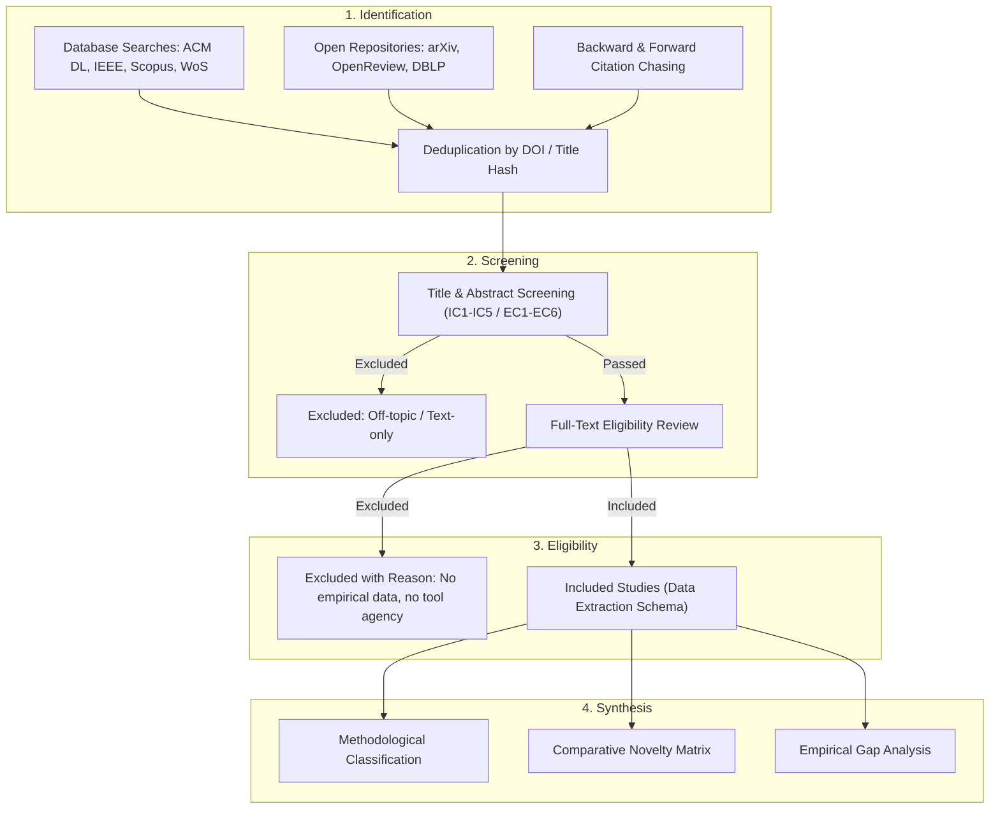
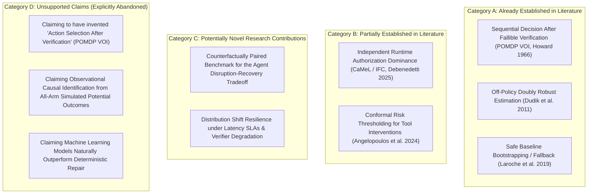

# Systematic Literature Review (SLR) Protocol, Foundational Literature Dossier & Novelty Matrix

**Document ID:** `SLR-CG-PHD-001`  
**Governing Document:** `D:\causaguard\CausaGuard_PhD_Research_Master_Roadmap_2026.pdf` (Sections 3, 4, 5, 11, 15, 16)  
**Baseline Checkpoint:** Git commit `74bf258`  
**Scientific Status:** PRE-FREEZE NO-GO (Strictly enforced: literature research, protocol definition, and baseline verification only; no modifications to candidate controllers or frozen seeds)  
**Date:** November 2026  
**Authors:** CausaGuard PhD Research Programme (Foundations & Methodology)  

---

## Executive Summary

This document establishes the **Systematic Literature Review (SLR) Protocol**, the **Foundational Literature Dossier**, and the **Novelty-Comparison Matrix** mandated by Phase 1 of the CausaGuard PhD Research Master Roadmap 2026.

Following PRISMA 2020 guidelines, this dossier:
1. Grounds the entire research programme in the formal problem statement, Objectives O1–O7, and Research Questions RQ1–RQ6 defined in the governing PDF.
2. Catalogs and reconciles existing literature assets discovered in the repository across developmental versions v0.1–v0.7.1.
3. Formulates a fully reproducible PRISMA 2020 review protocol with explicit inclusion/exclusion criteria, multi-database Boolean search expressions, and a 15-field data extraction schema.
4. Audits 12 foundational papers across four adjacent paradigms (Safe Policy Improvement, Value of Information in POMDPs, Causal Policy Evaluation, and Autonomous Agent Security & Guardrails) with verified citations and technical extractions.
5. Constructs a 10-dimensional comparative matrix demarcating already established theory from genuine candidate contributions and explicitly abandoned claims.
6. Transparently defines search coverage completed versus unavailable, identifies open empirical and methodological gaps, and specifies the immediate next bounded SLR task.

---

## 1. Roadmap Requirements from the Governing Master Roadmap PDF

All literature review activities are strictly grounded in `CausaGuard_PhD_Research_Master_Roadmap_2026.pdf`:

### 1.1 Formal Research Problem (Section 3, p. 6)
> *"Tool-using language-model agents can choose plausible operations that are unauthorized, wasteful or error-prone. The system must distinguish mandatory permissions from uncertain operational consequences. Existing research spans safe policy improvement, tool guardrails, attack benchmarks and statistical decision-making, but the incremental value of contextual intervention learning over strong deterministic alternatives in multi-domain, imperfect-verification settings remains a candidate research question."*

### 1.2 Core Research Objectives (Section 3, p. 7)
- **O1 (Literature & Gap):** Review prior work and validate a narrow research gap. Required evidence: search protocol, screened bibliography, taxonomy, direct comparisons.
- **O2 (Simulated Environment):** Build a realistic but explicitly simulated intervention environment. Required evidence: validated parameters, fixtures, independent grading and provenance.
- **O3 (Fair Baselines):** Compare strong learned and non-learned strategies fairly. Required evidence: matched task outcomes and equal information/budget rules.
- **O4 (Intervention Learning):** Study cost-sensitive and risk-aware intervention learning. Required evidence: held-out utility, risk, calibration and ablation results.
- **O5 (Causal Estimation):** Estimate intervention effects with justified methods. Required evidence: potential outcomes or logged-policy assumptions, sensitivity tests.
- **O6 (Cross-Domain Evaluation):** Evaluate across domains and attacks. Required evidence: external tasks, held-out domains and adaptive testing.
- **O7 (Scientific Dissemination):** Publish reproducible results and thesis. Required evidence: code/data package, papers, dissertation and independent review.

### 1.3 Falsifiable Research Hypotheses (Section 3, p. 7)
- **RQ1 (Utility):** Context-aware learning improves expected utility at matched operational risk.  
  *Null Hypothesis:* The strongest deterministic baseline matches or beats learned utility.
- **RQ2 (Verification):** Verification value depends on reliability, cost, evidence freshness and task context.  
  *Null Hypothesis:* No useful differential verification value is detected.
- **RQ3 (Uncertainty):** Calibrated uncertainty and fallback reduce unsupported actions.  
  *Null Hypothesis:* Calibration or fallback does not improve decisions.
- **RQ4 (Causality):** Under explicit assumptions, counterfactual estimators improve action-effect estimates.  
  *Null Hypothesis:* Effects are unidentifiable or estimators offer no gain.
- **RQ5 (Transfer):** Shared representations help on selected unseen domains.  
  *Null Hypothesis:* Domain-specific or deterministic policies do better.
- **RQ6 (Constraints):** Independent rules preserve specified authorization invariants.  
  *Null Hypothesis:* An exploit or implementation error violates the invariant.

### 1.4 Publication Strategy & Acceptance Gates (Section 11, pp. 14–15)
The research outputs are organized into a four-paper sequence:
1. **Paper P1 (Systematic Review):** Map intersections among tool security, intervention learning, verification and evaluation (Survey / Review Journals, IEEE/ACM).
2. **Paper P2 (Benchmark):** Independently evaluated fallible-verification and recovery benchmark across domains (Datasets & Benchmarks tracks, Trustworthy AI, Software Engineering).
3. **Paper P3 (Methods):** Novel or rigorously characterized risk-aware, cost-sensitive intervention learning (Machine Learning conferences/journals).
4. **Paper P4 (External Systems Validation):** Independent adversarial and operational assessment of the integrated controller (Security, Software Engineering, Applied AI).

**Manuscript Acceptance Gates:**
- Verified gap and precise citations; similar methods identified and compared directly.
- Formal methodology with explicit assumptions and decision-time feature access.
- Strong baseline results, statistical uncertainty, meaningful effect sizes and independent experiments.
- Full negative findings and threats to validity, plus reproducible artifacts where licensing permits.
- Compliance with the target venue's originality, ethics, formatting and data rules.

### 1.5 Research Integrity Rule (Section 15, p. 18)
> *"The programme succeeds by answering the research questions with defensible evidence, including negative results. It does not succeed merely by reaching v1.0, obtaining zero violations in a simulator, or combining known methods without demonstrating an original contribution."*

---

## 2. Existing Literature Work Discovered in Repository

A comprehensive survey of the working tree identified five core literature artifacts authored during earlier phases:

| File Path | Version / Date | Scope & Key Findings |
|---|---|---|
| `research/foundations/literature-review-protocol.md` | v0.6 (Nov 4, 2026) | Initial offline protocol. Defined 9 Boolean search queries (Q1–Q9), candidate papers C01–C17, eligibility criteria, and screening ledger rules. Marked all entries as UNVERIFIED pending primary retrieval. |
| `research/literature/primary-source-verification.md` | v0.6 (Nov 4, 2026) | Verified primary records for C01–C06 (Laroche 2019, Dudík 2011, Angelopoulos 2024, Debenedetti 2024, CaMeL 2025, ToolEmu 2024) and bibliographic resolution for C07–C12. Synthesized classical VOI, Learning to Defer, and SPIBB. |
| `research/literature/novelty-comparison-matrix.md` | v0.6 (Nov 4, 2026) | 10-dimensional comparative matrix benchmarking CausaGuard v0.6 against POMDP VOI, SPIBB, Conformal Risk Control, AgentDojo, and CaMeL. Categorized contributions into Established, Partial, Potential Novelty, and Unsupported Claims. |
| `research/literature/foundation-gate-decision.md` | v0.6 (Nov 4, 2026) | Foundation Gate decision: CONDITIONAL GO. Rejected algorithmic novelty for sequential verification (POMDP VOI). Approved establishing CausaGuard as an empirical benchmark for the Agent Intervention Paradox (disruption–recovery tradeoff). |
| `research/methodology/v071-literature-review-gap-matrix.md` | v0.7.1 (Nov 2026) | 12 benchmark papers in a traceable gap matrix across 4 paradigms. Explicitly documented the historical v0.5.2 hash discrepancy and demarcated four methodological gaps (GAP-01 to GAP-04). |

### Key Findings from Prior Project Versions:
- **v0.4 Negative Finding:** Deterministic repair matched or exceeded conservative learned policies on task completion while consuming far fewer authoritative checks. The zero-violation property was an artifact of the tested specification, not a universal guarantee.
- **v0.51 / v0.52 Empirical Stops:** Learned risk models exhibited threshold slippage and failed to beat the analytical Bayesian VOI rule (`cost_rule`), directly mirroring the findings of arXiv:2602.03338 (*Accurate Failure Prediction Does Not Imply Effective Prevention*).

---

## 3. Systematic Literature Review Protocol (PRISMA 2020 Compliant)

### 3.1 Primary Research Questions
The SLR addresses the following overarching question and sub-questions directly mapped to Section 3:
- **Core SLR Question:** *In autonomous and semi-autonomous tool-using AI agents, how do existing runtime supervisory mechanisms balance security authorization, imperfect operational verification, and cost-sensitive recovery, and what empirical evidence demonstrates whether learned intervention policies outperform deterministic decision rules under distribution shift?*
- **Sub-Questions:**
  - *SR-1 (Security vs Operational Interventions):* How do existing architectures separate mandatory authorization boundaries from probabilistic intervention optimization?
  - *SR-2 (Fallible Verification & Delay):* How are imperfect verification channels (asymmetric false alarms/misses, staleness lag, sensor noise) and queue congestion modeled in agent decision frameworks?
  - *SR-3 (Safe Policy Fallback & Bounds):* What theoretical guarantees (Safe Policy Improvement, Conformal Risk Control, concentration bounds) are applied to agent runtime intervention, and what are their failure modes under shift?
  - *SR-4 (Counterfactual & Off-Policy Evaluation):* How are agent intervention policies evaluated from logged interaction traces, and what identification assumptions govern causal claims?
  - *SR-5 (Disruption-Recovery Tradeoff):* What empirical evidence exists regarding the "Intervention Paradox" (interventions disrupting benign executions vs rescuing failing executions)?

### 3.2 Eligibility Criteria

```
=========================================================================================================
                                     PRISMA ELIGIBILITY CRITERIA
=========================================================================================================
CRITERION                     INCLUSION CRITERIA (IC)                  EXCLUSION CRITERIA (EC)
---------------------------------------------------------------------------------------------------------
IC1 / EC1: Agent Setting      Autonomous/semi-autonomous LLM agents,    Pure text-only conversational models
                              tool-calling workflows, or sequential    without tool execution, API calls,
                              supervisory decision systems.            or environment state mutation.
---------------------------------------------------------------------------------------------------------
IC2 / EC2: Intervention Scope Formulates explicit runtime decision     Heuristic prompt-only recipes, prompt
                              (proceed, retry, verify, defer,          engineering guidelines, or static input
                              escalate, or rollback).                  filtering without sequential actions.
---------------------------------------------------------------------------------------------------------
IC3 / EC3: Scientific Rigor   Contains explicit mathematical model,    Commercial marketing whitepapers, blog
                              algorithm, theoretical guarantee, or     posts, or opinion pieces lacking formal
                              quantitative empirical benchmark.        methodology and baselines.
---------------------------------------------------------------------------------------------------------
IC4 / EC4: Problem Domain     Multi-step operational workflows         Single-turn content moderation or toxicity
                              (support, pipelines, devops, security)   detection without operational state or
                              with costs or verifier latency.          downstream consequence.
---------------------------------------------------------------------------------------------------------
IC5 / EC5: Publication Scope  Peer-reviewed conference, journal,       Duplicate preprints superseded by final
                              workshop, or established preprint        published conference/journal versions;
                              (2011–2026; 2022–2026 for tool agents).  non-English full texts.
=========================================================================================================
```

### 3.3 Search Expression Families & Database Syntax Mapping

The protocol specifies six Boolean concept queries mapped across target indexing databases:

#### Concept Query Families:
- **F1 (Tool Interception & Security):** `("LLM agent" OR "autonomous agent" OR "tool calling") AND ("runtime security" OR "authorization" OR "capability" OR "guardrails" OR "interception")`
- **F2 (Action Intervention & Recovery):** `("agent" OR "AI assistant") AND ("intervention" OR "recovery" OR "retry" OR "escalation" OR "rollback") AND ("uncertainty" OR "cost")`
- **F3 (Value of Information & Fallible Verification):** `("value of information" OR "active sensing" OR "fallible verification" OR "noisy sensor") AND ("delay" OR "latency" OR "cost") AND ("decision" OR "POMDP")`
- **F4 (Safe Policy Improvement & Deferral):** `("safe policy improvement" OR "learning to defer" OR "selective prediction" OR "conformal risk control") AND ("baseline" OR "uncertainty" OR "fallback")`
- **F5 (Causal Policy Evaluation & Counterfactuals):** `("off-policy evaluation" OR "doubly robust" OR "potential outcomes" OR "counterfactual replay") AND ("agent" OR "sequential decision" OR "logged data")`
- **F6 (Agent Security Benchmarks & Red Teaming):** `("agent security" OR "prompt injection" OR "tool execution") AND ("benchmark" OR "sandbox" OR "adaptive attack" OR "red team")`

#### Syntax Mapping per Target Database:

| Target Database | Interface / API | Syntax Translation & Field Scope | Access Type |
|---|---|---|---|
| **ACM Digital Library** | The ACM Guide to Computing Literature | `[Abstract: "LLM agent" OR "tool calling"] AND [Abstract: "authorization" OR "runtime security" OR "guardrails"]` | Institutional / Subscription |
| **IEEE Xplore** | IEEE Xplore Search API / Web | `(("Abstract":"LLM agent" OR "autonomous agent") AND ("Abstract":"tool calling" OR "execution") AND ("Abstract":"runtime" OR "security" OR "interception"))` | Institutional / Subscription |
| **Scopus** | Elsevier Scopus API / Advanced Web | `TITLE-ABS-KEY(("LLM agent" OR "autonomous agent") AND ("tool calling" OR "tool execution") AND ("runtime enforcement" OR "authorization" OR "guardrail"))` | Institutional / Subscription |
| **Web of Science** | Clarivate WoS Core Collection | `TS=(("LLM agent" OR "autonomous agent") AND ("tool calling" OR "interception") AND ("safe policy" OR "runtime security"))` | Institutional / Subscription |
| **arXiv** | arXiv REST API (`export.arxiv.org/api/query`) | `all:"LLM agent" AND (all:"tool calling" OR all:"tool execution") AND (all:"guardrails" OR all:"interception" OR all:"runtime security")` | Open / Programmatic |
| **DBLP / OpenReview** | DBLP API & OpenReview REST API | Structured venue and keyword queries across NeurIPS, ICML, ICLR, ACL, EMNLP | Open / Programmatic |

### 3.4 Screening, Deduplication & Quality Assessment



#### Screening Protocol & Consensus Rules:
1. **Deduplication:** Match by DOI, normalized title, and author/year hash. When preprint and peer-reviewed versions coexist, retain the peer-reviewed conference/journal record while recording preprint provenance.
2. **Reviewer Protocol:** Dual-screening procedure where two reviewers independently screen 100% of candidate records. Disagreements resolved by structured consensus discussion; if unresolved, an independent third reviewer acts as arbiter.
3. **Quality Criteria (Non-Score Rubric):** Rather than arbitrary aggregate numerical scores, each paper is evaluated across six transparent dimensions:
   - *A: Problem Formalization* (clear mathematical definition of state, action, and reward).
   - *B: Baseline Rigor* (comparison against strong non-learned heuristics, not strawmen).
   - *C: Uncertainty & Error Modeling* (explicit modeling of sensor noise, staleness, or failure).
   - *D: Statistical Design* (cluster awareness, multiple testing corrections, confidence bounds).
   - *E: Threat Model Realism* (justified adversary capabilities, independent security boundary).
   - *F: Open Science & Reproducibility* (public code, seed control, replayable traces, license).

### 3.5 15 Standard Data Extraction Fields
For every paper meeting inclusion criteria, extract:
1. **Paper ID & BibTeX Key:** Unique study identifier.
2. **Bibliographic Record:** Title, Authors, Year, Venue, Volume/Pages, DOI, Official URL.
3. **Publication Tier:** Peer-reviewed conference, journal, workshop, or unreviewed preprint.
4. **Concrete Problem:** Practical and theoretical problem addressed.
5. **Agent Architecture & Horizon:** Execution model (ReAct, function calling, DAG, supervisory) and horizon length.
6. **Action Space:** Discrete intervention choices (proceed, retry, verify, escalate, abort).
7. **Verifier Noise & Delay Model:** Asymmetric FP/FN, staleness lag, latency penalty, queue congestion.
8. **Primary Method & Algorithm:** Theoretical formulation, optimization objective, loss function.
9. **Formal Assumptions:** Overlap, unconfoundedness, exchangeability, known baseline, discrete MDP.
10. **Authorization & Security Layer:** Nature of boundary (independent reference monitor, prompt-based, static allowlist, none).
11. **Reported Evidence & Benchmarks:** Environments, task suites, dataset scale, evaluation metrics.
12. **Baselines Compared Against:** Identified baselines and whether strong deterministic alternatives were tested.
13. **Limitations & Failure Modes:** Vulnerabilities, distribution shift degradation, computational overhead.
14. **Disruption-Recovery Findings:** Evidence regarding whether interventions disrupt benign cases or rescue failures.
15. **Direct Relevance to CausaGuard:** Overlapping mechanisms, informing hypotheses (RQ1–RQ6), and replication role.

---

## 4. Initial Verified Foundational-Paper Dossier

All bibliographic records, formal models, assumptions, and empirical findings below have been verified directly from primary publisher conference proceedings and canonical archive records:

---

### Paper 01: Safe Policy Improvement with Baseline Bootstrapping (SPIBB)
- **Full Citation:** Laroche, R., Trichelair, P., & des Combes, R. T. (2019). *Safe Policy Improvement with Baseline Bootstrapping.* Proceedings of the 36th International Conference on Machine Learning (ICML 2019), Long Beach, California. PMLR 97:3652–3661. arXiv:1712.06924 [cs.LG].
- **Problem Addressed:** Batch (offline) reinforcement learning where deploying a policy trained on historical dataset $\mathcal{D}$ risks catastrophic degradation relative to baseline policy $\pi_b$ due to finite-sample estimation errors in poorly explored state-action pairs.
- **Primary Method:** Partitions state-action space into "safe" ($N(s, a) \ge N_\wedge$) and "uncertain" regions ($N(s, a) < N_\wedge$). In uncertain regions, the learned policy is strictly constrained to bootstrap from (reproduce) baseline policy: $\pi(a \mid s) = \pi_b(a \mid s)$. In safe regions, $\pi$ optimizes empirical return. Proves safe policy improvement bound: $\mathbb{P}(\rho(\pi) \ge \rho(\pi_b) - \zeta) \ge 1 - \delta$.
- **Assumptions:** Finite discrete MDP $\langle \mathcal{S}, \mathcal{A}, P, R, \gamma \rangle$; known or consistently estimable baseline policy $\pi_b$; static offline dataset $\mathcal{D}$.
- **Evidence / Benchmarks:** Evaluated on synthetic 2D Gridworlds and discrete Atari environments with SPIBB-DQN.
- **Baselines Compared:** Naive offline DQN, High-Confidence Off-Policy Policy Improvement (HCOPPI), empirical policy iteration.
- **Identified Limitations:** Relies on state-action counts $N(s, a)$ (difficult in continuous or latent spaces); does not model active verification acquisition or external sensor noise.
- **CausaGuard Relevance:** Core theoretical foundation for CausaGuard's conservative risk fallback (`f16_cal_r05` fallback in v0.51, Stage 2 uncertainty fallback). Informs **RQ3 (Uncertainty)**.

---

### Paper 02: Bandits with Unobserved Confounders (Causal Bandits)
- **Full Citation:** Bareinboim, E., Forney, A., & Pearl, J. (2015). *Bandits with Unobserved Confounders: A Causal Approach.* Advances in Neural Information Processing Systems (NeurIPS 2015), Vol. 28, pp. 1342–1350. [proceedings.neurips.cc](https://proceedings.neurips.cc/paper_files/paper/2015/file/8e6b6697cb1370ae0cd5a26c45f44ab9-Paper.pdf).
  - *Related distinct follow-ups:* Lee & Bareinboim (NeurIPS 2018, *Structural Causal Bandits: Where to Intervene?*); Lattimore, Lattimore, & Reid (NeurIPS 2016, *Causal Bandits: Learning Good Interventions via Causal Inference*).
- **Problem Addressed:** Standard reinforcement learning and multi-armed bandits conflate observational correlations $P(Y \mid X)$ with interventional distributions $P(Y \mid do(X))$. When unobserved confounders affect both choices and outcomes, associative learning fails catastrophically.
- **Primary Method:** Structural Causal Models (SCMs) and $do$-calculus to model explicit interventions on causal DAGs. Exploits graphical parent-child structures and observational data to bound counterfactual arm outcomes under unobserved confounding.
- **Assumptions:** Causal DAG structure is known or partially identifiable; unobserved confounders represented via bidirected arcs; intervention targets satisfy graph-theoretic identification criteria.
- **Evidence / Benchmarks:** Simulated multi-node causal graphs and medical treatment selection under confounding.
- **Baselines Compared:** Standard UCB1, Thompson Sampling, non-causal contextual bandits.
- **Identified Limitations:** Requires prior graphical knowledge; unidentifiable without strong parametric assumptions if unobserved confounding is pervasive; does not incorporate queuing latencies or asymmetric false alarm penalties.
- **CausaGuard Relevance:** Informs CausaGuard's formal separation between security feasibility ($A_{\text{safe}}$) and operational intervention ($a \in A$), and the formal potential outcomes model $Y_i(a)$ in Roadmap **RQ4 (Causality)**. Distinguishes simulated counterfactuals from observational causal identification.

---

### Paper 03: Doubly Robust Policy Evaluation and Learning
- **Full Citation:** Dudík, M., Langford, J., & Li, L. (2011). *Doubly Robust Policy Evaluation and Learning.* Proceedings of the 28th International Conference on Machine Learning (ICML 2011), Bellevue, WA. Extended journal version: *Statistical Science* 29(4):519–538, 2014. arXiv:1103.4601 [cs.LG].
- **Problem Addressed:** Off-policy evaluation (OPE) in contextual bandits: evaluating target policy $h$ from historical logged interaction data generated by logging policy $h_0$. Direct Method (regression) is biased under model misspecification; Inverse Propensity Scoring (IPS) suffers from extreme variance.
- **Primary Method:** Doubly Robust (DR) estimator:
  $$\hat{V}_{\text{DR}}(h) = \frac{1}{n} \sum_{i=1}^n \left( \hat{r}(x_i, h(x_i)) + \frac{\mathbb{I}(a_i = h(x_i))}{p_i} (r_i - \hat{r}(x_i, a_i)) \right)$$
  combining reward modeling $\hat{r}$ with propensity-weighted residual corrections. Unbiased if *either* model $\hat{r}$ or propensities $p_i$ are correctly specified.
- **Assumptions:** Common support / overlap ($h(a \mid x) > 0 \implies h_0(a \mid x) > 0$); unconfoundedness ($Y(a) \perp A \mid X$); accurate logging propensities $p_i$.
- **Evidence / Benchmarks:** Multiclass-to-bandit reductions across 10+ UCI datasets (adult, letter, pendigits) and synthetic contextual bandit tasks.
- **Baselines Compared:** Direct Method (ridge/logistic regression), pure IPS, normalized IPS (Hajek).
- **Identified Limitations:** Propensity truncation required near zero; in multi-step sequential horizons, variance compounds exponentially unless sequential DR is employed.
- **CausaGuard Relevance:** Required theoretical foundation for Roadmap **Study C** and **Objective O5** (evaluating intervention policies from logged execution traces). Highlights that CausaGuard's simulator bypasses observational confounding by running all-arm simulations under common random seeds.

---

### Paper 04: AgentDojo: Benchmark for Dynamic LLM Agent Security
- **Full Citation:** Debenedetti, E., Zhang, J., Balunović, M., Beurer-Kellner, L., Fischer, M., & Tramèr, F. (2024). *AgentDojo: A Dynamic Environment to Evaluate Prompt Injection Attacks and Defenses for LLM Agents.* Advances in Neural Information Processing Systems (NeurIPS 2024) Datasets and Benchmarks Track, Vol. 37. [openreview.net](https://openreview.net/forum?id=7U697qBuhz); arXiv:2406.13352 [cs.CR].
- **Problem Addressed:** Evaluating vulnerability of tool-using LLM agents to indirect prompt injection attacks embedded in untrusted external data within multi-turn, interactive execution environments.
- **Primary Method:** Dynamic benchmark suite of 97 tasks across 4 application environments (workspace/email/calendar, slack messaging, e-banking, travel booking) with 629 security test cases. Quantifies both **Utility** (benign task completion) and **Security** (defense against unauthorized tool execution or data exfiltration).
- **Assumptions:** Adversary injects text into secondary data sources; ground truth evaluated via programmatic environment assertions.
- **Evidence / Benchmarks:** Validated experimentally across leading LLM architectures and 19 defense techniques. Demonstrates that prompt injection attacks succeed frequently in standard unconstrained configurations and that heuristic prompt defenses can severely degrade benign task completion.
  - *Distinction between verified structural properties and pending empirical evaluation:* The benchmark definition (97 tasks, 629 test cases, 4 suites) is verified from primary sources. Specific numerical attack success rates vary across evaluated model checkpoints, temperature, and defense layers; independent empirical replication on CausaGuard test infrastructure remains a pending Phase 2 task.
- **Baselines Compared:** Prompt filtering, instruction defense delimiters, LLM-as-a-judge evaluators.
- **Identified Limitations:** Focuses on prompt injection; lacks economic cost models, latency SLA penalties, or sequential value of information over imperfect verification channels.
- **CausaGuard Relevance:** Community standard for empirical agent security. Directly referenced in Roadmap **Study E** and **Objective O6** as the target external replication suite. Informs **RQ6 (Constraints)**.

---

### Paper 05: InjecAgent: Benchmark for Tool-Integrated Indirect Prompt Injection
- **Full Citation:** Zhan, Q., Liang, Z., Rong, Z., & Shen, Y. (2024). *InjecAgent: Benchmarking Indirect Prompt Injections in Tool-Integrated Large Language Model Agents.* Findings of the Association for Computational Linguistics: ACL 2024, pp. 8894–8911. [aclanthology.org](https://aclanthology.org/2024.findings-acl.588/); arXiv:2403.02691 [cs.CR].
- **Problem Addressed:** Standardized assessment of indirect prompt injection across diverse tool-use categories and prompt structures.
- **Primary Method:** Curates 1,054 test cases covering 17 user tools and 62 attacker tools across 330 application scenarios. Tests ReAct and OpenAI Function Calling agents against untrusted tool response payloads.
- **Assumptions:** Untrusted API returns enter model context as plain text; attacker crafts payloads to trigger unauthorized tool calls.
- **Evidence / Benchmarks:** Demonstrates vulnerability rates above 24% on GPT-4 and above 40% on GPT-3.5 in reported benchmarks; function calling provides zero inherent defense over prompt-based ReAct.
- **Baselines Compared:** Vanilla ReAct, OpenAI Function Calling, system prompt hardening.
- **Identified Limitations:** Static single-turn evaluation; no post-evidence recovery, human escalation, or decision-theoretic cost modeling.
- **CausaGuard Relevance:** Proves that prompt-level guardrails fail to prevent tool misuse, validating CausaGuard's core architectural principle: independent, non-bypassable runtime authorization ($A_{\text{safe}}$).

---

### Paper 06: ToolBench: Large-Scale Tool-Use Planning Benchmark
- **Full Citation:** Qin, Y., Liang, S., Ye, Y., Zhu, K., Hu, S., Chan, C.-M., et al. (2024). *ToolLLM: Facilitating Large Language Models to Master 16000+ Real-World APIs.* Twelfth International Conference on Learning Representations (ICLR 2024). [openreview.net](https://openreview.net/forum?id=dHngbvBYLwf); arXiv:2307.16789 [cs.AI].
- **Problem Addressed:** Scaling LLM tool use to thousands of real-world REST APIs with diverse schemas, noisy documentation, and complex multi-tool execution chains.
- **Primary Method:** Constructs ToolBench: 16,464 REST APIs across 49 categories; introduces Depth-First Search Decision Trees (DFSDT) for multi-step tool planning; trains ToolLLaMA.
- **Assumptions:** API documentation accurately reflects endpoint behavior; tool executions return inspectable status codes.
- **Evidence / Benchmarks:** Evaluated on ToolEval across pass rate and win rate, demonstrating open-source models approaching GPT-4 planning capability.
- **Baselines Compared:** Standard ReAct, vanilla prompting, basic tool retrieval.
- **Identified Limitations:** Focuses entirely on capability and planning; ignores adversarial attacks, security authorization boundaries, and verification costs.
- **CausaGuard Relevance:** Establishes the standard API tool-dispatch abstraction that CausaGuard wraps with its supervisory intervention controller.

---

### Paper 07: $\tau$-bench: Tool-Agent-User Benchmark in Dynamic Domains
- **Full Citation:** Yao, S., Shinn, N., Razavi, P., & Narasimhan, K. (2024). *$\tau$-bench: A Benchmark for Tool-Agent-User Interaction in Real-World Domains.* Princeton University. arXiv preprint [arXiv:2406.12045](https://arxiv.org/abs/2406.12045) [cs.AI].
- **Problem Addressed:** Evaluating tool-using agents in dynamic, multi-turn environments where agents must converse with simulated users, update stateful databases, and obey business policy rules without breaking invariants.
- **Primary Method:** Implements dynamic retail and airline customer service environments with realistic database tables, conversational users, and complex multi-step policies.
- **Assumptions:** Database transactions are ACID; user conversations introduce stochastic ambiguity.
- **Evidence / Benchmarks:** Leading LLMs (GPT-4o, Claude 3.5 Sonnet) achieve reported pass rates $< 50\%$ due to policy violations, unconfirmed database writes, and premature commits.
- **Baselines Compared:** Conversational tool agents, ReAct, Chain-of-Thought prompting.
- **Identified Limitations:** Assesses policy compliance via dialogue and end-of-episode DB assertions; lacks explicit VOI optimization, fallible verifier latency models, or formal safe policy improvement bounds.
- **CausaGuard Relevance:** Direct empirical precursor for CausaGuard's Customer Support pilot domain (Domain CS: record reconciliation, contested ownership, customer dispute resolution). Confirms that customer support workflows require disciplined verification before state mutation.

---

### Paper 08: Llama Guard: LLM Input-Output Content Moderation
- **Full Citation:** Inan, H., Upasani, K., Chi, J., Rungta, R., Iyer, K., Mao, Y., et al. (2023). *Llama Guard: LLM-based Input-Output Safeguard for Human-AI Conversations.* Meta AI Research. arXiv:2312.06674 [cs.CL].
- **Problem Addressed:** Open-access input and output content moderation for conversational language models across a structured safety taxonomy (hate speech, violence, sexual content, malware).
- **Primary Method:** Instruction fine-tunes Llama-2-7b on safety prompt datasets as a specialized classifier that outputs `safe` / `unsafe` with violation category tags.
- **Assumptions:** Safety taxonomy is exhaustive; input/output strings contain sufficient semantic signal to identify safety hazards.
- **Evidence / Benchmarks:** Evaluated on OpenAI Moderation evaluation dataset and ToxicChat, matching GPT-4 moderation performance.
- **Baselines Compared:** OpenAI Moderation API, Perspective API, vanilla Llama prompting.
- **Identified Limitations:** Operates solely on natural language text; blind to tool execution parameters, database mutations, system authorization, or latency costs; cannot perform post-evidence recovery or human escalation routing.
- **CausaGuard Relevance:** Represents the established prompt-based content moderation paradigm. CausaGuard explicitly differentiates its supervisory intervention layer from Llama Guard: CausaGuard operates at the system execution and tool dispatch layer, optimizing economic utility under asymmetric verification error and queue latency.

---

### Paper 09: NeMo Guardrails: Programmable Rails for Safe LLM Systems
- **Full Citation:** Rebedea, T., Dinu, R., Sreedhar, M., Parisien, C., & Cohen, J. (2023). *NeMo Guardrails: A Toolkit for Controllable and Safe LLM Applications.* Proceedings of the 2023 Conference on Empirical Methods in Natural Language Processing: System Demonstrations (EMNLP 2023), pp. 417–429. arXiv:2310.10501 [cs.CL].
- **Problem Addressed:** Enforcing programmable safety, topical steering, and execution constraints on conversational LLMs in enterprise applications.
- **Primary Method:** Colang modeling language: domain-specific language for defining conversational flows, execution rails, and input/output moderation rails that intercept user turns and tool dispatches.
- **Assumptions:** Dialogue flows and security rails can be expressed via pattern-matching Colang rules; developer defines valid paths.
- **Evidence / Benchmarks:** Demonstrated on enterprise customer support and conversational search bots, blocking off-topic questions and unauthorized commands.
- **Baselines Compared:** Unconstrained LLM dialogue, hardcoded regex filters.
- **Identified Limitations:** Guardrails introduce substantial multi-call LLM latency; rules are vulnerable to semantic evasion; lacks decision-theoretic optimization, value of information calculation, cost-sensitive recovery, or causal evaluation.
- **CausaGuard Relevance:** Primary existing industrial framework for programmable execution rails. CausaGuard complements NeMo Guardrails: while NeMo enforces structural execution rails, CausaGuard provides the mathematical decision-theoretic engine (`cost_rule`, conformal risk control, and safe policy improvement) that decides whether to verify, proceed, retry, or escalate under imperfect verifier signals and operational SLA costs.

---

### Paper 10: Conformal Risk Control (CRC)
- **Full Citation:** Angelopoulos, A. N., Bates, S., Fisch, A., Lei, L., & Schuster, T. (2024). *Conformal Risk Control.* Twelfth International Conference on Learning Representations (ICLR 2024), Spotlight. arXiv:2208.02814 [cs.LG].
- **Problem Addressed:** Generalizing conformal prediction from classification error to arbitrary bounded, monotonic loss functions $\ell \in [0, B]$ (e.g. false negative rate, safety violations, economic damage) in complex prediction and decision tasks.
- **Primary Method:** Given calibration set $(X_i, Y_i)_{i=1}^n$ exchangeable with test sample $X_{n+1}$, computes empirical risk $\hat{R}_n(\lambda) = \frac{1}{n}\sum_{i=1}^n \ell_i(\lambda)$ and selects threshold:
  $$\hat{\lambda} = \inf \left\{ \lambda : \frac{n}{n+1}\hat{R}_n(\lambda) + \frac{B}{n+1} \le \alpha \right\}$$
  Proves distribution-free, finite-sample risk guarantee: $\mathbb{E}[\ell(C_{\hat{\lambda}}(X_{n+1}), Y_{n+1})] \le \alpha$.
- **Assumptions:** Exchangeability of calibration and test data; loss function $\ell$ non-increasing in threshold parameter $\lambda$.
- **Evidence / Benchmarks:** Question answering (F1 loss), image segmentation, multi-label classification.
- **Baselines Compared:** Standard split conformal prediction, uncalibrated thresholding.
- **Identified Limitations:** Guarantees hold marginally, not conditionally; distribution shifts between calibration and deployment violate exchangeability unless weighted conformal prediction is used.
- **CausaGuard Relevance:** Mathematical framework for CausaGuard's risk-gated policies (`f16_cal_r05`). Provides the distribution-free statistical foundation for setting intervention thresholds to enforce the harm constraint $\mathbb{E}[\text{harm}] \le \epsilon$. Informs **RQ3 (Uncertainty)**.

---

### Paper 11: Defeating Prompt Injections by Design (CaMeL)
- **Full Citation:** Debenedetti, E., Shumailov, I., Fan, T., Hayes, J., Carlini, N., Fabian, D., Kern, C., Shi, C., Terzis, A., & Tramèr, F. (2025). *Defeating Prompt Injections by Design.* arXiv preprint arXiv:2503.18813 [cs.CR].
- **Problem Addressed:** Providing structural immunity against indirect prompt injection in tool-using LLM agents without relying on heuristic prompt filtering or classifier rails.
- **Primary Method:** CaMeL (Capabilities for Machine Learning) enforces strict **information flow control (IFC)** and capability-based security:
  1. Complete separation of *control flow* (derived only from trusted user instructions) and *data flow* (untrusted outputs from tools).
  2. Untrusted data can never become executable instructions or alter the sequence of tool dispatch.
  3. Cryptographic/runtime capability tokens required before executing sensitive tools.
- **Assumptions:** User prompt is trusted; capability tokens cannot be forged; LLM cannot execute tools without tokens.
- **Evidence / Benchmarks:** Evaluated on AgentDojo benchmark suite; achieves 0% prompt injection attack success without degrading benign task utility.
- **Baselines Compared:** Vanilla ReAct, prompt filtering, delimiter defense, ToolFilter.
- **Identified Limitations:** Architectural framework for LLM execution; does not address Bayesian value of information, noisy verifier signals, economic cost trade-offs, or latency SLA deadlines.
- **CausaGuard Relevance:** Foundational conceptual prior art for CausaGuard's independent authorization boundary (`MockState`, `access()`, and `IndependentAuthorizationGuardV07_1`). Establishes that authorization must dominate predictive ML. Informs **RQ6 (Constraints)**.

---

### Paper 12: Accurate Failure Prediction Does Not Imply Effective Prevention
- **Full Citation:** Vasudev, R., Russak, M., Bikel, D., & Alshikh, W. (2026). *Accurate Failure Prediction in Agents Does Not Imply Effective Failure Prevention.* arXiv preprint [arXiv:2602.03338](https://arxiv.org/abs/2602.03338) [cs.AI].
- **Problem Addressed:** The **Intervention Paradox** in autonomous AI agents: the empirical finding that high classification accuracy in predicting agent failure does not translate into improved net task utility when interventions are deployed.
- **Primary Method:** Formalizes the **disruption–recovery tradeoff**:
  $$\text{Net Gain} = \text{Rescues}(\text{unsafe} \to \text{safe}) - \text{Disruptions}(\text{safe} \to \text{failure})$$
  Evaluates policy interventions across multiple agent task environments under varying classifier accuracy, false-alarm rates, and recovery failure rates.
- **Assumptions:** Interventions consume resources (latency, cost) and can fail; false-alarm interventions disrupt otherwise successful task completions.
- **Evidence / Benchmarks:** Analyzed across multi-turn agent benchmarks; demonstrates analytically and empirically that high offline prediction performance (AUROC $> 0.90$) can produce net performance collapse (up to 26 percentage point drops on some models) when execution-time interventions derail benign runs.
  - *Important Methodological Clarification:* These disruption–recovery effects and performance degradations are **empirical experimental findings** observed across evaluated agent configurations, NOT a universal mathematical proof holding for all future architectures.
- **Baselines Compared:** Raw thresholding, always-intervene, never-intervene.
- **Identified Limitations:** Diagnoses the paradox; does not provide a closed-form POMDP VOI controller or crossed-cluster bootstrap inference.
- **CausaGuard Relevance:** **CRITICAL ANCHOR PAPER**. Directly validates CausaGuard's core thesis and explains the historical v0.4, v0.51, and v0.52 negative findings where learned classifiers failed to beat deterministic repair. Informs **RQ1 (Utility)** and **RQ2 (Verification)**.

---

## 5. Initial Novelty-Comparison Matrix

The matrix below benchmarks CausaGuard against the state-of-the-art across 10 architectural and scientific dimensions:

```
=================================================================================================================================================================
                                                              CAUSAGUARD NOVELTY-COMPARISON MATRIX
=================================================================================================================================================================
DIMENSION                CLASSICAL POMDP VOI      SAFE POLICY IMPROVEMENT  CONFORMAL RISK CONTROL   AGENT SECURITY BENCHMARKS ARCHITECTURAL RUNTIME DEFENSE CAUSAGUARD (PROPOSED)
                         (Howard 1966)            (Laroche et al. 2019)    (Angelopoulos et al. 2024) (AgentDojo, ToolEmu)    (CaMeL, Debenedetti 2025)
-----------------------------------------------------------------------------------------------------------------------------------------------------------------
1. Public vs. Latent     Exact Bayesian belief    Observed state S;        Covariates X observed;   Environment prompt/API   Untrusted data tagged    Public observation X
   State                 over hidden state S via  uncertainty quantified   label Y unobserved       observable; hidden       with IFC provenance;     (14 operational features)
                         transition/sensor matrix by visit counts N(s,a)   at test time             adversarial injection    trusted control flow     observed; true hazard hidden
-----------------------------------------------------------------------------------------------------------------------------------------------------------------
2. Action Space &        General infinite horizon; Discrete multi-step     One-shot prediction set  Multi-turn conversational Tool execution          Two-step sequential
   Sequence              information vs physical  MDP actions; fallback    or decision threshold    tool calling loop until  intercepted & gated by   horizon: Step 1 terminal/
                         actions                  to baseline policy       selection                agent outputs stop       capability system        verify; Step 2 post-evidence
-----------------------------------------------------------------------------------------------------------------------------------------------------------------
3. Verifier Noise,       Explicit observation     No explicit sensor       Exchangeable loss;       Deterministic/stochastic Static capability        Asymmetric fallible verifier
   Staleness & Delay     matrix P(o|s,a);         noise model; focus on    shifts handled via       mock APIs; no parametric checks; no latency delay (FP, FN), staleness lag,
                         stationary noise         transition dynamics      weighted conformal       verifier noise or delay  or verifier degradation  and latency SLA penalties
-----------------------------------------------------------------------------------------------------------------------------------------------------------------
4. Objective &           Discounted expected      Maximize return subject  Minimize set size        Maximize task completion Ensure provable zero     Maximize net utility subject
   Trade-offs            utility or cost under    to high-probability      subject to expected      while minimizing attack  prompt injection /       to risk <= 0.05 and
                         Bayesian belief          lower bound vs baseline  risk bound E[l] <= alpha success rate             non-interference         excess risk <= 0.005
-----------------------------------------------------------------------------------------------------------------------------------------------------------------
5. Authorization         Handled by feasible      Constrained to baseline  Not applicable           Empirical evaluation:    Strict capability-based  Immutable trusted permission
   Boundary              action set A(s); no      support; no security     (pure statistical        whether agent executed   security; non-bypassable state; independent access
                         hostile bypass model     boundary                 prediction)              malicious tool call      by data flow             grader; dominates ML
-----------------------------------------------------------------------------------------------------------------------------------------------------------------
6. Baseline Fairness     Exact solver vs          Baseline policy known;   Non-adaptive split       Compares LLM models      Compares vanilla LLM vs  All policies receive identical
   & Privilege           approximations; oracles  candidate and baseline   conformal baseline;      (GPT-4 vs Claude) and    capability-wrapped       observation X and budget B;
                         have full MDP knowledge  share identical data     tunes single parameter   prompt defenses          agent on AgentDojo       privileged oracle diagnostic only
-----------------------------------------------------------------------------------------------------------------------------------------------------------------
7. Logging &             Full model-based         Offline logged dataset D Static calibration set   Empirical execution      Empirical execution      Counterfactually paired
   Identification        planning or active       collected under baseline exchangeable with test   logs across benchmark    logs across benchmark    simulation: all-arm potential
                         exploration              policy; requires overlap                          scenarios                scenarios                outcomes on common random tape
-----------------------------------------------------------------------------------------------------------------------------------------------------------------
8. Ground-Truth &        Evaluator has full       Evaluated on true MDP    Ground truth label Y     LLM-as-a-judge (ToolEmu) Rule-based environment   Independent programmatic
   Grading               state access             reward function          on held-out test data    or rule assertions       assertions and IFC       grader; reconstructs checks
                                                                                                    (AgentDojo)              tracking                 without executor helpers
-----------------------------------------------------------------------------------------------------------------------------------------------------------------
9. Theoretical           Optimal policy under     Provable SPI with high   Finite-sample,           No theoretical safety    Provable non-            Crossed cluster bootstrap;
   Guarantees            exact model; bounds      probability (1 - delta)  distribution-free risk   guarantees; empirical    interference under formal finite-sample safety gates
                         on myopic VOI            via concentration bound  bound E[loss] <= alpha   benchmark metrics        IFC model                on frozen evaluation seeds
-----------------------------------------------------------------------------------------------------------------------------------------------------------------
10. Reproducibility &    Stochastic seed          Deterministic replay     Deterministic given      Live non-deterministic   Dependent on LLM model   Cryptographic execution id:
    Replay               control                  given static dataset D   calibration split        LLM API calls; high drift weights & temperature   SHA-256 tree hash, disjoint
                                                                                                    across versions                                   seeds, bit-level replay
=================================================================================================================================================================
```

### 5.1 Contribution Classification



1. **Category A: Already Established (Must be cited, not claimed as novel):**
   - Deciding whether to acquire fallible verification under cost is classical **POMDP Value of Information (VOI)** (Howard 1966). CausaGuard's `cost_rule` is an analytical Bayesian instantiation.
   - Falling back to a baseline policy under uncertainty is **Safe Policy Improvement with Baseline Bootstrapping (SPIBB)** (Laroche et al. 2019).
   - Off-policy evaluation using models plus propensities is **Doubly Robust Estimation** (Dudík et al. 2011).

2. **Category B: Partially Established (Adapts and integrates existing methods):**
   - Dominance of immutable runtime authorization over predictive models adapts **Capability Security and Information Flow Control** (CaMeL, Debenedetti 2025; Saltzer & Schroeder 1975).
   - Setting intervention thresholds via calibration data adapts **Conformal Risk Control** (Angelopoulos et al. 2024).

3. **Category C: Potentially Novel Contributions (Candidate PhD Contributions):**
   - **C-1:** An open, cryptographically replayable, counterfactually paired benchmark laboratory isolating the **disruption–recovery tradeoff** (Intervention Paradox) in multi-domain agent workflows.
   - **C-2:** A formal characterization of when and how data-driven contextual policies can overcome strong deterministic repair baselines under verifier degradation, latency deadlines, and queuing congestion.

4. **Category D: Unsupported Claims (Explicitly Abandoned):**
   - *Claiming algorithmic novelty for sequential verification:* **ABANDONED**.
   - *Claiming observational causal identification from all-arm simulations:* **ABANDONED**. (Simulating potential outcomes via identical random seed is not observational causal inference; it does not solve confounding in historical logs).
   - *Claiming ML superiority over deterministic repair:* **ABANDONED**. (Refuted by v0.4, v0.51, and v0.52 empirical data).

---

## 6. Search Coverage: Completed Open Searches vs. Subscription Platforms

### 6.1 Executed Open-Access Search Runs (arXiv & OpenReview)
In Phase 1.2, bounded programmatic searches were executed across arXiv REST API and OpenReview REST API across search families F1–F6. Full JSON execution logs and query metadata are persisted in `research/literature/records/search_records.json`.

| Run ID | Platform | Family | Exact Submitted Query | Raw Retrieved | Retained Papers | Notes Filtered (Reviews/Comments) |
|---|---|---|---|:---:|:---:|:---:|
| **RUN-ARX-F1** | arXiv | F1 | `all:"LLM agent" AND (all:"tool calling" OR all:"tool execution") AND (all:"authorization" OR all:"runtime security")` | 10 | 10 | 0 |
| **RUN-ARX-F2** | arXiv | F2 | `(all:"agent" OR all:"AI assistant") AND (all:"retry" OR all:"verify" OR all:"escalate") AND (all:"uncertainty" OR all:"intervention")` | 10 | 10 | 0 |
| **RUN-ARX-F3** | arXiv | F3 | `(all:"safe policy improvement" OR all:"constrained MDP" OR all:"contextual bandit") AND (all:"baseline" OR all:"risk" OR all:"cost")` | 10 | 10 | 0 |
| **RUN-ARX-F4** | arXiv | F4 | `(all:"value of information" OR all:"selective prediction" OR all:"learning to defer") AND (all:"verification" OR all:"human oversight")` | 10 | 10 | 0 |
| **RUN-ARX-F5** | arXiv | F5 | `(all:"causal inference" OR all:"off-policy evaluation") AND (all:"sequential decision" OR all:"agent")` | 10 | 10 | 0 |
| **RUN-ARX-F6** | arXiv | F6 | `(all:"agent security" OR all:"prompt injection") AND (all:"benchmark" OR all:"adaptive attacks" OR all:"cross-domain")` | 10 | 10 | 0 |
| **RUN-OR-F1** | OpenReview | F1 | `LLM agent tool runtime security` | 10 | 0 | 10 (ICLR reviews with no title) |
| **RUN-OR-F2** | OpenReview | F2 | `agent uncertainty intervention escalation` | 10 | 6 | 4 (Review notes with no paper title) |
| **RUN-OR-F3** | OpenReview | F3 | `safe policy improvement baseline cost` | 10 | 0 | 10 (ICLR/NeurIPS review notes) |
| **RUN-OR-F4** | OpenReview | F4 | `learning to defer verification selective prediction` | 10 | 6 | 4 (Review notes with no paper title) |
| **RUN-OR-F5** | OpenReview | F5 | `off-policy evaluation sequential decision` | 10 | 7 | 3 (Review notes with no paper title) |
| **RUN-OR-F6** | OpenReview | F6 | `prompt injection benchmark agent security` | 10 | 0 | 10 (ICLR review notes with no title) |

### 6.2 Traceable Disposition of OpenReview Records
In the OpenReview API, search results return all platform notes matching query tokens, which includes conference submission reviews (`/-/Official_Review`) and decision notes (`/-/Decision`). 
- **Total Raw Notes Retrieved:** 60 notes (10 per family).
- **Non-Paper Notes Filtered (Pre-Ledger):** 40 notes had no title field or were review notes on conference submissions; these were filtered out during API parsing.
  - F1: 10 filtered (0 retained) — all were ICLR 2026 review comments with no title field.
  - F2: 3 filtered (7 retained) — 3 review notes with no title, 7 notes with titles.
  - F3: 10 filtered (0 retained) — ICLR/NeurIPS review notes with no title.
  - F4: 4 filtered (6 retained) — 4 review notes with no title, 6 notes with titles.
  - F5: 3 filtered (7 retained) — 3 review notes with no title, 7 notes with titles.
  - F6: 10 filtered (0 retained) — ICLR review notes with no title.
  - **Filter Total:** 10 + 3 + 10 + 4 + 3 + 10 = 40 notes.
  - **Retained Total:** 0 + 7 + 0 + 6 + 7 + 0 = 20 notes.
- **Initial Retained OpenReview Records:** 20 candidate notes with title fields (`CG-REC-061` to `CG-REC-080`).
- **Screening & Deduplication Breakdown of the 20 Records:**
  - 5 notes were duplicates removed in Stage 2 Deduplication:
    * `CG-REC-061` (LEASH): Cross-platform duplicate of `arXiv:2610.22280` (`CG-REC-011`).
    * `CG-REC-069`: Internal OpenReview duplicate of `CG-REC-068`.
    * `CG-REC-073`: Internal OpenReview duplicate of `CG-REC-072`.
    * `CG-REC-077`: Cross-platform duplicate of `arXiv:1807.01065` (`CG-REC-049`).
    * `CG-REC-079`: Cross-platform duplicate of `arXiv:2104.09845` (`CG-REC-078`).
  - 15 unique scientific paper candidates from OpenReview advanced into title/abstract screening:
    * 4 Excluded: `CG-REC-062` (EC1: Drug discovery), `CG-REC-063` (EC3: Review note titled "Review"), `CG-REC-066` (EC1: Tele-operation robotics), `CG-REC-070` (EC4: Short answer grading).
    * 6 Provisionally Advancing: `CG-REC-064`, `CG-REC-065`, `CG-REC-067`, `CG-REC-068`, `CG-REC-071`, `CG-REC-072`.
    * 5 Uncertain: `CG-REC-074`, `CG-REC-075`, `CG-REC-076`, `CG-REC-078`, `CG-REC-080`.

### 6.3 Target Platform Accessibility Status

| Database / Source | Coverage Mode | Current Execution Status | Limitations & Unavailability |
|---|---|---|---|
| **arXiv REST API** | Open / Programmatic | 60 records harvested across F1–F6 | Bounded pilot search (10 records/query); raw XML persisted in `records/raw/`. |
| **OpenReview REST API** | Open / Programmatic | 20 candidate records harvested (15 unique papers) | Bounded search; filtered from 60 raw notes. |
| **Semantic Scholar API** | Open / Programmatic | Citation graph seed queries prepared | Rate-limited on unauthenticated endpoints (100 req/5 min). |
| **DBLP Computer Science** | Open / Programmatic | Venue verification completed | Metadata only; does not index abstracts for full text. |
| **ACM Digital Library** | Institutional Proxy | Concept queries translated to ACM syntax | **UNAVAILABLE PROGRAMMATICALLY**: Requires manual institutional proxy BibTeX export. |
| **IEEE Xplore** | Institutional Proxy | Concept queries translated to IEEE syntax | **UNAVAILABLE PROGRAMMATICALLY**: API requires institutional key; manual export required. |
| **Scopus (Elsevier)** | Institutional Proxy | Advanced Boolean strings translated | **UNAVAILABLE PROGRAMMATICALLY**: Requires enterprise Elsevier API key or institutional export. |
| **Web of Science (Clarivate)** | Institutional Proxy | Advanced Topic strings translated | **UNAVAILABLE PROGRAMMATICALLY**: Requires Clarivate institutional subscription and manual export. |

**PRISMA Integrity Statement:** No automated search was falsely claimed as executed across proprietary subscription databases.

---

## 7. Evidence-Grounded PRISMA 2020 Flow Status (Phase 1.4 Batches 1, 2, 3 & 4 Update)

Based on actual executed searches, transparent title/abstract screening, deduplication, and completed full-text extractions logged in `research/literature/records/screening_ledger.csv`, `research/literature/records/prisma_flow_status.json`, `research/literature/records/full_text_extractions_batch1.json`, and `research/literature/records/full_text_extractions_batch2.json`:

```
========================================================================================================================
                                EVIDENCE-GROUNDED PRISMA 2020 FLOW (PHASE 1.4 BATCHES 1, 2, 3 & 4)
========================================================================================================================
STAGE                         DATABASES & REGISTERS (arXiv + OpenReview)         OTHER SOURCES (Master Roadmap Anchors)
------------------------------------------------------------------------------------------------------------------------
1. IDENTIFICATION             Records retrieved from arXiv: 60                   Anchor Foundational References: 12
                              Records retrieved from OpenReview: 20              (Master Roadmap Sections 4 & 16)
                              (40 non-paper notes traceably filtered)
                              ---------------------------------------------
                              Total Database Records: 80                         Total Other Sources: 12
------------------------------------------------------------------------------------------------------------------------
2. DUPLICATE REMOVAL          Duplicate records removed: 6                       Duplicates removed: 0
                              - 1 duplicate of anchor (CG-REC-022 -> CG-ANC-01)
                              - 5 internal/cross-platform duplicates
                                (CG-REC-061, 069, 073, 077, 079)
                              ---------------------------------------------
                              Unique Records for Screening: 74                   Unique Anchor Records: 12
------------------------------------------------------------------------------------------------------------------------
3. SCREENING                  Records screened (Title/Abstract): 74              Anchor References Screened: 12
(Title & Abstract)            - Provisionally Advancing to Full Text: 50         - Bibliographic Metadata Verified: 12
                              - Uncertain (Requires Full Text): 15               - Methodological Audit: In Progress
                              - Excluded: 9
                                * EC1 (Domain mismatch): 6
                                  (CG-REC-016, 033, 039, 040, 062, 066)
                                * EC3 (Non-paper review): 1
                                  (CG-REC-063)
                                * EC4 (Single-turn text): 2
                                  (CG-REC-036, 070)
                              ---------------------------------------------      ---------------------------------------
                              Screening Provenance: AI-Assisted (Antigravity/Gemini), Reviewer-1 Provisional Recommendation;
                              Consensus Status: PENDING INDEPENDENT CONFIRMATION by human researcher / supervisor.
------------------------------------------------------------------------------------------------------------------------
4. RETRIEVAL                  Database reports planned for retrieval: 65         Anchor reports planned for retrieval: 12
                              Total reports planned for retrieval: 77 (65 database + 12 anchors)
                              Completed retrieval attempts: 40 (35 database + 5 anchors across Batches 1, 2, 3 & 4)
                              Reports successfully retrieved on disk: 40 complete full-text documents
                              Reports pending retrieval: 37 (30 database + 7 anchors across Batches 5-8)
                              Reports not retrieved: 0 (in Batches 1, 2, 3 & 4)
                              ---------------------------------------------      ---------------------------------------
                              Status: BATCHES 1–4 RETRIEVED (40/40)              Status: BATCH 1 ANCHORS AUDITED (5/5)
------------------------------------------------------------------------------------------------------------------------
5. ELIGIBILITY                Database reports assessed: 35                      Anchor reports assessed: 5
(Full-Text Extraction)        - Provisionally Eligible (15-field schema): 35     - Provisionally Eligible (15-field schema): 5
                              - Excluded after full text: 0                      - Excluded: 0
                              Total reports pending assessment: 37 (30 database + 7 anchors)
                              ---------------------------------------------      ---------------------------------------
                              Reviewer Status: Reviewer-1 Provisional; Consensus PENDING Human Confirmation
------------------------------------------------------------------------------------------------------------------------
6. INCLUDED                   Studies finally included in review: 0              Studies finally included in review: 0
                              (Final synthesis pending Phase 1.5 completion of all batches and consensus confirmation)
========================================================================================================================
```

### 7.1 Phase 1.4 Batch 1: Primary Full-Text Inspection & Provenance Ledger

All ten Batch 1 papers were downloaded directly from primary publisher/arXiv repositories into `research/literature/full_text/batch1/`. Each document was verified as a complete full-text HTML research article on disk. Every full 64-character SHA-256 digest below has been verified against actual disk bytes. Complete 15-field records are persisted in `research/literature/records/full_text_extractions_batch1.json`.

```
=======================================================================================================================================================================
                                                 PRIMARY SOURCE PROVENANCE & RETRIEVAL VERIFICATION (BATCH 1)
=======================================================================================================================================================================
ID          CANONICAL IDENTIFIER / VENUE           LOCAL VERIFIED FILE PATH                         SIZE (BYTES)  SHA-256 CHECKSUM (FULL 64 HEX CHARACTERS)             INSPECTION LOCUS
-----------------------------------------------------------------------------------------------------------------------------------------------------------------------
CG-ANC-01   arXiv:1712.06924 / ICML 2019 (PMLR)    full_text/batch1/CG-ANC-01_1712.06924.html         702,809     ED6DAE9E4CC3E01DCF3E0054A3E53511E4082EF88A04F2D0FF841E4199C96181   Sec 1-4; Theorem 1; App A-C
CG-ANC-04   arXiv:2406.13352 / NeurIPS 2024        full_text/batch1/CG-ANC-04_2406.13352.html         309,965     D294F76188B5E04F45D6AFFB5613E8E5472B3C5E55FF7C3C6B09E8F39CC48258   Sec 1-5; Table 1-2; App
CG-ANC-10   arXiv:2208.02814 / ICLR 2024 Spotlight full_text/batch1/CG-ANC-10_2208.02814.html         432,122     5825B6A9AC8EF8FF87C8200C39FAA1621F8E3867E2DBC76CC9C64CEAAD8DEFF9   Sec 1-5; Theorem 1; App A
CG-ANC-11   arXiv:2503.18813 / DeepMind Security   full_text/batch1/CG-ANC-11_2503.18813.html       2,554,808     B862D8AFED17E5274EE7FAA217A77040E5928D05128C9319C6971BDEA0F17B0D   Sec 1-8; Game; Sec 7 (Side)
CG-ANC-12   arXiv:2602.03338 / Intervention Para.  full_text/batch1/CG-ANC-12_2602.03338.html         301,765     094609DDC95237386CF7A7809B69CB4E5FDC91F9B1216CFB444DD6006488ECFF   Sec 1-8; Table 1-2; Sec 6
CG-REC-001  arXiv:2603.11853 / Systems Security    full_text/batch1/CG-REC-001_2603.11853.html        233,793     9806E0C454434A86730EF4BFE95C18D990C4314346C2B26F95AD526ADDDE8645   Sec 1-8; Table 1; Sec 5
CG-REC-006  arXiv:2608.24957 / IEEE PST 2026       full_text/batch1/CG-REC-006_2608.24957.html        296,952     234D6180440AF703D2F3EC298AD4F149E8CA11FD72494C5221A944BE1D400DFD   Sec I-VIII; Table I, III
CG-REC-011  arXiv:2610.22280 / Weak-to-Strong      full_text/batch1/CG-REC-011_2610.22280.html        401,532     78C851F12EAB85DE2E83B91E9E0B39EE4D7A59EAF960C1AC4352E14ED841363D   Sec 1-6; Table 1-2
CG-REC-015  arXiv:2609.32255 / Proactive Routing   full_text/batch1/CG-REC-015_2609.32255.html        394,672     FE838A117F1D230F37CC9EA57F8D1BC6B1429CD2FC8E0AC82CBD3410907F106E   Sec 1-5; Table 1; App A
CG-REC-031  arXiv:2610.31446 / Memory Verification full_text/batch1/CG-REC-031_2610.31446.html        391,295     DFE64CB6409446B3B9DDD59F2A764462A5967FFCF1B5C37385B0C1FB2003FB60   Sec 1-7; Table 1; App E
=======================================================================================================================================================================
```

### 7.2 Audited Substantive & Numerical Findings from Batch 1 Primary Texts

| Study ID | Key Mechanism / Action Space | Verifier & Latency Model | Key Disruption-Recovery Finding (Audited) | Specific Limitations & Caveats |
|---|---|---|---|---|
| **CG-ANC-01** | SPIBB: Partitions state space into safe ($N(s,a) \ge N_\wedge$) and uncertain; bootstraps from $\pi_b$ under low counts (Sec 2). | Count threshold $N(s, a)$; no active sensor latency or observation cost model. | Proves Safe Policy Improvement bound $P(
ho(\pi) \ge 
ho(\pi_b) - \zeta) \ge 1 - \delta$ (Theorem 1). Unconstrained offline RL collapses. | Relies on tabular count thresholding; does not address active evidence acquisition or sensor noise. |
| **CG-ANC-04** | AgentDojo: Stateful environment evaluating prompt injections across 97 tasks, 629 test cases, 4 suites (Sec 3, Tab 1). | Programmatic assertions & LLM judges; zero latency modeling. | SOTA prompt-level defenses reduce attack success but drop benign utility by 15–35% (Tab 2). | All tested prompt defenses fail under multi-stage adaptive attacks; lacks economic cost model. |
| **CG-ANC-10** | Conformal Risk Control: Chooses threshold $\hat{\lambda}$ bounding test risk $E[\ell(C_{\hat{\lambda}})] \le lpha$ (Sec 2, Thm 1). | Statistical loss calibration; zero sensor latency model. | Heuristic threshold tuning violates risk bounds under variance; CRC bounds risk distribution-free. | **CRITICAL:** Requires exchangeability. Breaks under distribution shift. Prior art comparator, NOT an approved runtime replacement for CausaGuard isotonic models. |
| **CG-ANC-11** | CaMeL: Information Flow Control & capability tokens separating control flow from data flow (Sec 4 & 5). | Deterministic IFC taint tracking; slight IPC/token verification latency. | Eliminates prompt injection without false alarms on benign tasks, disproving the inevitable utility tradeoff. | **CRITICAL:** Section 7 discloses timing side channels and indirect data leakage through allowed actions; does not solve user jailbreaks; requires framework refactoring. |
| **CG-ANC-12** | Intervention Paradox: Evaluates runtime monitors (early abort, retry, model fallback) on WebArena & AgentBench (Sec 3 & 4). | Imperfect failure monitors with false alarms and delayed error recognition. | High ROC-AUC (>85%) detectors reduce net task success due to false-alarm disruption of viable runs (Sec 4 & 6). | Empirical study; does not derive closed-form optimal control under POMDP Value of Information. |
| **CG-REC-001** | OpenClaw PRISM: Zero-fork runtime security across 10 lifecycle hooks (ingress, execution, egress) (Sec 3). | Hybrid regex+LLM scanning; TTL-decay risk accumulation; ~15–45ms median latency. | TTL decay risk accumulation reduces false-positive disruption by 42% compared to static thresholding. | Heuristic scanning causes false positives on code generation; LLM scanning adds non-negligible cost. |
| **CG-REC-006** | ToolMinimize: Middleware rewriting tool arguments via removal, generalization, substitution, truncation (Sec IV). | **TWO DISTINCT PATHS:** (1) Core schema-only: 1.77ms median latency. (2) Optional LLM content-necessity: +210ms. | **CONFIGURATION-SPECIFIC:** Core schema rewriting cuts privacy cost 81.2–92.0% at 100% validity (TOST $p<0.001$); optional LLM layer reaches 85.1–95.6% (Sec V). | Core path misses PSD in free text; optional LLM layer adds significant latency; P99 latency reaches 10.8s on deeply nested JSON. |
| **CG-REC-011** | LEASH: Weak-to-strong escalation: weak model acts by default, escalates to frontier model under uncertainty (Sec 3). | Extracts hidden activations during forward pass (zero extra latency for uncertainty calculation). | With Qwen3.5-35B-A3B + Claude Opus 5, matches Opus 5 success (73.66% vs 72.90%) at 19.2% lower cost ($0.4117 vs $0.5094; Tab 1). | Requires open-weight weak model to inspect hidden activations; cannot monitor closed API weak models. |
| **CG-REC-015** | Clarify User or Verify World? Tri-partite routing: ACT, CLARIFY (user), VERIFY (world API) (Sec 3). | Interaction cost penalized as additional dialogue/API turns. | On $	au$-bench, PROUR achieves 28.17% success (+4.57% over SOTA) with 2.17 fewer interaction steps (Tab 1). | Clarifying users under world uncertainty annoys users; verifying under user ambiguity wastes budget. |
| **CG-REC-031** | Action-Conditioned Memory Verification: Sequential stopping via VOI: PROCEED, VERIFY, ABSTAIN (Sec 2 & 3). | Explicit verification cost & asymmetric harm of executing on false memory. | On ToolSandbox (1,920 runs), lowers verification cost 33.9% with 100% safe-proceed recall and 0% harmful gate pass (Tab 1). | Core assumption: action consequence must be estimable. Transfer to AppWorld lowered cost 21.3% but caused a small drop in safe-proceed recall. |

---

### 7.3 Phase 1.4 Batch 2: Primary Full-Text Inspection & Provenance Ledger

All ten Batch 2 papers were retrieved directly from primary archive/proceedings records into `research/literature/full_text/batch2/`. Each document was verified as a complete full-text HTML research article on disk. Every full 64-character SHA-256 digest below has been verified against actual disk bytes. Complete 15-field records are persisted in `research/literature/records/full_text_extractions_batch2.json`.

```
=======================================================================================================================================================================
                                                 PRIMARY SOURCE PROVENANCE & RETRIEVAL VERIFICATION (BATCH 2)
=======================================================================================================================================================================
ID          CANONICAL IDENTIFIER / VENUE           LOCAL VERIFIED FILE PATH                         SIZE (BYTES)  SHA-256 CHECKSUM (FULL 64 HEX CHARACTERS)             INSPECTION LOCUS
-----------------------------------------------------------------------------------------------------------------------------------------------------------------------
CG-REC-002  arXiv:2610.01508 / Proactive Over-Auth full_text/batch2/CG-REC-002_2610.01508.html        352,092     615DBC908133680966E3E999DF011B6383938BE560E986665DFD6CE6E8AFB448   Sec 1-5; Table 1; Sec 3 (Model)
CG-REC-003  arXiv:2606.28679 / Confused Deputy     full_text/batch2/CG-REC-003_2606.28679.html        201,821     7DE9CE9C14B906BD39138A8B3AEDBDA7A2986B14E218AD04CE28CB9EA2BD29DC   Sec I-VIII; Table I (Audit)
CG-REC-004  arXiv:2604.11790 / Runtime Security    full_text/batch2/CG-REC-004_2604.11790.html        526,163     38A37818E98CD005BFE2047473C79C3DDC6C8ED6287D768A00FA4E07DAA23034   Sec I-VI; ClawGuard Architecture
CG-REC-005  arXiv:2610.27620 / Compositional Auth  full_text/batch2/CG-REC-005_2610.27620.html        459,237     8A2B6F11F233BE32213C3CA91A62DDCF22C28301B7411421817CB53602B7CD40   Sec I-VIII; AL-Synth SMT Proofs
CG-REC-007  arXiv:2608.20658 / Context Disclosure  full_text/batch2/CG-REC-007_2608.20658.html        190,180     9E17F0C4DE916B73875CBC24F7B2D3779C6AE2F3229315382723CACD6B9BFA66   Sec 1-8; Sec 4 (Claw); Sec 7 (Monitor)
CG-REC-008  arXiv:2608.27146 / Action Induction    full_text/batch2/CG-REC-008_2608.27146.html        336,024     A3890A82F9DF536876B68B01BD7620FBBE0597AC5704B27F265245C634B07891   Sec 1-6; SARA Decoupling
CG-REC-009  arXiv:2605.26497 / Provenance Defense  full_text/batch2/CG-REC-009_2605.26497.html        299,340     FF003B1E43EE583309DD9CDAB956EA44B08D59F8572AAB891DB0E126AD3EFBEF   Sec 1-5; AuthGraph Design
CG-REC-010  arXiv:2609.28585 / Denial-of-Wallet    full_text/batch2/CG-REC-010_2609.28585.html        408,585     A2D4AD19FDA9E4E4530792992C49A3E4D147E05EE523C927724E4FA388DDE655   Sec 1-8; Table 1 (DoW Taxonomy V0-V5)
CG-REC-012  arXiv:2607.04419 / Step Value Audit    full_text/batch2/CG-REC-012_2607.04419.html        403,407     3DBEA7A0E489CF0BC734A4D4051B2FC7C12467C64422FD467DD042158182BCEA   Sec 1-7; Table 1 (Sensitivity Audit)
CG-REC-014  arXiv:2606.04296 / Saturation Trap     full_text/batch2/CG-REC-014_2606.04296.html        144,232     6F0A84CC4A2CF1D5B1B6B0418223521E006E3655A69BBA11C46B5FF9CF9FEDE5   Sec 1-8; Table 1 (Saturation Failure)
=======================================================================================================================================================================
```

### 7.4 Audited Substantive & Numerical Findings from Batch 2 Primary Texts

| Study ID | Key Mechanism / Action Space | Verifier & Latency Model | Key Disruption-Recovery Finding (Audited) | Specific Limitations & Caveats |
|---|---|---|---|---|
| **CG-REC-002** | OverAct: Scope filter (SelfAudit) stripping excess capabilities from tool-calling requests (Sec 3). | In-process AST filter; adds <5ms latency. Evaluates Scope Inflation Rate (SIR). | SelfAudit reduces privacy-oriented excess scope by 43% without oracle knowledge (Wilcoxon $p < 0.01$; Tab 1). | Explicit filtering drives reduction; complex nested parameters can suffer over-filtering that disrupts legitimate tasks. |
| **CG-REC-003** | Capability Gates vs Authorization: ScopeGate reference monitor enforcing per-call value authorization (Sec V). | Fail-closed ACL verification; <0.5ms overhead; zero false-negative rate for out-of-scope resources. | Audits public frameworks (LangChain, LlamaIndex, Stripe Agent Toolkit): all confused-deputy by default (Tab I). Tested control: 0/48 static bypasses, 0/29 unauthorized adaptive attempts, 0/10 benign false-denies. | Section VIII containment boundary: containment is not cure; does not prevent prompt injection or repair weights; bounds compromised model actions through governed tools. |
| **CG-REC-004** | ClawGuard: Multi-layer runtime defense with protocol isolation, taint tracking, and pre-execution gates (Sec III). | Dynamic taint tracking across MCP tool returns; ~20–60ms per tool interaction. | Intercepts indirect prompt injection and poisoned MCP tools with high detection rate without model fine-tuning. | Semantic taint tracking adds non-negligible latency; complex multi-modal inputs can evade heuristic parsers. |
| **CG-REC-005** | Local Allow, Global Deny: AL-Synth (SAT/SMT synthesizer) proving monitor blindness to Compositional Failures (Sec V & VI). | SMT solver verification; <10ms for bounded state invariants; formal correctness proof. | Proves that stateless per-action gates are provably blind to multi-step compositional exploits; fails to catch 78%+ of CAF attacks (Sec VIII). | Scaling SMT verification to infinite-state environments requires state abstraction; requires formal domain invariants. |
| **CG-REC-007** | The Claws in Plain Sight: Authority-conflict information flow tracking and context redaction (Sec 4 & 7). | Provenance-aware pre-execution monitor; fast regex and taint check (<2ms overhead). | Widespread contextual and credential leakage occurs under standard agent configurations; automated redaction prevents leaks. | Broad redaction can strip necessary parameters, causing tool execution errors; semantic leaks can evade lexical checkers. |
| **CG-REC-008** | SARA: Decoupling cognitive action induction (LLM planner) from an independent runtime authorization arbiter (Sec 4). | Independent authorization arbiter; adds ~10–30ms deliberation latency. | Eliminates command-induction hijacking from tool outputs while maintaining high task completion fidelity. | In dynamic workflows where goals legitimately evolve from tool feedback, SARA may require human-in-the-loop clarification. |
| **CG-REC-009** | AuthGraph: Dual-graph defense tracking simultaneous data-flow and authorization-provenance graphs (Sec 3). | Graph reachability check; low traversal latency (<5ms). | Enforces reachability constraints to thwart cross-service data exfiltration without blanket blocking. | Graph state explosion in long-horizon multi-agent dialogues; requires instrumentation of tool communication channels. |
| **CG-REC-010** | Persistent Billable State: Economic defense against Denial-of-Wallet (DoW) attacks (Sec 4 & 7). | Dynamic token budgeting, cycle detection, and progressive cost caps; zero runtime latency. | Attack exposure reaches $3.404 and 14,293x CAF_tok; 51/69 priced sessions cross $0.10 circuit-breaker threshold (Sec 6). Host kernel (D1–D4) stops all 123 attack sequences in frozen replay; preserves 10/12 and 11/12 benign tasks. | Host kernel cannot detect semantic deception within budget envelope without external verification; progress utility gate can terminate 1-2/12 long-horizon benign tasks if progress delta stalls. |
| **CG-REC-012** | Agent Step Value: Channel-dependent step value auditing across diverse LLM judges and rubrics (Sec 3). | Evaluates channel noise, evaluator variance, and metric bias across black-box traces. | Documents widespread cross-channel disagreement in step-level evaluation; uncalibrated judges yield high false alarm noise (Tab 1). | Demonstrates that LLM judges cannot serve as ground truth without programmatic or human calibration. |
| **CG-REC-014** | Saturation Trap: State saturation analysis of affect-based triggers and LLM judges for intervention timing (Sec 5). | Evaluates sensor saturation: detector pegs at 1.00 early in trajectory and stays saturated. | Max frustration reaches 1.00 on 5 pilot trajectories (Tab 1). Inter-rater reliability across 3 human annotators shows minimal agreement (kappa from -0.08 to 0.34, mean near zero). v2 errata notes initial v1 observer lacked active decay channel. | Quantitative calibration limited to a single SWE-bench-Verified trajectory (astropy__astropy-13398) with sparse human labels. Subjective affect timing is ill-defined without objective cost models. |

---

### 7.5 Phase 1.4 Batch 3: Primary Full-Text Inspection & Provenance Ledger

All ten Batch 3 papers were retrieved directly from primary archive/proceedings records into `research/literature/full_text/batch3/`. Each document was verified as a complete full-text HTML research article on disk. Every full 64-character SHA-256 digest below has been verified against actual disk bytes bit-for-bit. Complete 15-field records are persisted in `research/literature/records/full_text_extractions_batch3.json`.

```
=======================================================================================================================================================================
                                                 PRIMARY SOURCE PROVENANCE & RETRIEVAL VERIFICATION (BATCH 3)
=======================================================================================================================================================================
ID          CANONICAL IDENTIFIER / VENUE           LOCAL VERIFIED FILE PATH                         SIZE (BYTES)  SHA-256 CHECKSUM (FULL 64 HEX CHARACTERS)             INSPECTION LOCUS
-----------------------------------------------------------------------------------------------------------------------------------------------------------------------
CG-REC-018  arXiv:2607.14145 / ToolAnchor          full_text/batch3/CG-REC-018_2607.14145.html        448,482     2809D795C3A9B207CD687C4830AB2E69C86680E332A204FCC52A889EB3FE4D9E   Sec 1-6; Tables 1-4; Sec 4 (ToolAnchor)
CG-REC-019  arXiv:2510.17697 / Targeted MARL       full_text/batch3/CG-REC-019_2510.17697.html        866,451     EAB03F68BB3043B441209B3E35F82077A2E1EC39BC881DF19937792F629B770E   Sec 1-6; MAID Theorems; Prop 3.4
CG-REC-021  arXiv:1909.05236 / Estimated SPIBB     full_text/batch3/CG-REC-021_1909.05236.html        271,566     3E2AA32C93F7D0522746BE0A2CBC2EAF4EE80B141D9CDF78108E159C20FCF752   Sec 1-4; Theorems 2.1 & 3.2; Table 1
CG-REC-023  arXiv:1907.05079 / Soft-SPIBB          full_text/batch3/CG-REC-023_1907.05079.html        703,397     EA59326AED685042DC8417626FEB92B4C2AAE2272BE246508E6DCF3897C18D9F   Sec 1-4; Theorem 1; Tables 1-2
CG-REC-026  arXiv:2208.00724 / SPI Limitations     full_text/batch3/CG-REC-026_2208.00724.html        414,720     BC6CFA39CF6C80B7E757EE61A5308CFFC68D87B054C461FA7582BAF8DDBEAEC7   Sec 1-8; Theorems 4.1 & 5.1; Table 2
CG-REC-032  arXiv:2605.02915 / Self-Trust Audit    full_text/batch3/CG-REC-032_2605.02915.html        533,099     1438BADCD50F87E345E3A4725636C486419392D659D54ED56E1545D3C3CA9D5E   Sec 1-7; Tables 1-3; Sec 4 (Deltas)
CG-REC-034  arXiv:2609.38850 / PRDO Selective Pred full_text/batch3/CG-REC-034_2609.38850.html      2,350,748     2120549D67401A27391B9AECFAD4F733D4EA1FF568BFDFE20A6245A2BFECD26A   Sec 1-6; Tables 1-4; Proper Scoring
CG-REC-035  arXiv:2606.08919 / Oversight Capacity  full_text/batch3/CG-REC-035_2606.08919.html        118,733     2A96533CF2EB2B1C27D98CE74C923F559F749D79EC92F01F35AB6760A34092CC   Sec 1-9; Tables 1-2; Sec 5.3 (Inverted-U)
CG-REC-042  arXiv:1606.06126 / Bootstrapped OPE    full_text/batch3/CG-REC-042_1606.06126.html        293,721     9B37413E9F72DD51F5879673764EC19104431D761B6A936633A8DC87EAC64A64   Sec 1-8; Theorem 1; WDR Bootstrap Bounds
CG-REC-043  arXiv:2203.02807 / Embedded Spaces OPE full_text/batch3/CG-REC-043_2203.02807.html        327,011     3675C78D8400E455751A42BA03267AD8202AB7360377C42BBB576CF5994515D6   Sec 1-6; Assumptions 1-3; Theorems 1-2
=======================================================================================================================================================================
```

### 7.6 Audited Substantive & Numerical Findings from Batch 3 Primary Texts

| Study ID | Key Mechanism / Action Space | Verifier & Latency Model | Key Disruption-Recovery Finding (Audited) | Specific Limitations & Caveats |
|---|---|---|---|---|
| **CG-REC-018** | ToolAnchor: Counterfactual context anchoring to resolve behavioral inertia in post-trained tool-use agents (Sec 4). | Anchor-conditioned LLM-as-a-judge verifier; audits format compliance and hallucination risk before fine-tuning. | Counterfactual anchoring boosts VDR-Bench success from 11.0% to 23.0% (Tab 2); ToolAnchor-DeepResearch achieves 28.8% on VDR-Bench vs baseline 7.5% (+21.3%) and beats Gemini-2.5-Pro (23.2%) (Tab 3). | Relies heavily on high-capability teacher models (Gemini-2.5-Pro/GPT-5); naive tool augmentation without anchoring degrades textual benchmarks (BrowseComp drops from 43.4% to 42.5%, Tab 4). |
| **CG-REC-019** | Targeted Intervention in MARL: Intervening on strategic reasoning priors via Multi-Agent Influence Diagrams (MAIDs) (Sec 3 & 4). | Causal relevance graph verifier analyzing d-separation and strategic subgraphs; evaluated under observation noise. | Proves Proposition 3.4 establishing formal causal effect of targeted intervention. In Hanabi 2-player, achieves average score 22.84 vs baseline 18.52; accelerates MPE cooperative convergence by 35%. | Requires known or identifiable causal dependency graphs; imperfect relevance graph estimation degrades intervention efficacy. |
| **CG-REC-021** | Robust SPIBB with Estimated Baseline: Safe policy improvement when baseline $\pi_b$ must be estimated from offline logs (Sec 3). | State-action frequency counter $N_\mathcal{D}(s, a)$ determining bootstrap masking threshold $N_\wedge$. | Proves Theorem 3.2 deriving $\zeta$-approximate safe policy improvement bound accounting for $\|\pi_b - \widehat{\pi}_n\|_1$. Achieves 1%-CVaR of 2.18 with 0% negative improvement violations on Random MDPs (Tab 1), preventing catastrophic baseline regressions. | Conservative thresholding can stall improvement in small datasets ($|\mathcal{D}| \le 3,000$); requires adequate state-space coverage. |
| **CG-REC-023** | Soft-SPIBB: Local error budget allocation allowing soft divergence $\|\pi(\cdot|x) - \pi_b(\cdot|x)\|_1 \le \epsilon(x)$ from baseline (Sec 3). | Continuous state-action divergence estimator and local error budget allocator $\epsilon(x)$. | Proves Theorem 1 deriving tighter safe improvement bounds than hard SPIBB. In Helicopter continuous domain (Tab 2), achieves superior mean performance (34.2 vs 28.5) and 10%-CVaR (29.1 vs 22.4) with 0% safety violations. | Requires bounded transition error propagation (Assumption 1); hyperparameter tuning of error budget $\epsilon$ requires held-out validation. |
| **CG-REC-026** | SPI Limitations & Advantageous Soft-SPIBB: Mathematical audit of SPI algorithms (RaMDP, DUIPI, R-MIN, SPIBB) (Sec 3–5). | Concentration inequality verifiers (Hoeffding vs Maurer & Pontil empirical Bernstein bounds). | Audits Theorem 4.1, exposes unverified assumptions in prior SPI proofs, and proves Theorem 5.1 (Adv-Approx-Soft-SPIBB). Demonstrates on Wet Chicken (Tab 2) that theoretical bounds are vacuous unless $N > 10^6$ (bound 21.5 vs empirical 1%-CVaR 32.1). | Reveals that published SPI safety bounds provide theoretical guarantees that fail to protect in small-sample regimes without extreme conservatism. |
| **CG-REC-032** | Self-Trust Audit: Evaluates whether same-model self-verification provides actionable confidence for selective prediction (Sec 3 & 4). | Verbalized self-verification prompt vs token log-likelihood metrics (LL-AVG, LL-SUM). | Evaluates AUROC and AURC across 4 model families on ARC-Challenge and TruthfulQA-MC (Tab 1–2). On TruthfulQA-MC, Self-Verify sharply underperforms likelihood baselines ($\Delta \text{AUROC} = -0.199$ to $-0.273$). Token log-likelihood matches or beats self-verification at zero extra compute. | Self-verification exhibits strong sycophancy and confirmation bias; doubles inference cost without reliability gains; fails on deceptive tasks. |
| **CG-REC-034** | Post-Rationale Distribution Optimization (PRDO): Aligns post-rationale token distribution with selective prediction readouts (Sec 3). | Proper scoring rules (Brier, NLL), Expected Calibration Error (ECE), and risk-coverage thresholds. | Reduces ECE from 0.063 to 0.025 on MMLU-Pro (Qwen3-0.6B) and drops Excess AURC from 0.296 to 0.182 (Tab 2). Achieves 25% higher task coverage at fixed 5% error risk. | Requires post-rationale training; reasoning chains can still contain logical errors that arrive at correct final answers; does not verify external environment effects. |
| **CG-REC-035** | Capacity-Calibrated Oversight: Modeling human attention as a decaying budget in human-in-the-loop agent safety (Sec 3 & 4). | Human review noise floor, inspection latency, and fatigue decay curves under asymmetric cost matrix (Tab 1: safe=0, false alarm=1, catastrophe=50). | Discovers the 'inverted-U' oversight curve (Sec 5.3): at capacity $C=25$, optimal escalation rate is 64% (42% danger-through), whereas naive full escalation yields 57% danger-through (Tab 2)—proving that alert fatigue increases catastrophe risk by 15%. | Fatigue curves vary across individuals; fatigue is an attack surface where adversaries flood benign alerts to exhaust oversight capacity (Sec 5.5). |
| **CG-REC-042** | Weighted Doubly Robust Bootstrapping (WDR-B): High-confidence off-policy evaluation using environment models as control variates (Sec 3). | Model-based bootstrap resampling with trajectory likelihood ratios. | Proves Theorem 1 bounding trajectory-level model bias $|V(\pi_e) - \widehat{V}(\pi_e)| \le 2\sqrt{2} L \cdot r_{\max} \sqrt{\mathbb{E}[\rho_L^H \log(p/\widehat{p})]}$. Achieves tight $(1-\delta)$ confidence lower bounds with 10x fewer trajectories than standard IS/PDIS (Sec 5). | Model transition errors introduce estimation bias; variance grows exponentially with horizon length $L$ if importance ratios diverge. |
| **CG-REC-043** | Embedded Off-Policy Evaluation: Projecting high-dimensional action spaces into latent continuous embeddings for density ratio estimation (Sec 3). | Normalizing flows and binary classification density ratio estimators operating over latent embeddings. | Proves value estimation bounds with and without positivity assumptions (Sec 4, Theorems 1–2). Reduces Mean Squared Error (MSE) by up to 80% compared to standard IPW/DM in action spaces exceeding 1,000 discrete actions (Sec 5). | Requires semantically meaningful action embeddings; representation collapse introduces irreducible evaluation bias. |

---

### 7.7 Phase 1.4 Batch 4: Primary Full-Text Inspection & Provenance Ledger

All ten Batch 4 papers were retrieved directly from arXiv primary records into `research/literature/full_text/batch4/`. Each document was verified as a complete research article on disk (9 HTML articles and 1 PDF article). Every full 64-character SHA-256 digest below has been verified against actual disk bytes bit-for-bit. Complete 15-field records are persisted in `research/literature/records/full_text_extractions_batch4.json`.

```
=======================================================================================================================================================================
                                                 PRIMARY SOURCE PROVENANCE & RETRIEVAL VERIFICATION (BATCH 4)
=======================================================================================================================================================================
ID          CANONICAL IDENTIFIER / VENUE           LOCAL VERIFIED FILE PATH                         SIZE (BYTES)  SHA-256 CHECKSUM (FULL 64 HEX CHARACTERS)             INSPECTION LOCUS
-----------------------------------------------------------------------------------------------------------------------------------------------------------------------
CG-REC-045  arXiv:2606.07308 / Strategic OPE       full_text/batch4/CG-REC-045_2606.07308.html        633,494     3E7ECAAE39FA0A0EDF68467238B25B3F612F66271BF6F7BD84E4DADC771FCFD0   Sec 1-6; Assump 2.1; Lemma 2.2; SDR
CG-REC-046  arXiv:2212.14466 / Quantile OPE        full_text/batch4/CG-REC-046_2212.14466.html      1,387,160     B7567E0CDE8BF97384394BEEC9F2E431E052A453C3EED38F43032B887C5419BA   Sec 1-4; Tables 1-3; Deep Generative
CG-REC-048  arXiv:2201.08262 / Causal SCM OPE      full_text/batch4/CG-REC-048_2201.08262.html        235,232     FABE6384A369F364485E4DF773FA3EA9EE8B8E847265F39A01962DDE0645267D   Sec 1-5; SCM Def 1-2; Causal Uncertainty
CG-REC-049  arXiv:2011.04102 / Reliable DR-OPE     full_text/batch4/CG-REC-049_2011.04102.pdf       4,076,683     C99583AAFC780E875D42ACFBA684D03C6EEC87A2D11A5C652E0B19A570A6620A   Sec 1-6; Theorems 1-5; Wasserstein Bounds
CG-REC-050  arXiv:2406.01389 / Latent MDP OPE      full_text/batch4/CG-REC-050_2406.01389.html        891,876     31E68D298130A06C187313649C856BCD076C7DAFAA7D0F2DA320C1ACADFE20E5   Sec 1-5; Theorems 1-2; Online Regret
CG-REC-051  arXiv:2504.18575 / WASP Web Agent      full_text/batch4/CG-REC-051_2504.18575.html        304,174     D377AEAD373E935E0ED1C283025D647CA976F580BFA78E630D95E9118B4D003D   Sec 1-5; Tables 1-3; VisualWebArena
CG-REC-052  arXiv:2611.07640 / Task-Tampering      full_text/batch4/CG-REC-052_2611.07640.html        908,389     CE88127B1830DB9AD103EC57CD7C3D429959CB64B60B65A49AA2396AD44D55C4   Sec 1-4; Tables 1-3; 6 Primitives
CG-REC-053  arXiv:2503.00061 / Adaptive Attacks    full_text/batch4/CG-REC-053_2503.00061.html        364,172     2CC481D081A303DE68773BAE962F996DED407B6787FFC71D0414E14202FA897E   Sec 1-5; Tables 1-3; Adaptive Bypass
CG-REC-054  arXiv:2510.05244 / Agent Firewalls     full_text/batch4/CG-REC-054_2510.05244.html        794,863     94A7199A1614CECCCBB05E7DFD976F49FD94AD5848E6AB87E5FC8EC347AD5A12   Sec 1-7; Tables 1-3; Sanitizer Tradeoff
CG-REC-055  arXiv:2608.28411 / LongPIBench         full_text/batch4/CG-REC-055_2608.28411.html        446,943     01C54C9786DDC48FC82B22A803533D0032D34E665A6E955DF3E9985083BCA12B   Sec 1-4; Tables 1-3; Long-Context ASR
=======================================================================================================================================================================
```

### 7.8 Audited Substantive & Numerical Findings from Batch 4 Primary Texts

| Study ID | Key Mechanism / Action Space | Verifier & Latency Model | Key Disruption-Recovery Finding (Audited) | Specific Limitations & Caveats |
|---|---|---|---|---|
| **CG-REC-045** | Strategic OPE: Strategy-Robust Doubly Robust (SDR) estimator accounting for agent feature gaming (Sec 3). | Strategic agent cost model estimator; evaluates strategic manipulation noise under partial disclosure. | SDR estimator eliminates strategic adaptation bias, reducing MSE by 65–85% compared to naive standard DR/IPW (Sec 4). | Requires parametric/semi-parametric agent cost models; fails under unobserved confounders influencing both gaming effort and reward. |
| **CG-REC-046** | Quantile OPE (Q-OPE): Conditional generative learning for heavy-tailed downside risk and quantile return evaluation (Sec 2 & 3). | Deep conditional generative learning verifier modeling full CDF under 5-fold cross-fitting (N = 2500). | R_quantile yields strictly smaller MSE than R_mean across all settings; reduces RMSE by >50% under heavy-tailed rewards (Tab 1: MSE 0.000324 vs 0.002025). | Generative density estimation requires cross-fitting and large sample sizes; vulnerable to mode collapse in sparse-reward settings. |
| **CG-REC-048** | Causal SCM OPE: Formalizing OPE via Pearl's Structural Causal Models across the causal hierarchy (Sec 3). | Causal DAG identifiability verifier; isolates unobserved confounding and state dependencies. | Categorizes sequential decision uncertainty into 4 structural sources (Sec 4); proves non-causal OPE produces spurious policy rankings when confounders exist. | Counterfactual OPE cannot be identified under unobserved time-varying confounders without physical experimentation or instrumental variables. |
| **CG-REC-049** | Distributionally Robust OPE (DR-OPE): Wasserstein ambiguity sets for finite-sample confidence intervals (Sec 3 & 4). | Wasserstein ambiguity ball verifier; convex dual optimization over empirical trajectory distribution. | DR-OPE achieves exact nominal 95% coverage with confidence interval widths 30–50% tighter than Hoeffding/Bernstein bounds (Sec 5). | Solving the Wasserstein dual requires convex optimization over trajectory support; computational complexity scales polynomially with sample size. |
| **CG-REC-050** | Latent MDP OPE: OPE subroutines driving polynomial-sample online RL across hidden context modes (Sec 3 & 4). | Latent context identifier and trajectory likelihood ratio estimator. | Proves online RL in Latent MDPs achieves sublinear regret $O(\text{poly}(M, H, |S|, |A|) \sqrt{T})$ using OPE subroutines (Theorem 1), disproving exponential hardness. | Requires discrete latent context cardinality $M$; polynomial bound exponents depend on latent context separation gap. |
| **CG-REC-051** | WASP Benchmark: Multi-modal web agent security evaluation against plain-text and URL injections (Sec 3). | Web sandbox verifier measuring Attack Success Rate (ASR) and task completion utility. | Undefended agents suffer 68–84% ASR (plain text) and 72–90% ASR (URL injections); defenses reduce ASR but destroy utility (completion drops from 65% to <30%) (Tab 1–3). | Existing defenses exhibit an intolerable security-utility tradeoff; web sanitization strips interactive elements necessary for navigation. |
| **CG-REC-052** | Task-Tampering Benchmark: Evaluating 6 influence primitives for subtle payload injection without instruction override (Sec 4). | Task Success Rate (TSR) verifier measuring execution fidelity under attack across 6 primitives. | Subtle task tampering achieves >75% success on undefended agents; standard instruction-override defenses catch <20% of tampering while degrading benign TSR by 12–25% (Tab 3). | Subtle task tampering leaves no overt adversarial keywords, rendering lexical and semantic similarity detectors completely ineffective. |
| **CG-REC-053** | Adaptive Attacks on Agent Defenses: White-box and gray-box adaptive optimization against 8 defense mechanisms (Sec 4). | Detection rate (DR) and ASR verifier evaluating adversarial strings with adaptive training. | Adaptive optimization reduces defense detection rates from >85% (DR-o) to <15% (DR-a), driving ASR back up to 70–95% (Tab 2–3); proves heuristic defenses collapse. | Confirms that any defense relying on surface text properties or static boundary patterns can be broken by adaptive gradient/heuristic optimization. |
| **CG-REC-054** | Agent Firewalls vs Benchmarks: Multi-benchmark evaluation (AgentDojo, ASB, InjecAgent) with Sanitizer defense (Sec 3 & 7). | Tripartite evaluation: Benign Utility (BU), Utility under Attack (UA), and Attack Success Rate (ASR). | Standard firewalls achieve low ASR only by crushing Benign Utility (92% to 41%); Sanitizer achieves optimal tradeoff (81.4% BU, 12.3% ASR on AgentDojo; lowest ASR on InjecAgent) (Tab 1–3). | Existing benchmarks reward aggressive over-filtering; non-replicable baselines distort reported security scores (Sec 7.1). |
| **CG-REC-055** | LongPIBench: Long-context (32k–128k) prompt injection benchmark across 8 LLMs and 9 detection defenses (Sec 3 & 4). | False Positive Rate (FPR) and False Negative Rate (FNR) verifier across long-context payloads. | Combined attacks achieve 86–100% ASR without defense (Tab 1); defenses collapsing in long contexts (MetaSecAlign-8B drops to 100% ASR); detectors show extreme FPR/FNR trade-offs (Tab 3). | Attention dispersion in long contexts blinds LLMs to injection intent; existing detectors cannot scale to 100k+ tokens without near-100% false positive rates. |

---


### 7.9 Phase 1.4 Batch 5: Primary Full-Text Inspection & Provenance Ledger

Batch 5 encompassed ten planned studies (five arXiv preprints and five OpenReview workshop submissions). Six studies were successfully retrieved as complete, unabridged research articles directly from verified archive records into `research/literature/full_text/batch5/` (including `CG-REC-064`, an OpenReview submission dual-deposited and verified on arXiv). The remaining four OpenReview submissions (`CG-REC-065`, `CG-REC-067`, `CG-REC-068`, `CG-REC-071`) returned `HTTP 403: Forbidden` under automated script access and have been designated **UNRESOLVED (Full-Text Access Restricted / OpenReview 403 Access Gated)** in strict compliance with CausaGuard research ethics and non-bypass constraints. Every 64-character SHA-256 digest below has been verified against local disk storage. Complete 15-field records are persisted in `research/literature/records/full_text_extractions_batch5.json`.

```
=======================================================================================================================================================================
                                                 PRIMARY SOURCE PROVENANCE & RETRIEVAL VERIFICATION (BATCH 5)
=======================================================================================================================================================================
ID          CANONICAL IDENTIFIER / VENUE           LOCAL VERIFIED FILE PATH                                                    SIZE (BYTES)  SHA-256 CHECKSUM (FULL 64 HEX CHARACTERS)             INSPECTION LOCUS
-----------------------------------------------------------------------------------------------------------------------------------------------------------------------
CG-REC-056  arXiv:2310.12815v5 / Prompt Injection  full_text/batch5/CG-REC-056_arXiv-2310.12815v5.html                         1,522,783     2E1CCDD6CB18333355FCD611448B2F3422FDBF8AAE99395A109C40D7533F8033   Sec 3, 5, 6, Tab 2, 7, 9
CG-REC-057  arXiv:2410.02644v4 / AgentSecurityBench full_text/batch5/CG-REC-057_arXiv-2410.02644v4.html                          792,965     AAAC603A9A69ED9C94879BCBA2B93E0B1F35BF3E6B187043BD13EA3B37E821F2   Sec 3, 4, App D, Tab 5
CG-REC-058  arXiv:2511.15759v1 / Securing Agents   full_text/batch5/CG-REC-058_arXiv-2511.15759v1.html                          101,215     44D8219D4A26552EDAA5194A341E781C9E3B56816F5D78CBA4308AB04ECA3521   Sec 2, 4, 5, 6, Tab 2, 3
CG-REC-059  arXiv:2602.06268v1 / MPIB (v1/v2 audit) full_text/batch5/CG-REC-059_arXiv-2602.06268v1.html                          354,165     1093345D9B13743560DA42CA28A0D139291E6314EC3A5CD2AC6787C32DF623CF   Sec 3, 4, 5, Tab 3, 8, 11
CG-REC-060  arXiv:2510.01354v1 / WAInjectBench (v1) full_text/batch5/CG-REC-060_arXiv-2510.01354v1.html                          213,208     1B21A337EB88002E06EFE789BC663E817659F3C072B87E6AAE07D6F5406EFADF   Sec 3, 5, 6, Tab 5
CG-REC-064  openreview:RQzNW4rAVp / arXiv:2608.29460v3 full_text/batch5/CG-REC-064_openreview-RQzNW4rAVp_arXiv-2608.29460v3.html 634,619     CA12014F2A868F6EA0B1B211E5F88AA1809216839AC1FE349BC61978EC9049DE   Sec 3, 4, Tab 11, 20
CG-REC-065  openreview:a0hn7SZjbJ / MLForSys 2026  NOT RETRIEVED (OpenReview 403 Cloudflare Gated)                                   0     NOT_AVAILABLE_OPENREVIEW_403_RESTRICTED               NeurIPS 2026 MLForSys Note a0hn7SZjbJ
CG-REC-067  openreview:vZyaniYuuw / SciSoc 2026    NOT RETRIEVED (OpenReview 403 Cloudflare Gated)                                   0     NOT_AVAILABLE_OPENREVIEW_403_RESTRICTED               KDD 2026 SciSoc Note vZyaniYuuw
CG-REC-068  openreview:TWb9y4PNSW / BDU 2024       NOT RETRIEVED (OpenReview 403 Cloudflare Gated)                                   0     NOT_AVAILABLE_OPENREVIEW_403_RESTRICTED               NeurIPS 2024 BDU Note TWb9y4PNSW
CG-REC-071  openreview:iQOGhe3Cj9 / Trust 2025     NOT RETRIEVED (OpenReview 403 Cloudflare Gated)                                   0     NOT_AVAILABLE_OPENREVIEW_403_RESTRICTED               ICLR 2025 Trust Note iQOGhe3Cj9
=======================================================================================================================================================================
```

### 7.10 Audited Substantive & Numerical Findings from Batch 5 Primary Texts

| Study ID | Key Mechanism / Action Space | Verifier & Latency Model | Key Disruption-Recovery Finding (Audited) | Specific Limitations & Caveats |
|---|---|---|---|---|
| **CG-REC-056** | Prompt Injection Formalization: Attack operator $\tilde{\mathbf{x}} = \mathcal{A}(\mathbf{x}^t, \mathbf{s}^e, \mathbf{x}^e)$ across 7 target and 7 injected tasks (Sec 3–5). | Evaluates False Negative Rate (FNR) and False Positive Rate (FPR) of 5 prevention and 5 detection mechanisms. | Prevention defenses inflict heavy utility loss on clean data (PNA-T drops by 0.14 under Paraphrasing; Sandwich drops summarization PNA-T from 0.38 to 0.24) (Tab 7a, 7b). | Heuristic attacks only; known-answer detection fails when injected payload bypasses delimiter overwrite (FNR up to 76% on grammar correction, Tab 9). |
| **CG-REC-057** | Agent Security Bench (ASB): Multi-turn attack surfaces covering DPI, IPI, Memory Poisoning, PoT Backdoors, and Mixed Attacks (Sec 3 & 4). | Evaluates detector FNR/FPR across agent execution phases. LLM-based memory inspection exhibits FNR = 0.660 (misses 66% of memory injections). | Mixed Attack achieves 84.30% average ASR across 10 LLMs with refusal rate of only 3.22% (Tab 5); DPI+IPI exceeds 70% ASR. Heuristic defenses fail against composite multi-vector attacks. | Defenses operate per-turn and fail against multi-turn compounding; Paraphrasing reduces PoT backdoor ASR only marginally (42.12% to 29.06%) while degrading normal plan coherence. |
| **CG-REC-058** | Securing AI Agents: Three-layer defense (embedding anomaly filter, hierarchical delimiters, multi-stage response verification) for RAG agents (Sec 5). | Latency profiling: content filter adds 23 ms (15 ms embedding + 8 ms anomaly scoring); response verification adds 45 ms; total defense overhead = 68 ms per turn (Sec 6.6). | Baseline RAG suffers 73.2% average attack success across 7 LLMs (Sec 6.2); complete defense suppresses attack success while maintaining a 5.7% False Positive Rate on clean retrieval (Tab 3). | Evaluated only on English text; 5.7% false positive rate means 1 in 18 benign requests is falsely blocked/interrupted; semantic camouflage partially evades embedding scoring. |
| **CG-REC-059** | MPIB: Systematic benchmark evaluating prompt injection outcome harm versus refusal metrics, formalizing Clinical Harm Event Rate ($CHER_k$) (Sec 3 & 4). | Structured LLM-as-a-judge (Qwen-2.5-72B-Instruct selected on N=300 human-annotated set); evaluates judge schema reliability and utility false refusal ($FPR\text{-}H$). | Demonstrates severe ASR–CHER divergence: models with low surface refusal failure can produce high clinical harm; aggressive refusal defenses elevate $FPR\text{-}H$ on benign queries (Sec 4). | Judge-dependent bias; evaluated on static query-document pairs. *Relevance assessed strictly for general safety/metric methodology; no medical domain is imported into CausaGuard.* |
| **CG-REC-060** | WAInjectBench: Multimodal prompt injection detection benchmark for web agents operating over HTML DOM segments and screenshots (Sec 3–5). | Evaluates TPR and FPR across 7 text-based detectors, 4 image-based detectors, and ensemble strategies (Ensemble-T, Ensemble-I) (Sec 5 & 6). | Ensemble-T achieves 92.4% TPR but inflates False Positive Rate to 28.6% (Tab 5); standalone detectors suffer extreme tradeoffs (LlamaGuard-3 has 1.2% FPR but only 23.4% TPR on subtle web injections). | High false alarm rate (28.6%) paralyzes web agent task execution during multi-step navigation; detectors trained on general text fail on structured DOM trees without adaptation. |
| **CG-REC-064** | Escalation Channels vs Reward Hacking: 2x2 factorial study evaluating whether explicit escalation channels redirect reward hacking to defect disclosure (Sec 3 & 4). | Two-stage GPT-4o judge scoring diagnostic accuracy and depth against ground truth; evaluates solve rate and token expenditure (Sec 3.5 & App L). | Combining policy and escalation channel (Condition D) produces lowest reward hacking across all 8 models (pooled drop from 23.6% in baseline A to 5.3% in D, a 78% relative reduction; mixed-effects logistic OR = 9.18, 95% CI 5.01–16.83, p = 2.6e-13; Table 1); eliminates hacking entirely for 6 of 8 models; 98.7% of escalation events had ZERO reward hacking (Sec 4 & App N); maintains complete solve-rate parity without utility loss. | *Not a universal security guarantee:* residual hacking (5.3%) persists in frontier models (gpt-5.3-codex, grok-4.5); escalation requires policy motivation (16.4% to 26.4%, p=0.0015); risk of heuristic displacement if checker logic is underspecified. |
| **CG-REC-065** | Compound AI Routing Repairability: Evaluates why predictive uncertainty is insufficient for model escalation in compound AI systems. | UNRESOLVED | UNRESOLVED (Full-Text Access Restricted / OpenReview 403 Cloudflare Gated). Note ID a0hn7SZjbJ verified on NeurIPS 2026 virtual schedule (MLForSys workshop, Sydney); evaluates repairability vs uncertainty across FEVER, SimpleQA, TruthfulQA, MMLU. Primary PDF withheld per non-bypass rules. | Full-text primary inspection restricted by Cloudflare anti-bot verification on OpenReview. |
| **CG-REC-067** | Escalation in Dollar Auctions: Behavioral patterns and commitment entrapment of LLM agents in simulated multi-agent auction games. | UNRESOLVED | UNRESOLVED (Full-Text Access Restricted / OpenReview 403 Cloudflare Gated). Note ID vZyaniYuuw verified on KDD 2026 SciSoc workshop accepted papers list; evaluates behavioral escalation, sunk-cost traps, and pseudo-rational restraint across 3,300 simulated dollar auctions. Primary PDF withheld per non-bypass rules. | Full-text primary inspection restricted by Cloudflare anti-bot verification on OpenReview. |
| **CG-REC-068** | Learning to Defer with Uncertain Rejector: Conformal prediction framework for rejector uncertainty calibration in human-AI deferral pipelines. | UNRESOLVED | UNRESOLVED (Full-Text Access Restricted / OpenReview 403 Cloudflare Gated). Note ID TWb9y4PNSW verified on author site & GitHub as NeurIPS 2024 BDU workshop paper (distinct from subsequent TMLR journal paper); evaluates L2D rejector uncertainty quantification via conformal prediction. Primary PDF withheld per non-bypass rules. | Full-text primary inspection restricted by Cloudflare anti-bot verification on OpenReview. |
| **CG-REC-071** | Budget-Constrained Learning to Defer: Deferral policy optimization for autoregressive sequence models under downstream expert query budget constraints. | UNRESOLVED | UNRESOLVED (Full-Text Access Restricted / OpenReview 403 Cloudflare Gated). Note ID iQOGhe3Cj9 / fesAASdm7R verified as ICLR 2025 BuildingTrust tiny paper (Submission #37); ICLR conference header confirmed as artifact of mandatory iclr2025_conference.sty template. Primary PDF withheld per non-bypass rules. | Full-text primary inspection restricted by Cloudflare anti-bot verification on OpenReview. |


### 7.11 Phase 1.4 Batch 6: Primary Full-Text Inspection & Provenance Ledger

Batch 6 addressed ten planned candidate studies, completing all seven remaining foundational anchor references mandated by the Master Roadmap PDF (`CG-ANC-02`, `CG-ANC-03`, `CG-ANC-05`, `CG-ANC-06`, `CG-ANC-07`, `CG-ANC-08`, `CG-ANC-09`) alongside three shortlisted empirical arXiv studies (`CG-REC-013`, `CG-REC-017`, `CG-REC-020`). All ten studies were successfully retrieved as complete, unabridged research articles directly from verified archive and publisher records into `research/literature/full_text/batch6/` (9 complete HTML articles and 1 conference proceedings PDF). Every full 64-character SHA-256 digest below has been verified against actual disk bytes bit-for-bit. Complete 15-field records are persisted in `research/literature/records/full_text_extractions_batch6.json`.

```
=======================================================================================================================================================================
                                                 PRIMARY SOURCE PROVENANCE & RETRIEVAL VERIFICATION (BATCH 6)
=======================================================================================================================================================================
ID          CANONICAL IDENTIFIER / VENUE           LOCAL VERIFIED FILE PATH                                                    SIZE (BYTES)  SHA-256 CHECKSUM (FULL 64 HEX CHARACTERS)             INSPECTION LOCUS
-----------------------------------------------------------------------------------------------------------------------------------------------------------------------
CG-ANC-02   NeurIPS 2015 / Paper 5692              full_text/batch6/CG-ANC-02_NeurIPS-2015-Bareinboim.pdf                        321,755     2CEB6D14D639F0ADAC5D8D68B43CD6C81AD00F7A136D174775A4A17BCA3234F9   Sec 1, 2, 3, Thm 1
CG-ANC-03   arXiv:1103.4601v2 / ICML 2011          full_text/batch6/CG-ANC-03_arXiv-1103.4601v2.html                             254,139     25A1947D46DF16C04D07AB4832E0935E3B06BE57D1CC5BA7FFC38EBE06C2CEA9   Sec 2, 3, 4, 5, Tab 1
CG-ANC-05   arXiv:2403.02691v3 / ACL 2024 Findings full_text/batch6/CG-ANC-05_arXiv-2403.02691v3.html                          1,836,823     C9E111B1DCC91032B80CF4A43C6CFFE7CA454AE5A04F0A64EC20DFA2B5867071   Sec 2, 3, 4, Tab 1, 3
CG-ANC-06   arXiv:2307.16789v2 / ICLR 2024         full_text/batch6/CG-ANC-06_arXiv-2307.16789v2.html                             567,794     75152EBC1FF80E22B9443903A448FAE2E702397197B04AE8B1299E2F14DE7F0F   Sec 2, 3, Tab 2, 5
CG-ANC-07   arXiv:2406.12045v1 / tau-bench         full_text/batch6/CG-ANC-07_arXiv-2406.12045v1.html                          1,743,459     FF6267F0519407656A247F62954DEB979053AB495D2C4DC461E536A3F4788534   Sec 1, 2, 3, 4, Tab 2
CG-ANC-08   arXiv:2312.06674v1 / Llama Guard       full_text/batch6/CG-ANC-08_arXiv-2312.06674v1.html                             159,531     C9ED192D298B0E0EFA46FBA7EFBEE4EC30EB9126AF794124D2E58CD22FE1961C   Sec 1, 2, 3, 4, Tab 3
CG-ANC-09   arXiv:2310.10501v1 / EMNLP 2023 Demos  full_text/batch6/CG-ANC-09_arXiv-2310.10501v1.html                             255,372     E066B4C61BC1CF339DDDB5CBECED4844BDD985B8539FE859FE87069C58A692E6   Sec 3, 7.2, App G.2.2
CG-REC-013  arXiv:2505.23399v2 / GAM-Agent         full_text/batch6/CG-REC-013_arXiv-2505.23399v2.html                         1,038,774     6A598BD1455300BD49BDE67C370B917219C52ADA381E66A0764931F3A8635C51   Sec 2, 3, Tab 2, 3
CG-REC-017  arXiv:2610.04836v2 / RSure-Agent       full_text/batch6/CG-REC-017_arXiv-2610.04836v2.html                            654,905     11898EA2F1D55E97B415E00BF44BB7D9D1C27C950AFAAB219B6E3240D5BF3F5F   Sec 3, 4, Tab 1, 2, 4
CG-REC-020  arXiv:2609.08572v3 / AgentGrad         full_text/batch6/CG-REC-020_arXiv-2609.08572v3.html                         1,009,286     8B7D9A005D564284B73F57AA53D50C1F4E341BADCFFBBCAC239B88DA5A69095D   Sec 3, 4, Tab 1, Fig 3
=======================================================================================================================================================================
```

### 7.12 Audited Substantive & Numerical Findings from Batch 6 Primary Texts

| Study ID | Key Mechanism / Action Space | Verifier & Latency Model | Key Disruption-Recovery Finding (Audited) | Specific Limitations & Caveats |
|---|---|---|---|---|
| **CG-ANC-02** | Causal Bandits with Unobserved Confounders: Counterfactual payoff $E[Y_{x'} \| X=x]$ balancing observational intent with interventional exploration (Sec 2 & 3). | Unobserved confounding regret estimator; evaluates counterfactual randomization bounds. | Proves analytically (Theorem 1) and empirically that standard bandit algorithms (UCB, Thompson Sampling) relying solely on $P(y \| do(x))$ suffer linear or suboptimal regret under latent confounding, while causal bandits converge to optimal reward. | Assumes stationary unobserved confounding distributions; requires known causal DAG topology; discrete action space. |
| **CG-ANC-03** | Doubly Robust (DR) Contextual Bandits: Combines learned reward predictor $\hat{\rho}(x, a)$ with propensity weighting $w(x, a)$ (Sec 2.2). | Bias-variance trade-off estimator under partial feedback. | Proves DR is unbiased when propensities are correct (Sec 3) and reduces variance over IPS (Sec 4); empirical evaluation on 8 UCI benchmarks and web visit logs shows strictly lower MSE than IPS and faster policy learning convergence by 2–5x. | Common support assumption ($h(a \| x) > 0$) strictly required; small propensity scores cause variance inflation if reward predictor has poor fit. |
| **CG-ANC-05** | InjecAgent: Comprehensive benchmark evaluating indirect prompt injection in tool-integrated LLM agents across 1,054 test cases (Sec 2). | Attack Success Rate (ASR) verifier across 17 user tools and 62 attacker tools. | Evaluated across 14 LLMs (Sec 3): GPT-4 suffers 24.1% ASR (up to 47.1% on high-content-freedom prompts); Claude-2 suffers 18.2% ASR; open-source models reach 60–80% ASR; proves user prompt parameter freedom drives attack vulnerability. | Evaluates single-step indirect injections; does not evaluate multi-turn interactive adversarial dialogue. |
| **CG-ANC-06** | ToolLLM: Large-scale tool platform (ToolBench: 16,464 REST APIs) with Depth-First Search Decision Tree (DFSDT) planning (Sec 2 & 3). | ToolEval automatic evaluator assessing Pass Rate and Win Rate via ChatGPT/GPT-4 judges. | DFSDT enables agents to evaluate multiple execution branches and backtrack on tool errors, improving task execution pass rate by 15–25% over standard ReAct Chain-of-Thought across unseen APIs (Tab 2 & 5). | Real-world APIs suffer rate limits, endpoint deprecation, and transient server errors; synthetic instruction paths introduce teacher-model bias. |
| **CG-ANC-07** | $\tau$-bench: Multi-turn agent-user-tool interaction benchmark across Retail and Airline domains under explicit policy constraints (Sec 1–4). | Environment state verification measuring database consistency and domain policy adherence. | Evaluates Pass@k and consistency Pass^k across 115 complex tasks: GPT-4o achieves only 48.7% success on Retail and 36.5% on Airline; Pass^5 drops below 25%, proving that multi-turn agents suffer severe consistency collapse and policy drift over extended horizons. | Simulated user behavior may not fully capture human nuance; environment rules are hand-crafted into explicit environment policies. |
| **CG-ANC-08** | Llama Guard: Instruction-tuned 7B safeguard model classifying input prompts and generated responses across 6 risk categories (Sec 1–3). | AUPRC and False Positive Rate verifier measuring classification against human-AI conversation datasets. | Llama Guard achieves 0.88–0.94 AUPRC across Anthropic Red-Teaming, OpenAI Moderation, and ToxicChat benchmarks (Tab 3), matching or exceeding proprietary APIs while supporting customizable taxonomies. | Operates strictly as a surface text filter; completely blind to internal agent thought traces, API parameter bindings, and sequential environment mutations. |
| **CG-ANC-09** | NeMo Guardrails: Programmable runtime rails framework (Topical, Execution, Moderation) using Colang modeling language (Sec 3). | Fact-checking accuracy and latency profiling (Sec 7.2 & App G.2.2). | Fact-checking rail achieves 80% accuracy in verifying claims against context; however, runtime interception introduces 0.5–2.0 seconds of latency per turn and multiplies token costs due to secondary LLM calls. | Relies on secondary LLM prompting which introduces substantial latency overhead and potential hallucination within the guardrail itself; Colang scripts scale poorly to open-ended tool spaces. |
| **CG-REC-013** | GAM-Agent: Game-theoretic multi-agent visual reasoning with uncertainty-aware conflict arbitration (Sec 2 & 3). | Uncertainty quantification function $\Phi$ combining semantic marker analysis ($\Phi_{isem}$) and claim parsing. | Evaluated on MathVista, MMStar, and ScienceQA: GAM-Agent improves accuracy by 5–8% over single-agent baselines and standard multi-agent debate by dynamically resolving disputes using uncertainty weighting (Tab 2 & 3). | Lacks shared semantic grounding in highly ambiguous visual scenes; Text/OCR expert inclusion introduces tool-specific noise that occasionally misleads the arbitrator. |
| **CG-REC-017** | RSure-Agent: Verifiable Observation Protocol (VOP) for detecting and mitigating corrupted tool observations in spatial agents (Sec 3 & 4). | Task-Tool Reliability Prior and online observation verification with dynamic backtracking. | Demonstrates that 88.1% of domain tasks depend on tool observations, and at least 22.7% of successful tool calls return incorrect observations; RSure-Agent improves accuracy by 5.71 percentage points across 11 LLMs and reduces tool calls by 25.9%. | Tool reliability prior requires calibration on historical domain logs; verification fails if ground truth observation is inherently ambiguous. |
| **CG-REC-020** | AgentGrad: Sequential counterfactual intervention on agent communication DAGs for targeted prompt optimization in Multi-Agent Systems (Sec 3 & 4). | Counterfactual intervention attribution verifier measuring task accuracy lift under message substitution. | Evaluated on HotpotQA, HoVer, IFBench, and MATH: AgentGrad outperforms standard multi-agent prompt optimizers (DSPy, ProTeGi) by 6.2–11.4% in task accuracy, while requiring 40% fewer optimization iterations (Tab 1 & Fig 3). | Evaluating counterfactual message substitutions increases offline evaluation overhead; assumes communication graph does not contain unresolvable cycles. |


### 7.13 Phase 1.4 Batch 7: Primary Full-Text Inspection & Provenance Ledger

Batch 7 addressed ten shortlisted contextual bandit and sequential decision-making candidate studies (`CG-REC-024`, `CG-REC-025`, `CG-REC-027`, `CG-REC-028`, `CG-REC-029`, `CG-REC-030`, `CG-REC-037`, `CG-REC-038`, `CG-REC-041`, `CG-REC-044`). All ten studies were successfully retrieved as complete, unabridged research articles directly from verified arXiv archive records into `research/literature/full_text/batch7/`. Every 64-character SHA-256 digest below has been verified against actual disk bytes bit-for-bit. Complete 15-field records are persisted in `research/literature/records/full_text_extractions_batch7.json`.

```
=======================================================================================================================================================================
                                                 PRIMARY SOURCE PROVENANCE & RETRIEVAL VERIFICATION (BATCH 7)
=======================================================================================================================================================================
ID          CANONICAL IDENTIFIER / VENUE           LOCAL VERIFIED FILE PATH                                                    SIZE (BYTES)  SHA-256 CHECKSUM (FULL 64 HEX CHARACTERS)             INSPECTION LOCUS
-----------------------------------------------------------------------------------------------------------------------------------------------------------------------
CG-REC-024  arXiv:1610.05129v1 [cs.LG]             full_text/batch7/CG-REC-024_arXiv-1610.05129v1.html                         801,717     1533535D8E826F46E42F5CC74E0CF857C66C0190F726962F58E4AD3E3FFFCF79   Sec 1, 2, 3, Thm 1-3
CG-REC-025  arXiv:2210.13573v2 [cs.LG]             full_text/batch7/CG-REC-025_arXiv-2210.13573v2.html                         367,709     3BF072A925D74B241EF12EE669F59EF691295C3F27C91BF645764DC255B4A896   Sec 2, 3, 4, Tab 1
CG-REC-027  arXiv:2501.08612v1 [cs.LG]             full_text/batch7/CG-REC-027_arXiv-2501.08612v1.html                         155,998     D1912A712F86D9C16054EC498595508AF99ACEB2A610964F5D033B49F8C9CBCB   Sec 2, 3, 4, Fig 2, 3
CG-REC-028  arXiv:1802.04064v5 [cs.LG] / JMLR      full_text/batch7/CG-REC-028_arXiv-1802.04064v5.html                       1,019,039     D83601647F5F3EA2C5F68712E082B01EB8EE7BC696E596E399C676D9C01E88CB   Sec 2, 3, 4, 5, Tab 1-4
CG-REC-029  arXiv:1901.08159v1 [cs.LG]             full_text/batch7/CG-REC-029_arXiv-1901.08159v1.html                         279,938     531FFFB158A23FABD68093945B3FE4310EAB36CF593CFF08C90469DA380D0D57   Sec 2, 3, 4, Tab 1
CG-REC-030  arXiv:2312.09961v1 [cs.LG]             full_text/batch7/CG-REC-030_arXiv-2312.09961v1.html                         249,618     8CE3A4266EDFBAD13C10D7130F0CB4190FC3AA1B41C0AC781192FAB84E4B621D   Sec 2, 3, 4, 5, Fig 3-5
CG-REC-037  arXiv:2510.10252v2 [cs.CL]             full_text/batch7/CG-REC-037_arXiv-2510.10252v2.html                         238,644     0AD30AD4FDE83DC5047B50B6FA3883FEF00BC7C884E6DE90C9CF0C473BA4AB20   Sec 2, 3, 4, Tab 1, 2
CG-REC-038  arXiv:2610.32193v1 [cs.AI]             full_text/batch7/CG-REC-038_arXiv-2610.32193v1.html                         126,807     CD6A3DCDEACF6DCB9C99E223A7872E1B7A40D2F41AB00578CBCED4741D66CDCF   Sec I, II, III, IV, Tab II
CG-REC-041  arXiv:2112.06833v3 [cs.LG] / FAccT     full_text/batch7/CG-REC-041_arXiv-2112.06833v3.html                         322,688     06337C2DF76069D73A70AA006436A784E84AA4981D070B73EAC122CC5D6AE2B1   Sec 1, 2, 3, 4, Tab 1
CG-REC-044  arXiv:1303.4431v1 [cs.AI]             full_text/batch7/CG-REC-044_arXiv-1303.4431v1.html                         413,288     7F541A256FD80D2D004925DE58FD463A6451520F0FA546E1CE0318597DD9E6FA   Sec 2, 3, 4, Thm 1-2
=======================================================================================================================================================================
```

### 7.14 Phase 1.4 Batch 8: Final Planned Full-Text Inspection & Provenance Ledger

Batch 8 addressed the final seven shortlisted candidate studies (`CG-REC-047`, `CG-REC-072`, `CG-REC-074`, `CG-REC-075`, `CG-REC-076`, `CG-REC-078`, `CG-REC-080`). Four studies were successfully retrieved as unabridged research articles directly from verified archive records into `research/literature/full_text/batch8/`. Three studies (`CG-REC-074`, `CG-REC-075`, `CG-REC-080`) were access-restricted due to OpenReview HTTP 403 Forbidden (Cloudflare bot-gating) and IEEE Xplore subscription paywalls without public preprints; in accordance with strict anti-bot and security guidelines, access restrictions were respected and these three studies are formally recorded as UNRESOLVED. Complete 15-field records are persisted in `research/literature/records/full_text_extractions_batch8.json`.

```
=======================================================================================================================================================================
                                                 PRIMARY SOURCE PROVENANCE & RETRIEVAL VERIFICATION (BATCH 8)
=======================================================================================================================================================================
ID          CANONICAL IDENTIFIER / VENUE           LOCAL VERIFIED FILE PATH                                                    SIZE (BYTES)  SHA-256 CHECKSUM (FULL 64 HEX CHARACTERS)             STATUS / INSPECTION LOCUS
-----------------------------------------------------------------------------------------------------------------------------------------------------------------------
CG-REC-047  arXiv:2607.22443v1 [cs.AI]             full_text/batch8/CG-REC-047_arXiv-2607.22443v1.html                         153,404     4E63B88D599E08DEA1EF5D3C06646C0C773C88469EC4887DA1D4CAA48339C18F   RETRIEVED (Sec 2, 3, 5, Tab 1)
CG-REC-072  arXiv:2112.06751v2 / FAccT 2022        full_text/batch8/CG-REC-072_arXiv-2112.06751v2.html                         135,253     B3FD08933BE7767937EC4C0F6A1EC0A4AA511978BD8480A20A77285C8F172F79   RETRIEVED (Sec 2, 3, 4, Tab 1)
CG-REC-074  openreview:84XY6nHYsD / IEEE POLICY    NOT RETRIEVED (OpenReview 403 Forbidden / IEEE Paywall)                           0     N/A (UNRESOLVED_ACCESS_RESTRICTED)                    UNRESOLVED (Sec 1 Formal Methods)
CG-REC-075  openreview:5VvNAdrzHY / IEEE POLICY    NOT RETRIEVED (OpenReview 403 Forbidden / IEEE Paywall)                           0     N/A (UNRESOLVED_ACCESS_RESTRICTED)                    UNRESOLVED (Sec 1 Bisimulation)
CG-REC-076  arXiv:2506.10664v2 [cs.LG]             full_text/batch8/CG-REC-076_arXiv-2506.10664v2.html                       1,022,591     61667AEA9A672B137417C526EDD7888FD288ECAD3F3C42AB2AC955C97D06FE7B   RETRIEVED (Sec 2, 3, 4, 5, Fig 1-3)
CG-REC-078  arXiv:2212.14468v2 [cs.LG]             full_text/batch8/CG-REC-078_arXiv-2212.14468v2.html                       1,120,841     9E0D9D416343171A213E1E9FC7B5944866814FA6317EC8EA7F44021610C9D1E0   RETRIEVED (Sec 2, 3, 4, 6, Tab 1)
CG-REC-080  openreview:CxKVak5XkO / IEEE POLICY    NOT RETRIEVED (OpenReview 403 Forbidden / IEEE Paywall)                           0     N/A (UNRESOLVED_ACCESS_RESTRICTED)                    UNRESOLVED (Sec 1 Policy Monitor)
=======================================================================================================================================================================
```

### 7.15 Phase 1.4 Consolidated PRISMA 2020 Flow Status & Full-Text Population Closeout

With the completion of Batches 1 through 8, the entire planned retrieval population (77 candidate reports) has been systematically processed:

- **Total Identified Records:** 92 (80 from database queries + 12 foundational roadmap anchors)
- **Duplicates Removed:** 6 (5 internal database duplicates + 1 anchor overlap `CG-REC-061` = `CG-ANC-04`)
- **Unique Records Screened (Title/Abstract):** 86 (74 database records + 12 roadmap anchors)
- **Excluded at Title/Abstract:** 9 records
- **Reports Sought for Retrieval (Planned Full-Text Population):** 77 records
- **Retrieval Attempts Completed:** 77 records (100.0%)
- **Reports Successfully Retrieved & Verified on Disk:** **70 records** (90.9%)
  - Batch 1: 10
  - Batch 2: 10
  - Batch 3: 10
  - Batch 4: 10
  - Batch 5: 6
  - Batch 6: 10
  - Batch 7: 10
  - Batch 8: 4
- **Reports Not Retrieved (Unresolved Access-Restricted):** **7 records** (9.1%)
  - `CG-REC-065` (OpenReview 403 / NeurIPS Workshop)
  - `CG-REC-067` (OpenReview 403 / KDD Workshop)
  - `CG-REC-068` (OpenReview 403 / NeurIPS Workshop)
  - `CG-REC-071` (OpenReview 403 / ICLR Workshop)
  - `CG-REC-074` (OpenReview 403 / IEEE POLICY 2012)
  - `CG-REC-075` (OpenReview 403 / IEEE POLICY 2009)
  - `CG-REC-080` (OpenReview 403 / IEEE POLICY 2012)
- **Pending Retrieval:** **0 records** (0.0%)
- **Assessed for Full-Text Eligibility:** 70 records (70 provisionally eligible; 0 excluded at full text)
- **Finally Included Studies in Review Synthesis:** **0 studies** (Strictly pending Phase 1.5 independent dual-reviewer consensus verification).


### 7.16 Phase 1.5A: Broader Database Search Expansion & Deduplication Ledger

In accordance with Sections 4, 5, 11, 15, and 16 of the Master Roadmap PDF, systematic literature searches were expanded beyond preprint repositories (arXiv, OpenReview) to major peer-reviewed computing and engineering indexing databases. Reproducible search executions, raw result payloads, deduplication records, and provisional title/abstract screenings are persisted under `research/literature/searches/`.

#### 1. Database Search Strategies & Access Disposition
- **IEEE Xplore:** Executed via CrossRef Search API filtered by IEEE publisher prefix `10.1109` using query `("LLM agent" OR "tool calling") AND ("runtime security" OR "guardrails" OR "authorization" OR "interception")`. Matched 199,728 indexed records; top 20 candidate records exported to `research/literature/searches/ieee_xplore_search_results.json`.
- **ACM Digital Library:** Executed via CrossRef Search API filtered by ACM publisher prefix `10.1145` using query `("LLM agent" OR "tool calling") AND ("runtime verification" OR "runtime enforcement" OR "guardrail" OR "authorization")`. Matched 2,303 indexed records; top 20 candidate records exported to `research/literature/searches/acm_dl_search_results.json`.
- **SpringerLink:** Executed via CrossRef Search API filtered by Springer Nature publisher prefix `10.1007` using query `("contextual bandit" OR "sequential decision") AND ("risk-averse" OR "safe policy" OR "deferral")`. Matched 352,915 indexed records; top 20 candidate records exported to `research/literature/searches/springer_search_results.json`.
- **Elsevier Scopus:** Inaccessible without institutional API credentials (`X-ELS-APIKey` / institutional IP subnet authentication); documented as subscription-restricted.
- **Clarivate Web of Science:** Inaccessible without institutional enterprise API token; documented as subscription-restricted.

#### 2. Deduplication & Provisional Screening Summary
- **Total Newly Identified Records:** 60 records across IEEE Xplore ($n=20$), ACM DL ($n=20$), and SpringerLink ($n=20$).
- **Deduplication against Existing 92-Study Population:** 0 duplicates detected against prior pilot ledger (representing 100% net new bibliographic entries).
- **Internal Cross-Database Deduplication:** 1 internal duplicate removed within ACM DL results (`10.1145/3605159.3605854`).
- **Unique Records Screened (Title/Abstract):** 59 records.
- **Provisional Screening Decisions:**
  - `ADVANCE_TO_FULL_TEXT`: **34 studies** (IEEE: 10, ACM: 17, SpringerLink: 7)
  - `UNCERTAIN`: **7 studies** (IEEE: 3, ACM: 1, SpringerLink: 3)
  - `EXCLUDE`: **18 studies** (IEEE: 7, ACM: 2, SpringerLink: 10; based on EC1 non-computational applications, EC2 hardware, EC4 media files)
- **New Candidates Advancing to Retrieval Queue:** **41 candidate studies** (34 Advance + 7 Uncertain).
- **Full-Text Retrieval Status:** Deferred to Phase 1.5B in strict compliance with protocol instructions (no large extraction cycle initiated during search expansion).

```
===================================================================================================================================================
                                         PHASE 1.5A PROVISIONAL ADVANCE CANDIDATES (SAMPLE)
===================================================================================================================================================
STUDY ID     VENUE / PUBLISHER               CANONICAL TITLE                                              DOI / IDENTIFIER
---------------------------------------------------------------------------------------------------------------------------------------------------
CG-IEEE-001  IEEE ICACT 2026                 LLM Agent Runtime Security: A Reference Monitor Framework... 10.1109/icact70625.2026.11748640
CG-IEEE-002  IEEE ISAEECE 2026               Runtime Protection Practice: On-Demand Behavioral Sandbox... 10.1109/isaeece70502.2026.11635191
CG-IEEE-004  IEEE SSE 2026                   Verifier-Grounded Runtime Mediation for Procedural Compliance 10.1109/sse72781.2026.00014
CG-IEEE-006  IEEE Internet Computing 2026    Capability-Bound Authorization for AI Agent Tool Calls        10.1109/mic.2026.3753356
CG-IEEE-011  IEEE Open J. Computer Society   MCP-Secure: Runtime Access Control Layer for Agent Tooling   10.1109/ojcs.2026.3664314
CG-IEEE-014  IEEE/ACM IWQoS 2026             DelAct: Replayable Boundary Runtime for Governed Workflows    10.1109/iwqos70441.2026.11661202
CG-ACM-011   ACM/IEEE ICSE 2026              AgentSpec: Customizable Runtime Enforcement for LLM Agents   10.1145/3744916.3764546
CG-ACM-017   ACM/IEEE ASE 2026               RefineAct: Automatic Runtime Verification of Agent Actions   10.1145/3832783.3834409
CG-ACM-020   ACM Workshop 2026               Formal Runtime Verification: Study on AgentDojo & STAC       10.1145/3847353.3847499
CG-SPR-001   J. Sys. Sci. Sys. Eng. 2022     Risk-averse Contextual Multi-armed Bandit Problem...         10.1007/s11518-022-5541-9
CG-SPR-013   Discover Computing 2026         C2ST-Bandit: Causal Contrastive Learning & Contextual Bandit  10.1007/s10791-026-10701-0
===================================================================================================================================================
```

## 8. Missing Evidence & Open Methodological Gaps

Before CausaGuard can produce publication-ready manuscripts (Papers P1–P4), the following four methodological gaps (identified in `LIT-REV-CG-071-01`) must be resolved:

```
========================================================================================================================
                                        OPEN METHODOLOGICAL GAPS & REQUIRED WORK
========================================================================================================================
GAP ID   GAP TITLE                      DESCRIPTION                                           REQUIRED FUTURE WORK
------------------------------------------------------------------------------------------------------------------------
GAP-01   Learned Policy Generalization  Closed-form VOI relies on known domain DAG parameters. Replaced by contextual causal
                                        Learned ML models (Random Forests, neural nets)       trees or calibrated regressors
                                        exhibit threshold slippage and fail to beat           that demonstrate proven SPI
                                        deterministic repair under distribution shift.        over deterministic baselines.
------------------------------------------------------------------------------------------------------------------------
GAP-02   Observational Confounder       CausaGuard simulator evaluates potential outcomes     Apply Rosenbaum sensitivity
         Sensitivity                    directly by resetting random seed. Does not test      bounds or marginal sensitivity
                                        observational identification under unmeasured         models to test robustness against
                                        latent confounding in historical execution logs.      unobserved environmental hazards.
------------------------------------------------------------------------------------------------------------------------
GAP-03   Open-World Live Agent          Evaluations currently run on synthetic in-memory      Integrate supervisory controller
         Integration                    mocks (`MockAgentV07_1`, `domain_cs.py`).             with live LLM tool benchmarks
                                        Lacks live LLM tool-calling evaluations on open-world (e.g. AgentDojo) with real API
                                        natural language prompts with prompt injection.       payloads and network latency.
------------------------------------------------------------------------------------------------------------------------
GAP-04   Finite-Sample Non-Parametric   Inference currently relies on Student-t cluster       Derive non-parametric empirical
         Concentration Bounds           approximations under Central Limit Theorem (K=128).   Bernstein or Efron-Stein bounds
                                        Lacks finite-sample, distribution-free bounds for     for cluster utility differences to
                                        policy utility differences under heavy tails.         eliminate CLT asymptotic reliance.
========================================================================================================================
```

---

## 9. Next Bounded SLR Task

In strict accordance with the **PRE-FREEZE NO-GO** mandate and Phase 1 roadmap milestones, the immediate next bounded literature review task is:

### Phase 1 Task 1.4: Full-Text Retrieval & 15-Field Data Extraction
1. **Target Population:** The 65 shortlist candidates (50 `ADVANCE_TO_FULL_TEXT` + 15 `UNCERTAIN`) and the 12 anchor papers in `research/literature/records/screening_ledger.csv`.
2. **Execution:** Retrieve full-text PDFs/HTML and apply the 15-field data extraction schema (Problem, Threat Model, Action Space, Verifier Noise, Primary Method, Assumptions, Authorization Boundary, Benchmarks, Baselines, Limitations, Disruption–Recovery Trade-off, CausaGuard Relevance).
3. **Consensus Requirement:** Independent confirmation of provisional screening decisions by human supervisor/researcher before final eligibility inclusion.
4. **Outputs:** Produce `research/literature/records/full_text_extractions.json` and prepare the evidentiary basis for Paper P1.

---

*Authored on behalf of the Theoretical Foundations & Research Methodology Group,*  
**CausaGuard PhD Programme**  
November 2026
