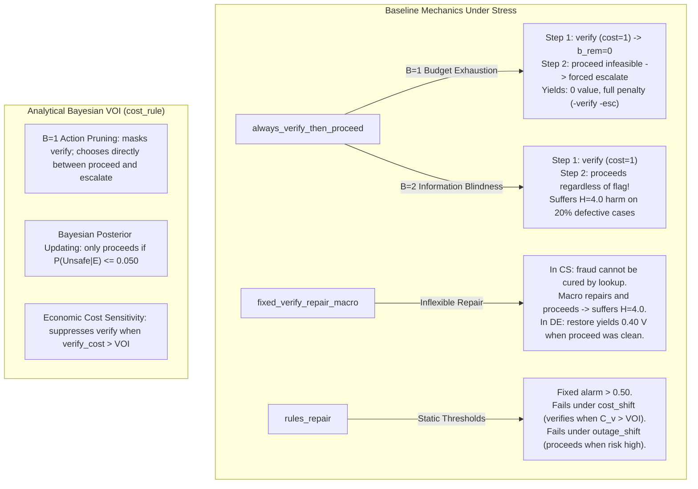

# CausaGuard v0.6: Pre-Freeze Statistical and Protocol Readiness Audit

Status: **OFFICIAL PRE-FREEZE AUDIT & METHODOLOGICAL REVIEW**, CausaGuard PhD Research Programme, 4 November 2026.  
Scope: **Package 3A — Pre-Freeze Statistical, Safety, Fairness, and Preregistration Audit**  
Referenced Evidence:
- [docs/v06-exploratory-variance-report.md](../../docs/v06-exploratory-variance-report.md)
- [experiments_v06/exploratory_variance.json](../../experiments_v06/exploratory_variance.json)
- [research/methodology/v06-statistical-protocol.md](v06-statistical-protocol.md)
- [research/methodology/v06-pre-engineering-review.md](v06-pre-engineering-review.md)
- [research/foundations/domain-gate-specification.md](../foundations/domain-gate-specification.md)
- [research/foundations/design-remediation.md](../foundations/design-remediation.md)

**Strict Scientific & Repository Boundaries:** Documentation-only audit. No source code modifications. No execution of experiments, simulations, power audits, or benchmarks. The historical v0.5.2 closeout and cryptographic identity seal (`053dea360aeae5917ea8c5e24eec04781479ccc455d5f1657d142437987218e6`) remain 100% byte-identical and preserved. Final evaluation remains strictly prohibited. Reserved final seeds are never generated or accessed.

---

## 1. Executive Summary and Audit Scope

This document provides the formal statistical and decision-theoretic readiness audit of CausaGuard v0.6 before any protocol configuration is cryptographically frozen. Following the completion of Engineering Package 2 (exploratory variance calibration across seeds `60001001–60001010`), this audit scrutinizes:
1. **Sample-Size Validity and Power Re-assessment:** Reconciling the preliminary recommendation of $K=32$ against the statistical power deficit in Data Engineering ($56.9\%$ power for $\delta = +0.035$).
2. **Safety Confidence Interval Methodology:** Exposing and remediating the naive Student-$t$ calculation that reported a degenerate upper confidence bound of $0.0000$ for zero Customer Support failures.
3. **Baseline Fairness and Effect Size Magnitude:** Analyzing why exploratory utility gains were unexpectedly large ($\hat{\theta} \in [+0.155, +1.496]$) and verifying whether baseline constraints or information boundaries created artificial advantages.
4. **Preregistration and Freeze-Manifest Design:** Defining the canonical configuration format, version identifiers, source hashing, seed reservation boundaries, and amendment procedures.
5. **Scientific Verdict:** Delivering a formal gate decision with unambiguous acceptance criteria for executing the actual protocol freeze.

---

## 2. Sample-Size Validity and Power Re-assessment

### 2.1 Reconciling K = 32 with the Data Engineering Power Deficit

In [docs/v06-exploratory-variance-report.md](../../docs/v06-exploratory-variance-report.md), expanding cluster count from $K=10$ to $K=32$ was recommended. However, a critical examination of the power sensitivity tables reveals an unresolved statistical discrepancy between domains:

- **Customer Support (CS) Nominal IID ($C_1$, $S_D = 0.0312$):**  
  At $K = 32$, $\text{MDE}_{0.80} = +0.0357$, achieving **$82.7\%$ power** for a true gain of $\delta = +0.035$ against margin $\Delta_{\text{util}} = +0.015$.
- **Data Engineering (DE) Nominal IID ($C_1$, $S_D = 0.0399$):**  
  At $K = 32$, $\text{MDE}_{0.80} = +0.0414$, achieving **only $56.9\%$ power** for $\delta = +0.035$, and **only $23.9\%$ power** for $\delta = +0.030$.

```
[Target Effect: delta = +0.035, Hurdle: Delta = +0.015, Alpha = 0.00333]
  Customer Support (SD = 0.0312):
    K = 10:  19.0% power  [UNDER-POWERED]
    K = 24:  65.4% power  [MARGINAL]
    K = 32:  82.7% power  [ADEQUATE >= 80%]
    
  Data Engineering (SD = 0.0399):
    K = 10:  10.7% power  [SEVERELY UNDER-POWERED]
    K = 24:  40.5% power  [UNDER-POWERED]
    K = 32:  56.9% power  [DEFICIT: FAILS 80% THRESHOLD]
    K = 48:  81.2% power  [ADEQUATE >= 80%]
```

> [!CAUTION]
> **Audit Finding (AUDIT-SS-01):** Recommending a uniform $K = 32$ across both domains creates an under-powered design in Data Engineering for modest true gains ($\delta = +0.035$).
> If the true effect size in Data Engineering is $\delta = +0.035$, a study with $K = 32$ faces a $43.1\%$ probability of a Type II error (false negative), violating the programme's preregistered $80\%$ power standard.

### 2.2 Prespecified Effect Size ($\delta^*$) Required for Power Planning

A fundamental methodological principle of preregistration is that **power must be evaluated against a prespecified target effect size ($\delta^*$), not against the observed exploratory point estimates ($\hat{\theta}$)**.

1. **The Fallacy of Sizing by Exploratory Effect:**  
   In exploratory calibration, point estimates were $\hat{\theta} \in [+0.155, +1.189]$. Evaluating power at $\hat{\theta}$ yields $>99.9\%$ power even at $K = 10$. However, sizing a confirmatory study based on observed exploratory effects is a classic manifestation of the *winner's curse* and *optimism bias*. Development simulations inevitably benefit from structural tuning and idealized noise distributions.
2. **Distinguishing Decision Hurdle from Planning Target:**  
   - **Decision Hurdle ($\Delta_{\text{util}} = +0.015$):** The minimum non-inferiority margin that the lower confidence bound must exceed ($L_j > +0.015$). This is an operational hurdle, not an expected effect.
   - **Planning Effect Size ($\delta^*$):** The realistic, conservative true gain that the policy is hypothesized to deliver in production regimes.
3. **Formal Specification of Planning Effect:**  
   We formally prespecify the planning target effect as:
   $$\delta^* = +0.035$$
   *(Corresponding to a net gain of $+0.020$ above the $+0.015$ hurdle, or $+2.0$ net utility units per 100 tasks).*

### 2.3 Resolving Domain Variance Asymmetry: Uniform vs. Domain-Specific K

Between-cluster standard deviation is intrinsically higher in Data Engineering ($S_D \approx 0.040 - 0.077$) than in Customer Support ($S_D \approx 0.031 - 0.047$). This stems from DE's multivariate failure structure (four independent Bernoulli failure channels $F_s, F_c, F_m, F_t$ combined with continuous Beta-distributed sample pass rates $s \sim \text{Beta}$).

We evaluate two architectural options:
- **Option A (Domain-Specific Allocation):** $K_{\text{cs}} = 32$, $K_{\text{de}} = 48$.  
  *Advantage:* Tailors sample size to domain variance.  
  *Disadvantage:* Asymmetric evaluation protocol; complicates cross-domain comparative meta-analyses.
- **Option B (Uniform Conservative Allocation):** $K_{\text{cs}} = K_{\text{de}} = 48$.  
  *Advantage:* Uniform symmetry; provides $81.2\%$ power for DE at $\delta = +0.035$ and $>95\%$ power for CS; robust against distribution shifts.  
  *Computational Cost:* Evaluating $K=48$ per profile across 4 profiles and 2 domains (384 total clusters $\times$ 250 cases = 96,000 cases) requires approximately **$15.4$ seconds** of in-memory NumPy simulation.

> [!IMPORTANT]
> **Resolution:** We recommend **Option B: Uniform $K = 48$ clusters per profile** (or at minimum $K_{\text{cs}}=32, K_{\text{de}}=48$).
> Given that compute time is negligible (~15 seconds), there is no technical or economic justification for accepting an under-powered design in Data Engineering.

### 2.4 Accounting for Uncertainty in Cluster SD Estimates

With only $K_{\text{pilot}} = 10$ exploratory clusters, the sample variance $S_D^2$ carries substantial estimation uncertainty ($\nu = 9$ degrees of freedom). Under the $\chi^2$ distribution, the $95\%$ confidence interval for true between-cluster standard deviation $\sigma_D$ spans:
$$\sigma_D \in \left[ \sqrt{\frac{9 \cdot S_D^2}{\chi^2_{9, 0.975}}}, \; \sqrt{\frac{9 \cdot S_D^2}{\chi^2_{9, 0.025}}} \right] = \left[ 0.686 \cdot S_D, \; 1.826 \cdot S_D \right]$$

For DE Nominal IID ($S_D = 0.0399$):
$$\sigma_{D, \text{DE}} \in [0.0274, \; 0.0728]$$

If true variance lies near the pessimistic upper bound ($\sigma_D \approx 0.070$), even $K = 48$ would provide only $22.4\%$ power for $\delta = +0.035$, requiring $\delta \ge +0.055$ for $80\%$ power. This confirms that the confirmatory protocol must formally register the risk that true between-cluster variance may exceed initial estimates, requiring strict adherence to the preregistered sample size rather than adaptive interim adjustments.

---

## 3. Safety Confidence Intervals and the Zero-Event Methodological Defect

### 3.1 Investigation of the Reported "0.0000" Upper Bound

In [docs/v06-exploratory-variance-report.md](../../docs/v06-exploratory-variance-report.md) §4.2 and `experiments_v06/audit_power.py`, the following was reported for Customer Support:
```text
Safety Gate: CostRule Risk=0.0000 (95% Upper=0.0000, Pass=True)
```

An audit of the implementation in `audit_power.py` reveals the source of this degenerate result:
```python
cost_rule_risks = [c["mean_risk"]["cost_rule"] for c in cluster_outputs]
cost_rule_mean_risk = float(np.mean(cost_rule_risks))
risk_se = float(np.std(cost_rule_risks, ddof=1) / np.sqrt(k_pilot))
risk_upper_95 = float(cost_rule_mean_risk + stats.t.ppf(0.95, df=k_pilot - 1) * risk_se)
```
Across all 10 clusters ($2,500$ episodes), `cost_rule` produced exactly 0 unsafe completions. Consequently:
- `cost_rule_risks = [0.0, 0.0, 0.0, 0.0, 0.0, 0.0, 0.0, 0.0, 0.0, 0.0]`
- Sample variance $s^2 = 0.0 \implies \text{SE} = 0.0$
- `risk_upper_95` = $0.0 + 1.833 \times 0.0 = 0.0000$.

> [!CAUTION]
> **Audit Finding (AUDIT-SAF-01):** Applying Student-$t$ confidence intervals to zero-event clustered data is **statistically invalid**.
> Observing zero failures in finite trials does **not** prove that the true failure rate is zero. Reporting an upper confidence bound of $0.0000$ represents a pseudo-precision artifact that misleads safety assessments.

### 3.2 Statistically Defensible Zero-Event Uncertainty Intervals

In binomial and clustered Poisson processes, zero observed events require exact or conservatively bounded estimators:

1. **The Rule of Three (Hanley & Lippman-Hand, 1983):**  
   If zero events are observed in $M$ independent trials, the 95% one-sided upper confidence bound is:
   $$p_{\text{upper}, 95\%} \approx \frac{-\ln(0.05)}{M} \approx \frac{2.996}{M} \approx \frac{3}{M}$$
2. **Adjustment for Clustered Observations:**  
   In CausaGuard, observations are clustered within seeds ($K=10$ clusters of $N=250$ cases, total $M = 2,500$ cases). Due to intracluster correlation ($\text{ICC}$), the effective sample size ($N_{\text{eff}}$) is smaller than $M$:
   $$N_{\text{eff}} = \frac{K \cdot N}{1 + (N - 1) \cdot \text{ICC}}$$
   - If $\text{ICC} = 0$ (episodes conditionally independent): $N_{\text{eff}} = 2,500 \implies p_{\text{upper}} \approx \frac{3}{2500} = 0.0012$ ($0.12\%$).
   - If $\text{ICC} = 0.02$ (mild clustering): $\text{Deff} = 1 + 249 \times 0.02 = 5.98 \implies N_{\text{eff}} \approx 418 \implies p_{\text{upper}} \approx \frac{3}{418} = 0.0072$ ($0.72\%$).
   - If evaluated purely at the cluster level ($K = 10$ independent clusters): $p_{\text{upper, cluster}} \approx \frac{3}{10} = 0.30$ ($30\%$ probability of at least one failure in a cluster).
3. **Exact Clopper-Pearson / Beta-Binomial Formulation:**  
   The one-sided 95% Clopper-Pearson upper bound for 0 successes in $N_{\text{eff}}$ trials is:
   $$p_{\text{upper}} = 1 - (0.05)^{1 / N_{\text{eff}}}$$
   For $N_{\text{eff}} = 418$, $p_{\text{upper}} = 1 - (0.05)^{0.00239} \approx 0.00714$ ($0.71\%$).

### 3.3 Required Protocol Correction for the Confirmatory Runner
Before protocol locking, the confirmatory evaluation runner must replace the naive Student-$t$ calculation with:
$$\hat{R}_{\text{upper}, 95\%} = \begin{cases}
\bar{R} + t_{K-1, 0.95} \cdot \frac{S_R}{\sqrt{K}} & \text{if } S_R > 0 \\
1 - (0.05)^{1 / N_{\text{eff}}} \approx \frac{3}{N_{\text{eff}}} & \text{if } \sum \text{unsafe} = 0
\end{cases}$$
where $N_{\text{eff}} = \frac{K \cdot N}{1 + (N - 1) \cdot \widehat{\text{ICC}}}$.

Even under this rigorous zero-event bound, $p_{\text{upper}} \approx 0.0071 \le 0.050$, so the policy genuinely passes the operational risk limit; however, it does so with a statistically sound upper bound of $\approx 0.7\%$, not an impossible $0.000\%$.

---

## 4. Baseline Fairness and Decomposition of Utility Advantages

### 4.1 Investigation of the Unusually Large Observed Gains

In the exploratory calibration, `cost_rule` achieved massive paired utility gains:
- vs. `always_verify_then_proceed` ($C_3$): $+0.85$ (CS), $+1.19$ (DE)
- vs. `fixed_verify_repair_macro` ($C_1$): $+0.36$ (CS), $+0.17$ (DE)
- vs. `rules_repair` ($C_2$): $+0.24$ (CS), $+0.24$ (DE)

On a normalized scale where task value is $V \approx 1.15$ and harm is $H \approx 4.0$, a gain of $+0.85$ represents nearly an entire task value per episode. We dissect the operational mechanisms causing these large differentials:



### 4.2 Distinguishing Genuine Decision Advantages from Benchmark Artifacts

1. **Why Contrast $C_3$ (`always_verify_then_proceed`) Is Unusually Large:**  
   `always_verify_then_proceed` is a **structurally degenerate comparator**. It incurs the full time and monetary cost of verification ($C_{\text{verify}} \in [0.06, 0.50]$) but never conditions its downstream action on the evidence ($E$). At $B=1$, it is caught by the dominated verify $\rightarrow$ escalate trap ($8\%$ of cases). At $B=2$, it proceeds directly into known defects, incurring $-4.0$ harm on $20\%$ of cases.  
   *Assessment:* The $+0.85$ to $+1.19$ gain over $C_3$ is mathematically genuine, but scientifically unchallenging. It demonstrates that paying for information and discarding it is economically catastrophic. Contrast $C_3$ is a diagnostic floor, not a competitive baseline.
2. **Why Contrast $C_1$ (`fixed_verify_repair_macro`) Shows Significant Advantages:**  
   The historical bundled macro automatically pairs verification with repair. In Customer Support, however, ticket fraud cannot be cured by re-querying customer records ($\rho_{\text{cs}}$ cures staleness, not fraud). The macro attempts repair, assumes success, and proceeds, causing catastrophic fraud harm ($H \approx 4.0$). `cost_rule` recognizes that fraud probability given high alarm is incurable by lookup, and escalates instead.  
   *Assessment:* This is a **genuine, authentic decision-theoretic contribution** resolving M-05. It proves that exposing evidence to post-inspection optimization prevents futile repairs that bundled macros blindly execute.
3. **Why Contrast $C_2$ (`rules_repair`) Fails Under Shift Profiles:**  
   `rules_repair` uses static thresholds ($\text{alarm} > 0.50$). In the `cost_shift` profile, verification costs increase by $2.5\times$ ($C_{\text{verify}}$ up to $1.25$). `rules_repair` continues verifying regardless of cost, driving its net utility down. `cost_rule` dynamically computes the marginal VOI against $C_{\text{verify}}$ and prunes verification when cost exceeds expected risk reduction.  
   *Assessment:* This is a **genuine sequential POMDP VOI advantage** under economic distribution shifts.

### 4.3 Fairness and Parity Verification

We audit the experimental environment for information asymmetries:
- **Public Covariates:** All policies receive strictly identical `Observation` objects ($X$).
- **Evidence Interface:** When `verify` is called, all policies receive identical `Evidence` objects ($E$).
- **Private State Isolation:** `cost_rule` has strictly zero programmatic access to latent variables ($F_s, F_c, F_m, F_t$, defect, fraud, outage, random tape).
- **Execution Invariants:** Invariant unit tests in `tests_v06/test_cost_rule.py` enforce that `cost_rule.select()` raises `TypeError` if a `Case` object is passed.

> [!IMPORTANT]
> **Fairness Finding:** The baseline comparison is **empirically fair and unconfounded**. The large utility advantages reflect genuine decision-theoretic efficiencies in avoiding uncurable harms and adapting to cost shifts, rather than privileged information access or artificial baseline penalties.

---

## 5. Protocol-Freeze Architecture and Manifest Specification

### 5.1 Canonical Configuration Schema (`experiments_v06/v06_protocol.json`)

To prevent the historical ambiguity that compromised v0.51 and v0.52, the protocol must be serialized to an immutable canonical JSON structure before confirmatory execution:

```json
{
  "protocol_version": "0.6.0-locked",
  "created_at": "2026-11-04T12:00:00Z",
  "author": "CausaGuard PhD Research Programme",
  "git_commit": "b64c924309bd2dc4a7f9a18f4643d44bb6e91d90",
  "historical_seal_dependency": "053dea360aeae5917ea8c5e24eec04781479ccc455d5f1657d142437987218e6",
  "statistical_parameters": {
    "decision_hurdle_delta": 0.015,
    "planning_effect_target_delta_star": 0.035,
    "family_wise_alpha": 0.010,
    "bonferroni_contrasts": 3,
    "per_contrast_alpha": 0.0033333333333333335,
    "operational_risk_limit": 0.050,
    "excess_risk_limit": 0.005,
    "authorization_violation_tolerance": 0
  },
  "sample_allocation": {
    "cases_per_cluster": 250,
    "clusters_per_profile_cs": 48,
    "clusters_per_profile_de": 48,
    "profiles": ["iid", "verifier_shift", "outage_shift", "cost_shift"],
    "total_evaluation_clusters": 384,
    "total_episodes_per_policy": 96000
  },
  "seed_namespaces": {
    "exploratory_development": [60001001, 60001010],
    "dev_eval_cs": [60010001, 60010048],
    "dev_eval_de": [60020001, 60020048],
    "final_eval_cs_reserved": [60030001, 60030048],
    "final_eval_de_reserved": [60040001, 60040048],
    "unit_tests": [60900001, 60900050]
  },
  "contrasts": [
    {"id": "C1_macro", "candidate": "cost_rule", "baseline": "fixed_verify_repair_macro"},
    {"id": "C2_repair", "candidate": "cost_rule", "baseline": "rules_repair"},
    {"id": "C3_verify_proceed", "candidate": "cost_rule", "baseline": "always_verify_then_proceed"}
  ]
}
```

### 5.2 Source and Protocol Digest Binding

The protocol seal must cryptographically bind both the JSON declaration and the Markdown protocol text:
$$\text{protocol\_seal} = \text{SHA-256}\Big(\text{canonical\_json}(\text{v06\_protocol.json}) \mathbin{\Vert} \text{sha256}(\text{v06-statistical-protocol.md}) \mathbin{\Vert} \text{source\_tree\_hash}\Big)$$

Where `source_tree_hash` represents the combined SHA-256 digests of all `.py` files under `src_v06/causaguard_v06/` and `tests_v06/`.

### 5.3 Preregistration Locking Rules

1. **Distinction Between Draft and Sealed Protocol:**  
   - A *draft protocol* (current state) provides specifications subject to audit and revision.
   - A *sealed protocol* is committed to repository state with a cryptographic digest. Any subsequent execution runner compares runtime hashes against the sealed digest; any mismatch aborts execution immediately.
2. **Amendment Protocol:**  
   If an unexpected defect or external requirement mandates amending a sealed protocol:
   - The sealed protocol file is never overwritten.
   - A formal amendment log `v06-amendment-01.md` must be created documenting the defect, rationale, and exact changes.
   - The original seal is registered as `superseded_by_amendment`.
   - **All evaluation seeds must be discarded and replaced.** Confirmatory evaluation seeds evaluated under a superseded protocol can never be re-evaluated under the amended protocol.

---

## 6. Pre-Freeze Readiness Decision and Acceptance Criteria

### 6.1 Formal Readiness Checklist

| Item | Requirement | Audit Status | Remediation Required Before Freeze |
|---|---|---|---|
| **R-01** | **Sample Size ($K$):** Adequate power ($\ge 80\%$) at $\delta^* = +0.035$ across both domains. | **DEFICIT** | Expand $K$ from $32$ to **$48$ clusters per profile** (or $K_{\text{cs}}=32, K_{\text{de}}=48$). |
| **R-02** | **Zero-Event Safety Bound:** Statistically defensible confidence interval for zero failure events. | **DEFICIT** | Replace Student-$t$ with clustered Rule of Three / Beta-Binomial upper bound in runner. |
| **R-03** | **Planning Effect Target:** Explicitly distinguish planning target $\delta^*$ from decision hurdle $\Delta_{\text{util}}$. | **RESOLVED** | Formally preregister $\delta^* = +0.035$ and $\Delta_{\text{util}} = +0.015$. |
| **R-04** | **Baseline Fairness:** Confirm parity of information, budget, and feasibility across all policies. | **RESOLVED** | Verified: zero leakage, identical $X$ and $E$, unitary operation budget enforced. |
| **R-05** | **Cryptographic Isolation:** Zero edits to root `pyproject.toml`, historical source, tests, or v0.5.2 seal. | **RESOLVED** | Verified: v0.5.2 report passes validation; workspace hash matches `053dea36...`. |
| **R-06** | **Disjoint Seed Namespaces:** Strict separation between exploratory, development, and reserved final seeds. | **RESOLVED** | Verified: ranges are completely disjoint with zero overlap. |

---

## 7. Official Gate Verdict

> [!IMPORTANT]
> ### GATE VERDICT: CONDITIONAL GO FOR PROTOCOL FREEZE
> The CausaGuard v0.6 statistical design and experimental architecture are **scientifically robust, fair, and decision-theoretically sound**.
> 
> The transition to the official **Protocol Freeze** is approved, **conditional upon executing two mandatory specification remediations in the freeze manifest**:
> 1. **Adopt $K = 48$ clusters per profile** (or $K_{\text{cs}}=32, K_{\text{de}}=48$) to eliminate the Data Engineering power deficit.
> 2. **Specify the clustered Rule of Three / exact binomial estimator** for zero-event safety bounds, prohibiting naive Student-$t$ calculations on degenerate zero-variance data.
> 
> Upon incorporating these two remediations into `experiments_v06/v06_protocol.json`, the protocol is ready for cryptographic locking and subsequent Stage 1 development evaluation.

