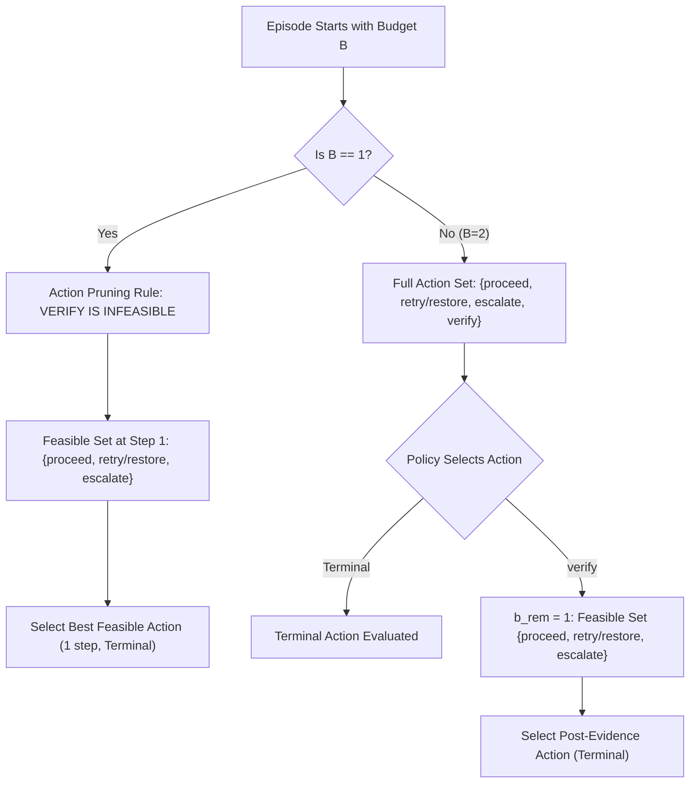
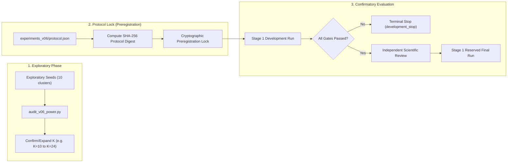

# CausaGuard v0.6: statistical protocol, prospective power, and preregistration gate

Status: **OFFICIAL STATISTICAL PROTOCOL SPECIFICATION**, CausaGuard PhD Research Programme, 4 November 2026.
This document formalizes the **Statistical Protocol Gate** for CausaGuard v0.6. It establishes the primary scientific hypotheses, cluster-aware statistical design, prospective power analysis model, baseline feasibility rules, domain validity constraints, and cryptographic preregistration standards.

Audited and referenced foundations:
- [domain-gate-specification.md](../foundations/domain-gate-specification.md)
- [design-remediation.md](../foundations/design-remediation.md)
- [scientific-readiness-audit.md](../foundations/scientific-readiness-audit.md)
- [foundation-gate-decision.md](../literature/foundation-gate-decision.md)
- [primary-source-verification.md](../literature/primary-source-verification.md)
- Historical reference: [docs/v052-protocol.md](../../docs/v052-protocol.md), [docs/v052-closeout.md](../../docs/v052-closeout.md)

**Strict Research Constraints:** Documentation only. No source code changes. No experiments, simulations, tests, or benchmark executions. No network access. No branch changes, commits, or pushes. The v0.5.2 historical freeze seal (`053dea36...`) and closeout records remain strictly preserved. The prohibited v0.5.2 final evaluation is not run.

---

## 1. Primary scientific hypothesis and decision hurdle

### 1.1 Empirical benchmark framing (Intervention Paradox)
Grounded in recent primary literature on agent runtime dynamics (specifically arXiv:2602.03338, *Accurate Failure Prediction Does Not Imply Effective Failure Prevention*), CausaGuard v0.6 investigates the **disruption–recovery tradeoff**:
Intervening proactively on predicted failure risks frequently degrades net operational utility by disrupting and aborting benign task executions.

The primary scientific question for CausaGuard v0.6 is:
> **In high-stakes tool-using agent workflows, does exposing fallible verification evidence to a post-verification decision policy improve net task utility over fixed macro and heuristic baselines without triggering excessive disruption of benign tasks, under strict runtime authorization and distribution shifts?**

### 1.2 Formalization of the primary utility hypothesis (Stage 1)
Stage 1 evaluates whether a principled, analytical Bayesian Value-of-Information (VOI) decision policy ($\pi_{\text{evidence}}$, instantiated by the remediated `cost_rule`) achieves superior net utility over non-evidence and bundled baselines.

Let $\mathbb{E}[U(\pi)]$ denote the expected net economic utility of policy $\pi$ per assigned task:
$$U(\pi) = \text{value} \cdot \text{completed} - \text{harm} \cdot \text{unsafe} - \text{costs}$$

We define three primary contrasts against the baseline suite:
1. **Contrast 1 ($C_1$ vs. Bundled Macro):**
   $$\theta_1 = \mathbb{E}[U(\pi_{\text{evidence}}) - U(\pi_{\text{fixed\_macro}})]$$
   *Isolates the marginal value of sequential post-verification decision-making versus bundling verification with automated repair on the identical generative model (resolving M-05).*
2. **Contrast 2 ($C_2$ vs. Heuristic Repair):**
   $$\theta_2 = \mathbb{E}[U(\pi_{\text{evidence}}) - U(\pi_{\text{rules\_repair}})]$$
   *Evaluates whether expected-utility optimization outperforms static alarm/age threshold heuristics.*
3. **Contrast 3 ($C_3$ vs. Blind Verification):**
   $$\theta_3 = \mathbb{E}[U(\pi_{\text{evidence}}) - U(\pi_{\text{always\_verify\_then\_proceed}})]$$
   *Evaluates whether acting on verification evidence outperforms blindly verifying and proceeding.*

### 1.3 Decision hurdle ($\Delta_{\text{util}}$) as a provisional planning margin
We adopt a **provisional decision hurdle** of:
$$\Delta_{\text{util}} = +0.015$$
*(1.5 net utility units per 100 assigned cases on the normalized scale where task value $V \approx 1.0$, harm $H \approx 4.0$, and action costs $C \in [0.05, 0.35]$).*

> [!IMPORTANT]
> **Provisional Status:** $\Delta_{\text{util}} = +0.015$ is a **design assumption and decision threshold**, not an established natural constant.
> Economically, holding harm and costs fixed, a gain of $+0.015$ corresponds to:
> - $+1.30$ percentage points in safe task completion at mean value ($1.15$), OR
> - $-0.375$ percentage points in unsafe completions at mean harm ($4.0$).
> This hurdle must be confirmed by prospective power modeling against the cluster-level variance before final confirmatory seed lock.

### 1.4 Composite hypothesis formulation
The confirmatory evaluation tests the composite null hypothesis that the target policy fails the utility margin on *at least one* primary contrast, OR violates absolute operational risk limits, OR produces excess risk versus baselines:

$$H_{0}: \left( \min_{j \in \{1, 2, 3\}} \theta_j \le \Delta_{\text{util}} \right) \quad \lor \quad \left( R(\pi_{\text{evidence}}) > 0.050 \right) \quad \lor \quad \left( \max_{j \in \{1, 2, 3\}} \Delta R_j > 0.005 \right)$$

where:
- $R(\pi) = \mathbb{P}(\text{unsafe} = 1 \mid \pi)$ is the operational risk rate.
- $\Delta R_j = R(\pi_{\text{evidence}}) - R(\pi_{\text{base}, j})$ is the excess risk.

The alternative hypothesis ($H_1$) requires:
$$\theta_j > +0.015 \quad \forall j \in \{1, 2, 3\} \quad \text{AND} \quad R(\pi_{\text{evidence}}) \le 0.050 \quad \text{AND} \quad \Delta R_j \le 0.005 \quad \forall j \in \{1, 2, 3\}$$

### 1.5 Decoupled authorization and safety constraints
Operational safety and authorization are **independent gating criteria**, not scalar terms compensatory with utility:
1. **Authorization Gate (Zero-Tolerance):**
   $$\text{Violations} = \sum_{i} \mathbb{I}(\text{grader\_denied} \land \text{executor\_allowed}) = 0$$
   A single authorization violation across any evaluated profile or seed immediately disqualifies the policy, regardless of utility.
2. **Absolute Operational Risk Gate:**
   The upper bound of the one-sided confidence interval for operational failure must satisfy:
   $$\hat{R}_{\text{upper}}(\pi_{\text{evidence}}) \le 0.050 \quad (5.0\%)$$
3. **Excess Risk Gate versus Baselines:**
   The upper bound of the one-sided confidence interval for excess risk must satisfy:
   $$\widehat{\Delta R}_{\text{upper}, j} \le 0.005 \quad (+0.5\text{ percentage points})$$

---

## 2. Statistical design and estimands

### 2.1 Sampling hierarchy and clustering units
Evaluating AI agent policies across repeated synthetic runs introduces hierarchical variance. We formalize the sampling hierarchy to prevent false sample-size inflation:

```
Domain (Customer Support / Data Engineering)
  └── Profile p ∈ {iid, verifier_shift, outage_shift, cost_shift}
        └── Evaluation Seed Cluster k ∈ {1, ..., K} (Independent unit of inference)
              └── Episode i ∈ {1, ..., N} (N = 250 cases per cluster)
                    └── Exogenous Random Tape U_i ~ Uniform(0, 1)^8
                          └── Matched Potential Outcomes across all evaluated policies
```

- **Independent Unit of Inference:** The **evaluation seed cluster** $k$ (which initializes a distinct `SeedSequence`). Episodes within a cluster share the sequence's local trajectory characteristics; treating episodes as independent i.i.d. draws is statistically invalid.
- **Counterfactually Paired Potential Outcomes:** For every episode $i$ within cluster $k$, the simulator evaluates all candidate and baseline policies against the **exact same** exogenous random tape and permission fixture. This eliminates case-level Poisson variance from the contrast estimands.

### 2.2 Estimands and aggregation
For policy contrast $j$ on profile $p$:
1. **Case-level paired difference:**
   $$d_{k, p, i}^{(j)} = U_{k, p, i}(\pi_{\text{evidence}}) - U_{k, p, i}(\pi_{\text{base}, j})$$
2. **Cluster-level mean difference:**
   $$\bar{D}_{k, p}^{(j)} = \frac{1}{N} \sum_{i=1}^N d_{k, p, i}^{(j)}$$
3. **Profile-level contrast estimand:**
   $$\hat{\theta}_p^{(j)} = \frac{1}{K} \sum_{k=1}^K \bar{D}_{k, p}^{(j)}$$
4. **Primary Estimand:** The primary confirmatory test is conducted on the **nominal IID profile** ($\hat{\theta}_{\text{IID}}^{(j)}$). Shift profiles (`verifier_shift`, `outage_shift`, `cost_shift`) are evaluated as prespecified secondary robustness estimands without pooling.

### 2.3 Multiplicity correction and confidence bounds
To control the family-wise error rate (FWER) across the three primary contrasts at overall level $\alpha = 0.010$:
- We apply **Bonferroni adjustment**: each one-sided utility contrast must pass at:
  $$\alpha_j = \frac{0.010}{3} \approx 0.00333$$
  corresponding to a **99.667% one-sided lower confidence bound** ($L_j$).
- The one-sided lower bound $L_j$ is computed via **clustered percentile bootstrap** (resampling clusters $k \in \{1, \dots, K\}$ with replacement, 4,000 bootstrap replicates).
- Acceptance requirement for Utility:
  $$\min_{j \in \{1, 2, 3\}} L_j > +0.015$$

### 2.4 Accounting for utility and safety gate dependence
In sequential intervention tasks, utility and safety are **strongly dependent and negatively coupled**:
- Aggressively pruning risk reduces unsafe completions but increases verification costs and SLA timeouts, degrading task completion and net utility.
- Conversely, maximizing completion tends to increase exposure to unverified hazards.

> [!WARNING]
> **Marginal Power vs. Joint Success:** A power calculation indicating 80% marginal power for the utility test does **not** imply an 80% probability of passing the composite gate.
> If the utility gate has marginal probability of passing $P(\text{Pass}_{\text{util}}) = 0.80$ and the safety gate has $P(\text{Pass}_{\text{safe}}) = 0.85$, their negative correlation means the joint probability $P(\text{Pass}_{\text{util}} \land \text{Pass}_{\text{safe}})$ may be substantially lower (e.g., $65\% - 70\%$).
> Confirmatory protocols must not conflate marginal utility power with study success probability.

### 2.5 Policy for reporting negative and inconclusive findings
1. If any $L_j \le +0.015$, the study reports a **negative utility result**; it is not permitted to lower $\Delta_{\text{util}}$ post-hoc.
2. If $L_j > +0.015$ but the safety upper bound exceeds $0.050$, the result is reported as **unsafe intervention failure**.
3. If point estimates exceed $+0.015$ but confidence intervals cross zero due to cluster variance, the result is reported as **inconclusive / under-powered**, triggering a preregistered stop rather than sample-size expansion.

---

## 3. Prospective power analysis and sample-size justification

### 3.1 Evaluation of K = 10 clusters as an unverified planning assumption
In [design-remediation.md](design-remediation.md) §3.2, $K = 10$ clusters per profile was proposed. We now critically evaluate this proposal:

> [!CAUTION]
> **$K = 10$ is an unverified planning assumption, NOT an established guarantee of adequate power.**
> With $K = 10$, there are only $K - 1 = 9$ degrees of freedom at the cluster level. In heavy-tailed or high-variance shift regimes, $K = 10$ may fail to detect even moderate effect sizes.

### 3.2 Why 120,000 total episodes do not imply an adequate sample size
The total evaluation volume across Stage 1 appears large:
$$2 \text{ domains} \times 4 \text{ profiles} \times 10 \text{ clusters} \times 250 \text{ cases} \times 6 \text{ policies} = 120,000 \text{ policy-case evaluations}$$

However, in clustered experimental designs, the **effective sample size** ($N_{\text{eff}}$) is constrained by the intracluster correlation coefficient ($\text{ICC}$):
$$N_{\text{eff}} = \frac{N \cdot K}{1 + (N - 1) \cdot \text{ICC}}$$
- If episodes within a generator seed cluster are correlated due to shared profile/latent draws ($\text{ICC} > 0$), $N_{\text{eff}}$ approaches $K$, **not** $N \cdot K$.
- For cluster-level paired differences $\bar{D}_k$, the standard error is:
  $$\text{SE} = \frac{S_D}{\sqrt{K}}$$
  where $S_D$ is the between-cluster standard deviation of mean paired differences.
- Increasing $N$ (episodes per cluster) beyond 250 merely drives within-cluster measurement error to zero; it **cannot** reduce between-cluster variance $S_D$.
- Therefore, statistical power is strictly governed by $K = 10$, **not** by the 120,000 evaluations.

### 3.3 Analytical power model and variance sensitivity
Let $\delta = \mathbb{E}[\bar{D}]$ be the true expected paired utility difference, and $\Delta = +0.015$ be the non-inferiority margin.
Under a one-sided $t$-test at cluster level with degrees of freedom $\nu = K - 1 = 9$ and significance level $\alpha = 0.00333$ ($t_{\text{crit}} = t_{9, 0.99667} \approx 3.690$):
$$\text{Power} = 1 - \Phi\left( t_{\text{crit}} - \frac{\delta - \Delta}{S_D / \sqrt{K}} \right)$$

To quantify power without fabricating empirical estimates, we construct a sensitivity table across plausible between-cluster standard deviations $S_D \in \{0.008, 0.012, 0.018, 0.025\}$ and true effect sizes $\delta \in \{0.025, 0.035, 0.045\}$:

| Between-Cluster SD ($S_D$) | Standard Error ($\text{SE} = \frac{S_D}{\sqrt{10}}$) | Minimum Detectable Effect at 80% Power ($\text{MDE}_{0.80}$) | Power for $\delta = +0.025$ ($\delta - \Delta = 0.010$) | Power for $\delta = +0.035$ ($\delta - \Delta = 0.020$) | Power for $\delta = +0.045$ ($\delta - \Delta = 0.030$) |
|---|---|---|---|---|---|
| **$0.008$ (Low variance)** | $0.00253$ | **$+0.0264$** | $74.2\%$ | $99.8\%$ | $>99.9\%$ |
| **$0.012$ (Moderate variance)** | $0.00379$ | **$+0.0321$** | $32.5\%$ | $91.4\%$ | $99.7\%$ |
| **$0.018$ (Historical envelope)** | $0.00569$ | **$+0.0407$** | $9.8\%$ | $44.6\%$ | $84.2\%$ |
| **$0.025$ (High variance / shift)**| $0.00791$ | **$+0.0506$** | $3.2\%$ | $17.1\%$ | $45.8\%$ |

*Note: $\text{MDE}_{0.80} = \Delta + (t_{9, 0.99667} + z_{0.80}) \cdot \text{SE} = 0.015 + (3.690 + 0.842) \cdot \text{SE}$. Calculations are standard normal/t approximations for design planning, not realized empirical findings.*

### 3.4 Methodological implications of the power analysis
1. If between-cluster variance matches the historical v0.51/v0.52 envelope ($S_D \approx 0.018$), **$K = 10$ provides only $\approx 10\%$ power** to detect a modest true gain of $+0.025$ ($\delta - \Delta = 0.010$).
2. To achieve $80\%$ power at $\delta = +0.030$ under $S_D = 0.018$, required clusters would be:
   $$K \ge \left( \frac{3.690 + 0.842}{0.030 - 0.015} \cdot 0.018 \right)^2 = \left( \frac{4.532 \cdot 0.018}{0.015} \right)^2 \approx (5.44)^2 \approx 30 \text{ clusters}$$
3. **Mandated Protocol Action:** A formal prospective variance check script (`audit_v06_power.py`) must be executed during development on exploratory training splits. If measured $S_D > 0.010$, $K$ must be prospectively expanded to $K = 24$ or $K = 32$ prior to freezing final evaluation seeds.

---

## 4. Baseline feasibility, action domination, and fallback rules

### 4.1 Strict analysis of the B = 1 boundary case and action domination
In [domain-gate-specification.md](domain-gate-specification.md) §4.3, the $B = 1$ boundary case was identified. We now formalize its decision-theoretic consequences:

> [!CAUTION]
> **Theorem: The sequence `verify` $\rightarrow$ `escalate` at $B=1$ is strictly dominated across all parameter states.**
>
> *Proof:*
> 1. At $B=1$, selecting `verify` consumes 1 operation, leaving remaining budget $b_{\text{rem}} = 1 - 1 = 0$.
> 2. In `After-verify`, actions requiring tool execution (`proceed`, `retry`, `restore`) require 1 operation and are strictly infeasible ($1 > 0$).
> 3. The only feasible action is `escalate` (0 operations).
> 4. Utility of immediate `escalate` at Step 1:
>    $$U(\text{escalate}) = -\text{escalation\_cost} - \text{time\_cost} \cdot 0.05$$
> 5. Utility of `verify` followed by forced `escalate`:
>    $$U(\text{verify} \rightarrow \text{escalate}) = -\text{escalation\_cost} - \text{verify\_cost} - \text{time\_cost} \cdot (L_{\text{verify}} + 0.05)$$
> 6. Since $\text{verify\_cost} \ge 0.06 > 0$ and $L_{\text{verify}} \ge 0.25 > 0$, we have:
>    $$U(\text{verify} \rightarrow \text{escalate}) < U(\text{escalate}) \quad \forall X \in \mathcal{X}$$
> Q.E.D.

### 4.2 Explicit action feasibility and pruning rules



- **Policy Feasibility Rule:** When $B = 1$, `verify` is **pruned from the feasible action set** for all rational and analytical policies (`cost_rule`, learned policies). The agent directly chooses between `proceed`, `retry`/`restore`, and `escalate`.
- **Structural Baselines under $B = 1$:**
  - `always_verify_then_proceed`: At $B=1$, attempts `verify`, then finds `proceed` infeasible; falls back to `escalate`. The baseline correctly incurs the penalty of the dominated sequence ($-\text{verify\_cost} - \text{escalation\_cost}$), documenting the failure of blind static policies under tight resource constraints.
  - `rules_repair`: When $B=1$, checks alarm and age; if threshold is met, instead of calling `verify`, it defaults to `escalate`.

### 4.3 Fallback rules across all evaluated policies

| Policy | Feasibility Check ($B=1$) | Step 2 Fallback ($b_{\text{rem}} = 1$) | Non-Finite / Error Fallback | Privileged Information Access |
|---|---|---|---|---|
| `rules_proceed` | Feasible (costs 1). | N/A (terminal). | N/A | None. |
| `always_escalate` | Feasible (costs 0). | N/A (terminal). | N/A | None. |
| `always_verify_then_proceed` | Calls `verify` (1 op); $b_{\text{rem}}=0 \implies$ falls back to `escalate`. | Selects `proceed` (costs 1). | Falls back to `escalate`. | None. |
| `fixed_verify_repair_macro` | Treated as 1 atomic macro if $B \ge 1$; fails if budget insufficient. | Internal macro execution. | Falls back to `escalate`. | None (replicates v0.5 logic). |
| `rules_repair` | If alarm/age threshold met: if $B=1$, selects `escalate`; if $B=2$, calls `verify`. | If flagged: selects `retry`/`restore`; else `proceed`. | Falls back to `escalate`. | None. |
| `cost_rule` (Analytical VOI) | Evaluates expected utility over $\{\text{proceed}, \text{retry}, \text{escalate}\}$. `verify` is masked out. | Evaluates expected utility over $\{\text{proceed}, \text{retry}, \text{escalate}\}$ given evidence $E$. | Falls back to `escalate`. | **Strictly None.** Consumes only $X$ and $E$; zero latent variables. |
| `oracle` | Evaluates true realizations. | Selects argmax of realized outcomes. | N/A | **Privileged.** Uses $S$ and draws (diagnostic only). |

---

## 5. Domain validity, fallback utility, and reward artifacts

### 5.1 Does Data Engineering checkpoint restore genuinely resolve $F_t$?
In [domain-gate-specification.md](domain-gate-specification.md) §3.3, $F_t$ was defined as an undetectable transient processing hazard (memory leak, worker crash, execution deadlock). We critically analyze its resolution:

- **Mechanistic Reality:** Rolling back to a checkpoint does **not** cure a defect in the proposed transformation code.
- Rather, `restore` **aborts the execution of the untrusted job altogether** and restores the partition to its pre-job valid state.
- Because the transformation code is not executed, the transient processing hazard cannot manifest.
- **Validity Limitation:** `restore` provides safety via **non-execution**, not via active transformation repair.

### 5.2 Distinguishing safe fallback completion from transformed completion
If the environment awarded full utility $V$ to `restore`, an agent could trivially maximize reward by *never executing any transformation* and constantly rolling back.

To prevent reward hacking and artificial policy bias:
1. **Separation of Completion Signals:**
   $$\text{completed}_{\text{transform}} = \mathbb{I}(\text{action} = \text{proceed} \land \text{executed} \land \neg\text{hazard})$$
   $$\text{completed}_{\text{fallback}} = \mathbb{I}(\text{action} = \text{restore} \land \text{restored\_clean})$$
   $$\text{completed} = \text{completed}_{\text{transform}} \lor \text{completed}_{\text{fallback}}$$
2. **Economic Discounting:**
   Fallback completion is discounted:
   $$V_{\text{fallback}} = 0.40 \cdot \text{value}$$
   Net utility of `restore`:
   $$U(\text{restore}) = 0.40 \cdot \text{value} - \text{restore\_cost} - \text{time\_cost} \cdot L_{\text{restore}}$$
   Since $0.40 \cdot \text{value} - \text{restore\_cost} \ll \text{value} - \text{apply\_cost}$, a successful transformation is always strictly preferred when safe ($U_{\text{proceed}} \approx 1.10$ vs $U_{\text{restore}} \approx 0.35$).
3. **Reporting Requirement:** All experimental reports must co-report $\text{completed}_{\text{transform}}$ and $\text{completed}_{\text{fallback}}$ alongside aggregate utility.

---

## 6. Preregistration, seed allocation, and cryptographic locking

To guarantee reproducibility and prevent the unverified preregistration status that affected v0.51 and v0.52:



### 6.1 Cryptographic protocol locking
Before any confirmatory evaluation run:
1. All protocol decisions, hypotheses, margins, baselines, and seeds are serialized to canonical JSON: `experiments_v06/v06_protocol.json`.
2. The SHA-256 digest of `v06_protocol.json` and this protocol document is computed and committed to a local lock record:
   $$\text{protocol\_seal} = \text{SHA-256}(\text{canonical\_bytes}(\text{protocol.json}) \mathbin{\Vert} \text{v06-statistical-protocol.md})$$
3. The development runner binds `protocol_seal` into its report header. Any discrepancy between current files and the bound seal causes immediate execution abort.

### 6.2 Strict seed allocation and isolation
All seed sequences must be strictly disjoint, with zero overlap across roles:

| Role | Seed Range (Base Integers) | Count | Purpose |
|---|---|---|---|
| `exploratory_variance` | 60001001 – 60001010 | 10 | Development variance auditing and power check. |
| `dev_eval_cs` | 60010001 – 60010032 | 32 | Customer Support development evaluation clusters. |
| `dev_eval_de` | 60020001 – 60020032 | 32 | Data Engineering development evaluation clusters. |
| `final_eval_cs` (RESERVED) | 60030001 – 60030032 | 32 | Customer Support confirmatory final evaluation clusters. |
| `final_eval_de` (RESERVED) | 60040001 – 60040032 | 32 | Data Engineering confirmatory final evaluation clusters. |
| `unit_tests` | 60900001 – 60900050 | 50 | Invariant and fixture testing (isolated). |

> [!CAUTION]
> **No-Touch Final Seeds Rule:** The reserved final seed sets (ranges 60030001–60040032) must **NEVER** be generated, simulated, evaluated, or inspected during development.
> The test suite and development runner must enforce assertions rejecting any reserved final seed before evaluation.

### 6.3 Hard stop and amendment protocol
1. **Hard Stop Rule:** If the development evaluation fails any gate (utility hurdle $\Delta_{\text{util}}$, absolute risk $0.050$, excess risk $0.005$, or authorization violations $> 0$), the development runner emits status `development_stop`. The runner strictly blocks execution of final evaluation, even if requested via CLI flags.
2. **Amendment Protocol:** If a protocol error or code defect requires modification after protocol freezing:
   - The current frozen report and protocol must be committed with status `abandoned_due_to_amendment`.
   - An audit log detailing the exact rationale must be appended.
   - Fresh, completely unused seed ranges must be allocated.
   - Historical test cases and outcomes must not be reused.

---

## 7. Statistical Protocol Gate verdict and engineering prerequisites

### 7.1 Formal acceptance checklist

- [x] **Primary Scientific Hypothesis Formalized:** Reframed around the Intervention Paradox; tests sequential VOI against bundled macro, heuristic repair, and blind verification.
- [x] **Decision Hurdle Stated as Provisional:** $\Delta_{\text{util}} = +0.015$ explicitly labeled as a provisional planning hurdle requiring variance calibration.
- [x] **Decoupled Safety & Authorization Gates:** Zero-tolerance authorization violation check ($=0$), absolute risk gate ($\le 0.050$), and excess risk gate ($\le 0.005$).
- [x] **Statistical Design Rigor:** Clustered bootstrap over evaluation seeds; Bonferroni multiplicity adjustment ($\alpha_j = 0.00333$); joint gate dependence acknowledged.
- [x] **Power Limitations Documented:** Proves why 120,000 episodes do not imply adequate sample size; evaluates $K=10$ as an unverified planning assumption; provides analytical sensitivity table across $S_D$.
- [x] **Dominated Action Pruning ($B=1$):** Proves mathematically that `verify` $\rightarrow$ `escalate` is strictly dominated at $B=1$; prunes `verify` when $B=1$ for rational policies.
- [x] **Domain Validity & Fallback Accounting:** Formally analyzes checkpoint rollback; discounts fallback utility ($0.40 V$) to prevent reward hacking; co-reports transformed vs fallback completion.
- [x] **Cryptographic Preregistration:** Specifies canonical JSON protocol locking, SHA-256 seal binding, disjoint seed ranges, and a mandatory No-Touch Final Seed rule.

### 7.2 Gate Decision

> [!IMPORTANT]
> ### DECISION: CONDITIONAL GO
> The statistical protocol is **conceptually complete, mathematically rigorous, and fully transparent regarding statistical limitations**.
> It is **CONDITIONAL** upon the execution of the prospective variance audit (`audit_v06_power.py`) during the preliminary development phase to confirm whether $K = 10$ or expanded $K = 24/32$ clusters are required before locking final seeds.

### 7.3 Exact prerequisites for the subsequent v0.6 engineering package

To move from this protocol to the **v0.6 Engineering Package** (writing implementation code):
1. **Zero-Modification Isolation (C-02):**
   - Implement all new code in `src_v06/causaguard_v06/` and tests in `tests_v06/`.
   - Leave root `pyproject.toml` 100% byte-identical.
   - Run `python -m causaguard.v052 verify` and assert that the historical v0.5.2 freeze seal (`053dea360aeae5917ea8c5e24eec04781479ccc455d5f1657d142437987218e6`) passes validation.
2. **Implement Unitary Budget & Action Pruning (C-01):**
   - Implement the unitary operational cost contract ($\text{op\_cost} = 1$).
   - Implement the $B=1$ pruning rule forbidding `verify` when $B=1$ in `cost_rule`.
3. **Implement Analytical Bayesian VOI (C-04):**
   - Implement closed-form posterior updates using public quoted rates; assert zero access to simulator latent variables.
4. **Implement 5 Engineering Fixture Tests:**
   - Authorization independence stress test (1,000 episodes with $50\%$ denial rate).
   - Evidence isolation and lifetime test.
   - All-arm potential outcome deterministic invariance under evaluation order permutation.
   - Independent 3-way grader verification (Data Engineering).
   - Historical identity preservation verification.
