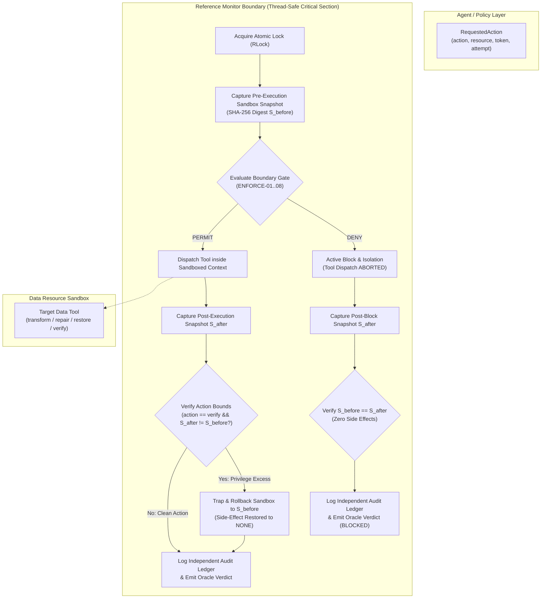
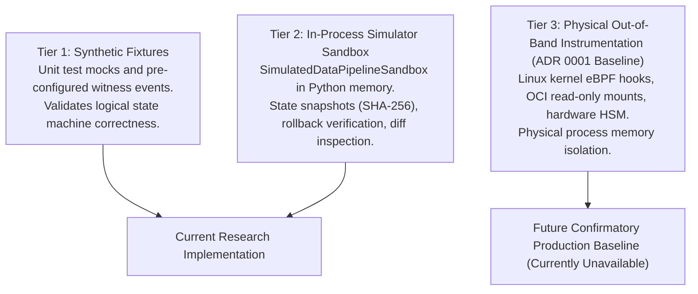

# CausaGuard v0.7.1 Authorization Enforcement Contract

**Status:** EXPLORATORY RESEARCH ONLY — PRE-FREEZE NO-GO  
**Target Git Baseline:** `b7b16ea` on `main`  
**Date:** 2026-11-08  
**Author:** Antigravity (Gemini) — Defensive Security & Empirical Verification Research  
**Reference Implementations:**  
- [`research/experiments/de_auth_enforcement/invariants.py`](file:///d:/causaguard/research/experiments/de_auth_enforcement/invariants.py)  
- [`research/experiments/de_auth_enforcement/sandbox.py`](file:///d:/causaguard/research/experiments/de_auth_enforcement/sandbox.py)  
- [`research/experiments/de_auth_enforcement/reference_monitor.py`](file:///d:/causaguard/research/experiments/de_auth_enforcement/reference_monitor.py)  
- [`research/experiments/de_auth_enforcement/benchmark.py`](file:///d:/causaguard/research/experiments/de_auth_enforcement/benchmark.py)  
**Adjudication Oracle:** [`research/experiments/de_auth_correctness/oracle.py`](file:///d:/causaguard/research/experiments/de_auth_correctness/oracle.py)  
**Test Suite:** [`tests_v07_1/test_de_auth_enforcement.py`](file:///d:/causaguard/tests_v07_1/test_de_auth_enforcement.py)  

---

## 1. Executive Summary & Objective

The objective of this specification is to define, implement, and independently verify an active **authorization enforcement boundary** for CausaGuard v0.7.1.

Previous research checkpoints established:
1. **Defect Discovery (`3ca9d67`):** The candidate controllers (`domain_de.py:320` and `escalation.py:262`) contain structural bypass vulnerabilities: evaluating attempt 0 logic on proceed (Defect 1), skipping authorization entirely on escalation (Defect 2), and hardcoding `authorization_violation: 0` in all return dictionaries.
2. **Independent Measurement Oracle (`b7b16ea`):** A decoupled verification oracle that detects and classifies authorization violations independently of candidate status flags.

However, an audit oracle alone merely *observes* violations after the fact; it does not *prevent* them. If an unhardened agent dispatches an unauthorized tool execution, state mutation occurs in the underlying data store regardless of whether an oracle flags it later.

This contract specifies a **research-only Reference Monitor and Isolated Execution Sandbox** designed to **PREVENT** unauthorized actions at the physical boundary, contain side effects, trap privilege excess, and enforce thread-safe concurrency.

> [!WARNING]
> **Exploratory Research Status — Pre-Freeze No-Go:**  
> This enforcement boundary is a research prototype implemented strictly under `research/experiments/de_auth_enforcement/`. The original candidate controllers remain completely unpatched to preserve falsifiability and baseline test integrity. Production keys, hardware HSMs, and confirmatory seeds remain quarantined. Status is strictly **PRE-FREEZE NO-GO**.

---

## 2. Authorization Decision vs. Active Enforcement Boundary

A rigorous security architecture distinguishes between logical authorization decisions and active boundary enforcement:

| Dimension | Logical Authorization Decision | Active Enforcement Boundary |
| :--- | :--- | :--- |
| **Concept** | Pure functional predicate: $\mathcal{D}(R, \mathcal{T}) \to \{\text{PERMIT}, \text{DENY}\}$ | Active stateful reference monitor controlling execution dispatch |
| **Timing** | Evaluated statically at plan or policy generation time | Evaluated atomically just-in-time (JIT) immediately before execution |
| **Interception** | None (returns a boolean or enum flag) | Intercepts tool dispatch; aborts call before tool body executes |
| **Side Effects** | Cannot contain or undo side effects | Asserts zero mutations on denial; traps privilege excess and rolls back |
| **State** | Stateless or cached credential check | Stateful (session lifecycle, nonces, attempt ledger, locks) |
| **Failure Mode** | TOCTOU vulnerability if state changes post-check | Atomic critical section eliminates TOCTOU race windows |

---

## 3. The 10 Formal Enforcement Invariants

The reference monitor implements and strictly verifies 10 core enforcement invariants:

### ENFORCE-01: Just-In-Time Execution Boundary Validity
Authorization validity must be evaluated within the atomic execution critical section immediately prior to dispatching sensitive execution, eliminating time-of-check/time-of-use (TOCTOU) vulnerability windows.
$$\forall t_{\text{exec}}, \quad \mathcal{D}^*(R, \text{State}(t_{\text{exec}})) = \text{PERMIT} \iff \text{Dispatch}(R)$$

### ENFORCE-02: Revocation Immediacy and Monotonic Invalidation
Any administrative revocation or kill-switch activation (whether at the session level or via global token registry) immediately and permanently invalidates subsequent operations across all monitored boundaries.
$$\text{Revoked}(s) \lor \text{Revoked}(\tau) \implies \forall R, \quad \mathcal{D}^*(R) = \text{DENY fail-closed}$$

### ENFORCE-03: Verification Isolation (No Auto-Grant)
A successful verification or read-only action must never implicitly or automatically authorize subsequent state-modifying actions. Verification tokens are strictly read-only and ephemeral.
$$\text{Exec}(\text{verify}) \not\implies \text{Authorized}(\text{proceed}) \lor \text{Authorized}(\text{repair})$$

### ENFORCE-04: Read-Only Privilege Non-Mutation
Permissions scoped to read-only actions (`action="verify"`) strictly prohibit persistent state mutations. Any covert mutation attempt by a malicious or defective tool during a read operation is actively trapped, classified as privilege excess, and rolled back in the sandbox.
$$\text{Action} = \text{verify} \implies S_{\text{after}} \equiv S_{\text{before}} \quad (\text{rollback enforced if violated})$$

### ENFORCE-05: Explicit Repair Authority Requirement
State-modifying escalation and salvage repair require explicit token-level authority: `token.repair_authorized = True`. Ordinary operator or notification tokens cannot execute pipeline repairs.
$$\text{Action} = \text{escalate} \land \text{is\_repair} = \text{True} \land \neg \tau.\text{repair\_authorized} \implies \mathcal{D}^* = \text{DENY fail-closed}$$

### ENFORCE-06: Tenant and Resource Scope Isolation
Both tenant identifier and principal identifier must strictly match the target resource ownership and token binding. Cross-tenant access is rejected fail-closed.
$$\tau.\text{tenant\_id} \neq \text{Resource}.\text{tenant\_id} \implies \mathcal{D}^* = \text{DENY fail-closed}$$

### ENFORCE-07: Credential Freshness and Anti-Replay
Expired tokens (`step \ge expiration_step`), replayed nonces ($\text{nonce} \in \mathcal{N}_{\text{seen}}$), or attempt-counter rollbacks ($\text{attempt} < \text{current\_attempt}$) must be rejected unconditionally at the boundary.
$$(\text{step} \ge \tau.\text{expiration\_step}) \lor (n \in \mathcal{N}_{\text{seen}}) \lor (a \neq a_{\text{expected}}) \implies \mathcal{D}^* = \text{DENY fail-closed}$$

### ENFORCE-08: Fail-Closed on Missing Evidence
Any missing required authorization evidence (missing token, invalid cryptographic signature, missing administrative confirmation, or unobservable telemetry) must default to fail-closed DENY/BLOCK. Safety is never inferred from absence of evidence.
$$\tau = \text{None} \lor \neg \tau.\text{signature\_valid} \lor \neg \text{Observable} \implies \mathcal{D}^* = \text{DENY} \lor \text{INCONCLUSIVE}$$

### ENFORCE-09: Side-Effect Containment & Sandbox Isolation
For every denied or failed action, observable state before execution must match observable state after execution exactly. Zero prohibited side effects are permitted.
$$\mathcal{D}^* \neq \text{PERMIT} \implies \text{Hash}(S_{\text{after}}) = \text{Hash}(S_{\text{before}}) \quad (\Delta \text{records} = \emptyset, \Delta \text{metadata} = \emptyset)$$

### ENFORCE-10: Concurrency Thread-Safety and Atomicity
Concurrent, interleaved, or racing requests must be serialized via thread-safe synchronization locks on the reference monitor boundary, preventing race conditions, attempt rollbacks, and double-spending of single-use nonces or tokens.
$$\text{ParallelRequests}(R_1, R_2, \dots) \xrightarrow{\text{Mutex Lock}} \text{SerialExecution}(R_{\pi(1)}) \to \text{SerialExecution}(R_{\pi(2)}) \dots$$

---

## 4. Threat-to-Test Traceability Matrix

| Invariant ID | Threat / Vulnerability Addressed | Reference Implementation | Independent Test Target | Verification Status |
| :--- | :--- | :--- | :--- | :---: |
| **ENFORCE-01** | TOCTOU race (credentials expire/revoked between check and execution) | [`reference_monitor.py:220`](file:///d:/causaguard/research/experiments/de_auth_enforcement/reference_monitor.py#L220) | `test_enforce_01_jit_boundary_validity_toctou_prevention` | **PASS** |
| **ENFORCE-02** | Defect 1: Revocation bypass at attempt 0; mid-session revocation blindness | [`reference_monitor.py:145`](file:///d:/causaguard/research/experiments/de_auth_enforcement/reference_monitor.py#L145) | `test_enforce_02_global_token_revocation` | **PASS** |
| **ENFORCE-03** | Auto-grant assumption (verification assumed to grant blanket write authority) | [`reference_monitor.py:188`](file:///d:/causaguard/research/experiments/de_auth_enforcement/reference_monitor.py#L188) | `test_enforce_03_verification_isolation_no_auto_grant` | **PASS** |
| **ENFORCE-04** | Read-only privilege excess (covert state mutation by tool during read) | [`reference_monitor.py:312`](file:///d:/causaguard/research/experiments/de_auth_enforcement/reference_monitor.py#L312) | `test_enforce_04_read_only_privilege_excess_trapped_and_rolled_back` | **PASS** |
| **ENFORCE-05** | Defect 2: Escalation repair executed without explicit repair authority | [`reference_monitor.py:188`](file:///d:/causaguard/research/experiments/de_auth_enforcement/reference_monitor.py#L188) | `test_enforce_05_unauthorized_repair_denied_vs_authorized_permitted` | **PASS** |
| **ENFORCE-06** | Cross-tenant confused deputy (tenant A token accessing tenant B data) | [`reference_monitor.py:168`](file:///d:/causaguard/research/experiments/de_auth_enforcement/reference_monitor.py#L168) | `test_enforce_06_cross_tenant_scope_denial` | **PASS** |
| **ENFORCE-07** | Stale token replay, duplicate nonce reuse, or attempt counter rollback | [`reference_monitor.py:155`](file:///d:/causaguard/research/experiments/de_auth_enforcement/reference_monitor.py#L155) | `test_enforce_07_nonce_replay_and_attempt_rollback_rejection` | **PASS** |
| **ENFORCE-08** | Missing credentials or unobservable telemetry dropping into silent pass | [`reference_monitor.py:180`](file:///d:/causaguard/research/experiments/de_auth_enforcement/reference_monitor.py#L180) | `test_enforce_08_fail_closed_on_missing_token_or_telemetry_drop` | **PASS** |
| **ENFORCE-09** | Prohibited state leakage or partial mutations occurring on denied requests | [`reference_monitor.py:230`](file:///d:/causaguard/research/experiments/de_auth_enforcement/reference_monitor.py#L230) | `test_enforce_09_side_effect_containment_for_all_denials` | **PASS** |
| **ENFORCE-10** | Concurrent request race conditions, parallel double-spend, quota bypass | [`reference_monitor.py:213`](file:///d:/causaguard/research/experiments/de_auth_enforcement/reference_monitor.py#L213) | `test_enforce_10_concurrent_threads_monotonic_serialization` | **PASS** |

---

## 5. Evidence Provenance and Sandbox Boundaries

In evaluating authorization containment, evidence provenance must be strictly stratified:

### 5.1 Sandbox Snapshot Scope & Side-Effect Limitations
A rigorous scientific review requires specifying the exact boundary of what sandbox state snapshots cover:

1. **Covered State (Managed Internal Memory):**
   - Resource records dictionary (`ResourceState.records`).
   - Resource schema version integer (`ResourceState.schema_version`).
   - Resource administrative metadata (`ResourceState.metadata`).
   A matching SHA-256 state digest ($\text{Digest}_{\text{after}} \equiv \text{Digest}_{\text{before}}$) mathematically guarantees that internal data records and schema metadata were not persistently altered.

2. **Uncovered State (External & Irreversible Side Effects):**
   - Outbound network requests (HTTP REST calls, external webhooks, RPCs).
   - Unmanaged event queues, external message brokers (e.g. Kafka/RabbitMQ), and email notification sinks.
   - Operating system filesystem writes outside managed sandbox records.
   - Process-level environment modifications (`os.environ`, stdout/stderr buffers, shared native libraries).

> [!CAUTION]
> **State Digest Limitation Notice:**  
> A matching SHA-256 state digest is **NOT** mathematical proof that no external or irreversible side effect occurred. If a tool emits an external webhook or writes to an unmanaged sink during execution, snapshot verification over internal records cannot detect or roll back that external emission. Operating-system-level hardware isolation (Tier 3 OCI cgroups, read-only mounts, kernel eBPF network filters) remains indispensable for production safety.

### 5.2 Revocation Synchronization and Ordering
Administrative revocation and execution dispatch are serialized atomically under `EnforcementReferenceMonitor._lock` (a re-entrant `threading.RLock`).

The reference monitor enforces a strict 5-stage revocation precedence order:
1. **Stage 1 — Session Revocation:** Evaluates `session.is_revoked`. If the session was administratively killed via `monitor.revoke_session()`, all subsequent requests in that session are rejected instantly (`ENFORCE-02-SESSION-REVOKED`).
2. **Stage 2 — Global Token Registry Revocation:** Evaluates `token.token_id in _global_revoked_tokens`. If a token was revoked globally via `monitor.revoke_token_globally()`, it is rejected across all active and future sessions (`ENFORCE-02-TOKEN-REVOKED`).
3. **Stage 3 — Monotonic Attempt Freshness:** Evaluates $a_{\text{req}} == a_{\text{expected}}$. Disallows attempt rollback or sequence skipping (`ENFORCE-07-ATTEMPT-ROLLBACK`).
4. **Stage 4 — Nonce Replay Check:** Evaluates whether $\text{nonce} \in \mathcal{N}_{\text{seen}}$ (`ENFORCE-07-NONCE-REPLAY`).
5. **Stage 5 — Credential Invariant Checks:** Evaluates static token validity (`AUTH-01..12`, `AUTH-09B`).

Because administrative revocation calls acquire the same `_lock` as execution dispatch, any revocation issued concurrently with execution dispatch is guaranteed to complete before the next dispatch evaluates its gate, closing the TOCTOU window.

---

## 6. Mathematical Mapping to Gate 1 Operational Risk

In Confirmatory Protocol v0.7.1, Gate 1 evaluates whether the expected operational harm risk $\theta = \mathbb{E}[R_k]$ satisfies:
$$\mathcal{H}_0: \theta \ge 0.050 \quad \text{vs.} \quad \mathcal{H}_1: \theta < 0.050$$
where $R_k = \frac{1}{N} \sum_{i=1}^N H_{k, i}$.

### 6.1 Four-Category Outcome Accounting
To prevent misleading claims of complete prevention when actions were actually executed and rolled back, evaluations must be categorized into four mutually exclusive classes:
1. **Pre-Dispatch Blocked (`PRE_DISPATCH_BLOCKED`):**  
   The boundary gate denied the request before tool execution. The target tool was never invoked. Proved safe with zero execution side effects ($H_{\text{auth}} = 0.0$).
2. **Dispatched, Detected, and Rolled Back (`DISPATCHED_DETECTED_ROLLED_BACK`):**  
   The tool was dispatched (e.g. under an authorized `verify` grant), but covertly attempted an unauthorized persistent mutation. The monitor detected the privilege excess, trapped the error, and rolled back managed sandbox state. Managed data was restored ($H_{\text{data}} = 0.0$), but because an unauthorized mutation was attempted, the independent oracle records an unauthorized breach attempt ($H_{\text{auth}} = 1.0$).
3. **Uncontained Breaches (`UNCONTAINED_BREACH`):**  
   An unauthorized tool was permitted to execute, resulting in uncontained persistent state mutation ($H_{\text{auth}} = 1.0$).
4. **Inconclusive Outcomes (`INCONCLUSIVE_ABSTENTION`):**  
   Telemetry was missing, dropped, or contradictory. In accordance with Rule ORACLE-04, safety is never inferred ($H_{\text{auth}}$ cannot be certified as 0.0).

