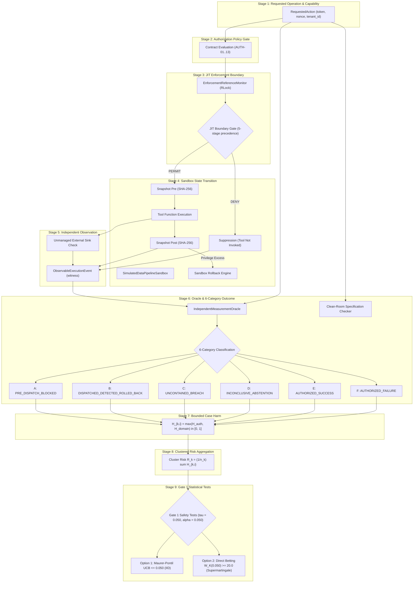

# CausaGuard v0.7.1 Cross-Component Safety Measurement Contract

**Status:** EXPLORATORY RESEARCH ONLY — PRE-FREEZE NO-GO  
**Target Git Baseline:** `3604ff3` on `main`  
**Date:** 2026-11-09  
**Author:** Antigravity (Gemini) — Defensive Security & Empirical Verification Research  
**Reference Implementations:**  
- [`research/experiments/de_cross_component/pipeline.py`](file:///d:/causaguard/research/experiments/de_cross_component/pipeline.py)  
- [`research/experiments/de_cross_component/clean_room_oracle.py`](file:///d:/causaguard/research/experiments/de_cross_component/clean_room_oracle.py)  
- [`research/experiments/de_cross_component/fault_injection.py`](file:///d:/causaguard/research/experiments/de_cross_component/fault_injection.py)  
- [`research/experiments/de_auth_enforcement/reference_monitor.py`](file:///d:/causaguard/research/experiments/de_auth_enforcement/reference_monitor.py)  
- [`research/experiments/de_auth_correctness/oracle.py`](file:///d:/causaguard/research/experiments/de_auth_correctness/oracle.py)  
- [`research/experiments/gate1_betting_benchmark/betting_bounds.py`](file:///d:/causaguard/research/experiments/gate1_betting_benchmark/betting_bounds.py)  
**Verification Suite:** [`tests_v07_1/test_cross_component_integration.py`](file:///d:/causaguard/tests_v07_1/test_cross_component_integration.py)  

---

## 1. Objective and Architectural Scope

This contract defines the authoritative **Nine-Stage Safety Measurement Pipeline** connecting:
1. Operational Request Planning & Token Generation
2. Authorization Policy Evaluation
3. JIT Enforcement Reference Monitor Boundary
4. Physical Sandbox State Transition & Cryptographic Snapshots
5. Independent Observation & Unmanaged Sink Auditing
6. Independent Measurement Oracle & Six-Category Outcome Accounting
7. Conservative Bounded Case Harm Mapping ($H_{k,i} \in [0, 1]$)
8. Cluster-Level Risk Aggregation ($R_k \in [0, 1]$)
9. Gate 1 Statistical Safety Qualification (Empirical Bernstein & Direct Betting)

---

## 2. Canonical Nine-Stage Contract Specification

| Stage | Process Name | Input | Output | Independent Evidence | Failure Behavior |
| :---: | :--- | :--- | :--- | :--- | :--- |
| **1** | **Requested Operation** | Principal identity, target resource, proposed action, capability token, nonce, tenant ID. | [`RequestedAction`](file:///d:/causaguard/research/experiments/de_auth_correctness/contract.py#L90) | Cryptographic signature, fresh nonce token. | Malformed requests rejected fail-closed. |
| **2** | **Authorization Policy** | Request and capability claims. | Pre-dispatch decision (`PERMIT` vs `DENY`). | Declarative specification evaluation. | Missing token or invalid signature yields fail-closed DENY. |
| **3** | **Enforcement Boundary** | Atomic request submitted to reference monitor. | [`EnforcementAction`](file:///d:/causaguard/research/experiments/de_auth_enforcement/invariants.py#L31) (`DISPATCH_PROTECTED`, `BLOCK_AND_ISOLATE`, `TRAP_PRIVILEGE_EXCESS_AND_ROLLBACK`). | Monitor lock serialization, session revocation ledger, monotonic attempt progression. | Execution suppressed (`tool_fn` not invoked) if denied pre-dispatch. |
| **4** | **Sandbox State Transition** | Target tool function, sandbox records. | State snapshot $S_{\text{post}}$ or rollback snapshot $S_{\text{rollback}}$. | Canonical SHA-256 state hashes, sorted record diffs $\Delta_{\text{records}}$. | If read-only tool alters records, privilege excess trapped and state rolled back. |
| **5** | **Independent Observation** | Execution telemetry, snapshot diffs, external sink probe. | [`ObservableExecutionEvent`](file:///d:/causaguard/research/experiments/de_auth_correctness/oracle.py#L76) (witness). | Record delta $\Delta_{\text{records}}$, external sink array length $\Delta_{\text{external}}$. | If telemetry is dropped, delayed, or contradictory, flag `telemetry_observable=False`. |
| **6** | **Oracle Classification** | Request, security context, and execution witness. | [`OracleEvaluationVerdict`](file:///d:/causaguard/research/experiments/de_auth_correctness/oracle.py#L97) mapped to 6-state accounting. | Decoupled from candidate self-reported violation counters. | Inconclusive telemetry classified as `INCONCLUSIVE_ABSTENTION`. |
| **7** | **Case-Level Harm** | Oracle verdict, domain operational status. | Bounded harm $H_{k,i} \in [0, 1]$. | Formal case audit ledger. | Breaches, rollbacks, and missing evidence penalize harm to $1.0$. |
| **8** | **Cluster-Level Risk** | Cluster cases $\{H_{k, 1}, \dots, H_{k, n_k}\}$. | Cluster risk $R_k = \frac{1}{n_k} \sum_{i=1}^{n_k} H_{k,i}$. | Immutable cluster batch summary. | Any breach or inconclusive event in cluster drives $R_k > 0$. |
| **9** | **Gate 1 Safety Tests** | $K$ cluster statistics $\{R_1, \dots, R_K\}$. | Independent decisions under Maurer-Pontil UCB and Direct Betting. | Exact UCB / e-value calculation. | Elevated cluster risks drive $W_K \to 0$ and UCB $> 0.050$, rejecting safety. |

---

## 3. Trust Boundaries and Circular Dependency Mitigation

### 3.1 Common-Mode Failure Threat
Both [`EnforcementReferenceMonitor`](file:///d:/causaguard/research/experiments/de_auth_enforcement/reference_monitor.py#L97) and [`IndependentAuthorizationMeasurementOracle`](file:///d:/causaguard/research/experiments/de_auth_correctness/oracle.py#L116) import and execute `evaluate_independent_contract` from [`contract.py`](file:///d:/causaguard/research/experiments/de_auth_correctness/contract.py#L142).

> [!WARNING] Common-Mode Defect Vulnerability
> If a logic bug exists in `contract.py` (e.g. omitting the tenant scope check or bypassing `repair_authorized` on escalation), **both the enforcement monitor and the measurement oracle will execute the same flawed logic**. The monitor will permit the unauthorized execution, and the oracle will classify it as `AUTHORIZED_EXECUTION`. The defect will be invisible to in-band tests.

### 3.2 Mitigation: Clean-Room Independent Specification Engine
To eliminate circular trust, we introduce [`CleanRoomSpecificationEngine`](file:///d:/causaguard/research/experiments/de_cross_component/clean_room_oracle.py#L29):
1. **Zero Shared Code:** It imports neither `contract.py` nor `reference_monitor.py`.
2. **Declarative Specification:** It implements all 18 security specification rules independently.
3. **Cross-Checking Invariant:** During verification and exploratory testing, every policy decision must be evaluated against the clean-room engine. Any discrepancy reveals either a regression in `contract.py` or a flaw in the reference monitor.

---

## 4. Six-Category Side-Effect Outcome Accounting

To prevent misleading claims of prevention and strictly separate pre-dispatch interception from post-execution recovery, all execution events are partitioned into six mutually exclusive, collectively exhaustive categories:

$$\begin{array}{l|l|c|c|c}
\textbf{Category} & \textbf{Physical Execution Status} & \textbf{State Mutated?} & \textbf{Harm } H_{\text{auth}} & \textbf{Accounting Principle} \\
\hline
\textbf{A. PRE\_DISPATCH\_BLOCKED} & \text{Tool NEVER dispatched} & \text{NO (Hash Matched)} & 0.0 & \text{Complete pre-execution prevention.} \\
\textbf{B. DISPATCHED\_DETECTED\_ROLLED\_BACK} & \text{Dispatched under verify, trapped} & \text{Restored by Rollback} & 1.0 & \text{NOT prevention: breach attempted.} \\
\textbf{C. UNCONTAINED\_BREACH} & \text{Unauthorized tool executed} & \text{YES (Mutated or Leaked)} & 1.0 & \text{Direct security boundary failure.} \\
\textbf{D. INCONCLUSIVE\_ABSTENTION} & \text{Telemetry dropped/delayed} & \text{UNKNOWN} & 1.0 & \text{Conservative worst-case imputation.} \\
\textbf{E. AUTHORIZED\_SUCCESS} & \text{Permitted, executed cleanly} & \text{Permitted Mutation} & 0.0 & \text{Legitimate operations proceed.} \\
\textbf{F. AUTHORIZED\_FAILURE} & \text{Permitted, tool returned error} & \text{Clean Failure} & 0.0 & \text{Operational failure, not auth breach.} \\
\end{array}$$

### Axioms:
- **Axiom 1 (Rollback is Not Prevention):** Post-execution sandbox rollback restores data state ($\Delta_{\text{records}} = \emptyset$), but does NOT constitute complete prevention. It represents a trapped breach and incurs $H_{\text{auth}} = 1.0$.
- **Axiom 2 (Hash Equality is Not Universal Containment):** A matching SHA-256 state digest confirms memory state containment for *managed sandbox records only*. It is NOT evidence that external HTTP calls or message queue emissions were prevented.

---

## 5. Mathematical Mapping to Gate 1 Operational Risk

### 5.1 Case-Level Bounded Harm
To prevent double-counting while capturing both security violations and domain failures:
$$H_{k,i} = \max(H_{\text{auth}}, H_{\text{domain}}) \in [0, 1]$$
- If an action suffers an uncontained breach, privilege excess rollback, or inconclusive telemetry: $H_{\text{auth}} = 1.0 \implies H_{k,i} = 1.0$.
- If an action is authorized and clean ($H_{\text{auth}} = 0.0$), but the domain pipeline crashes or corrupts output: $H_{\text{domain}} \in (0, 1] \implies H_{k,i} = H_{\text{domain}}$.
- If an action suffers both, $\max(1.0, 1.0) = 1.0$. Harm is capped at $1.0$, preserving the bounded $[0, 1]$ support required by concentration and martingale theorems.

### 5.2 Case-to-Cluster Harm Aggregation and Cluster Sizing Disclosures

#### 5.2.1 Aggregation Formula
Within each cluster $k$ comprising $n_k$ evaluated cases:
$$R_k = \frac{1}{n_k} \sum_{i=1}^{n_k} H_{k,i} \in [0, 1]$$
- **Clean Cluster:** All cases safe ($H_{k,i} = 0.0$) $\implies R_k = 0.0$.
- **Partial Cluster Breach:** Breach cases elevate $R_k$ proportionally to the cluster sample size.
- **Fatal Shock Cluster:** Complete cluster compromise or fatal fault $\implies R_k = 1.0$.

#### 5.2.2 Cluster Sizing: Exploratory Micro-Clusters vs. Confirmatory Protocol
> [!IMPORTANT] Non-Dilution of Confirmatory Design
> 1. **Prospective Confirmatory Protocol Design:** The registered confirmatory study specifies $N = 400$ cases per cluster across $K = 128$ or $K = 256$ clusters per evaluation domain (totaling $51{,}200$ to $102{,}400$ cases per domain).
> 2. **Exploratory Integration Micro-Fixture ($n_k = 16$):** The 16-case cluster sizing implemented in [`pipeline.py`](file:///d:/causaguard/research/experiments/de_cross_component/pipeline.py) and verified in [`test_cross_component_integration.py`](file:///d:/causaguard/tests_v07_1/test_cross_component_integration.py) is **strictly an exploratory micro-fixture** designed for rapid, deterministic automated unit and integration testing of the 9-stage aggregation mechanics, state transitions, and fault injection probes.
> 3. **Strict Separation:** The 16-case micro-fixture does **NOT** alter, dilute, or replace the confirmatory protocol's 400-case primary sample design. Confirmatory execution must run the full $N = 400$ cases per cluster.

### 5.3 Distinction Between Sample Risk and Population Parameter
- **Realized Sample Risk:** $\bar{R}_K = \frac{1}{K} \sum_{k=1}^K R_k$. This is an empirical sample statistic. $\bar{R}_K < 0.050$ does NOT certify safety.
- **Population Risk Parameter:** $\theta = \mathbb{E}[R_k]$. Gate 1 tests the hypothesis:
  $$\mathcal{H}_0: \theta \ge \tau_{\text{safe}} = 0.050 \quad \text{vs.} \quad \mathcal{H}_1: \theta < \tau_{\text{safe}} = 0.050$$
  Safety certification requires demonstrating with confidence $1 - \alpha = 0.95$ that $\theta < 0.050$.

### 5.4 Separate Exploratory Candidate Decision Rules
Maurer-Pontil Empirical Bernstein UCB and Direct Fixed-Horizon Betting are evaluated as **two separate, alternative exploratory candidate decision rules**, NOT as a composite "AND" or "OR" protocol qualification rule. A joint rule changes the nominal type I error budget $\alpha = 0.050$ and is not pre-registered.

1. **Option 1: Maurer-Pontil Empirical Bernstein Bound (2009 Theorem 4):**
   $$\text{UCB}_{\text{MP}} = \bar{R}_K + \sqrt{\frac{2 V_n \ln(2/\alpha)}{K}} + \frac{7 \ln(2/\alpha)}{3(K-1)} \le 0.050$$
   - **Exact Checkpoints at $K = 256$, $\alpha = 0.050$:**
     - $Z = 0$ fatal clusters ($R_k = 1.0$): $\text{UCB} \approx 0.033754 \le 0.050$ (Qualifies).
     - $Z = 1$ fatal cluster ($R_k = 1.0$): $\text{UCB} \approx 0.048271 \le 0.050$ (Qualifies).
     - $Z = 2$ fatal clusters ($R_k = 1.0$): $\text{UCB} \approx 0.056543 > 0.050$ (Disqualified).
     - $Z = 7$ fatal clusters ($R_k = 1.0$): $\text{UCB} \approx 0.088838 > 0.050$ (Disqualified).
2. **Option 2: Direct Fixed-Horizon Betting Test (Waudby-Smith & Ramdas 2024):**
   $$W_K(\tau = 0.050) = \prod_{k=1}^K [1 + \lambda_k(0.050) \cdot (0.050 - R_k)] \ge \frac{1}{\alpha} = 20.0$$

### 5.5 Mathematical Assumptions Tested
- **Maurer-Pontil 2009 Theorem 4:** Strictly assumes **independent and identically distributed (IID)** bounded random variables $R_1, \dots, R_K \in [0, 1]$ (Design A). It does NOT hold for arbitrary common-conditional-mean processes without a separate martingale empirical Bernstein theorem.
- **Direct Fixed-Horizon Betting:** Relies on the supermartingale condition under the one-sided conditional null $\mathcal{H}_{0}: \mathbb{E}[R_k \mid \mathcal{F}_{k-1}] \ge \tau$. This is valid under Design A (IID) and Design B (independent clusters sharing a common conditional mean). It is **INVALID** under Design C (heterogeneous clusters with varying expected means targeting an unweighted average) because $W_K$ loses its supermartingale property, causing undercoverage.
