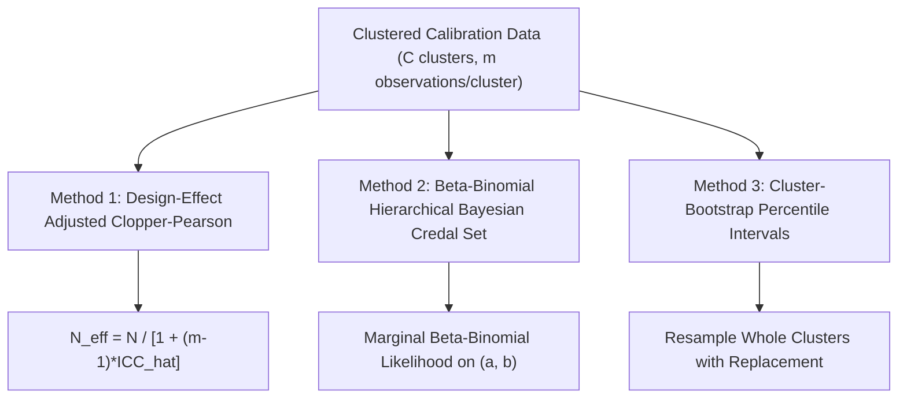

# Protocol Specification: Cluster-Robust Calibration and Sequential Drift Detection in Data Engineering (v0.7.1)

**Document Version:** 1.0.0-PROSPECTIVE-DESIGN  
**Date:** 2026-11-07  
**Research Baseline:** `cfa841a` on `main`  
**Status:** **EXPLORATORY METHODOLOGY DESIGN — PRE-FREEZE NO-GO**  
**Execution Environment:** Seed-free prospective design, non-confirmatory exploration  
**Cross-References:**  
- Experiment 05 Review: [`research/reviews/v071-de-calibration-coverage-exp05.md`](file:///d:/causaguard/research/reviews/v071-de-calibration-coverage-exp05.md)  
- Prior Calibration Protocol: [`research/methodology/v071-de-credal-calibration-protocol.md`](file:///d:/causaguard/research/methodology/v071-de-credal-calibration-protocol.md)  
- Credal Risk Specification: [`research/experiments/de_credal_exp04/experiment.py`](file:///d:/causaguard/research/experiments/de_credal_exp04/experiment.py)  

---

## 1. Research Objectives & Motivation

### 1.1 Empirical Motivation from Experiment 05
Experiment 05 revealed two severe empirical vulnerabilities in naive pre-deployment calibration:
1. **The Clustering Collapse:** When calibration observations exhibit intra-cluster correlation ($\text{ICC} = 0.25$, cluster size $m = 10$), standard independent Clopper–Pearson intervals suffer a catastrophic **$33.1\%$ absolute coverage collapse** (dropping from $96.9\%$ to $63.8\%$), causing false safety qualifications to surge to **$3.9\%$**.
2. **The Sensor Drift Trap:** When sensor false-negative rate degrades post-deployment (e.g. $FN$ shifts from $0.24$ to $0.32$ due to parser degradation or new SQL dialects), static pre-deployment calibration bounds fail to enclose operational risk in **$95.5\%$ of cases** (risk coverage collapses to $4.5\%$).

### 1.2 Core Research Objectives for Experiment 06
Experiment 06 will design and evaluate:
- **Cluster-Robust Uncertainty Sets:** Calibration estimators that maintain $\ge 95\%$ simultaneous coverage under clustered sampling with non-zero intra-cluster correlation ($\text{ICC} > 0$).
- **Dynamic Sequential Drift Detection:** A runtime CUSUM / SPRT monitoring layer that detects sensor degradation in real time and triggers fail-closed quarantine before operational risk exceeds $\tau_{\text{safe}} = 0.050$.

> [!CAUTION]
> **PRE-FREEZE NO-GO PRESERVED:** This document specifies a prospective exploratory research design. No candidate controller files are modified, no confirmatory seeds (`70100001+`, `70200001+`, `60030001+`) are accessed, and no production authorization is granted.

---

## 2. Cluster-Aware Calibration Framework

### 2.1 Clustered Sampling Structure
In enterprise pipeline verification, calibration schemas naturally cluster by database engine, source repository, or ORM generator. Let:
- $C_{\text{clean}}$ be the number of independent clean clusters, each containing $m_c$ schema checks ($N_{\text{clean}} = \sum_{c=1}^{C_{\text{clean}}} m_c$).
- $C_{\text{schema}}$ be the number of independent defective clusters, each containing $m_s$ schema checks ($N_{\text{schema}} = \sum_{s=1}^{C_{\text{schema}}} m_s$).
- Within each cluster, observations exhibit positive intra-cluster correlation:
  $$\text{ICC} = \frac{\sigma_{\text{between}}^2}{\sigma_{\text{between}}^2 + \sigma_{\text{within}}^2} \in [0, 1]$$

### 2.2 Three Candidate Cluster-Robust Estimators
We propose three distinct estimators to be compared against naive Clopper–Pearson:

#### Method 1: Design-Effect Adjusted Effective Sample Size (Rao-Scott)
Under cluster sampling, the variance of sample proportion $\widehat{p}$ is inflated by the design effect:
$$\text{DEFF} = 1 + (\bar{m} - 1)\widehat{\text{ICC}}$$
The effective sample size is:
$$N_{\text{eff}} = \max\left(C, \; \left\lfloor \frac{N}{\text{DEFF}} \right\rfloor\right), \qquad k_{\text{eff}} = \left\lfloor \widehat{p} \cdot N_{\text{eff}} \right\rfloor$$
Adjusted Clopper–Pearson intervals are computed using $(k_{\text{eff}}, N_{\text{eff}})$.

*Known Limitation:* If $\text{ICC}$ is misspecified or estimated with noise from small cluster counts ($C < 20$), $N_{\text{eff}}$ can remain overconfident.

#### Method 2: Beta-Binomial Hierarchical Credal Region
Observations within cluster $c$ are modeled as:
$$p_c \sim \text{Beta}(a, b), \qquad k_c \mid p_c \sim \text{Binomial}(m_c, p_c)$$
with mean $\mu = \frac{a}{a + b}$ and dispersion $\phi = \frac{1}{a + b + 1} = \text{ICC}$.  
Profile-likelihood confidence regions for $\mu$ are derived by maximizing the marginal Beta-Binomial log-likelihood:
$$\log L(\mu, \phi) = \sum_{c=1}^C \log \left[ \binom{m_c}{k_c} \frac{B\left(k_c + \mu(\phi^{-1}-1), \; m_c - k_c + (1-\mu)(\phi^{-1}-1)\right)}{B\left(\mu(\phi^{-1}-1), \; (1-\mu)(\phi^{-1}-1)\right)} \right]$$

#### Method 3: Cluster Bootstrap
Resample $B = 2{,}000$ bootstrap cluster vectors with replacement from the $C$ observed clusters:
$$\mathcal{C}^*_b = \{ \text{Cluster}_1^*, \dots, \text{Cluster}_C^* \}, \qquad \widehat{p}_b^* = \frac{\sum_{c \in \mathcal{C}^*_b} k_c}{\sum_{c \in \mathcal{C}^*_b} m_c}$$
Construct the studentized or BCa percentile bootstrap interval $[\underline{p}_{\text{boot}}, \overline{p}_{\text{boot}}]$.

*Known Limitation (Cameron & Miller 2015):* When cluster count is small ($C < 30$), cluster bootstrap intervals can under-cover nominal rates. Cluster bootstrap requires at least $C \ge 30-50$ clusters for reliable asymptotic coverage.

---

## 3. Sequential Detection of Sensor-Reliability Drift

### 3.1 CUSUM Sequential Likelihood-Ratio Monitor
To detect post-deployment degradation in sensor reliability, a sequential CUSUM (Page 1954) monitor observes runtime binary verification checks $Y_1, Y_2, \dots, Y_t \in \{\text{pass}, \text{fail}\}$.

Let nominal pass probability under calibrated state be $p_0 = P(Y = \text{pass} \mid \text{nominal})$, and let degraded pass probability be $p_1 = P(Y = \text{pass} \mid \text{degraded})$:
$$p_0 = (1 - \pi_0)(1 - FP_0) + \pi_0 \cdot FN_0$$
$$p_1 = (1 - \pi_0)(1 - FP_1) + \pi_0 \cdot FN_1$$

The running CUSUM statistic accumulates log-likelihood evidence against nominal operation:
$$S_0 = 0, \qquad S_t = \max\left(0, \; S_{t-1} + z_t\right)$$
where the score increment for observation $Y_t$ is:
$$z_t = \begin{cases}
\log \left(\frac{p_1}{p_0}\right), & \text{if } Y_t = \text{pass} \\
\log \left(\frac{1 - p_1}{1 - p_0}\right), & \text{if } Y_t = \text{fail}
\end{cases}$$

### 3.2 Detection Threshold & ARL Tradeoff
The monitor alarms when $S_t \ge h_{\text{drift}}$:
- **Average Run Length Under In-Control ($ARL_0$):** Expected number of pipeline executions before a false alarm:
  $$ARL_0 = \mathbb{E}[T \mid \text{nominal}] \ge 1{,}000 \text{ runs}$$
- **Average Run Length Under Drift ($ARL_1$):** Expected delay to detect true degradation:
  $$ARL_1 = \mathbb{E}[T \mid \text{degraded}] \le 50 \text{ runs}$$

### 3.3 Fail-Closed Quarantine Trigger
When the monitor triggers an alarm ($S_t \ge h_{\text{drift}}$):
1. The credal set is immediately revoked (`status: 'DRIFT_QUARANTINE'`).
2. The controller reverts to vacuous bounds $\mathcal{C}_{\text{vacuous}} = [0, 1] \times [0, 1]$, producing $\overline{R} = 0.9100 > \tau_{\text{safe}}$.
3. All automated pipeline approvals are halted, forcing mandatory human escalation.

> [!IMPORTANT]
> **No Universal Protection Claim:** No sequential monitor can mathematically guarantee detection *before* a hazardous case is processed. There is an inescapable tradeoff between detection delay $ARL_1$ and false alarm rate $1 / ARL_0$. The protocol must evaluate the cumulative hazard volume during the detection delay window $[0, ARL_1]$.

---

## 4. Experimental Hypotheses, Estimands, and Failure Criteria

### 4.1 Research Hypotheses
| Hypothesis ID | Statement | Estimand | Success Threshold |
|---|---|---|---|
| **$H_{0, \text{cluster}}$** | Cluster-adjusted calibration maintains nominal simultaneous coverage across $\text{ICC} \in [0.05, 0.40]$ and $C \ge 30$. | Empirical coverage $P(\theta^* \in \mathcal{C})$ | $\ge 94.0\%$ ($95\%$ CI covers $0.95$) |
| **$H_{1, \text{cluster}}$ (Negative)** | Cluster-adjusted calibration under-covers when cluster count is small ($C < 20$) or ICC is underestimated by $\ge 50\%$. | Empirical coverage $P(\theta^* \in \mathcal{C})$ | $< 90.0\%$ (Falsification established) |
| **$H_{0, \text{drift}}$** | CUSUM monitoring detects sensor degradation ($FN$ drift $0.24 \to 0.32$) within $T \le 50$ runs with false alarm rate $\le 1\%$. | Mean detection delay $\mathbb{E}[T_{\text{detect}}]$ | $\le 50$ runs; $ARL_0 \ge 1{,}000$ |

### 4.2 Parameter Sweeps in Experiment 06
1. **Cluster Count Grid:** $C \in \{10, 20, 30, 50, 100\}$.
2. **Cluster Size Grid:** $m \in \{5, 10, 20\}$.
3. **Intra-Cluster Correlation Grid:** $\text{ICC} \in \{0.00, 0.05, 0.15, 0.25, 0.40\}$.
4. **Sensor Drift Magnitudes:** $\Delta FN \in \{+0.04, +0.08, +0.12\}$.

### 4.3 Baselines for Comparison
- **Baseline 1 (Unadjusted):** Naive independent Clopper–Pearson (Experiment 05 baseline).
- **Baseline 2 (Design-Effect Adjusted):** Rao-Scott adjusted Clopper–Pearson using estimated $\widehat{\text{ICC}}$.
- **Baseline 3 (Beta-Binomial Profile):** Exact profile likelihood on Beta-Binomial marginals.
- **Baseline 4 (Cluster Bootstrap):** Non-parametric cluster-resampled bootstrap percentile intervals.

---

## 5. Protocol Constraints & Pre-Freeze Integrity

- **Exploratory Isolation:** Experiment 06 must be implemented in an isolated package `research/experiments/de_cluster_drift_exp06/`.
- **Seed Isolation:** All random draws must use exploratory seed range `50200001+` (never overlapping confirmatory seeds `70100001+`, `70200001+`, `60030001+`).
- **No Controller Modification:** Original candidate controllers (`domain_de.py`, `policy_v07_1.py`) and frozen confirmatory manifests must remain strictly untouched.
- **Status:** **PRE-FREEZE NO-GO REMAINS IN EFFECT.**

