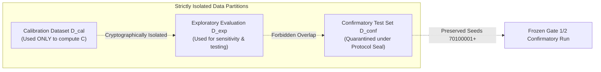

# Protocol Specification: Prospective Calibration of Bayesian Likelihood Uncertainty Sets in Data Engineering (v0.7.1)

**Document Version:** 1.0.0-PROSPECTIVE-DESIGN  
**Date:** 2026-11-07  
**Research Baseline:** `cfa841a` on `main`  
**Status:** **EXPLORATORY METHODOLOGY DESIGN — PRE-FREEZE NO-GO**  
**Execution Environment:** Seed-free offline design, prospective specification only  
**Primary References:**  
- Experiment 03 Review: [`research/reviews/v071-de-likelihood-robustness-exp03.md`](file:///d:/causaguard/research/reviews/v071-de-likelihood-robustness-exp03.md)  
- Experiment 04 Review: [`research/reviews/v071-de-credal-risk-exp04.md`](file:///d:/causaguard/research/reviews/v071-de-credal-risk-exp04.md)  
- Belief Engine Specification: [`research/experiments/de_belief_exp02/engine.py`](file:///d:/causaguard/research/experiments/de_belief_exp02/engine.py)  

---

## 1. Objective & Research Scope

### 1.1 Motivation
Experiment 04 established that replacing fragile point-estimate likelihoods with closed rectangular credal sets $\mathcal{C} = \mathcal{I}_{FP} \times \mathcal{I}_{FN}$ eliminates false safety qualifications near the critical operational risk threshold $\tau_{\text{safe}} = 0.050$, provided the true data-generating parameter vector $\theta^* = (FP^*, FN^*)$ is enclosed within $\mathcal{C}$ (Theorem 1).

However, Experiment 04 and independent review also revealed crucial boundary vulnerabilities and epistemic limits:
1. **Parameter Misspecification (Scenario D):** If the credal set $\mathcal{C}$ is artificially narrowed or misspecified such that $\theta^* \notin \mathcal{C}$, the upper risk bound collapses below the true risk, and false safety qualifications immediately re-emerge.
2. **Confidence Coverage vs. Universal Safety:** A $1 - \alpha_{\text{cal}} = 95\%$ confidence region guarantees that across repeated calibration draws from the population, $\theta^* \in \mathcal{C}$ with probability at least $0.95$. In the remaining $\approx 5\%$ of calibration studies where $\theta^* \notin \mathcal{C}$, Theorem 1's enclosure precondition fails, and false safety qualifications CAN occur. Frequentist calibration does **not** provide unconditional, universal zero-defect safety.
3. **Epistemic Status of Uncertainty Sets:** Illustrative or subjective intervals (e.g. nominal $\pm 20\%$) carry **no frequentist coverage guarantees**. To establish a defensible safety gatekeeper, the uncertainty set must be constructed via **statistically calibrated confidence regions** derived from empirical pre-deployment calibration trials.

### 1.2 Core Scope
This document specifies the prospective design for an empirical calibration study that:
- Establishes independent, gold-standard clean and faulty schema test suites.
- Determines the required calibration sample sizes $(N_{\text{clean}}, N_{\text{schema}})$ to achieve target bound widths.
- Constructs exact simultaneous Clopper–Pearson confidence rectangles with verified coverage at level $1 - \alpha$.
- Specifies rules for detecting operational distribution shift and handling insufficient calibration data.
- Prevents data leakage between calibration, exploratory evaluation, and prospective confirmatory evaluation.

> [!CAUTION]
> **PRE-FREEZE NO-GO REMAINS STRICTLY IN EFFECT:**  
> This document specifies a prospective protocol design. No calibration datasets are assumed to exist, no candidate controller files (`domain_de.py`, `policy_v07_1.py`) are modified, no confirmatory seeds are generated, and no production authorization is granted.

---

## 2. Calibration Dataset Requirements & Ground-Truth Stratification

### 2.1 Separation of Data Partitions
To prevent data snooping and circular validation, the pipeline data environment must be partitioned into three strictly segregated repositories:



1. **Calibration Partition ($\mathcal{D}_{\text{cal}}$):** Used exclusively to estimate sensor false-positive rate $FP$ and false-negative rate $FN$. Schemas in $\mathcal{D}_{\text{cal}}$ must never appear in exploratory benchmarks or confirmatory evaluations.
2. **Exploratory Partition ($\mathcal{D}_{\text{exp}}$):** Used for non-reserved algorithm development, stress testing, and Experiment 05 validation.
3. **Confirmatory Partition ($\mathcal{D}_{\text{conf}}$):** Strictly reserved under the v0.7.1 prospective protocol seal (`70100001+`, `70200001+`, `60030001+`). Accessible only if production authorization is formally granted.

### 2.2 Dual-Annotator Ground-Truth Labeling
Reference labels $S \in \{\text{clean}, \text{schema}\}$ in $\mathcal{D}_{\text{cal}}$ must be established independently of the automated verification tool being calibrated:
- **Clean Schemas ($S = \text{clean}$):** Verified against historical production schemas that ran to completion without runtime schema errors, confirmed by dual human review and static AST validation.
- **Faulty Schemas ($S = \text{schema}$):** Injected with ground-truth schema defects whose presence and failure modes are deterministically documented.

### 2.3 Stratification Across Schema Failure Modes
To prevent sample bias toward easily detectable errors, $\mathcal{D}_{\text{cal}}$ must be stratified across five canonical failure modes:

| Stratum ID | Schema Defect Category | Description | Calibration Proportion $q_s$ |
|---|---|---|:---:|
| **STRAT-1** | Structural Deletion / Rename | Column dropped, renamed, or table structure missing | $25\%$ |
| **STRAT-2** | Type & Precision Mismatch | Incompatible type widening/narrowing (e.g. `VARCHAR` $\to$ `INT`) | $25\%$ |
| **STRAT-3** | Nullability & Default Violation | Non-nullable column populated with `NULL` or missing default | $20\%$ |
| **STRAT-4** | Relational & Key Invariants | Primary key duplication or foreign key constraint violation | $15\%$ |
| **STRAT-5** | Semantic & Range Invariants | Check constraint violation, enum domain drift, or format shift | $15\%$ |

### 2.4 Stratified Calibration Weighting & Compositional Assumptions
If verification error rates vary significantly across failure modes (e.g. structural syntax errors have $FN_{\text{STRAT-1}} \approx 0.05$ while subtle semantic range errors have $FN_{\text{STRAT-5}} \approx 0.40$), the overall false-negative rate in production depends on the operational mixing distribution $w = (w_1, \dots, w_5)$:
$$FN_{\text{ops}} = \sum_{s=1}^5 w_s \cdot FN_s$$

1. **Compositional Congruence Assumption:** An unweighted pooled sample count $k_{FN} = \sum_s k_{FN, s}$ is an unbiased estimator of $FN_{\text{ops}}$ **if and only if** the calibration sampling proportions $q_s$ match the operational prevalence weights $w_s$.
2. **Post-Stratification Under Known Weights:** If operational weights $w_s$ are known from historical telemetry, post-stratified estimators $\widehat{FN}_{\text{strat}} = \sum_s w_s \widehat{FN}_s$ must be computed with stratified variance.
3. **Stratum-Wise Credal Bounding Under Weight Uncertainty:** If operational weights $w_s$ are unknown or non-stationary, conservative credal intervals must be constructed by taking the convex hull over individual stratum confidence intervals:
   $$\mathcal{I}_{FN} = \left[ \min_{s} \underline{FN}_s, \; \max_{s} \overline{FN}_s \right]$$
   This guarantees enclosure regardless of future operational mix shifts across failure types.

---

## 3. Sample Size Calculations & Clopper–Pearson Exact Confidence Regions

### 3.1 Clopper–Pearson Exact Interval Construction
Let $N_{\text{clean}}$ be the number of clean calibration trials, and let $k_{FP} = \sum_{i=1}^{N_{\text{clean}}} \mathbb{I}(Y_i = \text{False})$ be the number of observed false alarms (verification check emitted failure on a clean schema).

Let $N_{\text{schema}}$ be the number of faulty calibration trials, and let $k_{FN} = \sum_{j=1}^{N_{\text{schema}}} \mathbb{I}(Y_j = \text{True})$ be the number of observed missed detections (verification check emitted pass on a defective schema).

Under independent Bernoulli trials, the exact conservative two-sided $(1 - \alpha_1)$ confidence interval for $p \in \{FP, FN\}$ is the Clopper–Pearson (1934) interval $[\underline{p}, \overline{p}]$:
$$\underline{p} = \text{Beta}\left(\frac{\alpha_1}{2};\, k,\, n - k + 1\right)$$
$$\overline{p} = \text{Beta}\left(1 - \frac{\alpha_1}{2};\, k + 1,\, n - k\right)$$

#### Boundary Handlers:
- If $k = 0$:
  $$\underline{p} = 0, \quad \overline{p} = 1 - \left(\frac{\alpha_1}{2}\right)^{1/n}$$
- If $k = n$:
  $$\underline{p} = \left(\frac{\alpha_1}{2}\right)^{1/n}, \quad \overline{p} = 1$$

### 3.2 Calibration Sample Size Calculations
To ensure that the calibrated credal set $\mathcal{C}$ is sufficiently narrow to make decisive safety classifications without excessive abstentions, we specify target half-widths:
- Target half-width for $FP$: $\epsilon_{FP} \le 0.010$ (nominal $FP \approx 0.02 \implies \mathcal{I}_{FP} \approx [0.01, 0.03]$).
- Target half-width for $FN$: $\epsilon_{FN} \le 0.040$ (nominal $FN \approx 0.20 \implies \mathcal{I}_{FN} \approx [0.16, 0.24]$).

Using the standard normal approximation to the binomial distribution to establish required sample sizes at individual confidence level $1 - \alpha_1 = 0.975$ ($z_{1 - \alpha_1/2} \approx 2.241$):
$$N \ge \frac{z_{1 - \alpha_1/2}^2 \cdot p(1 - p)}{\epsilon^2}$$

1. **For Clean Calibration Trials ($N_{\text{clean}}$):**
   $$N_{\text{clean}} \ge \frac{(2.241)^2 \cdot (0.02) \cdot (0.98)}{(0.010)^2} = \frac{5.022 \cdot 0.0196}{0.00010} \approx 984.3 \implies \mathbf{N_{\text{clean}} \ge 1{,}000}$$
   *Exact Verification:* For $N_{\text{clean}} = 1000$ and nominal $k = 20$ ($FP = 0.02$), the exact two-sided Clopper–Pearson interval at $\alpha_1 = 0.025$ is $[0.01138, 0.03238]$, yielding a half-width of $0.01050 \approx 0.010$.
2. **For Defective Calibration Trials ($N_{\text{schema}}$):**
   $$N_{\text{schema}} \ge \frac{(2.241)^2 \cdot (0.20) \cdot (0.80)}{(0.040)^2} = \frac{5.022 \cdot 0.1600}{0.00160} \approx 502.2 \implies \mathbf{N_{\text{schema}} \ge 500}$$
   *Exact Verification:* For $N_{\text{schema}} = 500$ and nominal $k = 100$ ($FN = 0.20$), the exact two-sided Clopper–Pearson interval at $\alpha_2 = 0.025$ is $[0.16127, 0.24328]$, yielding a half-width of $0.04100 \approx 0.040$.

> [!IMPORTANT]
> **Minimum Sample Requirement:** A valid prospective calibration requires at least **1,000 clean schemas** and **500 defective schemas** across the 5 strata. Smaller sample sizes produce overly wide intervals that force universal abstention near $\tau_{\text{safe}} = 0.050$.

---

## 4. Simultaneous Coverage & Multiplicity Adjustment

### 4.1 Joint Confidence Rectangle Construction
The sensor credal set is the Cartesian product:
$$\mathcal{C} = \mathcal{I}_{FP} \times \mathcal{I}_{FN} = [\underline{FP}, \overline{FP}] \times [\underline{FN}, \overline{FN}]$$

### 4.2 Multiplicity Adjustment (Bonferroni vs. Šidák)
To ensure that the joint coverage satisfies $P\left( (FP^*, FN^*) \in \mathcal{C} \right) \ge 1 - \alpha_{\text{cal}} = 0.950$:
1. **Bonferroni Multiplicity Adjustment (Standard):**
   Allocate error budget equally: $\alpha_1 = \alpha_{\text{cal}} / 2 = 0.025$ and $\alpha_2 = \alpha_{\text{cal}} / 2 = 0.025$.
   By Boole's inequality:
   $$P\left( FP^* \in \mathcal{I}_{FP} \land FN^* \in \mathcal{I}_{FN} \right) \ge 1 - (\alpha_1 + \alpha_2) = 1 - 0.050 = 0.950$$
2. **Šidák Independence Adjustment:**
   Because clean schemas ($S = \text{clean}$) and defective schemas ($S = \text{schema}$) are distinct, independent test sets, the trial counts $k_{FP}$ and $k_{FN}$ are mutually independent. Thus, the exact simultaneous coverage is:
   $$P\left( FP^* \in \mathcal{I}_{FP} \land FN^* \in \mathcal{I}_{FN} \right) = P\left( FP^* \in \mathcal{I}_{FP} \right) \cdot P\left( FN^* \in \mathcal{I}_{FN} \right) = (1 - \alpha_1)(1 - \alpha_2)$$
   Setting $(1 - \alpha_1)^2 = 1 - \alpha_{\text{cal}} \implies \alpha_1 = 1 - \sqrt{1 - \alpha_{\text{cal}}} \approx 0.02532$.  
   The Bonferroni choice $\alpha_1 = 0.025$ is strictly conservative and robust even if cross-sample correlation exists.

### 4.3 Distinctness of Calibration Alpha from Confirmatory Protocol Multiplicity
> [!NOTE]
> The calibration significance level $\alpha_{\text{cal}} = 0.05$ governs estimation uncertainty in constructing the offline pre-deployment uncertainty set $\mathcal{C}$. It is **strictly distinct from and orthogonal to** the prospective confirmatory protocol's family-wise error rate $\alpha_{\text{conf}} = 0.05$ across Gate 1 (operational risk) and Gate 2 (superiority) on reserved confirmatory seeds. Calibration estimation errors do not consume or alter the prospective confirmatory hypothesis-testing budget.

---

## 5. Statistical Assumptions & Exchangeability Constraints

The validity of the calibrated credal set $\mathcal{C}$ depends on specific, explicit statistical assumptions:

| Assumption ID | Formal Statement | Operational Requirement | Risk If Violated |
|---|---|---|---|
| **ASSUMP-1 (Exchangeability)** | Calibration schemas and runtime production schemas are exchangeable draws from state-conditional distributions $P(X \mid S)$. | Calibration dataset must reflect operational schema complexity, dialect, and size. | Calibration understates production error rates; $\theta^* \notin \mathcal{C}$. |
| **ASSUMP-2 (Independent Trials & Clustering Limits)** | Calibration draws within a partition are conditionally independent Bernoulli trials given $S$. | Schemas must not share common unmodeled templates, database instances, or generators. | **Clustering Invalidation:** If schemas share clusters with intra-cluster correlation $\text{ICC} > 0$, effective sample size is $N_{\text{eff}} = \frac{N}{1 + (m-1)\text{ICC}} < N$. Standard Clopper–Pearson intervals understate uncertainty, severely deflating coverage below nominal $95\%$. |
| **ASSUMP-3 (Ground-Truth Purity)** | Reference labels $S \in \{\text{clean}, \text{schema}\}$ are free from classification error. | Dual-annotator agreement and AST validation required for all calibration cases. | Calibration intervals are centered on biased pseudo-rates. |
| **ASSUMP-4 (Stationarity)** | Sensor code, verification rules, and parser binaries remain frozen between calibration and deployment. | Verification tool binaries and prompt templates must be hash-locked. | Post-calibration tool changes invalidate all Clopper–Pearson bounds. |

---

## 6. Approaches to Repeated and Correlated Verification Evidence

### 6.1 Intra-Cluster and Sequential Correlation
In data engineering pipelines, verification checks are frequently executed in sequence (e.g. repeated runs, pre-migration dry run followed by post-migration verification, or multi-sensor consensus).

As proved in Experiment 03 (Scenario F), assuming conditional independence across correlated evidence sources results in catastrophic overconfidence ($R_{\text{naive}} = 0.04106 \le 0.050$ vs. $R_{\text{true}} = 0.05467 > 0.050$).

### 6.2 Copula Bound Defense
When marginal calibration intervals $\mathcal{I}_1 = [p_{1,\min}, p_{1,\max}]$ and $\mathcal{I}_2 = [p_{2,\min}, p_{2,\max}]$ are available, but their joint dependence structure is unknown:
1. **Bivariate Fréchet-Hoeffding Bounds (Fréchet 1951, Hoeffding 1940):**
   $$\max(0, p_1 + p_2 - 1) \le P(Y_1 = \text{True}, Y_2 = \text{True} \mid S) \le \min(p_1, p_2)$$
2. **Sequential Length Restriction ($K \le 3$):**
   For $K$ observations, the Fréchet lower bound is $\max\left(0, \sum_{i=1}^K p_i - (K - 1)\right)$.  
   If $\sum p_i \le K - 1$, the lower bound collapses to 0, forcing the posterior upper risk to 1.0 (complete uninformative abstention).  
   Therefore, **unconstrained sequential updating using pure Fréchet bounds is restricted to $K \le 3$ draws**. For longer sequences, an explicit parametric copula or conditional independence proof is mathematically mandatory.

---

## 7. Handling Uncertain Priors (Credal Priors)

Experiment 04 assumed an exact point prior $\pi_0 = 1/5$. If baseline defect prevalence is itself uncertain or subject to drift, the methodology generalizes to **two-interval imprecise probability** (Walley 1991, Augustin et al. 2014):

$$\Pi_0 = [\underline{\pi}_0, \overline{\pi}_0] \subset (0, 1)$$

### 7.1 Monotonicity Under Joint Prior-Likelihood Bounds
Let $\rho(\pi_0) = \frac{1 - \pi_0}{\pi_0}$. Since $\frac{d\rho}{d\pi_0} = -\frac{1}{\pi_0^2} < 0$, operational risk is strictly increasing in $\pi_0$:
$$\frac{\partial R}{\partial \pi_0} = A \cdot \frac{-\left(-\frac{1}{\pi_0^2}\right) \frac{L(\text{clean})}{L(\text{schema})}}{\left[1 + \rho \frac{L(\text{clean})}{L(\text{schema})}\right]^2} > 0$$

Therefore, the extreme risk bounds over the 3D compact box $\mathcal{C}_{\text{full}} = \mathcal{I}_{FP} \times \mathcal{I}_{FN} \times \Pi_0$ remain analytical corners:
- **Passed Evidence ($Y = \text{True}$):**
  $$\overline{R}_{\text{pass}} = R(\overline{FP}, \overline{FN}, \overline{\pi}_0 \mid \text{True})$$
  $$\underline{R}_{\text{pass}} = R(\underline{FP}, \underline{FN}, \underline{\pi}_0 \mid \text{True})$$
- **Failed Evidence ($Y = \text{False}$):**
  $$\overline{R}_{\text{fail}} = R(\underline{FP}, \underline{FN}, \overline{\pi}_0 \mid \text{False})$$
  $$\underline{R}_{\text{fail}} = R(\overline{FP}, \overline{FN}, \underline{\pi}_0 \mid \text{False})$$

---

## 8. Prospective Uncertainty-Set Construction Rule

The uncertainty set $\mathcal{C}$ is constructed deterministically via the following algorithm:

```python
def construct_prospective_credal_set(
    k_fp: int,
    n_clean: int,
    k_fn: int,
    n_schema: int,
    alpha: float = 0.05,
) -> CredalRates:
    """Constructs a simultaneous 1 - alpha Clopper-Pearson credal rectangle.

    Applies Bonferroni multiplicity adjustment: alpha_1 = alpha_2 = alpha / 2.
    """
    if n_clean < 1000 or n_schema < 500:
        raise InsufficientCalibrationDataError(
            f"Sample size below protocol threshold: n_clean={n_clean} (min 1000), "
            f"n_schema={n_schema} (min 500)"
        )

    alpha_dim = alpha / 2.0

    # Clopper-Pearson for False Positive Rate
    fp_low = scipy.stats.beta.ppf(alpha_dim / 2.0, k_fp, n_clean - k_fp + 1) if k_fp > 0 else 0.0
    fp_high = (
        scipy.stats.beta.ppf(1.0 - alpha_dim / 2.0, k_fp + 1, n_clean - k_fp)
        if k_fp < n_clean
        else 1.0
    )

    # Clopper-Pearson for False Negative Rate
    fn_low = (
        scipy.stats.beta.ppf(alpha_dim / 2.0, k_fn, n_schema - k_fn + 1) if k_fn > 0 else 0.0
    )
    fn_high = (
        scipy.stats.beta.ppf(1.0 - alpha_dim / 2.0, k_fn + 1, n_schema - k_fn)
        if k_fn < n_schema
        else 1.0
    )

    return CredalRates(
        fp=Interval(Fraction(str(round(fp_low, 6))), Fraction(str(round(fp_high, 6)))),
        fn=Interval(Fraction(str(round(fn_low, 6))), Fraction(str(round(fn_high, 6)))),
    )
```

---

## 9. Distribution Shift Detection & Monitoring

To detect when production operational conditions diverge from the calibration baseline (causing $\theta^* \notin \mathcal{C}$), the runtime controller must monitor sequential evidence distributions.

### 9.1 Marginal Pass-Rate Enclosure Check
Under calibration bounds $\mathcal{I}_{FP}$ and $\mathcal{I}_{FN}$ and baseline defect prevalence $\pi_0$, the marginal probability of a verification check emitting $Y = \text{True}$ is bounded by:
$$P(Y = \text{True}) = (1 - \pi_0)(1 - FP) + \pi_0 \cdot FN$$

Because $P(Y = \text{True})$ is strictly decreasing in $FP$ and strictly increasing in $FN$:
$$\underline{P}_{\text{pass}} = (1 - \pi_0)(1 - \overline{FP}) + \pi_0 \cdot \underline{FN}$$
$$\overline{P}_{\text{pass}} = (1 - \pi_0)(1 - \underline{FP}) + \pi_0 \cdot \overline{FN}$$

### 9.2 Sequential CUSUM Shift Trigger
A sequential Cumulative Sum (CUSUM, Page 1954) monitor tracks the running pass rate across rolling windows of $W = 100$ production verification events. If the empirical pass rate $\widehat{p}_W$ breaches $[\underline{P}_{\text{pass}}, \overline{P}_{\text{pass}}]$ with cumulative log-likelihood ratio exceeding threshold $h_{\text{shift}}$:
1. The credal set is declared **COMPROMISED (DISTRIBUTION SHIFT)**.
2. The gatekeeper immediately triggers **SAFE FALLBACK (FAIL-CLOSED)**.
3. Automated pipeline approvals are suspended pending recalibration.

---

## 10. Insufficient Calibration Evidence & Fail-Closed Fallback

If calibration trials cannot be executed, if $N_{\text{clean}} < 1{,}000$ or $N_{\text{schema}} < 500$, or if the CUSUM monitor detects active distribution shift:

> [!CAUTION]
> **FAIL-CLOSED FALLBACK RULE:**  
> The controller must revert to the vacuous credal set:
> $$\mathcal{C}_{\text{vacuous}} = [0, 1] \times [0, 1]$$
> Under $\mathcal{C}_{\text{vacuous}}$, the upper posterior risk is $\overline{R} = A \cdot 1.0 = 0.9100 > \tau_{\text{safe}} = 0.050$.  
> The gatekeeper decision is deterministically **DISQUALIFIED (UNSAFE)** or **MANDATORY HUMAN ESCALATION**.  
> The engine is strictly prohibited from guessing or reverting to an uncalibrated point estimate.

---

## 11. Task 4 — Next Experimental Validation (Experiment 05 Plan)

### 11.1 Five-Arm Comparative Benchmark
Experiment 05 will evaluate the empirical calibration protocol by comparing five inference architectures on an exploratory dataset $\mathcal{D}_{\text{exp}}$:

```
Arm A: Point-Estimate Bayes (Nominal FP=0.02, FN=0.20; vulnerable baseline)
Arm B: Oracle Credal Bayes (Centered on true data-generating parameters)
Arm C: Empirically Calibrated Credal Bayes (Clopper-Pearson from finite N_cal)
Arm D: Undersized / Misspecified Credal Bayes (N_cal = 50, creating loose bounds or coverage misses)
Arm E: Dependence-Aware Fréchet Bounds (Evaluating bivariate correlated evidence)
```

### 11.2 Evaluation Metrics
1. **Parameter-Set Coverage ($C_{\theta}$):** Empirical frequency with which $(FP^*, FN^*) \in \mathcal{C}$ across 1,000 synthetic calibration replications. Nominal target: $\ge 95.0\%$.
2. **Conditional-Risk Bound Coverage ($C_{R}$):** Empirical frequency with which $R(\theta^*) \in [\underline{R}, \overline{R}]$. Target: $\ge 95.0\%$.
3. **False Safety Qualification Rate ($P_{\text{FSQ}}$):**
   $$P_{\text{FSQ}} = P\left( \overline{R} \le \tau_{\text{safe}} \;\land\; R(\theta^*) > \tau_{\text{safe}} \right)$$
   Target for Arms B, C, and E: **Identically 0.0%**.
4. **Unnecessary Rejection Rate ($P_{\text{UR}}$):**
   $$P_{\text{UR}} = P\left( \underline{R} > \tau_{\text{safe}} \;\land\; R(\theta^*) \le \tau_{\text{safe}} \right)$$
5. **Abstention / Inconclusive Rate ($P_{\text{abstain}}$):**
   $$P_{\text{abstain}} = P\left( \underline{R} \le \tau_{\text{safe}} < \overline{R} \right)$$
6. **Decision Utility & Verification Cost ($U_{\text{net}}$):** Net economic value of pipeline throughput minus cost of human review for abstained cases and catastrophic loss for false qualifications.
7. **Sensitivity to Calibration Sample Size:** Sweep $N_{\text{cal}} \in \{50, 100, 250, 500, 1000, 2000\}$ to measure bound convergence rate $\mathcal{O}(1/\sqrt{N})$.
8. **Computation Time:** Verification latency per case (asserting $\le 0.1\text{ ms}$ for $O(1)$ rational corner arithmetic).

> [!WARNING]
> **Methodological Restriction:** The parameter grid evaluated in Experiment 05 must be explicitly designated as an **adversarial stress surface**, NOT as an empirical prior distribution over real-world states of nature. Summary averages across the grid must be reported as unweighted scenario benchmarks, not as operational average-case performance.

---

## 12. Primary Statistical References

1. **Clopper, C. J., & Pearson, E. S. (1934).** The use of confidence or fiducial limits illustrated in the case of the binomial. *Biometrika*, 26(4), 404–413.
2. **Walley, P. (1991).** *Statistical Reasoning with Imprecise Probabilities*. Chapman and Hall, London.
3. **Augustin, T., Coolen, F. P., de Cooman, G., & Troffaes, M. C. (Eds.). (2014).** *Introduction to Imprecise Probabilities*. John Wiley & Sons.
4. **Fréchet, M. (1951).** Sur les tableaux de corrélation dont les marges sont données. *Annales de l'Université de Lyon. Section A*, 14, 53–77.
5. **Hoeffding, W. (1940).** Masstabinvariante Korrelationstheorie. *Schriften des Mathematischen Seminars und des Instituts für Angewandte Mathematik der Universität Berlin*, 5(3), 179–233.
6. **Berger, J. O. (1984).** The robust Bayesian viewpoint. In *Robustness of Bayesian Analyses* (pp. 63–124). Elsevier.
7. **Vovk, V., Gammerman, A., & Shafer, G. (2005).** *Algorithmic Learning in a Random World*. Springer Science & Business Media.
8. **Wald, A. (1945).** Sequential tests of statistical hypotheses. *The Annals of Mathematical Statistics*, 16(2), 117–186.
9. **Page, E. S. (1954).** Continuous inspection schemes. *Biometrika*, 41(1/2), 100–115.

---

## 13. Integrity & Protocol Binding Sign-Off

- **Protocol Classification:** Prospective Methodology Specification (Exploratory Only).
- **Candidate Controller Status:** Unmodified (`domain_de.py`, `policy_v07_1.py` preserved).
- **Confirmatory Seeds:** Strictly unexecuted (`70100001+`, `70200001+`, `60030001+` preserved).
- **Production Key Generation:** Strictly disabled (`PRODUCTION_AUTHORIZATION_ENABLED = False`).
- **Research Status:** **PRE-FREEZE NO-GO PRESERVED**.

