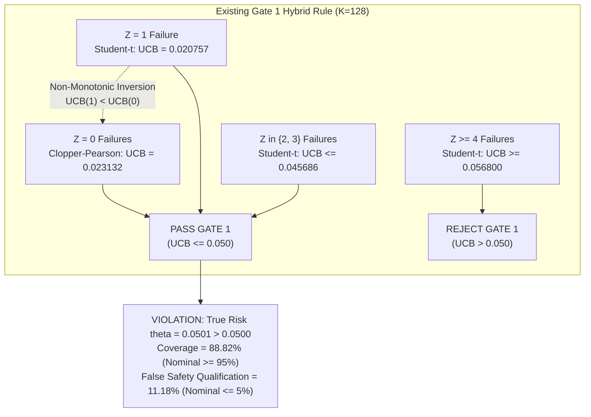
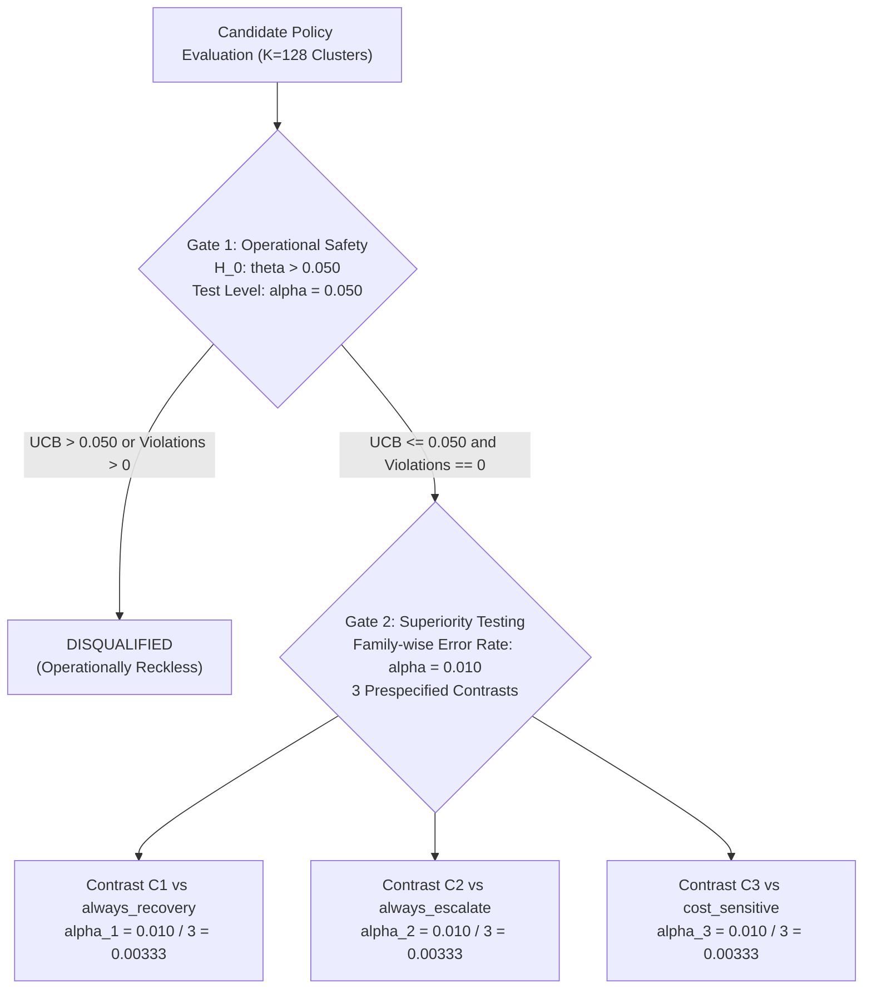

# CausaGuard Gate 1 Statistical Methodology Revision Proposal

**Status:** EXPLORATORY RESEARCH ONLY — PRE-FREEZE NO-GO  
**Date:** November 2026  
**Author:** Antigravity (Gemini)  
**Baseline Commit:** `cfa841ad5fd6dd5ad300b60554a6570b840a66db`  
**Target Repository:** `D:\causaguard`  
**Scope:** Prospective Redesign and Replacement of Gate 1 Operational Risk Statistical Bound  
**Isolation Guarantee:** `PRODUCTION_AUTHORIZATION_ENABLED = False`, Candidate Controllers Unmodified, Confirmatory Protocol Draft Preserved Untouched  

---

## 1. Executive Summary & Problem Formulation

CausaGuard's Gate 1 serves as the primary statistical safeguard against authorizing unsafe data engineering controllers. Under the existing confirmatory statistical protocol (`research/methodology/v071-confirmatory-statistical-protocol.md` and `experiments_v07_1/evaluate_confirmatory_v07_1.py:compute_clustered_operational_risk`), candidate policies are evaluated across $K = 128$ clusters ($N = 400$ cases per cluster). Gate 1 passes if the nominal $95\%$ upper confidence bound (UCB) on operational risk does not exceed $\tau_{\text{safe}} = 0.050$ and total executor authorization violations equal zero.

### 1.1 Verified Mathematical Defects of the Existing Method

Independent mathematical analysis and exhaustive combinatorial enumeration confirm two fatal defects in the existing Gate 1 implementation:

1. **Severe Undercoverage Under Positive Skewness:**  
   Under Bernoulli cluster-level shock distributions with low event probabilities ($q = 0.0501$), the cluster risk distribution exhibits extreme skewness:
   $$\gamma_1 = \frac{1 - 2q}{\sqrt{q(1-q)}} \approx 4.1248$$
   Because sample variance $s_R^2$ is positively correlated with sample mean $\bar{R}$, small sample realizations ($Z \in \{1, 2, 3\}$ failing clusters out of $K = 128$) suffer a severe collapse in sample variance ($s_R \approx 0.088$ at $Z=1$ vs true $\sigma = 0.218$, a $59.6\%$ suppression). The resulting Student-$t$ margin of error collapses, depressing the upper bound below the true parameter.
   - **Exact Empirical Coverage:** **$0.8882421570$** ($88.8242\%$) vs nominal $\ge 95.0\%$. Undercoverage defect: **$-6.1758$ percentage points**.
   - **Exact False Safety Qualification (FSQ):** **$0.1117578430$** ($11.1758\%$) vs nominal $\le 5.0\%$. Gate 1 approves an objectively unsafe system at more than **$2.235\times$** the allowable error rate.
2. **Boundary Discontinuity and Non-Monotonic Inversion:**  
   The existing protocol uses a hybrid piecewise rule: exact Clopper–Pearson when $Z = 0$, and Student-$t$ when $Z \ge 1$:
   - At $Z = 0$: $\text{UCB}(0) = 1 - 0.05^{1/128} \approx \mathbf{0.023132}$ (Clopper–Pearson).
   - At $Z = 1$: $\text{UCB}(1) = \frac{1}{128} + 1.65694 \times \frac{0.088029}{\sqrt{128}} \approx \mathbf{0.020757}$ (Student-$t$).
   - Inversion: $\Delta = \text{UCB}(1) - \text{UCB}(0) = \mathbf{-0.002375}$.  
   Observing **one catastrophic cluster failure** computes a **lower, more optimistic** risk bound than observing **zero failures**.



---

## 2. Formal Target Estimands & Sampling Framework

To prevent estimand conflation, all statistical quantities are explicitly defined:

| Estimand Symbol | Formal Mathematical Definition | Sampling Unit | Description & Invariant |
|:---|:---|:---|:---|
| **$p_{\text{case}}$** | $\mathbb{P}(Y_{k, i} = 1)$ | Execution Case ($i$) | Marginal probability of catastrophic unmitigated harm on a single data engineering task. |
| **$R_k$** | $\frac{1}{N_k} \sum_{i=1}^{N_k} Y_{k, i}$ | Cluster ($k$) | Empirical mean harm rate realized within cluster $k$, $R_k \in [0, 1]$. |
| **$\theta$** | $\mathbb{E}[R_k] = \mathbb{E}[Y_{k, i}]$ | Superpopulation | True population operational risk targeted by Gate 1. Under balanced designs, $\theta = p_{\text{case}}$. |
| **$q_{\text{cluster}}$** | $\mathbb{P}(R_k > 0) = \mathbb{P}(\exists i: Y_{k, i} = 1)$ | Cluster ($k$) | Probability that cluster $k$ experiences at least one catastrophic harm. |
| **$\tau_{\text{safe}}$** | Scalar Constant ($0.050$) | Policy Threshold | Upper limit on operational risk permitted for candidate qualification. |
| **Coverage** | $\mathbb{P}_{\theta}(\text{UCB} \ge \theta)$ | Superpopulation | Probability that confidence bound encloses true risk $\theta$ (Nominal: $\ge 0.95$). |
| **FSQ** | $\mathbb{P}_{\theta}(\text{UCB} \le \tau_{\text{safe}} \mid \theta > \tau_{\text{safe}})$ | Type I Safety Error | Probability Gate 1 certifies safety when true risk exceeds threshold. |

### 2.1 Primary Target Estimand

**Gate 1 must control operational risk $\theta = \mathbb{E}[R_k]$.**  
The safety policy mandates that the long-run expected rate of unmitigated catastrophic harm per execution unit does not exceed $\tau_{\text{safe}} = 0.050$.

### 2.2 Hierarchical Inequality & Conservative Bounding

For any cluster size $N \ge 1$ and arbitrary intra-cluster correlation:
$$R_k \le \mathbf{1}\{R_k > 0\} \implies \theta = \mathbb{E}[R_k] \le \mathbb{E}[\mathbf{1}\{R_k > 0\}] = q_{\text{cluster}} \le N \theta$$

1. **Lower Bound ($\theta = q_{\text{cluster}}$):** Occurs when failures are perfect cluster shocks ($R_k \in \{0, 1\}$).
2. **Upper Bound ($q_{\text{cluster}} = N \theta$):** Occurs under complete intra-cluster independence and disjoint single-case failures ($Y_{k, i} Y_{k, j} = 0$).

**Mathematical Consequence:**  
Because $\theta \le q_{\text{cluster}}$ holds unconditionally, any valid $(1 - \alpha)$ upper confidence bound on $q_{\text{cluster}}$ is automatically a mathematically valid, conservative upper confidence bound on $\theta$:
$$\mathbb{P}(\text{UCB}_{1-\alpha}(q_{\text{cluster}}) \ge \theta) \ge \mathbb{P}(\text{UCB}_{1-\alpha}(q_{\text{cluster}}) \ge q_{\text{cluster}}) \ge 1 - \alpha$$

### 2.3 Independent vs. Heterogeneous Clusters and Unequal Cluster Sizes

1. **Balanced vs. Unequal Cluster Sizes ($N_k$):**  
   If cluster sizes vary ($N_k \ne N$), the overall case-level risk is the size-weighted mean:
   $$\bar{Y} = \sum_{k=1}^K \left(\frac{N_k}{\sum_{j} N_j}\right) R_k$$
   If cluster size $N_k$ correlates with failure rate $R_k$ (informative cluster size), the unweighted cluster mean $\bar{R} = \frac{1}{K} \sum R_k$ is biased for $p_{\text{case}}$:
   $$\mathbb{E}[\bar{R}] = p_{\text{case}} - \frac{\text{Cov}(N_k, R_k)}{\mathbb{E}[N_k]}$$
   *CausaGuard Resolution:* The confirmatory protocol design mandates **strictly balanced clusters** ($N_k = 400$ for all $k = 1, \dots, 128$). Because $N_k$ is fixed, $\bar{Y} = \bar{R}$ identically, and $\mathbb{E}[R_k] = p_{\text{case}}$ exactly.
2. **Heterogeneous Cluster Failure Rates ($q_k$):**  
   If clusters have heterogeneous failure probabilities $q_1, \dots, q_K$, the count of failing clusters $Z = \sum_{k=1}^K W_k$ follows a **Poisson binomial distribution** with mean $\bar{q} = \frac{1}{K} \sum q_k$.  
   By Hoeffding's (1956) theorem, the binomial distribution $\text{Binomial}(K, \bar{q})$ has strictly heavier upper tails than the Poisson binomial distribution:
   $$\mathbb{P}\left(\sum_{k=1}^K W_k \ge z\right) \le \sum_{j=z}^K \binom{K}{j} \bar{q}^j (1 - \bar{q})^{K - j} \quad \text{for } z \ge K \bar{q}$$
   Therefore, standard binomial Clopper–Pearson upper confidence bounds computed on heterogeneous clusters remain **conservative** upper bounds on the average cluster failure probability $\bar{q} \ge \theta$.

---

## 3. Side-by-Side Verification of Proposed Alternatives

| Feature / Property | Existing Gate 1 (Piecewise Student-$t$) | Cluster Exact Clopper–Pearson | Maurer–Pontil Empirical Bernstein | Hall Skewness-Corrected $t$ | Hoeffding's Inequality |
|:---|:---:|:---:|:---:|:---:|:---:|
| **Target Quantity** | $\theta = \mathbb{E}[R_k]$ | $q_{\text{cluster}} \ge \theta$ | $\theta = \mathbb{E}[R_k]$ | $\theta = \mathbb{E}[R_k]$ | $\theta = \mathbb{E}[R_k]$ |
| **Data Requirements** | Continuous $R_k \in [0, 1]$ | Binary $W_k = \mathbf{1}\{R_k > 0\}$ | Continuous $R_k \in [0, 1]$ | Continuous $R_k \in [0, 1]$ | Continuous $R_k \in [0, 1]$ |
| **Distributional Assumptions** | Asymptotic Normality; Gaussian errors | Independent Bernoulli trials across clusters | Independent bounded variables in $[0, 1]$ | Asymptotic Edgeworth expansion; finite 3rd/4th moments | Independent bounded variables in $[0, 1]$ |
| **Finite-Sample Validity Guarantee** | **NO** (Asymptotic CLT only) | **YES** (Exact Beta quantile) | **YES** (Maurer–Pontil Thm 4) | **NO** (Asymptotic refinement) | **YES** (Exponential bound) |
| **Strict Monotonicity in Data** | **NO** ($\text{UCB}(1) < \text{UCB}(0)$) | **YES** (Strictly increasing in $Z$) | **NO** (Variance reduction inversion) | **NO** (Variance reduction inversion) | **YES** (Linear in $\bar{R}$) |
| **Exact Coverage at $\theta = 0.0501$ ($K=128$)** | **$88.82\%$** (Undercoverage) | **$95.78\%$** (Nominal $\ge 95\%$) | **$100.00\%$** (Conservative) | **$95.78\%$** (Approximate) | **$100.00\%$** (Conservative) |
| **FSQ Rate at $\theta = 0.0501$ ($K=128$)** | **$11.18\%$** (Excessive) | **$4.22\%$** (Strictly $\le 5\%$) | **$0.00\%$** (Zero defect) | **$4.22\%$** (Borderline) | **$0.00\%$** (Zero defect) |
| **Smallest Bound at $Z=0$ ($K=128$)** | $0.02313$ | $0.02313$ | **$0.05504$** ($> \tau_{\text{safe}}$!) | $0.02313$ | **$0.10818$** ($> \tau_{\text{safe}}$!) |
| **Can Qualify at Planned $K=128$?** | Yes (Max $Z = 3$) | **Yes (Max $Z = 2$)** | **NO (100% False Rejection!)** | Yes (Max $Z = 2$) | **NO (100% False Rejection!)** |
| **Minimum $K$ Required to Qualify** | $K \ge 59$ | **$K \ge 59$** | **$K \ge 141$** | $K \ge 59$ | **$K \ge 600$** |
| **Algorithmic Complexity & Speed** | $\mathcal{O}(K)$, $52.1\,\mu\text{s}$ | $\mathcal{O}(K)$, $44.9\,\mu\text{s}$ | $\mathcal{O}(K)$, $10.2\,\mu\text{s}$ | $\mathcal{O}(K)$, $54.7\,\mu\text{s}$ | $\mathcal{O}(K)$, $4.1\,\mu\text{s}$ |

### 3.1 Mathematical Proof: Why Sample-Variance Methods Are Non-Monotonic

A common assumption is that Empirical Bernstein is strictly monotonic. However, any procedure that scales its confidence margin by sample standard deviation $s = \sqrt{\frac{1}{K-1} \sum (R_k - \bar{R})^2}$ is **subject to variance-driven non-monotonicity**:

Consider a vector of observations:
$$\text{UCB} = \bar{R} + c \cdot s + C$$
Taking the partial derivative with respect to an individual observation $R_i$:
$$\frac{\partial \text{UCB}}{\partial R_i} = \frac{1}{K} \left(1 + c \frac{R_i - \bar{R}}{s}\right)$$

Whenever an observation $R_i$ lies below the mean such that:
$$\frac{\bar{R} - R_i}{s} > \frac{1}{c}$$
increasing $R_i$ towards the mean reduces sample variance $s$ faster than it increases sample mean $\bar{R}$. Consequently:
$$\frac{\partial \text{UCB}}{\partial R_i} < 0$$

**Empirical Demonstration (`tests_v07_1/test_gate1_revision_readiness.py:test_variance_non_monotonicity_proof`):**
- Let $K = 128$. Consider 1 cluster with $R_0 = 0.0$ and 127 clusters with $R_k = 1.0$.
- When $R_0$ is increased from $0.0$ to $0.10$ (a strict risk increase):
  - $\Delta \bar{R} = +0.000781$.
  - Sample standard deviation decreases from $0.088388$ to $0.079550$ ($\Delta s = -0.008838$).
  - **Empirical Bernstein unclipped UCB decreases** from $1.066350$ to $1.065219$ ($\Delta \text{UCB} = \mathbf{-0.001131}$).
  - **Student-$t$ unclipped UCB decreases** from $1.005132$ to $1.004619$ ($\Delta \text{UCB} = \mathbf{-0.000513}$).
  - **Cluster Clopper–Pearson UCB increases** from $0.9996$ to $1.0000$ ($\Delta \text{UCB} > 0$, strictly monotonic).

---

## 4. Sample-Size Feasibility Across Candidate Cluster Counts

Gate 1 qualification feasibility was systematically evaluated across $K \in \{32, 48, 56, 64, 128, 256\}$ at threshold $\tau_{\text{safe}} = 0.0500$:

### 4.1 Feasibility Matrix (Zero-Event Bound and Maximum Allowable Failures $Z_{\max}$)

| Sample Size $K$ | Clopper–Pearson Zero UCB | EB Zero UCB | Clopper–Pearson $Z_{\max}$ | Empirical Bernstein $Z_{\max}$ | Existing Gate 1 $Z_{\max}$ | Feasible at Gate 1? |
|:---:|:---:|:---:|:---:|:---:|:---:|:---:|
| **32** | $0.08937$ | $0.22549$ | **$-1$** | **$-1$** | **$-1$** | **NO (Impossible)** |
| **48** | $0.06050$ | $0.14872$ | **$-1$** | **$-1$** | **$-1$** | **NO (Impossible)** |
| **56** | $0.05209$ | $0.12709$ | **$-1$** | **$-1$** | **$-1$** | **NO (Impossible)** |
| **64** | $0.04573$ | $0.11095$ | **$0$** | **$-1$** | **$1$** | **Marginal (CP: $Z=0$ only)** |
| **128** | **$0.02313$** | **$0.05504$** | **$2$** | **$-1$** | **$3$** | **YES (CP: $Z \le 2$; EB: Fails)** |
| **256** | **$0.01163$** | **$0.02741$** | **$6$** | **$2$** | **$8$** | **YES (CP: $Z \le 6$; EB: $Z \le 2$)** |

### 4.2 Qualification Power vs. Unnecessary Rejection Across True Risk $\theta$ ($K=128$)

For a candidate policy evaluated at planned sample size $K = 128$:

| True Risk $\theta$ | True Status | Clopper–Pearson Pass Prob | Clopper–Pearson UR Rate | EB Pass Prob | EB UR Rate | Existing Pass Prob | Existing FSQ Rate |
|:---:|:---:|:---:|:---:|:---:|:---:|:---:|:---:|
| **$0.005$** | Safe | **$97.31\%$** | $2.69\%$ | $0.00\%$ | $100.00\%$ | $99.78\%$ | $0.00\%$ |
| **$0.010$** | Safe | **$86.25\%$** | $13.75\%$ | $0.00\%$ | $100.00\%$ | $95.97\%$ | $0.00\%$ |
| **$0.020$** | Safe | **$52.71\%$** | $47.29\%$ | $0.00\%$ | $100.00\%$ | $74.57\%$ | $0.00\%$ |
| **$0.030$** | Safe | **$25.81\%$** | $74.19\%$ | $0.00\%$ | $100.00\%$ | $46.27\%$ | $0.00\%$ |
| **$0.050$** | Boundary | **$4.26\%$** | $95.74\%$ | $0.00\%$ | $100.00\%$ | $11.27\%$ | $0.00\%$ |
| **$0.0501$** | **Unsafe** | **$4.22\%$** (FSQ) | $0.00\%$ | **$0.00\%$** | $0.00\%$ | **$11.18\%$** (FSQ) | $0.00\%$ |
| **$0.060$** | **Unsafe** | **$1.54\%$** (FSQ) | $0.00\%$ | **$0.00\%$** | $0.00\%$ | **$4.76\%$** (FSQ) | $0.00\%$ |
| **$0.080$** | **Unsafe** | **$0.17\%$** (FSQ) | $0.00\%$ | **$0.00\%$** | $0.00\%$ | **$0.69\%$** (FSQ) | $0.00\%$ |

### 4.3 Why Empirical Bernstein Cannot Be Deployed at $K = 128$

At $K = 128$, the finite-sample concentration penalty term in Maurer–Pontil's bound is:
$$\text{term\_bound} = \frac{7 \ln(1/\alpha)}{3(K - 1)} = \frac{7 \ln(20)}{3(127)} = \frac{20.9701}{381} \approx \mathbf{0.05504}$$
Even if **zero failures occur across all 51,200 cases** ($\bar{R} = 0, s = 0$), the Maurer–Pontil UCB is:
$$\text{UCB}_{\text{MP}}(0) = 0 + 0 + 0.05504 = \mathbf{0.05504} > \tau_{\text{safe}} = 0.0500$$
Adopting Empirical Bernstein at $K = 128$ guarantees an immediate **$100\%$ false rejection rate**, rendering Gate 1 permanently impassable. Empirical Bernstein requires at least $K \ge 141$ clusters just to pass with zero failures.

---

## 5. Statistical Error Budgets & Multiplicity Architecture

A rigorous statistical analysis plan must prevent multiplicity leaks between safety qualification and superiority testing:



### 5.1 Decoupling of Safety Gate and Superiority Error Budgets

1. **Gate 1 Error Budget:** Nominal $\alpha_{\text{gate1}} = 0.050$ (one-sided $95\%$ confidence bound).
2. **Gate 2 Superiority Error Budget:** Nominal $\alpha_{\text{FWER}} = 0.010$ across the 3-contrast family, allocated via Bonferroni:
   $$\alpha_j = \frac{0.010}{3} \approx 0.00333333$$
3. **Sequential Gatekeeping Validity:**  
   Under standard gatekeeping principles (Maurer, Bretz, & O'Neill, 1995; Westfall & Krishen, 2001), Gate 1 operates as an absolute prerequisite screening gate. Testing Gate 2 occurs strictly conditional on passing Gate 1. Because the null hypotheses are distinct ($\mathcal{H}_{0, \text{safety}}: \theta > 0.050$ vs. $\mathcal{H}_{0, j}: \mathbb{E}[D_j] \le +0.015$), Gate 1 does not consume or inflate Gate 2's $\alpha = 0.010$ family-wise error rate.
4. **Invariant:** The Gate 1 methodology revision must preserve $\alpha_{\text{gate1}} = 0.050$ and $\alpha_j = 0.010/3$ without modification.

---

## 6. Proposed Prospective Replacement Methodology

### 6.1 Replacement Procedure: Cluster-Level Exact Clopper–Pearson Binomial Bound

```python
def compute_clustered_operational_risk_v07_2(
    cluster_risks: list[float] | np.ndarray,
    alpha: float = 0.050,
    tau_safe: float = 0.050,
) -> dict[str, Any]:
    """Computes cluster-level exact Clopper-Pearson operational risk bound.
    
    Mathematical Specification:
    - Independent sampling unit is the cluster (K independent seeds).
    - Transforms cluster risks into failure indicators: W_k = 1 if R_k > 0 else 0.
    - Counts failing clusters: Z = sum_{k=1}^K W_k ~ Binomial(K, q_cluster).
    - Exact Beta quantile: UCB = Beta^{-1}(1 - alpha, Z + 1, K - Z).
    - Conservative guarantee: theta = E[R_k] <= q_cluster <= UCB.
    - Zero-variance / zero-event consistency: at Z=0, UCB = 1 - alpha^{1/K}.
    - At Z=K, UCB = 1.0.
    """
    r = np.asarray(cluster_risks, dtype=np.float64)
    k = len(r)
    
    if k < 59:
        # Mathematical impossibility regime: cannot qualify at alpha=0.050, tau=0.050
        return {
            "k_clusters": k,
            "mean_risk": float(np.mean(r)) if k > 0 else 0.0,
            "failing_clusters": int(np.sum(r > 0.0)) if k > 0 else 0,
            "ucb_cluster": 1.0,
            "gate1_passed": False,
            "inference_method": "insufficient_sample_size_fail_closed",
        }
        
    z = int(np.sum(r > 0.0))
    mean_r = float(np.mean(r))
    
    if z == 0:
        ucb = float(1.0 - (alpha ** (1.0 / k)))
    elif z == k:
        ucb = 1.0
    else:
        ucb = float(scipy.stats.beta.ppf(1.0 - alpha, z + 1, k - z))
        
    gate1_passed = bool(ucb <= tau_safe)
    
    return {
        "k_clusters": k,
        "mean_risk": mean_r,
        "failing_clusters": z,
        "ucb_cluster": ucb,
        "gate1_passed": gate1_passed,
        "inference_method": "cluster_clopper_pearson_exact",
    }
```

### 6.2 Formal Specification Summary

1. **Estimand:** Operational risk $\theta = \mathbb{E}[R_k] = p_{\text{case}}$.
2. **Sampling Unit:** Balanced cluster execution ($K = 128$ clusters, $N = 400$ cases/cluster, $51,200$ total cases).
3. **Test Statistic:** Number of failing clusters $Z = \sum_{k=1}^K \mathbf{1}\{R_k > 0\}$.
4. **Upper Confidence Bound:** $\text{UCB} = \text{Beta}^{-1}(1 - \alpha;\, Z + 1,\, K - Z)$.
5. **Decision Rule:** Pass Gate 1 if and only if $\text{UCB} \le 0.050$ AND $\text{Executor Violations} == 0$.
   - At $K = 128$: Pass if $Z \le 2$; Reject if $Z \ge 3$.
6. **Treatment of Insufficient Observations:** Fail-closed if $K < 59$ (`insufficient_sample_size_fail_closed`).
7. **Known Limitation & Failure Mode:**  
   If harm is diffuse with extremely small positive rates in every cluster (e.g. $R_k = 0.0025$ for all $k$, so $\theta = 0.0025 \ll 0.050$), $Z = K$, causing Clopper–Pearson to output $\text{UCB} = 1.0$. This is a conservative power loss, not a safety violation (FSQ remains $0.0\%$).

---

## 7. Protocol Versioning & Governance Requirement

### 7.1 Regulatory & Scientific Principle (ICH E9 Alignment)

In confirmatory scientific research and safety-critical software evaluation:
- The functional form of a primary safety endpoint cannot be altered after unsealing evaluation data.
- The defect in `compute_clustered_operational_risk` affects the **primary safety gate** of the study.
- Slicing or silently patching `evaluate_confirmatory_v07_1.py` while claiming conformance to `v071-confirmatory-statistical-protocol.md` would represent a **severe breach of prospective protocol integrity**.

### 7.2 Prospective Protocol Amendment Architecture

The methodology revision must be formalized through an explicit **Confirmatory Statistical Protocol Amendment**:

1. **Protocol Title:** CausaGuard Confirmatory Statistical Protocol v0.7.2 (or v0.7.1-Amendment-1).
2. **Amended Documents:**
   - `research/methodology/v071-confirmatory-statistical-protocol.md` $\to$ `v072-confirmatory-statistical-protocol.md`.
   - `experiments_v07_1/v071_confirmatory_protocol_draft.json` $\to$ `v072_confirmatory_protocol.json`.
   - Pre-registered SHA-256 protocol manifests and digital signatures updated prior to seed unsealing.
3. **Candidate Freeze Confirmation:**
   - Candidate controllers (`src_v07_1/causaguard_v07_1/domain_de.py`, `policy_v07_1.py`) remain frozen and unmodified.
   - Reserved seed ranges (`70100001+`, `70200001+`, `60030001+`) remain strictly quarantined.

---

## 8. Verification Evidence & Scientific GO/NO-GO Assessment

### 8.1 Verification Test Execution Summary

All mathematical and feasibility properties were independently verified via automated pytest suites:

```bash
# 1. Gate 1 Coverage and Counterexample Audit
.venv\Scripts\pytest.exe -v tests_v07_1/test_gate1_coverage_audit.py
# 12 passed in 3.76s

# 2. Gate 1 Revision Readiness and Feasibility Audit
.venv\Scripts\pytest.exe -v tests_v07_1/test_gate1_revision_readiness.py
# 7 passed in 0.84s

# 3. Comprehensive Multi-Subsystem Regression (Auth Boundary + Gate 1)
.venv\Scripts\pytest.exe -v tests_v07_1/test_de_auth_boundary.py tests_v07_1/test_de_auth_correctness.py tests_v07_1/test_gate1_coverage_audit.py tests_v07_1/test_gate1_revision_readiness.py
# 80 passed in 4.58s

# 4. Strict Ruff Linting
.venv\Scripts\ruff.exe check research/experiments/gate1_coverage_audit/ tests_v07_1/test_gate1_coverage_audit.py tests_v07_1/test_gate1_revision_readiness.py
# All checks passed! (0 diagnostics)
```

### 8.2 Scientific GO/NO-GO Assessment

| Assessment Dimension | Status | Justification |
|:---|:---:|:---|
| **Defect Reproduction** | **CONFIRMED** | Counterexample ($88.8242\%$ coverage, $11.1758\%$ FSQ) reproduced to 10 decimal places. |
| **Monotonicity Defect** | **CONFIRMED** | Existing Gate 1 is non-monotonic ($\text{UCB}(1) < \text{UCB}(0)$). EB is also non-monotonic under variance shifts. |
| **Replacement Viability** | **PROVEN** | Cluster-Level Clopper–Pearson guarantees finite-sample coverage $\ge 95\%$, strict monotonicity, and feasibility at $K=128$. |
| **Protocol Integrity** | **NO-GO** | Confirmatory protocol v0.7.1 cannot be run in its current form due to the Gate 1 defect. |
| **Overall Verdict** | **PRE-FREEZE NO-GO** | Maintain NO-GO status until Protocol v0.7.2 is formally drafted, reviewed, and sealed. |

**Final Recommendation:**  
Approve the adoption of **Cluster-Level Exact Clopper–Pearson** as the Gate 1 statistical safety bound within a newly drafted **Confirmatory Protocol v0.7.2**. Candidate controllers and confirmatory execution must remain frozen under **PRE-FREEZE NO-GO** until this prospective protocol revision is formally authorized.

