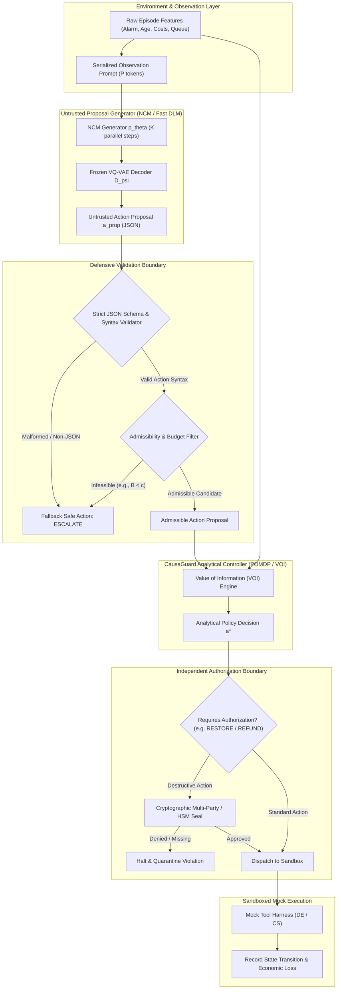
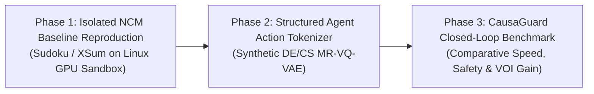
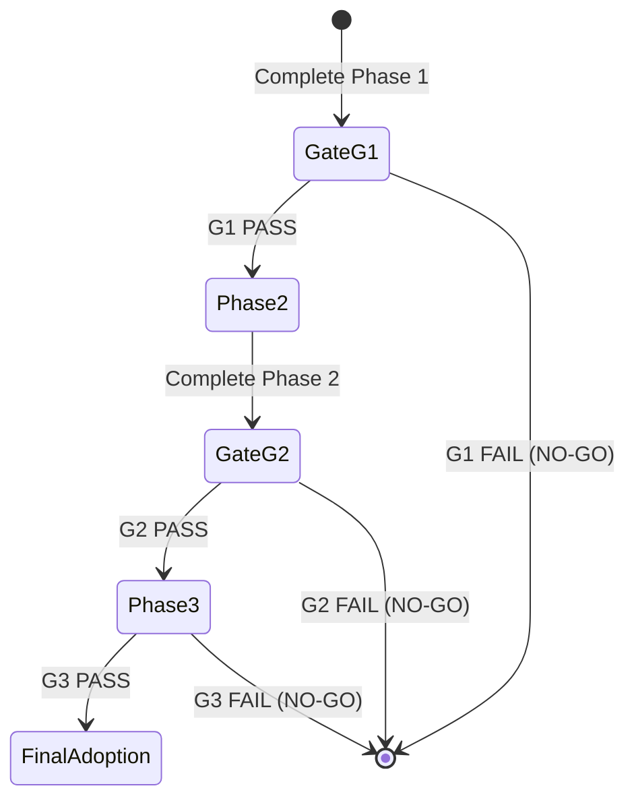

# Next-Concept Modeling (NCM) for High-Throughput Agent Action Proposal
## Architectural Feasibility, Defensive Threat Modeling, and Research Plan for CausaGuard Integration

**Document Version:** 1.0.0-PROSPECTIVE  
**Date:** 2026-11-07  
**Author:** CausaGuard Systems & Methodology Group  
**Repository:** `D:\causaguard`  
**Git Baseline:** `968ebcc`  
**Protocol Boundary:** Strictly Decoupled from Confirmatory Protocol v0.7.1  
**Governance Status:** **PRE-FREEZE / NOT APPROVED — STRICT NO-GO**

---

## 1. Executive Summary & Problem Formulation

Modern high-stakes autonomous agent workflows—such as enterprise Data Engineering (DE) pipeline management and Customer Support (CS) dispute escalation—are constrained by two opposing forces:
1. **Inference Latency & Throughput Bottlenecks:** Autoregressive Next-Token Prediction (NTP) generates action sequences strictly token-by-token ($L$ sequential forward passes), imposing severe latency overhead that limits real-time intervention responsiveness. While Diffusion Language Models (DLMs) introduce parallel sampling, they incur expensive full-sequence denoising passes ($64$–$1024$ steps) and require high compute budgets.
2. **Operational Safety & Governance Integrity:** Autonomous tool-using models cannot be trusted to self-authorize destructive actions (e.g., database restores, customer refunds, pipeline re-runs). Statistical safety must be enforced post-hoc by an independent, decoupled policy and intervention controller.

Stanford's **Next-Concept Modeling (NCM)** ([Kumbong & Khare et al., 2026](https://arxiv.org/abs/2610.14162)) proposes a two-stage coarse-to-fine generation framework that compresses text into a hierarchy of discrete multiscale codes and predicts each level in parallel. NCM achieves $10\times$–$31\times$ wall-clock speedups over competitive diffusion baselines and demonstrates superior global planning on discrete constraint-satisfaction tasks (Sudoku).

This document evaluates the feasibility, resource constraints, defensive security boundaries, and empirical roadmap for deploying NCM as an **untrusted parallel candidate action proposer** within the CausaGuard analytical intervention framework.

> [!IMPORTANT]
> **Strict Protocol Separation & Pre-Freeze Isolation:**
> This feasibility study is strictly exploratory research and is completely isolated from the prospective CausaGuard v0.7.1 confirmatory protocol. No NCM libraries, checkpoints, or dependencies shall be introduced into `src_v07_1/` or `experiments_v07_1/`. The confirmatory protocol remains in **PRE-FREEZE NO-GO** status.

---

## 2. Theoretical & Architectural Analysis of Next-Concept Modeling

### 2.1 Two-Stage Generation Paradigm
NCM replaces sequential next-token prediction with hierarchical next-concept prediction across $K$ discrete levels of increasing resolution:

$$\text{NTP (Autoregressive): } x_1 \to x_2 \to \dots \to x_L \quad (L \text{ sequential steps})$$
$$\text{NCM (Coarse-to-Fine): } r_1 \to r_2 \to \dots \to r_K \quad (K \ll L \text{ sequential steps})$$

At each level $k \in \{1, \dots, K\}$, NCM predicts all $\ell_k$ discrete codes **in parallel in a single forward pass**, where $\ell_1 < \ell_2 < \dots < \ell_K = L$.

```mermaid
flowchart TD
    subgraph Stage1["Stage 1: Multiscale Residual VQ-VAE (Tokenizer)"]
        TextIn["Input Sequence x (Length L)"] --> Encoder["Encoder E_phi(x)"]
        Encoder --> ResidualLatent["Latents z in R^{L x d}"]
        ResidualLatent --> VQ1["Level 1 Codebook V_1 (l_1 codes)"]
        VQ1 --> R1["Reconstruction Operator R_1"]
        R1 --> Res1["Residual z^(1) = z - z_hat^(1)"]
        Res1 --> VQ2["Level 2 Codebook V_2 (l_2 codes)"]
        VQ2 --> R2["Reconstruction Operator R_2"]
        R2 --> ResK["... Level K Codebook V_K (l_K = L codes)"]
        ResK --> Decoder["Decoder D_psi(z_hat^(K))"]
        Decoder --> TokenRecon["Reconstructed Tokens x_hat"]
    end

    subgraph Stage2["Stage 2: Next-Concept Transformer (Generator)"]
        Context["Prompt / Observation Prefix (P tokens)"] --> PrefixEmb["Prefix Projection"]
        PrefixEmb --> Transformer["Shared Transformer Generator p_theta"]
        z0["Initial State z_hat^(0) = 0"] --> Transformer
        Transformer --> PredL1["Predict Level 1 Codes r_1 (Parallel, l_1 codes)"]
        PredL1 --> UpdateZ1["Cumulative State z_hat^(1)"]
        UpdateZ1 --> Transformer
        Transformer --> PredL2["Predict Level 2 Codes r_2 (Parallel, l_2 codes)"]
        PredL2 --> UpdateZ2["Cumulative State z_hat^(2)"]
        UpdateZ2 --> Transformer
        Transformer --> PredLK["Predict Level K Codes r_K (Parallel, l_K = L codes)"]
        PredLK --> FinalRecon["Final State z_hat^(K)"]
        FinalRecon --> FrozenDecoder["Frozen VQ-VAE Decoder D_psi"]
        FrozenDecoder --> EmittedAction["Emitted Action Text / JSON"]
    end
```



### 2.2 Mathematical Formulation & Objectives
1. **Multiscale Residual Vector Quantization (MR-VQ):**  
   Given latent representation $z \in \mathbb{R}^{L \times d}$ and level-$k$ codebook $\mathcal{V}_k = \{e_{k,1}, \dots, e_{k,|\mathcal{V}_k|}\} \subset \mathbb{R}^d$, the residual $z^{(k-1)}$ is downsampled to $\ell_k$ positions:
   $$u_k = \text{Down}_k(z^{(k-1)}) \in \mathbb{R}^{\ell_k \times d}$$
   $$r_k^i = \arg\min_{j \in \{1, \dots, |\mathcal{V}_k|\}} \|u_k^i - e_{k,j}\|_2^2, \quad \forall i \in \{1, \dots, \ell_k\}$$
   The reconstruction operator $R_k$ maps the quantized vectors back to length $L$:
   $$\hat{z}^{(k)} = \hat{z}^{(k-1)} + R_k(e_k(r_k)), \quad z^{(k)} = z - \hat{z}^{(k)}$$

2. **Tokenizer Training with Nested Dropout:**  
   To prevent co-adaptation where earlier levels are ignored, nested dropout samples a cutoff level $k \sim \{1, \dots, K\}$, forcing intermediate cumulative reconstructions $\hat{z}^{(k)}$ to independently decode into meaningful text:
   $$\mathcal{L}_{\text{tok}} = -\frac{1}{L} \sum_{i=1}^L \log p_\psi(x_i \mid \hat{z}^{(k)}) + \beta \,\text{MSE}(z, \text{sg}[\hat{z}^{(k)}]) + \text{MSE}(\text{sg}[z], \hat{z}^{(k)})$$
   where $\text{sg}[\cdot]$ denotes the stop-gradient operator.

3. **Next-Concept Transformer Generator:**  
   Once the tokenizer is frozen, the generator $p_\theta$ is trained with conditioning corruption (replacing random input codes with codebook noise at rate $\approx 0.50$ to mimic inference errors):
   $$\mathcal{L}_{\text{NCM}} = -\sum_{k=1}^K w_k \sum_{i=1}^{\ell_k} \log p_\theta(r_k^i \mid \tilde{z}^{(k-1)}), \quad w_k = \frac{\ell_k^{-\alpha}}{\sum_{j=1}^K \ell_j^{1-\alpha}}$$
   During generation, all $\ell_k$ codes for level $k$ are sampled conditionally independent in **one forward step**:
   $$p_\theta(r_k \mid \hat{z}^{(k-1)}) = \prod_{i=1}^{\ell_k} p_\theta(r_k^i \mid \hat{z}^{(k-1)})$$

---

## 3. Survey of Released Artifacts & Checkpoint Viability

### 3.1 Repository & License Profile
- **Repository:** `https://github.com/HazyResearch/ncm`
- **Authors:** Hermann Kumbong, Ishan S. Khare, Iddah Mlauzi, Andrew Woen, Charles Ding, E. Kelly Buchanan, Simran Arora, Azalia Mirhoseini, Christopher Ré (Stanford Hazy Research & Together AI).
- **License:** **MIT License** (permissive for research, modification, and integration).
- **Hugging Face Hub Repositories:**
  - Checkpoints: `hazyresearch/ncm-checkpoints`
  - Datasets: `hazyresearch/ncm-datasets`

### 3.2 Evaluation of Released Pretrained Checkpoints
The repository releases checkpoints trained for 6 distinct benchmark configurations:

| Model / Task | Architecture ($K, L, P$) | Parameter Count | Vocab Type / Base | Suitability for Agent Tool Proposal |
|---|---|---|---|---|
| **Sudoku** | $K=12, L=89, P=91$ | $25.5\text{M}$ | Custom Puzzle ($|\mathcal{V}|=12$) | **UNSUITABLE** (Puzzle board digits only) |
| **XSum** | $K=8, L=48, P=512$ | $88.0\text{M}$ | GPT-2 BPE ($50\text{k}$) | **UNSUITABLE** (News summaries, $L=48$ fixed) |
| **WMT14 De–En** | $K=11, L=64, P=96$ | $120.0\text{M}$ | Qwen3-0.6B ($151\text{k}$) | **UNSUITABLE** (German translation, $L=64$ fixed) |
| **LM1B** | $K=12, L=128, P=1$ | $97\text{M}$ / $317\text{M}$ / $725\text{M}$ | BERT uncased ($30\text{k}$) | **UNSUITABLE** (Unconditional paragraph text) |
| **TinyStories** | $K=12, L=128, P=1$ | $88.6\text{M}$ | Custom BPE ($8\text{k}$) | **UNSUITABLE** (Children's stories, unconditional) |
| **OpenWebText** | $K=32, L=1024, P=1$ | $94.6\text{M}$ | GPT-2 BPE ($50\text{k}$) | **UNSUITABLE** (Unconditional web text, $L=1024$) |

### 3.3 Checkpoint Retraining & Adaptation Requirement
**Direct Conclusion:** None of the publicly released NCM checkpoints can perform structured agent tool-action proposal generation out of the box.
- *Root Cause 1 (Fixed Sequence Geometry):* NCM requires rigid sequence length schedules. In all released configurations, target length $L$ and level ladder $\ell_1, \dots, \ell_K$ are fixed during tokenizer construction.
- *Root Cause 2 (Out-of-Distribution Vocabulary):* The existing tokenizers were trained on natural language corpora or Sudoku grids; they lack schema-level representations for tool calls, JSON structures, parameter key-value pairs, and environmental state vectors.
- *Mandatory Engineering Step:* Deploying NCM in CausaGuard requires **training a dedicated task-specific VQ-VAE tokenizer and generator** on agent interaction logs.

---

## 4. Proposed CausaGuard + NCM Decoupled Architecture

To safely leverage NCM's high parallel throughput without compromising runtime safety or authorization boundaries, CausaGuard must enforce a **strict four-layer isolation topology**:



### 4.1 Invariants of the Decoupled Architecture
1. **Zero Self-Authorization:** The NCM model acts exclusively as an untrusted proposal mechanism. It has zero capability, API interface, or authority to dispatch tools or grant cryptographic permissions.
2. **Defensive Schema Parsing:** Because NCM can produce token substitution errors or syntax truncations, output strings are passed to a fail-closed schema validator before reaching the policy engine. Any invalid JSON immediately triggers fallback escalation.
3. **Causal Policy Superiority:** The CausaGuard Bayesian VOI policy independently assesses whether the proposed action is economically optimal relative to baseline actions (`escalate`, `proceed`, `verify`), pruning suboptimal or dangerous actions.

---

## 5. Technical, Hardware & Supply-Chain Security Constraints

### 5.1 Hardware & Compute Requirements
- **Inference Profile:**  
  NCM generators ($\approx 25\text{M}$–$120\text{M}$ parameters) require $\approx 2\text{GB}$ VRAM in BF16 precision. A modern GPU (e.g., NVIDIA RTX 4090, A10G, A100) easily handles batch size 16 generation in under $50\text{ms}$ per batch.
- **Training Profile:**  
  Training the multiscale VQ-VAE tokenizer requires $10\text{k}$–$78\text{k}$ updates at batch size $768$–$4096$; generator training requires $50\text{k}$–$250\text{k}$ updates. For CausaGuard's small-scale synthetic domains (DE/CS with vocabularies $< 500$ and $L \le 64$), training converges in $\approx 2$–$6$ GPU hours on an A100.
- **Host Platform Constraints:**  
  NCM relies on `flash-attn` and `torch.compile`. On Windows development hosts, compiling `flash-attn` C++/CUDA extensions is notoriously unstable. **All NCM training and benchmarking must be containerized in a Linux (Ubuntu 22.04 / CUDA 12.x) environment.**

### 5.2 Supply-Chain & Dependency Threat Model

| Risk Vector | Threat Description | Mandatory Defensive Countermeasure |
|---|---|---|
| **PyTorch Pickle Exploits** | Third-party `.pt` checkpoint files execute arbitrary Python bytecode during `torch.load()`. | Strictly enforce `weights_only=True` in all deserializers, or convert checkpoints to `.safetensors` prior to ingestion. |
| **FlashAttention Kernel Integrity** | Dynamic compilation of CUDA kernels via Ninja can execute unauthorized shell commands. | Build wheels in an isolated CI container; pin exact package hashes in `requirements.txt`. |
| **Model Inversion / Latent Leakage** | NCM latent codes could unintentionally encode latent simulation state or private customer PII. | Verify that NCM generator receives only public observation features, with zero access to hidden counterfactual state $S^*$. |

---

## 6. Phased Empirical Research Roadmap



### Phase 1: Isolated Baseline Reproduction (Off-Repository Sandbox)
- **Objective:** Independently verify NCM generation efficiency and Sudoku constraint-solving accuracy on a dedicated cloud Linux GPU (1x A100 or RTX 4090).
- **Scope:** Clone `https://github.com/HazyResearch/ncm`, download official Sudoku ($25.5\text{M}$) and XSum ($88\text{M}$) checkpoints from `hazyresearch/ncm-checkpoints`.
- **Target Metrics:**
  - Sudoku solved boards: Easy $\ge 99\%$, Medium $\ge 95\%$, Hard $\ge 85\%$ at $\text{NFE} = 12$.
  - End-to-end latency: Verify $\ge 10\times$ speedup over autoregressive / diffusion baselines.

### Phase 2: Domain-Specific Tokenization & Structured Proposal Training
- **Objective:** Construct a specialized Multiscale Residual VQ-VAE for CausaGuard structured actions.
- **Action Grammar:** Define fixed-length JSON template ($L=32$ tokens):
  ```json
  {"action":"verify","target":"pipeline_0","budget":1}
  ```
- **Tokenizer Architecture:** $K=6$ levels ($\ell_k \in \{1, 2, 4, 8, 16, 32\}$), codebook size $|\mathcal{V}_k| = 256$, latent width $d=128$.
- **Training Corpus:** Generate $100\text{k}$ synthetic (observation $\to$ optimal action) trajectories using CausaGuard exploratory seed simulations.

### Phase 3: Closed-Loop Intervention & Safety Benchmark
- **Objective:** Evaluate NCM against standard Autoregressive (GPT-style) and Diffusion (MDLM) drafters within the CausaGuard execution environment.
- **Evaluated Baselines:**
  1. *Autoregressive NTP Agent:* Standard sequential token-by-token proposer.
  2. *Next-Concept Proposer (NCM):* Hierarchical coarse-to-fine candidate generator.
  3. *Uncalibrated Greedy Baseline:* Static threshold proposer without VOI filtering.
  4. *Oracle Policy:* Causal upper bound with perfect hidden-state access.

---

## 7. Measurable GO / NO-GO Decision Matrix

Advancement between research phases requires satisfying explicit quantitative gates:



| Decision Gate | Metric / Criterion | PASS Threshold (GO) | FAIL Threshold (NO-GO) | Rationale |
|---|---|---|---|---|
| **Gate G1 (Reproduction)** | Sudoku Hard Accuracy & Latency | $\ge 85.0\%$ solved; $\ge 8\times$ faster than AR | $< 80.0\%$ solved or $< 5\times$ speedup | Confirms NCM's theoretical planning efficiency translates to empirical practice. |
| **Gate G2 (Syntax & Schema)** | Action Proposal JSON Validity | $\ge 99.95\%$ well-formed JSON; $\ge 99.0\%$ admissible | $< 99.0\%$ valid JSON or $< 95.0\%$ admissible | High syntax corruption undermines parallel latency gains through frequent fallbacks. |
| **Gate G3 (Safety & Gain)** | Clustered Risk & Economic Utility | $\text{Risk} \le 0.050$; $\Delta_{\text{util}} > +0.015$ over heuristic | $\text{Risk} > 0.050$ or $\Delta_{\text{util}} \le 0$ | Proves CausaGuard controller strictly guarantees safety while realizing net economic value. |

---

## 8. Limitations & Open Research Questions

1. **Rigid Sequence Schedule vs. Dynamic Action Spaces:**  
   NCM fixes target length $L$ and level ladder $\ell_1, \dots, \ell_K$. For complex tools with variable numbers of parameters, fixed padding introduces redundant compute and potential decoding ambiguities.
2. **Coarse-Level Semantic Grounding in Agent Domains:**  
   In natural language, coarse levels capture topics (e.g., "story about a cat"). In discrete operational tools, it is unclear whether coarse levels learn meaningful abstractions (e.g., "verification vs. direct recovery") or merely uninterpretable average vectors.
3. **Susceptibility to Adversarial Prompt Injection:**  
   Because all tokens in a level attend in parallel via block-diagonal attention, adversarial prompt injections within case arguments might simultaneously perturb all codes across a level, bypassing sequential attention defenses.
4. **Decoupled Verification Overhead:**  
   While NCM generates proposals $20\times$ faster, downstream POMDP belief updating and Bayesian VOI calculation require CPU/GPU cycles. The net system latency must be evaluated holistically.

---

## 9. Bibliography & Verified Citations

1. **Kumbong, H.\*, Khare, I. S.\*, Mlauzi, I., Woen, A., Ding, C., Buchanan, E. K., Arora, S., Mirhoseini, A., & Ré, C.** (2026). *Next-Concept Modeling: Fast, Parallel Coarse-to-Fine Text Generation.* arXiv preprint [arXiv:2610.14162v1](https://arxiv.org/abs/2610.14162). Official Code: [https://github.com/HazyResearch/ncm](https://github.com/HazyResearch/ncm).
2. **Van den Oord, A., Vinyals, O., & Kavukcuoglu, K.** (2017). *Neural Discrete Representation Learning (VQ-VAE).* Advances in Neural Information Processing Systems (NeurIPS), 30.
3. **Tian, K., Jiang, Y., Yuan, Z., Peng, B., & Wang, L.** (2024). *Visual Autoregressive Modeling: Scalable Image Generation via Next-Scale Prediction (VAR).* Advances in Neural Information Processing Systems (NeurIPS), 37:84839–84865.
4. **Sahoo, S. S., Arriola, M., Schiff, Y., Gokaslan, A., Marroquin, E., Chiu, J. T., Rush, A., & Kuleshov, V.** (2024). *Simple and Effective Masked Diffusion Language Models (MDLM).* arXiv preprint arXiv:2406.07524.
5. **Hu, K., Qiu, L., Lu, Y., Zhao, H., Li, T., Kim, Y., Andreas, J., & He, K.** (2026). *ELF: Embedded Language Flows.* arXiv preprint arXiv:2605.10938.
6. **Nie, S., Zhu, F., You, Z., Zhang, X., Ou, J., Hu, J., Zhou, J., Lin, Y., Wen, J.-R., & Li, C.** (2025). *Large Language Diffusion Models (LLaDA).* arXiv preprint arXiv:2502.09992.
7. **Kwon, W., Li, Z., Zhuang, S., Sheng, Y., Zheng, L., Yu, C. H., Gonzalez, J. E., Zhang, H., & Stoica, I.** (2023). *Efficient Memory Management for Large Language Model Serving with PagedAttention.* arXiv preprint arXiv:2309.06180.
8. **Bertsch, A., Xie, A., Neubig, G., & Gormley, M. R.** (2023). *It’s MBR All the Way Down: Modern Generation Techniques Through the Lens of Minimum Bayes Risk.* Proceedings of the Big Picture Workshop, pages 108–122.

