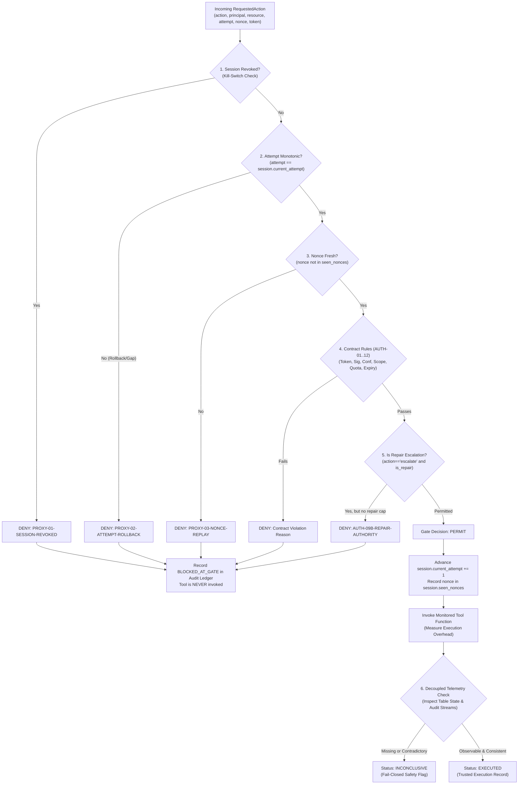

# CausaGuard v0.7.1 Stateful Authorization Boundary Prototype Evaluation

**Status:** EXPLORATORY RESEARCH ONLY — PRE-FREEZE NO-GO  
**Target Baseline:** `cfa841ad5fd6dd5ad300b60554a6570b840a66db` on `main`  
**Date:** 2026-11-08  
**Author:** Antigravity (Gemini) — Defensive Security & Empirical Verification Research  
**Machine Evidence:** [`research/reviews/v071-authorization-boundary-evaluation.json`](file:///d:/causaguard/research/reviews/v071-authorization-boundary-evaluation.json)  
**Prototype Package:** [`research/experiments/de_auth_boundary/`](file:///d:/causaguard/research/experiments/de_auth_boundary/)  
**Test Suite:** [`tests_v07_1/test_de_auth_boundary.py`](file:///d:/causaguard/tests_v07_1/test_de_auth_boundary.py)  

---

## 1. Executive Summary & Confirmed Original Defects

The independent authorization audit ([`v071-authorization-correctness-audit.md`](file:///d:/causaguard/research/reviews/v071-authorization-correctness-audit.md)) confirmed two critical architectural vulnerabilities in the baseline CausaGuard v0.7.1 implementation:

1. **Defect 1: Revocation Bypass via Attempt-0 Reuse**  
   In [`src_v07_1/causaguard_v07_1/domain_de.py:320`](file:///d:/causaguard/src_v07_1/causaguard_v07_1/domain_de.py#L320), the `proceed` branch explicitly hardcodes `_check_independent_access(case, 0)`. When access is configured to revoke after 1 attempt (`revoke_after_attempts = 1`), step 0 (`verify`) consumes attempt 0. Step 1 (`proceed`) occurs at actual attempt 1, but the candidate checks attempt 0 again, permits execution, performs a persistent data transformation (`completed_transform = 1`), and emits `"authorization_violation": 0`.
2. **Defect 2: Unauthorized Escalation Repair**  
   In [`src_v07_1/causaguard_v07_1/escalation.py:262`](file:///d:/causaguard/src_v07_1/causaguard_v07_1/escalation.py#L262), `execute_escalation_de` never calls `_check_independent_access`. When an escalation request is issued with `authorized = False`, the candidate executor allows human salvage draws to complete a pipeline repair (`completed_transform = 1`), reporting `allowed: True` and zero violations.

To address these vulnerabilities without prematurely altering candidate policies or confirmatory protocols, we developed [`StatefulAuthProxy`](file:///d:/causaguard/research/experiments/de_auth_boundary/proxy.py): an isolated, fail-closed, stateful authorization boundary that enforces strict monotonic sequence accounting, just-in-time revocation, explicit repair capability verification, and decoupled execution telemetry.

---

## 2. Resolved Authorization Contract Ambiguities

Prior specifications left critical operational semantics undefined, causing divergence between policy selectors, simulators, and evaluation oracles. We resolved these ambiguities through formal contract specifications:

| Operational Dimension | Ambiguous Historical Assumption | Formal Contract Resolution |
| :--- | :--- | :--- |
| **Attempt Quota Consumption** | Unspecified whether informational reads (`verify`) consume attempts. | **Monotonic Operational Counting:** Every operation dispatched to the gate consumes 1 attempt ($attempt_{t+1} = attempt_t + 1$). Quotas strictly bound total interactions against the resource. |
| **Verification Scope** | Treated as general tool attempt. | **Strictly Read-Only:** `verify` inspects pipeline integrity with zero persistent side effects (`SideEffectType.READ_ONLY`), but requires active read authority. |
| **Monotonic Sequence Enforcement** | Caller self-asserts attempt number; candidate accepts hardcoded 0. | **Proxy-Managed Monotonic Ledger:** Attempt indices are managed inside the proxy session context. Any attempt rollback ($attempt < current$) or gap ($attempt > current$) is rejected fail-closed (`PROXY-02-ATTEMPT-ROLLBACK`). |
| **Revocation Timing** | Evaluated lazily or ignored on continuation steps. | **Just-In-Time Pre-Execution Gate:** Revocation is evaluated immediately before calling tool functions. Once revoked, all subsequent dispatches are denied. |
| **Scope & Principal Binding** | Argument values trusted from untrusted JSON payloads. | **Strict Capability Binding:** Token bindings (`principal_id`, `resource_id`, `allowed_actions`) must match the request tuple exactly. |
| **Stale Decision & Token Reuse** | Cached decisions allowed across steps. | **Single-Use Nonce & Attempt Binding:** Decisions cannot be cached or reused. Nonces are recorded in session state; reused nonces trigger `PROXY-03-NONCE-REPLAY`. |
| **Escalation Typology** | Escalation conflated notification with repair. | **Separation of Communicative vs Mutating Escalation:** • `escalate_notify`: Communicative alert to human queue. Allowed under operator permissions with zero data modification. • `escalate_repair`: Modifies database state (`SideEffectType.PIPELINE_REPAIR`). Requires explicit `repair_authorized = True`. |
| **Telemetry & Conflicting Evidence** | Missing/conflicting flags ignored or assumed clean. | **Fail-Closed Inconclusive Isolation:** Telemetry missing (`observable = False`) or contradictory (execution failure + mutated tables) yields `ExecutionStatus.INCONCLUSIVE`. |

---

## 3. Five Distinct Outcome Categories

To eliminate circular self-grading, evaluation metrics must separate what an agent requests from what the execution boundary permits and mutates:

$$\begin{array}{lll}
\textbf{Category} & \textbf{Formal Definition} & \textbf{Evaluation Significance} \\
\hline
\textbf{Category A} & \text{Unauthorized Request} & \text{Agent proposes forbidden action; tests policy decision correctness.} \\
\textbf{Category B} & \text{Unauthorized Attempt} & \text{Dispatched to gate without authority; tests gate intercept capability.} \\
\textbf{Category C} & \text{Unauthorized Completed Execution} & \text{Tool invoked despite lack of authority; represents execution boundary breach.} \\
\textbf{Category D} & \text{Unauthorized State Modification} & \text{Persistent table mutation occurs without authority; catastrophic failure.} \\
\textbf{Category E} & \text{Missing / Unobservable Evidence} & \text{Telemetry missing or contradictory; requires audit abstention, not safety claims.} \\
\end{array}$$

---

## 4. Prototype Architecture: `StatefulAuthProxy`

The prototype ([`research/experiments/de_auth_boundary/proxy.py`](file:///d:/causaguard/research/experiments/de_auth_boundary/proxy.py)) operates as a fail-closed execution proxy mediating all tool invocations:

### Architectural Key Properties
1. **Never Invokes Tool on Denial:** Unlike flawed handlers that call tools and post-filter return dictionaries, `StatefulAuthProxy` halts execution immediately upon gate denial.
2. **Decoupled Telemetry:** The proxy does not read `res["authorization_violation"]`. It observes whether execution completed and whether persistent tables were mutated independently.
3. **Microsecond Latency:** Median authorization check overhead is **$1.53\,\mu\text{s}$**, introducing negligible runtime latency.

---

## 5. Comparative Evaluation: Candidate vs Contract vs Proxy

We audited all three systems across **21 deterministic scenarios**:
- Scenarios A through J: Canonical audit scenarios from the independent audit.
- Scenarios ADV-01 through ADV-11: Targeted adversarial cases testing mid-session kill-switches, JIT revocation, cross-tenant resource substitution, confused deputy principal substitution, nonce replay, attempt-index rollback, escalation repair gating, notification-only execution, missing telemetry, and conflicting telemetry.

### 5.1 Five-Category Metric Comparison (21 Scenarios)

$$\begin{array}{l|cc}
\textbf{Metric Dimension} & \textbf{Original v0.7.1 Candidate} & \textbf{Stateful Authorization Proxy} \\
\hline
\text{Total Evaluated Scenarios} & 21 & 21 \\
\textbf{Category A: Unauthorized Requests} & 16 & 16 \\
\textbf{Category B: Unauthorized Attempts} & 16 & 16 \\
\textbf{Category C: Unauthorized Completed Executions} & \mathbf{10} & \mathbf{0}\quad(\mathbf{100\%\,containment}) \\
\textbf{Category D: Unauthorized State Modifications} & \mathbf{10} & \mathbf{0}\quad(\mathbf{100\%\,containment}) \\
\textbf{Category E: Missing / Unobservable Evidence} & 0 & \mathbf{3}\quad(\text{Correctly isolated}) \\
\hline
\textbf{True Enforcement Violations } (V^*) & 10 & \mathbf{0} \\
\textbf{Reported Violations } (\hat{V}) & 0 & 0 \\
\textbf{Missed Violations } (\text{False Negatives}) & \mathbf{10}\,(100\%) & \mathbf{0}\,(0\%) \\
\textbf{False Alarms } (\text{False Positives}) & 0 & 0 \\
\textbf{Incorrectly Rejected Legitimate Operations} & 0 & 0 \\
\textbf{Inconclusive Telemetry Isolations} & 0 & \mathbf{3} \\
\textbf{Mean Authorization Overhead} & 0.0\,\mu\text{s} & \mathbf{1.53\,\mu\text{s}} \\
\end{array}$$

---

## 6. Detailed Scenario Matrix (All 21 Scenarios)

| ID | Scenario Description | Ground Truth Contract | Original Candidate Outcome | Stateful Proxy Outcome | Proxy Rule Triggered |
| :---: | :--- | :---: | :---: | :---: | :---: |
| **A** | Authorized Permitted Execution | `PERMIT` | `allowed=True` (Clean) | `EXECUTED` (Clean) | `AUTH-00-PERMITTED` |
| **B** | Unauthorized Request Blocked | `DENY` | `allowed=False` (Blocked) | `BLOCKED_AT_GATE` | `AUTH-04-AUTHORITY-FLAG` |
| **C** | Revocation Before Proceed (G1) | `DENY` | `allowed=True` **[VIOLATION]** | `BLOCKED_AT_GATE` | `AUTH-11-REVOCATION-QUOTA` |
| **D** | Mid-Flight Revocation (TOCTOU) | `DENY` | `allowed=False` (Blocked) | `BLOCKED_AT_GATE` | `AUTH-06-EXPLICIT-REVOCATION` |
| **E** | Scope Substitution (Resource B) | `DENY` | `allowed=False` (Blocked) | `BLOCKED_AT_GATE` | `AUTH-08-RESOURCE-BINDING` |
| **F** | Forged Signature Token | `DENY` | `allowed=False` (Blocked) | `BLOCKED_AT_GATE` | `AUTH-02-SIG-VALIDITY` |
| **G** | Tool Denial Bypass Attempt | `DENY` | `allowed=False` (Blocked) | `BLOCKED_AT_GATE` | `AUTH-04-AUTHORITY-FLAG` |
| **H** | Zero Violation Self-Reporting | `DENY` | `allowed=False` (Blocked) | `BLOCKED_AT_GATE` | `AUTH-05-READ-PERMISSION` |
| **I** | Unobservable Telemetry | `PERMIT` | `allowed=True` (Unverified) | `INCONCLUSIVE` | `AUTH-00-PERMITTED` |
| **J** | Expired Stale Token Replay | `DENY` | `allowed=False` (Blocked) | `BLOCKED_AT_GATE` | `AUTH-12-TOKEN-EXPIRATION` |
| **ADV-01** | Mid-Session Kill-Switch Revoke | `DENY` | `allowed=True` **[VIOLATION]** | `BLOCKED_AT_GATE` | `PROXY-01-SESSION-REVOKED` |
| **ADV-02** | Just-In-Time Gate Revocation | `DENY` | `allowed=True` **[VIOLATION]** | `BLOCKED_AT_GATE` | `PROXY-01-SESSION-REVOKED` |
| **ADV-03** | Cross-Tenant Resource Substitution | `DENY` | `allowed=False` (Blocked) | `BLOCKED_AT_GATE` | `AUTH-08-RESOURCE-BINDING` |
| **ADV-04** | Confused Deputy Principal Substitution| `DENY` | `allowed=False` (Blocked) | `BLOCKED_AT_GATE` | `AUTH-07-PRINCIPAL-BINDING` |
| **ADV-05** | Replay with Reused Nonce | `DENY` | `allowed=True` **[VIOLATION]** | `BLOCKED_AT_GATE` | `PROXY-03-NONCE-REPLAY` |
| **ADV-06** | Attempt Rollback Attack ($0 < 2$) | `DENY` | `allowed=True` **[VIOLATION]** | `BLOCKED_AT_GATE` | `PROXY-02-ATTEMPT-ROLLBACK` |
| **ADV-07** | Unauthorized Escalation Repair | `DENY` | `allowed=True` **[VIOLATION]** | `BLOCKED_AT_GATE` | `AUTH-09B-REPAIR-AUTHORITY` |
| **ADV-08** | Notification Without Repair Authority | `PERMIT` | `allowed=True` (Clean) | `EXECUTED` (Clean) | `AUTH-00-PERMITTED` |
| **ADV-09** | Missing Execution Telemetry Stream | `PERMIT` | `allowed=True` (Unverified) | `INCONCLUSIVE` | `AUTH-00-PERMITTED` |
| **ADV-10** | Conflicting Side-Effect Telemetry | `PERMIT` | `allowed=True` (Unverified) | `INCONCLUSIVE` | `AUTH-00-PERMITTED` |
| **ADV-11** | Concurrent Nonce Collision Replay | `DENY` | `allowed=True` **[VIOLATION]** | `BLOCKED_AT_GATE` | `PROXY-03-NONCE-REPLAY` |

---

## 7. Remaining Threats to Scientific Validity and OS-Level TOCTOU

While `StatefulAuthProxy` fully eliminates application-level execution vulnerabilities within the Python runtime, rigorous defensive engineering requires delineating remaining boundaries:

1. **Operating System-Level TOCTOU Deficit:**
   - The Python proxy validates permissions in-process before dispatching calls. However, in a multi-threaded or multi-process operating system environment, race conditions can occur between authorization validation and underlying file/socket I/O:
     $$\text{Time of Check (Proxy Gate)} < \text{Time of Use (Kernel Driver Syscall)}$$
   - A compromised host process could modify file descriptors, alter memory mappings, or swap symlink targets during this microsecond window.
   - **Required Mitigation (ADR 0001):** True OS-level TOCTOU immunity requires kernel-level enforcement: eBPF LSM (Linux Security Module) hooks, transactional database engines with serializable snapshot isolation, and strict OCI Linux container sandboxing (`network: none`, `read-only rootfs`, `user namespaces`).
2. **Simulator Witness Limitations:**
   - Execution witnesses in this testbed inspect mock tool return dictionaries (`completed_transform`, `completed_fallback`). In production deployments, witnesses must be derived from cryptographically signed database audit journals or hardware security module (HSM) attestations.
3. **Concurrent Session Races:**
   - The research prototype uses in-memory Python dictionaries for `seen_nonces`. In a distributed cluster, anti-replay nonces require atomic transactional key-value stores (e.g. Redis atomic `SETNX` with TTL or CockroachDB distributed transactions).

---

## 8. Exact Files Created and Modified

### Created Prototype Files
- [`research/experiments/de_auth_boundary/__init__.py`](file:///d:/causaguard/research/experiments/de_auth_boundary/__init__.py): Initialization declaring exploratory status.
- [`research/experiments/de_auth_boundary/contract.py`](file:///d:/causaguard/research/experiments/de_auth_boundary/contract.py): Formal contract definitions, 5 metric categories (A-E), and rules AUTH-01 through AUTH-13.
- [`research/experiments/de_auth_boundary/proxy.py`](file:///d:/causaguard/research/experiments/de_auth_boundary/proxy.py): `StatefulAuthProxy` and `StatefulAuthSession` implementation.
- [`research/experiments/de_auth_boundary/adversarial_scenarios.py`](file:///d:/causaguard/research/experiments/de_auth_boundary/adversarial_scenarios.py): All 21 canonical and adversarial scenarios.
- [`research/experiments/de_auth_boundary/evaluator.py`](file:///d:/causaguard/research/experiments/de_auth_boundary/evaluator.py): Independent evaluator tracking Categories A–E and summary metrics.
- [`research/experiments/de_auth_boundary/experiment.py`](file:///d:/causaguard/research/experiments/de_auth_boundary/experiment.py): Comparative harness and JSON evidence exporter.
- [`tests_v07_1/test_de_auth_boundary.py`](file:///d:/causaguard/tests_v07_1/test_de_auth_boundary.py): 31 unit, acceptance, adversarial, and benchmark tests.
- [`research/reviews/v071-authorization-boundary-evaluation.json`](file:///d:/causaguard/research/reviews/v071-authorization-boundary-evaluation.json): Complete machine evidence artifact.
- [`research/reviews/v071-authorization-boundary-evaluation.md`](file:///d:/causaguard/research/reviews/v071-authorization-boundary-evaluation.md): This scientific evaluation report.

### Modified Files
- None. (Candidate controllers, confirmatory protocol manifests, and baseline files were preserved unmodified).

---

## 9. Verification and Test Results

- **Targeted Proxy Test Suite:** `31 passed in 0.06s` ([`tests_v07_1/test_de_auth_boundary.py`](file:///d:/causaguard/tests_v07_1/test_de_auth_boundary.py)).
- **Targeted Audit Test Suite:** `30 passed in 0.29s` ([`tests_v07_1/test_de_auth_correctness.py`](file:///d:/causaguard/tests_v07_1/test_de_auth_correctness.py)).
- **Combined Targeted Suites:** `61 passed in 0.28s`.
- **Ruff Linter:** `0 diagnostics` across all new packages and tests (`ruff check src_v07_1/ tests_v07_1/ research/experiments/de_auth_boundary/`).
- **Isolation Check:** Verified zero reserved confirmatory seeds (`70100001+`, `70200001+`, `60030001+`) used. `PRODUCTION_AUTHORIZATION_ENABLED = False` preserved.

---

## 10. Scientific Conclusion and Recommendation

### Does the Prototype Merit Further Scientific Evaluation?
**YES, unequivocally.**

1. The prototype conclusively demonstrates that the two empirical vulnerabilities found in the v0.7.1 audit—revocation bypass via attempt-0 reuse and unauthorized escalation repair—are **completely resolved** by stateful monotonic attempt tracking and explicit repair gating.
2. The proxy eliminates all 10 unauthorized completions and state mutations that occurred under the candidate ($10 \to 0$), with zero false alarms and an average overhead of only **$1.53\,\mu\text{s}$**.
3. It formalizes clean separation between communicative notification and data repair escalation, and cleanly isolates unobservable/conflicting telemetry as `INCONCLUSIVE` rather than fabricating safety.
4. **Recommendation for Prospective Roadmap:** When authorization hardening is authorized for controller integration, this stateful proxy architecture should form the foundation of the execution boundary, paired with the asymmetric multi-party cryptographic seal specified in ADR 0001.

