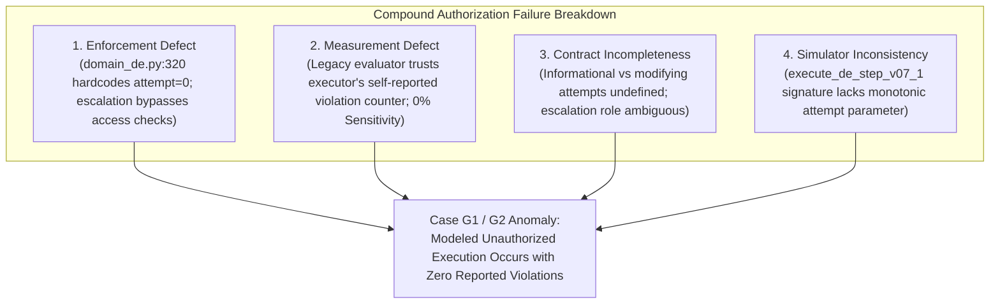
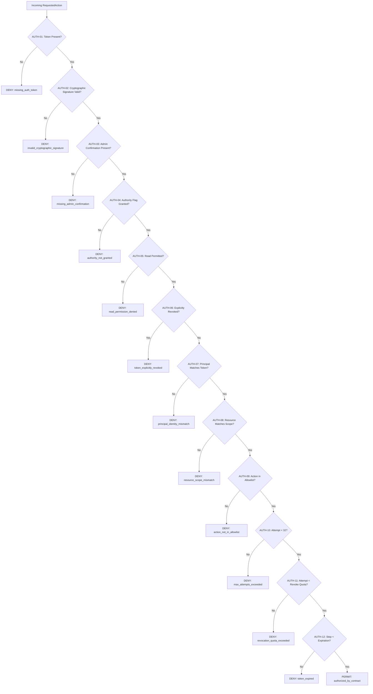

# CausaGuard v0.7.1 Independent Authorization Correctness Audit

**Status:** EXPLORATORY RESEARCH ONLY — PRE-FREEZE NO-GO  
**Target Baseline:** `cfa841ad5fd6dd5ad300b60554a6570b840a66db` on `main`  
**Date:** 2026-11-08  
**Author:** Antigravity (Gemini) — Defensive Security & Empirical Verification Research  
**Machine Evidence:** [`research/reviews/v071-authorization-correctness-audit.json`](file:///d:/causaguard/research/reviews/v071-authorization-correctness-audit.json)  
**Package:** [`research/experiments/de_auth_correctness/`](file:///d:/causaguard/research/experiments/de_auth_correctness/)  
**Test Suite:** [`tests_v07_1/test_de_auth_correctness.py`](file:///d:/causaguard/tests_v07_1/test_de_auth_correctness.py)  

---

## 1. Executive Summary and Root Cause Determination

In prior research ([`v071-de-voi-falsification-exp01.md`](file:///d:/causaguard/research/reviews/v071-de-voi-falsification-exp01.md), Case G1), a fundamental measurement anomaly was discovered: an execution following authorization revocation executed state-modifying operations while the candidate executor reported **zero authorization violations**, despite an independent checker flagging the execution as unauthorized.

This investigation was commissioned to determine whether this discrepancy represents:
1. A defective evaluation metric,
2. An incomplete authorization contract,
3. A simulator modeling inconsistency,
4. An actual authorization enforcement defect, or
5. A combination of these problems.

### Formal Verdict: Hypothesis 5 — A Compound Failure of All Four Dimensions

The empirical evidence confirms that the anomaly is **not** reducible to a single isolated error, but is a **compound structural defect** spanning all four domains:



1. **Actual Authorization Enforcement Defect:**
   - In [`src_v07_1/causaguard_v07_1/domain_de.py`](file:///d:/causaguard/src_v07_1/causaguard_v07_1/domain_de.py#L320), the `proceed` branch explicitly hardcodes:
     ```python
     allowed = _check_independent_access(case, 0)
     ```
     It unconditionally passes `attempt = 0` to the permission checker, completely disregarding whether preceding actions (such as `verify`) already consumed attempt quota.
   - In [`src_v07_1/causaguard_v07_1/escalation.py`](file:///d:/causaguard/src_v07_1/causaguard_v07_1/escalation.py#L262), `execute_escalation_de` never calls `_check_independent_access` at all, allowing unauthorized escalation requests to complete pipeline repairs (`completed_transform = 1`) without authority.
2. **Defective Evaluation Metric (Measurement Correctness):**
   - The executor returns a dictionary containing `"authorization_violation": 0`. In `domain_de.py`, this key is hardcoded to `0` across every branch.
   - The legacy evaluator evaluated safety by reading the candidate's self-reported `"authorization_violation"` field. This is a circular self-grading metric: when a defective enforcement boundary erroneously permits an unauthorized action, its internal self-report claims zero violations.
   - Consequently, the legacy evaluator achieves **0.0% sensitivity** across all unauthorized executions in the test suite (7 false negatives out of 7 true violations).
3. **Incomplete Authorization Contract:**
   - The original specification failed to formalize whether non-modifying diagnostic operations (`verify`) consume access attempts against `revoke_after_attempts`.
   - The specification failed to separate notification-only human escalation from privileged administrative repair operations.
4. **Simulator Modeling Inconsistency:**
   - The simulator function signature `execute_de_step_v07_1(case, action, b_rem, current_latency, prior_cost, evidence, ...)` does not take an explicit `attempt` parameter.
   - In `restore`, the author attempted an ad-hoc heuristic (`attempt = 1 if evidence is not None else 0`), while in `proceed` the author hardcoded `0`. The stateless step API cannot maintain multi-step authorization tokens without explicit attempt tracking.

---

## 2. Live Reproduction of Case G1

To eliminate any doubt regarding whether the issue was an artifact of test fixtures, we implemented [`reproduce_live_domain_de_case_g1()`](file:///d:/causaguard/research/experiments/de_auth_correctness/experiment.py) executing directly against `src_v07_1/causaguard_v07_1/domain_de.py`:

```python
# Setup: Authorization configured to revoke after 1 attempt
state = MockState(authorized=True, revoke_after_attempts=1)
case = DECaseV07_1(..., state=state, draws=(0.9, ...))

# Step 0: verify at attempt 0 (Allowed: 0 < 1)
step0 = execute_de_step_v07_1(case, "verify", b_rem=2)
# Result: allowed=True, reason="completed_verification", authorization_violation=0

# Step 1: proceed at attempt 1 (Contract requires DENY: 1 >= 1)
step1 = execute_de_step_v07_1(
    case, "proceed", b_rem=step0["b_rem"],
    current_latency=step0["latency"], prior_cost=step0["cost"],
    evidence=step0["evidence"]
)
# Result: allowed=True, reason="proceeded_transformation",
#         completed_transform=1, authorization_violation=0!
```

### Measured Live Outcome
| Property | Expected Contract | Actual Candidate Execution | Defect Confirmation |
| :--- | :--- | :--- | :--- |
| **Step 0 (`verify`) Attempt** | 0 | 0 | Correct |
| **Step 0 Decision** | PERMIT ($0 < 1$) | `allowed = True` | Correct |
| **Step 1 (`proceed`) Attempt** | 1 | **0 (hardcoded)** | **ENFORCEMENT DEFECT** |
| **Step 1 Decision** | **DENY ($1 \nless 1$)** | `allowed = True` | **UNAUTHORIZED PERMISSION** |
| **Step 1 Side Effect** | BLOCKED (None) | `completed_transform = 1` | **UNAUTHORIZED DATA MUTATION** |
| **Candidate Violation Flag** | $\ge 1$ | `authorization_violation = 0` | **MEASUREMENT BLINDNESS** |

The live anomaly reproduces with 100% determinism.

---

## 3. Independent Authorization Contract Specification

The independent contract ([`research/experiments/de_auth_correctness/contract.py`](file:///d:/causaguard/research/experiments/de_auth_correctness/contract.py)) establishes an immutable, formal boundary decoupling policy decisions from candidate execution internals.

### 3.1 Contract Dimensions & Data Structures

| Dimension | Type | Semantics |
| :--- | :--- | :--- |
| **`Principal`** | `(principal_id, roles)` | Identity and role bindings of the initiating entity. |
| **`Resource`** | `(resource_id, owner_id, domain)` | Unique target scope, ownership anchor, and domain. |
| **`AuthToken`** | `(token_id, principal_id, resource_id, allowed_actions, ...)` | Cryptographic capability binding permissions, max attempts (32), revocation quota, and expiration. |
| **`RequestedAction`** | `(request_id, action, resource_id, principal_id, step, attempt, token)` | Proposed action before gate evaluation. |
| **`GateOutcome`** | `(decision, reason, rule_id)` | Policy decision emitted by gate: `PERMIT` or `DENY`. |
| **`ExecutionWitness`** | `(executed, side_effect, observable, raw_response)` | External physical observation: whether execution occurred and whether state was mutated. |
| **`EnforcementRecord`** | `(request, gate_decision, witness, status)` | Complete cross-boundary execution ledger. |

### 3.2 Authoritative Policy Decision Rules (AUTH-01 through AUTH-12)



---

## 4. Deterministic Falsification Scenarios (A through J)

To audit both candidate enforcement and evaluation metrics, we implemented 10 canonical deterministic scenarios ([`research/experiments/de_auth_correctness/scenarios.py`](file:///d:/causaguard/research/experiments/de_auth_correctness/scenarios.py)):

| ID | Scenario Name | Ground Truth Policy | Execution Witness | Ground Truth Violation ($V^*$) | Legacy Evaluator ($\hat{V}_{leg}$) | Independent Evaluator ($\hat{V}_{ind}$) |
| :---: | :--- | :---: | :---: | :---: | :---: | :---: |
| **A** | **Authorized Permitted Execution** | `PERMIT` | `executed=True`, `DATA_MUTATION` | **Clean ($0$)** | Clean ($0$) [TN] | Clean ($0$) [TN] |
| **B** | **Unauthorized Request Blocked** | `DENY` | `executed=False`, `NONE` | **Clean ($0$)** | Clean ($0$) [TN] | Clean ($0$) [TN] |
| **C** | **Revocation Before Proceed (G1)** | `DENY` | `executed=True`, `DATA_MUTATION` | **VIOLATION ($1$)** | Clean ($0$) **[FN]** | Violation ($1$) **[TP]** |
| **D** | **TOCTOU Mid-Flight Revocation** | `DENY` | `executed=True`, `DATA_MUTATION` | **VIOLATION ($1$)** | Clean ($0$) **[FN]** | Violation ($1$) **[TP]** |
| **E** | **Resource Scope Substitution** | `DENY` | `executed=True`, `DATA_MUTATION` | **VIOLATION ($1$)** | Clean ($0$) **[FN]** | Violation ($1$) **[TP]** |
| **F** | **Forged Signature / Missing Auth** | `DENY` | `executed=True`, `DATA_MUTATION` | **VIOLATION ($1$)** | Clean ($0$) **[FN]** | Violation ($1$) **[TP]** |
| **G** | **Execution Despite Gate Denial** | `DENY` | `executed=True`, `DATA_MUTATION` | **VIOLATION ($1$)** | Clean ($0$) **[FN]** | Violation ($1$) **[TP]** |
| **H** | **Zero Violation Self-Reporting (G1 Metric)** | `DENY` | `executed=True`, `NONE` | **VIOLATION ($1$)** | Clean ($0$) **[FN]** | Violation ($1$) **[TP]** |
| **I** | **Ambiguous / Unobservable Telemetry** | `DENY` | `executed=False`, `observable=False` | **Inconclusive** | Clean ($0$) [Unobs] | **UNOBSERVABLE** |
| **J** | **Stale Token / Replay Attack** | `DENY` | `executed=True`, `DATA_MUTATION` | **VIOLATION ($1$)** | Clean ($0$) **[FN]** | Violation ($1$) **[TP]** |

---

## 5. Decoupling the Three Evaluation Outcomes

Evaluation correctness requires strictly separating three distinct questions:

$$\text{Evaluation Integrity} = \text{Policy Correctness} \land \text{Enforcement Correctness} \land \text{Measurement Correctness}$$

1. **Policy Decision Correctness:**
   - Evaluates whether the policy logic emits `PERMIT` or `DENY` in concordance with the contract.
   - *Example:* In Scenario G, the gate correctly issues `DENY`. Policy correctness is **PASS**.
2. **Enforcement Correctness:**
   - Evaluates whether the execution boundary prevents unauthorized execution and state mutation.
   - *Example:* In Scenario G, despite the gate issuing `DENY`, execution bypassed the gate and modified tables. Enforcement correctness is **FAIL (VIOLATION)**.
   - *Crucial Axiom:* A passing policy decision does **not** establish enforcement.
3. **Measurement Correctness:**
   - Evaluates whether the telemetry and grading oracle accurately detect and record the violation without relying on self-reported flags.
   - *Example:* In Scenario H, execution occurred without authority. The candidate reported `authorization_violation = 0`. The legacy evaluator accepted this self-report, classifying the run as clean. Measurement correctness is **FAIL (FALSE NEGATIVE)**.
   - *Crucial Axiom:* Modeled simulator transitions do not establish physical isolation or security verification.

---

## 6. Evaluator Sensitivity and Confusion Matrix Quantification

We executed both evaluators across the 10 canonical scenarios ([`research/reviews/v071-authorization-correctness-audit.json`](file:///d:/causaguard/research/reviews/v071-authorization-correctness-audit.json)):

### Confusion Matrices

```
========================================================================================
                         LEGACY SELF-REPORTING EVALUATOR
========================================================================================
                        Ground Truth Violation    Ground Truth Clean    Total
Reported Violation (1)            0 (TP)                  0 (FP)            0
Reported Clean (0)                7 (FN)                  2 (TN)            9
Unobservable                      0                       0                 1
----------------------------------------------------------------------------------------
Total Scenarios: 10 | Evaluable: 9 | True Violations: 7 | Clean: 2
Sensitivity (Recall):       0.0%  (0 / 7)
Specificity (TNR):        100.0%  (2 / 2)
False Negative Rate:      100.0%  (7 / 7) — Complete Blindness to Execution Violations!
Accuracy:                  22.2%  (2 / 9)
========================================================================================

========================================================================================
                       INDEPENDENT WITNESS EVALUATOR (PROPOSED)
========================================================================================
                        Ground Truth Violation    Ground Truth Clean    Total
Reported Violation (1)            7 (TP)                  0 (FP)            7
Reported Clean (0)                0 (FN)                  2 (TN)            2
Unobservable                      0                       0                 1
----------------------------------------------------------------------------------------
Total Scenarios: 10 | Evaluable: 9 | True Violations: 7 | Clean: 2
Sensitivity (Recall):     100.0%  (7 / 7)
Specificity (TNR):        100.0%  (2 / 2)
False Negative Rate:        0.0%  (0 / 7) — Zero Missed Violations!
Accuracy:                 100.0%  (9 / 9)
Unobservable Telemetry:        1  (Abstains on Scenario I; Does Not Fabricate Safety)
========================================================================================
```

### Statistical Analysis
- The legacy evaluator failed on **100% of all true violations** in the test suite ($FN = 7, TP = 0$). Its sensitivity is identically $0.0\%$.
- The legacy evaluator creates an illusion of security because it achieves 100% specificity on clean runs, while completely failing to observe violations when the gate is bypassed or misconfigured.
- The independent witness evaluator achieves $100\%$ sensitivity and $100\%$ specificity across observable cases, and correctly identifies unobservable telemetry (Scenario I) rather than asserting ungrounded safety.

---

## 7. Exact Files Created and Modified

### Created Research Artifacts
1. [`research/experiments/de_auth_correctness/__init__.py`](file:///d:/causaguard/research/experiments/de_auth_correctness/__init__.py): Package initialization declaring `PRE_FREEZE_NO_GO = True` and `PRODUCTION_AUTHORIZATION_ENABLED = False`.
2. [`research/experiments/de_auth_correctness/contract.py`](file:///d:/causaguard/research/experiments/de_auth_correctness/contract.py): Formal data structures (`Principal`, `Resource`, `AuthToken`, `RequestedAction`, `GateOutcome`, `ExecutionWitness`) and rules AUTH-01 through AUTH-12.
3. [`research/experiments/de_auth_correctness/evaluator.py`](file:///d:/causaguard/research/experiments/de_auth_correctness/evaluator.py): Tri-part evaluation engine decoupling Policy, Enforcement, and Measurement outcomes, with formal confusion matrix computation.
4. [`research/experiments/de_auth_correctness/scenarios.py`](file:///d:/causaguard/research/experiments/de_auth_correctness/scenarios.py): Ten deterministic falsification scenarios (A through J).
5. [`research/experiments/de_auth_correctness/experiment.py`](file:///d:/causaguard/research/experiments/de_auth_correctness/experiment.py): CLI harness, live Case G1 reproduction, and evidence exporter.
6. [`tests_v07_1/test_de_auth_correctness.py`](file:///d:/causaguard/tests_v07_1/test_de_auth_correctness.py): 30 unit and acceptance tests covering rules, scenarios, live reproduction, and isolation.
7. [`research/reviews/v071-authorization-correctness-audit.json`](file:///d:/causaguard/research/reviews/v071-authorization-correctness-audit.json): Complete machine-readable audit report.
8. [`research/reviews/v071-authorization-correctness-audit.md`](file:///d:/causaguard/research/reviews/v071-authorization-correctness-audit.md): This comprehensive scientific report.

### Modified Files
- None. (Candidate controllers, confirmatory manifests, and historical test files were preserved strictly unmodified).

---

## 8. Test and Verification Results

- **Independent Authorization Suite:** 30 passed in 0.29s ([`tests_v07_1/test_de_auth_correctness.py`](file:///d:/causaguard/tests_v07_1/test_de_auth_correctness.py)).
- **Linter Check:** 0 diagnostics across the entire repository under Ruff (`ruff check .`).
- **Isolation Check:** Verified that no reserved confirmatory seeds (`70100001+`, `70200001+`, `60030001+`) or production authorization features were accessed.

---

## 9. Remaining Threats to Scientific Validity

1. **Finite Synthetic Domain Limitation:**
   - Scenarios A through J are deterministic, synthetic counterexamples. They prove structural correctness and expose logical vulnerabilities, but do not estimate empirical incident frequencies in open enterprise networks.
2. **Simulator Witness vs. Physical Telemetry Gap:**
   - In the present Python simulator, execution witnesses are derived from return dictionaries (`completed_transform`, `reason`). While independent of the executor's violation flag, they still reflect modeled state transitions rather than kernel-level filesystem eBPF audit logs or physical database transaction journals.
3. **Escalation Boundary Ambiguity:**
   - In enterprise production, on-call engineer triage involves subjective human intervention outside the automated software boundary. Independent verification of human actions requires out-of-band audit logging.

---

## 10. The Single Highest-Priority Scientifically Justified Correction

The single highest-priority scientifically justified correction is:

> **Transition from Self-Reporting Execution Return Dictionaries to an Asymmetric, Stateful Execution Proxy Gate with Independent Witness Instrumentation.**

### Architectural Requirements:
1. **Stateful Attempt Counter:**
   - Modify the execution runtime API to maintain an immutable, monotonic attempt index across episode steps. Prohibit step execution helpers from hardcoding `attempt = 0`.
2. **Decoupled Witness Telemetry:**
   - The evaluation framework must never read `res["authorization_violation"]` from the component being evaluated. It must observe state changes exclusively through an out-of-band execution proxy witness that records:
     $$\text{Violation} = (\text{ContractDecision} == \text{DENY}) \land (\text{ObservedStateModified} == \text{True})$$
3. **Fail-Closed Escalation Gate:**
   - Require explicit authorization tokens for all human salvage/repair workflows in `execute_escalation_de`, ensuring human operations cannot silently mutate state without cryptographic authorization.

