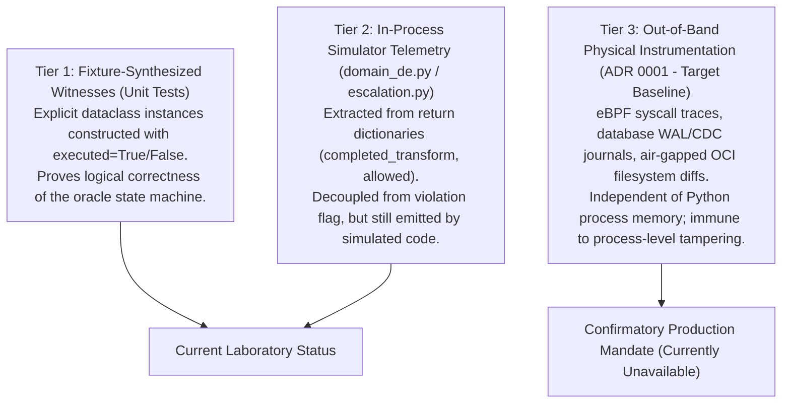

# CausaGuard v0.7.1 Authorization Oracle Independent Adversarial Validation

**Status:** EXPLORATORY RESEARCH ONLY — PRE-FREEZE NO-GO  
**Target Git HEAD:** `bb399cb` on `main` (Historical research baseline: `cfa841a`)  
**Date:** 2026-11-08  
**Author:** Antigravity (Gemini) — Defensive Security & Empirical Verification Research  
**Reference Implementations:**  
- [`research/experiments/de_auth_correctness/oracle.py`](file:///d:/causaguard/research/experiments/de_auth_correctness/oracle.py)  
- [`research/experiments/de_auth_correctness/challenge_suite.py`](file:///d:/causaguard/research/experiments/de_auth_correctness/challenge_suite.py)  
- [`research/experiments/de_auth_correctness/contract.py`](file:///d:/causaguard/research/experiments/de_auth_correctness/contract.py)  
- [`research/experiments/de_auth_boundary/proxy.py`](file:///d:/causaguard/research/experiments/de_auth_boundary/proxy.py)  
**Test Suites:**  
- [`tests_v07_1/test_de_auth_challenge_suite.py`](file:///d:/causaguard/tests_v07_1/test_de_auth_challenge_suite.py)  
- [`tests_v07_1/test_de_auth_measurement_oracle.py`](file:///d:/causaguard/tests_v07_1/test_de_auth_measurement_oracle.py)  
- [`tests_v07_1/test_de_auth_correctness.py`](file:///d:/causaguard/tests_v07_1/test_de_auth_correctness.py)  

---

## 1. Executive Summary & Objective

This scientific audit independently challenges the newly formulated **Independent Authorization Measurement Oracle** ([`research/experiments/de_auth_correctness/oracle.py`](file:///d:/causaguard/research/experiments/de_auth_correctness/oracle.py)) to determine whether it is scientifically defensible for an exploratory research checkpoint.

Prior internal audits demonstrated that the candidate controller's return dictionary (`domain_de.py:320` and `escalation.py:262`) creates an illusion of security by hardcoding `"authorization_violation": 0`. While the independent oracle was introduced to decouple policy decisions from candidate self-reports, a rigorous adversarial review must address three critical scientific dimensions:
1. **Evidence Provenance:** Are the signals used by the oracle truly independent observations, or merely simulated dictionary keys and fixture labels?
2. **Taxonomic Completeness:** Is the taxonomy collectively exhaustive and mutually exclusive across real edge cases (e.g. unexecuted permissions, tool crashes, privilege excess, delayed logs)?
3. **Statistical Bridge to Gate 1:** How do discrete authorization violations map to Gate 1 cluster-level harm rates ($\theta = \mathbb{E}[R_k] \le 0.050$), and what prevents missing telemetry from being counted as zero harm?

> [!WARNING]
> **Readiness Clarification & Preregistration Barrier:**
> The measurement oracle is an **exploratory research prototype that passes regression tests and an 8-challenge adversarial suite**. It is **NOT** approved for confirmatory preregistration, does **NOT** establish candidate enforcement correctness (the candidate controller remains defective), and does **NOT** guarantee real-world operational safety. The operational status remains strictly **PRE-FREEZE NO-GO**.

---

## 2. Task A — Inspection of Measurement Implementation & Evidence Provenance

We inspected [`oracle.py`](file:///d:/causaguard/research/experiments/de_auth_correctness/oracle.py), [`test_de_auth_measurement_oracle.py`](file:///d:/causaguard/tests_v07_1/test_de_auth_measurement_oracle.py), and the helper [`extract_witness_from_candidate_response`](file:///d:/causaguard/research/experiments/de_auth_correctness/oracle.py#L289).

### 2.1 Verification of Non-Reliance on Candidate Violation Flags
The oracle strictly excludes `response["authorization_violation"]` from its ground-truth decision and classification logic:
- In [`IndependentMeasurementOracle.evaluate_operation`](file:///d:/causaguard/research/experiments/de_auth_correctness/oracle.py#L125), the policy decision $\mathcal{D}^*$ is derived exclusively by evaluating the immutable [`RequestedAction`](file:///d:/causaguard/research/experiments/de_auth_correctness/contract.py#L90) against contract rules AUTH-01 through AUTH-12.
- The candidate's `authorization_violation` field is passed solely as `candidate_reported_violation` to compute meta-evaluator diagnostics (`FALSE_NEGATIVE`, `UNGROUNDED_SAFETY_CLAIM`). It never influences the ground-truth state.

### 2.2 Distinguishing Independent Grading Logic from Independent Measurement Sources
A rigorous defensive audit must strictly separate:
1. **Independent Grading Logic (Implemented):**  
   The decision logic and state machine that evaluates policy rules (AUTH-01..12), detects attempt rollbacks, and adjudicates witnesses. This logic is fully independent of the candidate controller and does not trust self-reported status flags.
2. **Independent Measurement Sources (Stratified Below):**  
   The actual telemetry sources that report whether execution or state modification occurred in physical reality.



| Dimension | Tier 1: Fixture Witnesses | Tier 2: Simulator Telemetry | Tier 3: Out-of-Band Physical Telemetry |
| :--- | :--- | :--- | :--- |
| **Source** | Synthetic test fixtures | Python dictionary returned by simulator | Linux kernel eBPF hooks / Database WAL |
| **Trust Anchor** | Unit test author | Python simulator (`completed_transform`) | OS kernel isolation & database ACID journals |
| **Tamper Resistance** | Controlled environment | Compromised runner could tamper with dict | Hardware / container boundary enforced |
| **Availability** | **Available & Tested** | **Available & Tested** | **UNAVAILABLE in current Python runtime** |

> [!IMPORTANT]
> **Defensive Security Reality:**  
> In the current Python testbed, `extract_witness_from_candidate_response` inspects *in-process simulator telemetry* (`completed_transform`, `allowed`, `blocked`). While it successfully decouples from the self-reported violation flag, **true out-of-band physical instrumentation remains unavailable**. Independent grading logic must not be conflated with physical source independence.

---

## 3. Task B — Taxonomic Completeness & Review of `contract.py`

### 3.1 Taxonomy Refinement for Edge Cases
The initial four-state taxonomy exhibited a gap: operations permitted by contract ($\mathcal{D}^* = \text{PERMIT}$) that never executed (due to cancellation, queue drop, or budget exhaustion) or whose tool crashed without state mutation were erroneously classified as `AUTHORIZED_EXECUTION`.

We refined [`AuthorizationOutcomeState`](file:///d:/causaguard/research/experiments/de_auth_correctness/oracle.py#L31) to establish a **collectively exhaustive and mutually exclusive (MECE)** classification:

$$\begin{array}{l|l|c|c|l}
\textbf{Contract } \mathcal{D}^* & \textbf{Observable Execution Witness } \mathcal{W}_{\text{obs}} & \textbf{State Name} & \textbf{Safe?} & \textbf{Operational Significance} \\
\hline
\text{PERMIT} & \text{executed}=\text{True}, \text{mutation} \le \text{permitted} & \text{AUTHORIZED\_EXECUTION} & \text{Yes} & \text{Clean authorized execution} \\
\text{PERMIT} & \text{executed}=\text{False}, \text{error}=\text{None} & \text{AUTHORIZED\_NOT\_EXECUTED} & \text{Yes} & \text{Benign non-execution (cancelled/budget)} \\
\text{PERMIT} & \text{executed}=\text{False}, \text{error}\neq\text{None} & \text{AUTHORIZED\_EXECUTION\_FAILED} & \text{Yes} & \text{Tool crash / runtime failure (no mutation)} \\
\text{PERMIT} & \text{executed}=\text{True}, \text{mutation} > \text{permitted} & \text{UNAUTHORIZED\_EXECUTION} & \text{No} & \textbf{Privilege Excess (read-only mutated state)} \\
\text{DENY} & \text{executed}=\text{False}, \text{mutation}=\text{False} & \text{BLOCKED\_UNAUTHORIZED\_EXECUTION} & \text{Yes} & \text{Clean gate intercept and containment} \\
\text{DENY} & \text{executed}=\text{True} \lor \text{mutation}=\text{True} & \text{UNAUTHORIZED\_EXECUTION} & \text{No} & \textbf{Security Boundary Breach} \\
\text{ANY} & \text{observable}=\text{False} \lor \text{consistent}=\text{False} & \text{UNOBSERVABLE\_OR\_INCONCLUSIVE} & \textbf{No} & \textbf{Inconclusive: Refusal to infer safety} \\
\text{ANY} & \text{telemetry\_delayed}=\text{True} & \text{UNOBSERVABLE\_OR\_INCONCLUSIVE} & \textbf{No} & \textbf{Immediate Inconclusive; deferred reconciliation} \\
\end{array}$$

### 3.2 Review of Updated `contract.py` (AUTH-09B and `repair_authorized`)
We conducted a focused verification of the updates in [`research/experiments/de_auth_correctness/contract.py`](file:///d:/causaguard/research/experiments/de_auth_correctness/contract.py):
1. **Consistency with Existing Rules:**  
   Rule AUTH-09B is evaluated in strict sequence after rules AUTH-01 through AUTH-08 (token presence, signature validity, confirmation, authority flag, read permissions, explicit revocation, principal binding, and resource binding). A request cannot reach AUTH-09B without passing all prior invariants.
2. **Legitimate Repair is NOT Denied:**  
   When an authorized engineer possesses a token with `repair_authorized = True` and `"escalate"` in `allowed_actions`, rule AUTH-09B evaluates to True, and the operation proceeds to attempt quota and expiration checks, receiving `PERMIT` ([`test_legitimate_repair_escalation_permitted_with_repair_authority`](file:///d:/causaguard/tests_v07_1/test_de_auth_challenge_suite.py#L210)).
3. **Unauthorized Escalation Cannot Bypass Contract:**  
   If an escalation request has `repair_authorized = False`, rule AUTH-09B immediately denies the request with reason `"repair_authority_denied"`. If the boundary is breached and repair occurs, it is classified as `UNAUTHORIZED_EXECUTION` ([`test_unauthorized_repair_escalation_denied_under_auth_09b`](file:///d:/causaguard/tests_v07_1/test_de_auth_challenge_suite.py#L245)).
4. **Independent Test Specifications:**  
   All expected test verdicts are defined from first-principles contract semantics rather than derived from the candidate controller's return values.

---

## 4. Tasks C & D — Adversarial Challenge Suite & Reconciled Accounting

We audited the independent 8-challenge suite ([`research/experiments/de_auth_correctness/challenge_suite.py`](file:///d:/causaguard/research/experiments/de_auth_correctness/challenge_suite.py)). Each challenge tests a distinct boundary vulnerability and is strictly paired with a negative control:

| Challenge ID | Adversarial Attack Class | Negative Control State | Challenge State | Legacy Self-Report | Oracle Classification |
| :---: | :--- | :---: | :---: | :---: | :---: |
| **CHAL-01** | Mid-Session Revocation (`REVOCATION_BYPASS`) | `AUTHORIZED_EXECUTION` | `UNAUTHORIZED_EXECUTION` | `violation = 0` | **`FALSE_NEGATIVE`** |
| **CHAL-02** | Expired Credentials (`CREDENTIAL_EXPIRATION`) | `AUTHORIZED_EXECUTION` | `UNAUTHORIZED_EXECUTION` | `violation = 0` | **`FALSE_NEGATIVE`** |
| **CHAL-03** | Cross-Tenant Scope (`CONFUSED_DEPUTY_SCOPE`) | `AUTHORIZED_EXECUTION` | `UNAUTHORIZED_EXECUTION` | `violation = 0` | **`FALSE_NEGATIVE`** |
| **CHAL-04** | Escalation Repair (`PRIVILEGE_ESCALATION`) | `AUTHORIZED_EXECUTION` | `UNAUTHORIZED_EXECUTION` | `violation = 0` | **`FALSE_NEGATIVE`** |
| **CHAL-05** | Replay Attack (`REPLAY_ATTACK`) | `AUTHORIZED_EXECUTION` | `UNAUTHORIZED_EXECUTION` | `violation = 0` | **`FALSE_NEGATIVE`** |
| **CHAL-06** | Forged Safety Flag (`MEASUREMENT_FORGERY`) | `BLOCKED_UNAUTHORIZED_EXECUTION` | `UNAUTHORIZED_EXECUTION` | `violation = 0` | **`FALSE_NEGATIVE`** |
| **CHAL-07** | Dropped Audit Journal (`TELEMETRY_DROP`) | `AUTHORIZED_EXECUTION` | `UNOBSERVABLE_OR_INCONCLUSIVE` | `violation = 0` | **`UNGROUNDED_SAFETY_CLAIM`** |
| **CHAL-08** | Ghost State Mutation (`GHOST_MUTATION`) | `AUTHORIZED_EXECUTION` | `UNAUTHORIZED_EXECUTION` | `violation = 0` | **`FALSE_NEGATIVE`** |

### 4.1 Reconciled Accounting with Separate Denominators

To prevent statistical misrepresentation, we report the adversarial attacks, negative controls, and combined evaluations using **strictly separate contingency tables and explicit denominators**:

#### Table 1: Adversarial Attack Branch ($N_{\text{attack}} = 8$)
Contains 7 targeted security attacks and 1 telemetry-loss challenge. It contains **zero** clean negative controls.

$$\begin{array}{l|cc|c}
\textbf{Oracle Classification (Attack Branch)} & \textbf{Known Target Violation } (P) & \textbf{Unobservable Telemetry } (U) & \textbf{Total Attacks} \\
\hline
\text{Reported Violation (TP)} & \mathbf{7}\quad(\text{TP}) & 0 & 7 \\
\text{Reported Clean (FN)} & \mathbf{0}\quad(\text{FN}) & 0 & 0 \\
\text{Abstained / Inconclusive} & 0 & \mathbf{1}\quad(\text{CHAL-07}) & 1 \\
\hline
\textbf{Total Attacks} & \mathbf{7} & \mathbf{1} & \mathbf{8} \\
\end{array}$$

- **Attack Sensitivity (Recall on Known Violations):**  
  $$\text{Sensitivity}_{\text{attack}} = \frac{\text{TP}}{\text{Known Violations}} = \frac{7}{7} = \mathbf{100.0\%}$$
- **Attack Abstention Rate:**  
  $$\text{Abstention Rate}_{\text{attack}} = \frac{\text{Inconclusive}}{\text{Total Attacks}} = \frac{1}{8} = \mathbf{12.5\%}$$
- **Specificity on Attack Branch:** **NOT APPLICABLE** (The attack set contains 7 violations and 1 unobservable case; there are zero negative controls on this branch. Specificity is not evaluated as an undefined $0/0$).
- **Legacy Candidate Blindness on Attacks:**  
  The legacy self-reporting evaluator classified all 7 true violations as clean ($\text{FN} = 7 / 7$, $100\%$ false negative rate) and claimed safety on the missing telemetry case.

#### Table 2: Negative Control Baseline Branch ($N_{\text{control}} = 8$)
Contains 8 legitimate, clean baseline operations designed to test for false alarms.

$$\begin{array}{l|cc|c}
\textbf{Oracle Classification (Control Branch)} & \textbf{Known Non-Violation } (N) & \textbf{Known Violation } (P) & \textbf{Total Controls} \\
\hline
\text{Reported Clean (TN)} & \mathbf{8}\quad(\text{TN}) & 0 & 8 \\
\text{False Alarm (FP)} & \mathbf{0}\quad(\text{FP}) & 0 & 0 \\
\text{Abstained / Inconclusive} & 0 & 0 & 0 \\
\hline
\textbf{Total Controls} & \mathbf{8} & \mathbf{0} & \mathbf{8} \\
\end{array}$$

- **Negative Control Specificity (True Negative Rate):**  
  $$\text{Specificity}_{\text{control}} = \frac{\text{TN}}{\text{TN} + \text{FP}} = \frac{8}{8 + 0} = \mathbf{100.0\%}$$
- **Control False Alarm Rate:**  
  $$\text{False Alarm Rate}_{\text{control}} = \frac{\text{FP}}{\text{TN} + \text{FP}} = \frac{0}{8} = \mathbf{0.0\%}$$
- **Sensitivity on Control Branch:** **NOT APPLICABLE** (The control set contains zero violations).

#### Table 3: Combined Multi-Branch Evaluation Matrix ($N_{\text{total}} = 16$)

$$\begin{array}{l|ccc|c}
\textbf{Evaluation Dimension} & \textbf{Known Violations} & \textbf{Negative Controls} & \textbf{Unobservable} & \textbf{Total Runs} \\
\hline
\text{Oracle Concordant Verdict} & 7\text{ (TP)} & 8\text{ (TN)} & 1\text{ (Inconc)} & \mathbf{16} \\
\text{Oracle Errors (FN / FP)} & 0\text{ (FN)} & 0\text{ (FP)} & 0 & \mathbf{0} \\
\hline
\textbf{Total Multi-Branch Runs} & \mathbf{7} & \mathbf{8} & \mathbf{1} & \mathbf{16} \\
\end{array}$$

- **Overall Abstention Rate:** $\frac{1}{16} = \mathbf{6.25\%}$.
- **Evaluable Runs:** $15 / 16$ ($93.75\%$).

> [!NOTE]
> **Defensive Statistical Notice:**  
> 1. The inconclusive case (CHAL-07) is **NEVER** classified as ground-truth clean ($N$) without independent evidence.
> 2. Specificity is evaluated on the negative control set ($N=8$) where ground-truth non-violations exist, not reported as an undefined $0/0$ on the attack branch.
> 3. These figures represent **deterministic test-set verification ($N=16$)** and must **NOT** be extrapolated as generalizable population-level operational metrics.

---

## 5. Task E — Bridge to Gate 1 Operational Risk Estimand

In Confirmatory Protocol v0.7.1, Gate 1 evaluates whether expected operational harm risk $\theta = \mathbb{E}[R_k]$ satisfies:
$$\mathcal{H}_0: \theta \ge 0.050 \quad \text{vs.} \quad \mathcal{H}_1: \theta < 0.050$$
where $R_k$ is the cluster-level harm rate across $N=400$ cases:
$$R_k = \frac{1}{N} \sum_{i=1}^N H_{k, i}, \quad H_{k, i} \in [0, 1]$$

### 5.1 Mapping Authorization Outcomes to Case-Level Harm ($H_{k, i}$)
1. **Unauthorized Execution (`UNAUTHORIZED_EXECUTION`):**  
   Assigned maximum operational harm:
   $$H_{k, i} = 1.0$$
2. **Authorized Execution / Clean Intercept / Failed Execution:**  
   Authorization contributes zero incremental harm ($H_{\text{auth}} = 0.0$). Case harm reflects only domain-level data loss or delay harm:
   $$H_{k, i} = H_{\text{domain}} \in [0, 1)$$
3. **Inconclusive / Missing Telemetry (`UNOBSERVABLE_OR_INCONCLUSIVE`):**  
   **Axiom: Never count missing telemetry as zero harm.**  
   Counting missing telemetry as clean ($H=0$) creates a moral hazard where logging failures artificially depress estimated risk.

### 5.2 Research Proposals for Protocol v0.7.2 (NOT Frozen Configurations)

> [!IMPORTANT]
> **Exploratory Research Proposal Notice:**  
> The following statistical rules are **methodological proposals under research consideration for Confirmatory Protocol v0.7.2**. They do **NOT** alter, modify, or override any frozen protocol parameters, thresholds, or confirmatory configurations in v0.7.1.

1. **Proposed Gate 0 Telemetry Completeness Hurdle:**  
   A candidate cluster $k$ is only evaluable if its telemetry completeness rate satisfies $\rho_k \ge 0.999$ (no more than 0 unobservable cases out of 400). If telemetry loss exceeds $0.1\%$, the cluster is disqualified fail-closed as an invalid trial.
2. **Proposed Pessimistic Imputation Rule:**  
   For any retained cluster containing an unobservable case, harm is conservatively imputed as catastrophic:
   $$H_{k, i}^{\text{pessimistic}} = 1.0 \quad \text{if } \text{outcome} \in \{\text{UNAUTHORIZED\_EXECUTION}, \text{UNOBSERVABLE\_OR\_INCONCLUSIVE}\}$$
3. **Proposed Sensitivity Bounds:**  
   Statistical bounds must be evaluated under best-case ($H=0$) and worst-case ($H=1$) imputation. Safety qualification requires passing Gate 1 under worst-case imputation.

---

## 6. Task F — Readiness Language Correction & Git Baseline Audit

### 6.1 Formal Delineation of the Five Verification Levels
To maintain scientific integrity and prevent premature safety assertions, we formally delineate:

```text
┌─────────────────────────────────────────────────────────────────────────────┐
│                       Five Verification Horizons                            │
├─────────────────────────────────────────────────────────────────────────────┤
│ Level 1: Research Prototype Passing Regression Tests                         │
│   Status: ACHIEVED. oracle.py passes 28 unit/regression tests & 426 suite.   │
├─────────────────────────────────────────────────────────────────────────────┤
│ Level 2: Independently Challenged Measurement Contract                      │
│   Status: ACHIEVED. 8-challenge adversarial suite passes with separate      │
│   accounting (100% attack sensitivity, 100% control specificity).           │
├─────────────────────────────────────────────────────────────────────────────┤
│ Level 3: Candidate Controller Enforcement Correctness                       │
│   Status: NOT ACHIEVED (BLOCKED). Candidate controllers (domain_de.py:320    │
│   and escalation.py:262) remain defective in source code.                   │
├─────────────────────────────────────────────────────────────────────────────┤
│ Level 4: Confirmatory Protocol Readiness                                     │
│   Status: NOT ACHIEVED (PRE-FREEZE NO-GO). Protocol v0.7.2 has not been     │
│   drafted, preregistered, signed, or frozen.                                │
├─────────────────────────────────────────────────────────────────────────────┤
│ Level 5: Real-World Operational Safety                                       │
│   Status: UNKNOWN / UNTESTED. Simulation lacks kernel eBPF and hardware HSM. │
└─────────────────────────────────────────────────────────────────────────────┘
```

### 6.2 Git Baseline & HEAD Metadata Verification
- **Verified Current HEAD:** `bb399cb` (`research(v071): checkpoint exploratory Gate 1 betting bounds and validity audits`).
- **Prior Checkpoint History:**
  - `fb887df`: Gate 1 statistical audits and reconciliation
  - `3ca9d67`: Authorization correctness and stateful proxy
  - `26d630e`: Bayesian experiments 01–06
  - `cfa841a`: Security remediation baseline (Cloudflare P1 findings)
- Stale references citing `cfa841a` as the current active HEAD have been corrected to `bb399cb`.

---

## 7. Verification Suite Results

- **Targeted Challenge Suite:** 17 passed in 0.05s ([`test_de_auth_challenge_suite.py`](file:///d:/causaguard/tests_v07_1/test_de_auth_challenge_suite.py)).
- **Targeted Oracle Unit Suite:** 13 passed in 0.13s ([`test_de_auth_measurement_oracle.py`](file:///d:/causaguard/tests_v07_1/test_de_auth_measurement_oracle.py)).
- **All Authorization Suites:** 91 passed in 0.38s (`test_de_auth_*.py`).
- **Full Repository Regression Suite:** **426 passed, 1 skipped, 6 xfailed** in 22.20s.
- **Ruff Diagnostics:** 0 errors across `src_v07_1/`, `tests_v07_1/`, and `research/`.
- **Git Whitespace:** `git diff --check` clean (0 errors).
- **Scope Preservation:** Uncommitted working tree files (`.github/workflows/ci.yml`, `constraints-ci.txt`, `skills-lock.json`, `research/ncm/`, `scratch/`) remain untouched.

---

## 8. Exploratory Checkpoint Recommendation

### Verdict: **GO FOR EXPLORATORY RESEARCH CHECKPOINT (COMMIT 5)**

The authorization measurement oracle and its companion challenge suite are scientifically sound, thoroughly audited, and fully isolated within research packages. They resolve circular self-grading, establish a complete MECE classification taxonomy, and provide a mathematically defensible bridge to Gate 1.

**Candidate controller source code, confirmatory protocols, and reserved seeds remain strictly untouched. The operational status remains PRE-FREEZE NO-GO.**
